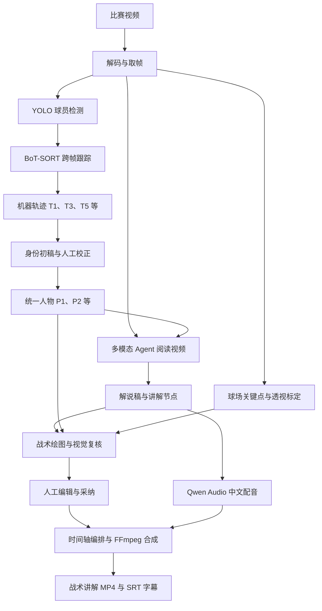
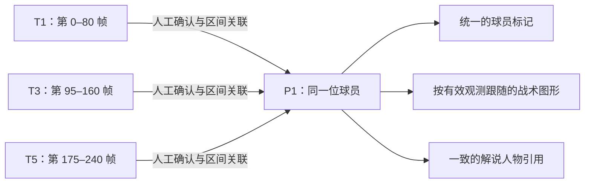
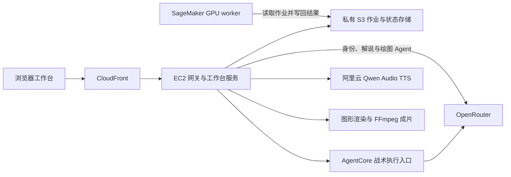

# CourtStory


**By viewers. For viewers.｜由观众打造，为观众打造。**

CourtStory 是一个面向篮球观众的 AI 篮球解读工作台。我们从观看比赛时的真实疑问出发，把比赛视频变成带有球员标记、战术路线、中文解说和字幕的讲解视频，让场上的配合与变化更容易理解。

我们的技术路线是 **深度学习检测 + 传统机器视觉与几何处理 + 多模态 Agent + 人工审核兜底**。机器先提供检测、跟踪和讲解初稿，人在关键位置修正身份与图形，再将确认后的内容编排成片。

[本地安装](docs/local-setup.md) · [云端工程](docs/cloud-setup.md) · [工程目录](engineering/README.md) · [视频素材](data/videos/README.md)

## 从比赛视频到讲解成片



工作台贯通球员标定、战术制作、解说、配音和成片。用户也可以直接人工制作，在模型结果不完整时继续完成作品。

## 视觉路线：从 YOLOv8s 基线到篮球专用 YOLOv8n

篮球视频中的遮挡、快速交叉跑位、相似球衣和镜头移动，会同时影响检测框与身份连续性。我们的优化覆盖检测、跟踪、结果处理和人工校正几个环节。

| 环节 | 通用基线 | 当前默认路线 |
| --- | --- | --- |
| 检测器 | 通用 COCO 权重的 YOLOv8s，检测人物 | 使用 E-BARD 篮球权重的 YOLOv8n，检测球员 |
| 跟踪器 | ByteTrack，按检测与运动进行关联 | BoT-SORT，结合运动和检测器外观特征进行续接 |
| 篮球场景处理 | 保留通用结果供比较 | 重复框处理、全身框恢复、球衣颜色证据与冲突提示 |
| 显示结果 | 原始观测 | 在已有观测上做稳定化，保留原始数据 |
| 人物身份 | 机器轨迹编号 | Agent 提供候选，人工按区间关联到统一人物 |

这里“从 YOLOv8s 到 YOLOv8n 的优化”指的是**检测权重选择与整条篮球处理流程的调整**。我们采用已有的篮球专用 YOLOv8n 权重，并保留 YOLOv8s 及不同跟踪组合用于对照；没有把这项工作表述为自研 YOLO 网络结构，也没有用模型名称代替准确率验证。

传统机器视觉承担可检查的辅助处理：例如用上身区域的颜色、检测框重叠和空间位移提供证据，通过镜头运动补偿与球场几何辅助定位。当前默认配置保留 BoT-SORT 原生关联核心，颜色证据用于审查和提示，重复框与框恢复规则作用于导出结果。**同色球衣只能提供辅助线索，不能单独证明是同一位球员。**

配置与实现：[模型组合](engineering/configs/tracking/workbench-models.json) · [默认跟踪配置](engineering/configs/tracking/basketball-optimized.yaml) · [篮球跟踪处理](engineering/scripts/basketball_tracker.py) · [视觉证据与片段建议](engineering/scripts/basketball_tracking.py)

## 人工如何兜底：把 T1、T3、T5 关联到 P1

**T 表示机器轨迹，P 表示工作台中的人物身份。** YOLO 提供检测框，跟踪器为跨帧关联的检测分配 T 编号；一个 T 编号并不天然等于一个真实球员。

例如，同一位球员在一段视频里先被跟踪为 `T1`，被掩护人遮挡后重新出现时变成 `T3`，之后又被分配为 `T5`。如果直接用 T 编号制作讲解，同一个人就会被拆成三段不同身份。人工观看视频，确认这些片段属于同一人后，可以把它们分别关联到 `P1`。



*图中的编号和帧区间仅用于说明操作，不是识别效果实测。*

| 视频区间 | 机器结果 | 人工确认 | 下游使用 |
| --- | --- | --- | --- |
| 第 0–80 帧 | T1 | 这一段属于 P1 | 使用 P1 的有效位置观测 |
| 第 95–160 帧 | T3 | 遮挡后仍是 P1 | 继续引用同一个 P1 |
| 第 175–240 帧 | T5 | 再次确认属于 P1 | 保持人物身份一致 |

关联以**实际有效区间**为单位。如果 T3 后半段误跟到了另一位球员，只把确认属于 P1 的部分关联进去；同帧重复框则需要排除或处理冲突，不能让一个人物同时占据多个矛盾位置。

这套设计让机器完成大量逐帧定位工作，让人工集中处理身份断裂、误关联、漏检和关键位置。人工也可以排除非球员、补点、修正姓名，并撤销修改。机器候选和人工确认分别记录，新的机器初稿不能覆盖已有人工修正。

**统一身份不等于补齐全部位置。** 上例第 81–94 帧和第 161–174 帧仍然可能没有观测。确认前后都是 P1 后，系统仍保留这些缺口；图形跟随遇到缺测、身份冲突或切镜时会隐藏或截断，不把未知位置当成已识别轨迹。

P1 也不要求一开始就有真实姓名。姓名候选结合明确的比赛、球队、球衣号码和[比赛名单](data/player-rosters/README.md)生成，证据不足时保留匿名。当前身份初稿流程没有使用人脸识别。详见[视频身份初稿与人工保护](engineering/docs/video-identity-review.md)。

## 战术理解、贴地绘图与中文讲解

### Agent 基于视频证据组织讲解

身份、解说和绘图 Agent 使用视频总览、时间窗口和局部读图工具，把画面证据与已保存的身份快照结合起来，生成可审核的候选。解说节点连接视频时间、讲解内容和绘图需求，再由工作台校验来源、时间范围及人物关联。

在用语言与视觉模型按当前部署记录统一通过 OpenRouter 调用，云端战术分析使用 AgentCore 执行入口。模型选择由服务端配置管理；机器结果仍需结合实际画面审核。

### 球场几何帮助图形跟随镜头

48 点场地模型提供关键点候选，再由球场标定建立画面与球场平面的透视映射。有有效标定时，球员脚点可以先映射到球场，再投回当前镜头，辅助路线和位置环贴地显示。

没有有效标定时，部分图形可以按画面坐标跟随，但移动镜头下的贴地精度有限。球场模型已执行并不代表每帧都有可靠标定；缺测、切镜和身份冲突仍需检查。

### 编辑与导出使用同一套图形

工作台支持跑位箭头、传球路线、位置环、重点圈和掩护标记。前端画布与成片共用 SVG 绘制逻辑，支持路线逐步展开和讲解暂停。人工编辑跟随路线后，可转为手工路线，保留制作意图。

中文配音采用阿里云 `qwen-audio-3.1-tts-flash`，默认男声为 `anmingyuan_v3.1`，模型与音色可通过服务端配置调整。渲染流程把已采纳图形、配音、字幕和原视频编排到同一时间轴，输出 MP4 与 SRT。详见[战术动态跟随与绘制](engineering/docs/tactics-motion.md)。

## 运行架构：本地与云端共用工作台

| 层次 | 技术与职责 |
| --- | --- |
| 交互层 | React、JavaScript：球员标定、战术编辑、人工审核、预览 |
| 服务层 | Python：视频处理、HTTP 接口、任务管理、草稿与版本校验 |
| Agent 层 | Node.js Agent 工具、Python 适配模块、OpenRouter 模型调用 |
| 视觉计算 | YOLO、BoT-SORT / ByteTrack、OpenCV、球场关键点与几何处理 |
| 成片层 | SVG 图形、阿里云 Qwen Audio 配音、FFmpeg 视频合成 |
| 云端基础设施 | CloudFront、EC2、AgentCore、SageMaker GPU、私有 S3 |



本地版本在个人电脑运行同一工作台，自动识别需自行准备模型依赖和权重；也可直接进入人工制作。云端版本由 EC2 提供工作台服务，通过私有 S3 作业调用 SageMaker GPU，执行检测、跟踪和场地模型。GPU 心跳不可用时，工作台明确报告未就绪。

当前代码已从 Team Hub 以文件快照迁入，本地与云端尚未拆成两个独立发行包。模型、API 凭据和运行数据独立配置，不随源码提交。

## 当前进展与验证边界

根据 [2026-10-10 部署记录](docs/aws-live-deployment.md)，项目已验证公网工作台访问、视频播放、GPU 推理、模型请求和中文配音，并完成一次官方训练样例的联合成片：**6 段解说、18 个图形、1920 × 1080、约 42.77 秒**。

上述成片属于切换 TTS 前的历史验证结果，不代表新配音方案已完成同样的整链路验收。这证明该样例能够走通制作链路。识别准确率、长视频稳定性及全部战术图形的质量仍需持续验证：记录中存在场地首帧高置信度关键点为 0、绘图对象未定位等情况，因此保留人工校正和审核入口是产品架构的一部分。

| 文档 | 内容 |
| --- | --- |
| [本地安装与启动](docs/local-setup.md) | 环境依赖、启动与模型配置 |
| [云端工程说明](docs/cloud-setup.md) | 云端代码入口与部署范围 |
| [运行与验证记录](docs/aws-live-deployment.md) | 已验证链路、维护方式及已知限制 |
| [工程目录](engineering/README.md) | 前端、服务、Agent、渲染和基础设施入口 |
| [视频素材库](data/videos/README.md) | 当前样例与 Git LFS 素材管理 |
| [迁移记录](docs/product-import.md) / [功能同步](docs/feature-sync-20261010.md) | 代码来源、迁移范围及历史验证 |

## 合作者首次配置

本仓库按所有者要求统一提交署名：作者和提交者均为 **ZeYu.Lin `<Linzeyu912@gmail.com>`**，GitHub 对应账号为 `Linzeyu912`。每台电脑克隆后，在仓库目录运行一次：

```powershell
powershell -NoProfile -ExecutionPolicy Bypass -File .\scripts\setup-git-identity.ps1
```

macOS、Linux 或 Git Bash 使用 `sh scripts/setup-git-identity.sh`。配置会启用提交和推送前的身份检查；各成员继续使用自己的 GitHub 登录凭据。安装、验证和远端检查的范围见[协作署名说明](docs/git-identity.md)。
