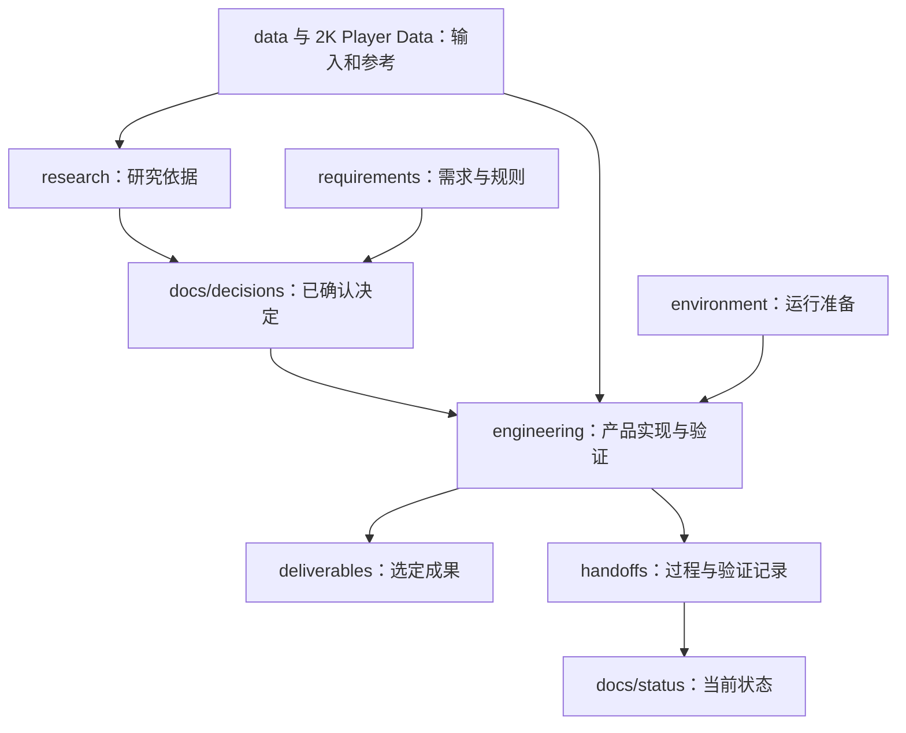

# CourtStory 仓库

这是 CourtStory 持续开发的主仓库，保留原 Team Hub 的开发历史，以及研究、数据、需求、决策、产品实现和交接记录。本页介绍仓库如何组织，帮助读者找到对应资料、判断资料性质，并确定新内容应放在哪里。

**产品目录是 [`engineering/`](engineering/README.md)。CourtStory 的产品介绍、Single 成果视频、系统架构、制作流程和使用入口集中在该目录的 README。**

比赛提交版本另存于 [courtstory-snapshot](https://github.com/Linzeyu912/courtstory-snapshot)。本仓库继续维护产品和开发资料，快照仓库保留比赛时的成果。

## 从这里开始

| 你想了解什么 | 入口 |
| --- | --- |
| 产品能做什么、成片效果如何、怎样运行 | [产品 README](engineering/README.md) |
| 仓库有哪些内容、新资料放在哪里 | [目录边界与迁移记录](docs/repository-map.md) |
| 研究过哪些方案、有哪些实验依据 | [调研与实验](research/README.md) |
| 有哪些数据、来源和使用限制是什么 | [数据总览](data/README.md) |
| 已经决定了什么、当前进展如何 | [决策记录](docs/decisions.md)、[团队状态](docs/status.md) |
| 怎样协作、提交和接续他人的工作 | [团队文档](docs/README.md)、[交接记录](handoffs/README.md) |
| 什么可以入库、commit 怎么写、什么时候上传 | [仓库管理规范](AGENTS.md)、[协作流程](docs/workflow.md) |

## 目录划分

| 类别 | 目录 | 保存什么 | 阅读边界 |
| --- | --- | --- | --- |
| 调研 | [`research/`](research/README.md) | 论文与模型研究、独立实验脚本、来源、结果与限制 | 实验结论需要经过决策和工程验证，才能成为产品能力 |
| 数据 | [`data/`](data/README.md) | 视频输入、标签、轨迹、明确比赛名单和历史工作台辅助数据 | 数据来源、候选结果和人工确认分别记录 |
| 参考数据包 | [`2K Player Data/`](2K%20Player%20Data/README.md) | NBA 2K 球员能力、球队赛季名单及来源索引 | 第三方游戏评分用于参考，不能替代真实比赛名单或技术统计 |
| 需求与规则 | [`requirements/`](requirements/README.md) | 赛事要求、评分与交付约束、来源和历史资料 | 按赛事和采集日期阅读，团队设想不写成官方规定 |
| 决策与协作 | [`docs/`](docs/README.md) | 决定、当前状态、协作流程、目录规范和历史接续说明 | 已确认决定在 `docs/decisions.md`，当前进展在 `docs/status.md` |
| 产品 | **[`engineering/`](engineering/README.md)** | 工作台前端、服务、Agent、算法、配置、测试、部署工程及产品文档 | 产品介绍与使用说明从本目录 README 进入 |
| 环境准备 | [`environment/`](environment/README.md) | 本机工具、模型依赖、AWS 账号与权限准备说明 | 环境可用不等于产品已部署，实际凭据与权重留在本机 |
| 最终成果 | [`deliverables/`](deliverables/README.md) | 已选定的 Single 最终 MP4 与字幕 | 是产品输出；原始输入在 `data/videos/` |
| 过程记录 | [`handoffs/`](handoffs/README.md) | 每轮修改、验证、阻塞和下一步 | 保留记录当时的事实，最新状态回到 `docs/status.md` 查看 |
| 仓库维护 | `scripts/`、`config/`、`.githooks/`、`.github/` | 视频/LFS 校验、Git 署名设置、检查与 Issue 模板 | 产品运行脚本和配置分别在 `engineering/scripts/`、`engineering/configs/` |

数据按用途组成一层：`data/` 提供视频与比赛上下文，`2K Player Data/` 提供参考评分，`deliverables/` 保存选定的最终成果。这些目录共享给产品与研究使用；实际路径及引用规则见[数据总览](data/README.md)。

## 目录之间的关系



这是一条内容归属关系：研究记录支持选择，决策记录说明采用什么，产品目录承载实现与验证，成果目录保存选定输出，交接和状态文档记录实际进展。不是每项研究都已被采用；完成状态以具体提交和验证记录为依据。

## 产品目录内如何查找

```text
engineering/
├── README.md          产品介绍、Single 样例、架构与使用导航
├── tools/             工作台前端、审核与预览工具
├── scripts/           服务、视频处理、身份/战术/解说与渲染
├── configs/           产品运行配置
├── agent-workflows/   Agent 工作流契约
├── infra/             EC2 / AgentCore / CloudFront / SageMaker 工程
├── deploy/            本地与 AWS 两套部署指导及各自依赖入口
├── tests/             工程测试与固定样例
└── docs/              产品设计、操作、接口、计划与验收记录
```

产品安装和运维说明也随产品保存：[本地部署](engineering/deploy/local/README.md)、[AWS 云端部署](engineering/deploy/aws/README.md)、[既有云端运行记录](engineering/docs/aws-live-deployment.md)。两种部署均可使用在线 AI，服务与数据的运行位置分别说明。命令默认从仓库根目录执行。

## 维护约定

- 新内容按上述职责归类，并更新所属目录的 README；详细规则见[目录说明](docs/repository-map.md)。
- 采用的决定写入[决策记录](docs/decisions.md)，当前进展写入[团队状态](docs/status.md)，每轮工作按[交接模板](handoffs/_template.md)留下来源与验证。
- 按[协作流程](docs/workflow.md)直接在 `main` 选择性提交；新提交遵守[统一署名要求](docs/git-identity.md)。
- 共享视频使用 Git LFS，遵循[数据管理规范](docs/video-data-management.md)。`artifacts/`、`tmp/`、本机原片、草稿、模型和凭据是本地内容，不作为共享仓库的正式目录入口。

仓库历史的接续方式见[接续记录](docs/repository-continuation-20261011.md)和[提交对照表](docs/repository-update-history-20261011.md)。历史资料中的旧名称、旧路径和当时的“未完成”状态，按对应日期理解。
