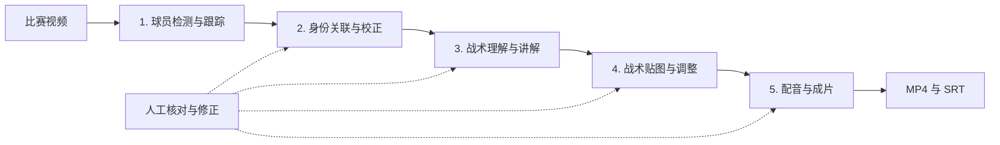
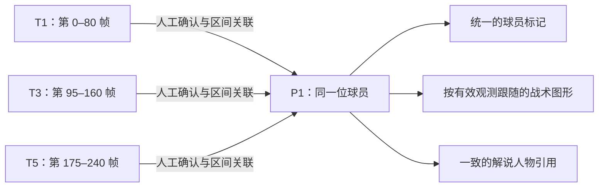

# CourtStory 产品与工程

`engineering/` 是 CourtStory 的产品目录，包含工作台、服务、Agent、渲染、测试与部署工程。本页介绍产品能力、成果样例和实现；仓库整体的资料分类、数据与决策入口见[仓库总览](../README.md)。

本产品使用同一套工作台、服务与算法代码，提供[本地部署](deploy/local/README.md)和[AWS 云端部署](deploy/aws/README.md)两套指导。两者的运行位置、依赖、技术架构与数据流分别在各自 README 说明；本页保留共用的产品能力与制作流程。


**By viewers. For viewers.｜由观众打造，为观众打造。**

CourtStory 是一个面向篮球观众的 AI 篮球解读工作台。我们从观看比赛时的真实疑问出发，把比赛视频变成带有球员标记、战术路线、中文解说和字幕的讲解视频，让场上的配合与变化更容易理解。

我们的技术路线是 **深度学习检测 + 传统机器视觉与几何处理 + 多模态 Agent + 人工审核兜底**。机器先提供检测、跟踪、讲解和绘图候选，用户在各制作环节核对与修正，再将保存后的内容编排成片。**人工兜底贯穿身份、讲解、图形和成片检查，T→P 关联是其中一个例子。**

## 成果样例：Single

下面的 **Single 战术解析成片**展示了 CourtStory 能把一段篮球比赛制作成怎样的讲解视频：在原比赛画面上加入球员姓名与重点标记、随移动变化的战术路线，配合中文解说、字幕和出手定格，让观众跟着画面理解回合中的配合与选择。

**[▶ 查看 / 下载 Single 最终成片（MP4）](../deliverables/single.mp4)**

成片时长 **68.3 秒**，画面为 **1920 × 1080、30 fps**，包含解说音轨。视频通过 Git LFS 保存；本地克隆后运行 `git lfs pull` 即可下载播放。更多文件说明见[成果目录](../deliverables/README.md)。

## 项目概览

| 属性 | 内容 |
| --- | --- |
| 项目名称 | CourtStory |
| 产品形态 | 面向篮球观众与内容创作者的 AI 篮球解读工作台 |
| 主要输入 | 比赛视频；可选的明确比赛、球队和球员名单上下文 |
| 中间产物 | 检测轨迹、场地关键点、人物关联、身份快照、解说节点、战术图形与音频 |
| 最终输出 | 可预览的战术讲解 MP4、SRT 字幕与可继续编辑的工作台草稿 |
| 交互方式 | 浏览器内标定、审核、编辑、预览与下载；机器生成候选，人工可以修正 |
| 内容质量控制 | 人工核对身份与讲解，调整图形位置、时间和曲线；来源、版本与区间校验配合成片预览 |
| 应用技术 | Python、React、JavaScript、Node.js、OpenCV、SVG、FFmpeg |
| 视觉模型与跟踪 | 篮球专用 YOLOv8n + BoT-SORT 为默认组合；保留 YOLOv8s 与 ByteTrack 对照；48 点场地模型辅助标定 |
| 部署方式 | [本地部署](deploy/local/README.md)：服务与数据在本机；[AWS 云端部署](deploy/aws/README.md)：交互、GPU、Agent 与存储分工运行 |
| 外部模型服务 | OpenRouter 提供语言与视觉模型调用；阿里云 Qwen Audio 提供中文配音 |
| 外部依赖边界 | 两种部署均使用 OpenRouter 理解 / 绘图与 Qwen Audio 配音；本地部署无需 AWS 账号，不另行部署本地语言模型或 TTS |

### 内容导航

- [成果样例：Single](#成果样例single)：查看最终讲解成片。
- [系统架构](#系统架构)：查看共用流程，并选择本地或 AWS 的架构与部署指导。
- [五步制作流程](#五步制作流程)：按检测、身份、讲解、贴图、成片的顺序展开实现。
- [全流程可靠性保障](#全流程可靠性保障)：集中说明人工兜底、数据一致性和运行恢复。
- [代码与文档入口](#代码与文档入口)：定位实现、安装与维护说明。

### 设计原则

- **按负载分工**：把浏览器交互、GPU 视觉计算和模型分析安排到对应的运行环境。
- **保留人工控制**：身份、讲解和绘图均提供核对与编辑入口，用户可以修正关联、文字、图形位置、显示时间和曲线形状。
- **保持数据可追溯**：把人物、视频帧、制作版本和输出结果关联起来。
- **支持中断恢复**：保存工作区状态和已完成的成片，便于继续制作。
- **围绕观众理解组织表达**：用人物定位、路线、暂停和声音逐步解释篮球配合。

## 系统架构

### 整体方案：从视频到成片

制作流程由五个环节构成：**检测球员 → 校正身份 → 生成讲解 → 制作贴图 → 合成成片**。每一步的产物交给下一步；人工可以在身份、讲解、贴图和成片检查中介入修正。



工作台贯通球员标定、战术制作、解说、配音和成片。用户也可以直接人工制作，在模型结果不完整时继续完成作品。

### 选择部署方式

| 选择 | 运行位置与数据 | AI 与计算依赖 | 部署指南 |
| --- | --- | --- | --- |
| 本地部署 | 浏览器连接本机 Python 服务，视频、草稿和输出保存在本机 | OpenRouter / Qwen 在线 AI；可选本机 CUDA 检测，基础工作台不要求 AWS | [本地架构、安装与验收](deploy/local/README.md) |
| AWS 云端部署 | CloudFront 访问 EC2 工作台，S3 保存作业和备份，SageMaker 执行 GPU 计算 | AgentCore 承载战术分析适配器；在线模型与配音仍使用各自服务凭据 | [AWS 架构、部署与验收](deploy/aws/README.md) |

两套指导复用下面的产品流程，部署目录只保存部署入口与说明。工作台实现仍在 `tools/`、`scripts/`，基础设施仍在 `infra/`；两个部署入口不复制产品代码。

## 五步制作流程

这一节按制作顺序展开。每一步先说明输入、要解决的问题和输出，再介绍其中的模型、算法或人工操作。球场准备等计算可按需执行，下表描述的是作品制作中的数据依赖。

| 步骤 | 输入 | 解决的问题 | 输出给下一步 |
| --- | --- | --- | --- |
| 1. 球员检测与跟踪 | 比赛视频 | 球员在哪里、前后帧如何关联 | 检测框、T 轨迹与位置观测 |
| 2. 身份关联与校正 | 视频、T 轨迹及可选比赛名单 | 哪些轨迹属于同一个人 | 保存后的 P 人物、有效区间及身份快照 |
| 3. 战术理解与讲解 | 原视频与身份快照 | 这个回合发生了什么、怎样解释 | 经核对保存的讲解文字、时间与节点 |
| 4. 战术贴图与调整 | 讲解节点、人物观测及可用球场标定 | 用什么图形、在哪里、何时表达配合 | 已采纳并保存的图形及显示时序 |
| 5. 配音与成片 | 原视频、保存的解说稿和图形 | 怎样把声音、字幕和画面对齐 | 可预览的 MP4、SRT 与可继续编辑的草稿 |

### 第一步：球员检测与跟踪

**输入：** 比赛视频。**输出：** 带时间与来源信息的检测框和 T 轨迹，供第二步校正身份。

这一步先回答“球员在哪里、前后帧是否连续”。YOLO 检测每帧中的球员，跟踪器把跨帧观测连接成带 T 编号的轨迹。遮挡、快速交叉跑位和镜头移动会导致轨迹断裂，因此输出还需要下一步的身份校正。

#### 检测与跟踪模型的选择

| 环节 | 通用基线 | 当前默认路线 |
| --- | --- | --- |
| 检测器 | 通用 COCO 权重的 YOLOv8s，检测人物 | 使用 E-BARD 篮球权重的 YOLOv8n，检测球员 |
| 跟踪器 | ByteTrack，按检测与运动进行关联 | BoT-SORT，结合运动和检测器外观特征进行续接 |
| 篮球场景处理 | 保留通用结果供比较 | 重复框处理、全身框恢复、球衣颜色证据与冲突提示 |
| 显示结果 | 原始观测 | 在已有观测上做稳定化，保留原始数据 |

默认方案采用已有的 E-BARD 篮球专用 YOLOv8n 权重与 BoT-SORT，保留通用 YOLOv8s 和 ByteTrack 组合用于对照。这里比较的是检测权重与跟踪组合，而不是将 YOLOv8s 网络修改成 YOLOv8n。

#### 检测结果如何整理成可用观测

在原始检测之后，程序结合框重叠、已有跟踪支持和上身颜色证据处理重复框，并在有实际检测支持时恢复全身框。在有效观测段内还可做显示稳定化，减小标记抖动，同时保留原始观测和缺测区间。

传统机器视觉承担可检查的辅助处理：例如用上身区域的颜色、检测框重叠和空间位移提供证据，通过镜头运动补偿辅助跨帧关联。当前默认配置保留 BoT-SORT 原生关联核心，颜色证据用于审查和提示，重复框与框恢复规则作用于导出结果。**同色球衣只能提供辅助线索，不能单独证明是同一位球员。**

配置与实现：[模型组合](configs/tracking/workbench-models.json) · [默认跟踪配置](configs/tracking/basketball-optimized.yaml) · [篮球跟踪处理](scripts/basketball_tracker.py) · [视觉证据与片段建议](scripts/basketball_tracking.py)

#### 显示稳定化如何检查

[稳定化处理](scripts/prepare_basketball_team_overlay.py)记录原始与显示框的坐标偏移，以及观测脚点相对相邻时刻线性位置的残差，并输出均值、中位数、P95 和最大值。对三个有效观测点，纵向残差定义为：

```text
α = (tᵢ − tᵢ₋₁) / (tᵢ₊₁ − tᵢ₋₁)
rᵢ = |yᵢ − [yᵢ₋₁ + α × (yᵢ₊₁ − yᵢ₋₁)]|
```

这些量用于对照**显示平稳度与坐标改动幅度**，单位为画面像素；残差包含真实球员及镜头运动，不作为身份准确率。实现同时记录改动的显示帧数和缺测填补数量，便于核查平滑是否改变了观测范围。

### 第二步：身份关联与校正

**输入：** 原视频、第一步的轨迹和可选比赛名单。**输出：** 保存后的 P 人物关联与身份快照，供第三步讲解和第四步贴图读取。

这一步回答“这些轨迹分别属于谁”。系统可以结合外观向量余弦相似度、按身高归一化的位移、时间间隔和候选唯一性提供保守的片段关联建议；人工对照视频确认或修正。身份校正是人工兜底的一个环节，后面的讲解与贴图也保留人工编辑入口。

#### 示例：把 T1、T3、T5 关联到 P1

**T 表示机器轨迹，P 表示工作台中的人物身份。** YOLO 提供检测框，跟踪器为跨帧关联的检测分配 T 编号；一个 T 编号并不天然等于一个真实球员。

例如，同一位球员在一段视频里先被跟踪为 `T1`，被掩护人遮挡后重新出现时变成 `T3`，之后又被分配为 `T5`。如果直接用 T 编号制作讲解，同一个人就会被拆成三段不同身份。人工观看视频，确认这些片段属于同一人后，可以把它们分别关联到 `P1`。



*图中的编号和帧区间仅用于说明操作，不是识别效果实测。*

| 视频区间 | 机器结果 | 人工确认 | 下游使用 |
| --- | --- | --- | --- |
| 第 0–80 帧 | T1 | 这一段属于 P1 | 使用 P1 的有效位置观测 |
| 第 95–160 帧 | T3 | 遮挡后仍是 P1 | 继续引用同一个 P1 |
| 第 175–240 帧 | T5 | 再次确认属于 P1 | 保持人物身份一致 |

关联以**实际有效区间**为单位。如果 T3 后半段误跟到了另一位球员，只把确认属于 P1 的部分关联进去；同帧重复框则需要排除或处理冲突，不能让一个人物同时占据多个矛盾位置。

这套设计让机器完成大量逐帧定位工作，让人工集中处理身份断裂、误关联、漏检和关键位置。人工也可以排除非球员、补点、修正姓名，并撤销修改。机器候选和人工确认分别记录，新的机器初稿不能覆盖已有人工修正。

**统一身份不等于补齐全部位置。** 上例第 81–94 帧和第 161–174 帧仍然可能没有观测。确认前后都是 P1 后，系统仍保留这些缺口；图形跟随遇到缺测、身份冲突或切镜时会隐藏或截断，不把未知位置当成已识别轨迹。

P1 也不要求一开始就有真实姓名。姓名候选结合明确的比赛、球队、球衣号码和[比赛名单](../data/player-rosters/README.md)生成，证据不足时保留匿名。当前身份初稿流程没有使用人脸识别。详见[视频身份初稿与人工保护](docs/video-identity-review.md)。

### 第三步：战术理解与讲解

**输入：** 原视频和保存后的身份快照。**输出：** 经用户核对保存的讲解稿与时间节点，供贴图与配音使用。

身份、解说和绘图 Agent 使用视频总览、时间窗口和局部读图工具，把画面证据与已保存的身份快照结合起来，生成可审核的候选。解说节点连接视频时间、讲解内容和绘图需求，再由工作台校验来源、时间范围及人物关联。

现有解说与视频身份初稿通过 OpenRouter 调用语言与视觉模型，模型选择由服务端配置管理。其他 Agent 的执行入口随部署方式配置，见对应部署指南。Agent 能辅助识别动作、组织讲解，但也可能误认人物、误解配合，或生成画面没有支持的描述，即模型幻视。

用户可以对照视频逐句核对并修改解说文字、起止时间和讲述方式，再保存用于后续绘图与配音。修改解说后，已有图形需按新稿核对，配音和成片需重新生成才能反映新内容。实现入口：[解说编辑](tools/player-review/commentary-ui.mjs)。

### 第四步：战术贴图与人工调整

**输入：** 讲解节点、人物观测与可用的球场标定。**输出：** 已采纳并保存的图形、位置和显示时序，供第五步渲染。

这一步把第三步的讲解转化为画面上的跑位箭头、位置环和掩护标记。球场几何负责帮助图形贴合镜头，人工编辑负责修正机器候选的位置、时间和形状。

#### 绘图候选如何绑定讲解节点

每次绘图围绕已保存的讲解节点展开，节点给出可查看的视频区间和讲解停留的参考帧。程序把这些约束写入绘图工具的输入规则，并在候选保存时再次检查：

- **坐标对应实际画面**：图形必须引用节点参考帧对应的图像资源，避免在另一帧的画面坐标上绘制。
- **时间对应讲解节点**：图形显示区间限定在该节点的证据窗口内，并包含参考帧；实际动作时间单独记录。
- **路线有连续画面依据**：路线至少需要两帧真实观察；尚未绑定 P 人物的匿名主体可以保留独立标识，不伪装成已确认人物。

这些检查约束候选的来源、几何和时间，内容仍由用户对照视频核对。实现入口：[节点绘图约束](tools/player-review/agents/drawing-tools.mjs)。

#### 球场几何：让图形贴合画面

48 点场地模型提供关键点候选，再由球场标定建立画面与球场平面的透视映射。有有效标定时，球员脚点可以先映射到球场，再投回当前镜头，辅助路线和位置环贴地显示。

没有有效标定时，部分图形可以按画面坐标跟随，但移动镜头下的贴地精度有限。球场模型已执行并不代表每帧都有可靠标定；缺测、切镜和身份冲突仍需检查。

有效标定提供球场平面点到画面点的单应矩阵 `H`：

```text
λ × [u, v, 1]ᵀ = H × [X, Y, 1]ᵀ
```

在存在有效映射时，各帧脚点先转换到球场坐标，再投回当前镜头；曲线显示进一步做简化与平滑。几何参照、身份有效区间和图形时序共同决定画面效果。对应实现：[球场标定](scripts/court_calibration.py)、[镜头传播](scripts/court_propagation.py)、[动态图形](tools/player-review/tactics-motion.mjs)。

#### 人工编辑：校正位置、时间和弧度

工作台支持跑位箭头、传球路线、位置环、重点圈和掩护标记。机器生成的贴图进入可编辑的标注流程，用户可以对照原视频修正：

| 可调整的内容 | 人工操作 | 解决的问题 |
| --- | --- | --- |
| 位置 | 拖动图形、路线起终点或整体平移路线 | 标记偏离球员，箭头起点或终点不准确 |
| 形状与弧度 | 拖动曲线控制点或弯曲手柄，调整路线走向 | 机器画出的弧线与实际跑位不符，表达不清晰 |
| 显示时间 | 修改有效起止区间及相关时序设置 | 图形过早出现、过晚消失，或与讲解动作错位 |
| 图形选择 | 编辑、删除不合适的标记，按需要手工补画 | 候选遗漏关键动作或加入了错误图形 |

前端画布与成片共用 SVG 绘制逻辑，支持路线逐步展开和讲解暂停。拖动跟随路线的控制点后，路线切换为手工控制，避免自动轨迹继续覆盖人工调整；图形修改保留人工来源，原始观测与审核记录继续保存。**调整展示图形不会自动把模型推测变成真实观测。**

实现入口：[标注修改与来源记录](tools/player-review/tactics-annotations.mjs)、[图形编辑交互](tools/player-review/tactics-ui.mjs)、[曲线编辑](tools/player-review/tactics-route-editor.mjs)。

### 第五步：配音、合成与成片检查

**输入：** 原视频、保存后的解说稿和图形。**输出：** MP4、SRT 字幕及预览结果；发现问题后可以返回前面的对应步骤修改。

中文配音采用阿里云 `qwen-audio-3.1-tts-flash`，默认男声为 `anmingyuan_v3.1`，模型与音色可通过服务端配置调整。渲染流程把已采纳图形、配音、字幕和原视频编排到同一时间轴，输出 MP4 与 SRT。详见[战术动态跟随与绘制](docs/tactics-motion.md)。

渲染前，联合时间轴根据实际解码时间戳和 WAV 音频长度编排讲解暂停、字幕与图形。浏览器画布和导出使用同一套 SVG 绘制逻辑，帮助编辑预览与成片保持一致。用户检查生成结果后，可以回到身份、解说或贴图环节调整，保存后重新生成。实现入口：[联合时间轴](scripts/commentary_joint.py)。

#### 最终视频如何讲清楚一个回合

作品围绕观众的观看顺序组织信息：**先看发生了什么，再看关键配合，最后回到比赛结果。**

- **先定位人物**：用球员标记、姓名和重点圈明确当前讲解对象。
- **再拆解配合**：在关键节点暂停，分步显示位置环、掩护短杠、持球人路线和后续跑位，控制同屏信息量。
- **用运动表达关系**：跑位曲线逐步展开，绑定图形依据有效轨迹跟随，传球与跑位使用不同图形表达。
- **让声音与画面配合**：中文讲解、暂停时长、字幕和图形共用制作时间轴。
- **允许创作者修正表达**：机器绘图候选可以编辑和采纳，画布与导出共用 SVG 样式，最终输出可预览的 MP4 与可下载的 SRT。

前端采用 React 与 JavaScript，服务和视频处理使用 Python，Agent 工具运行于 Node.js；本地与云端共用工作台实现。视觉实现入口：[统一绘制样式](tools/player-review/tactics-paint.mjs)、[动态跟随](docs/tactics-motion.md)、[成片编译](tools/player-review/tactics-production.mjs)。

## 全流程可靠性保障

前面的五步介绍“怎样制作”。本节集中说明贯穿这些步骤的保障机制：人工兜底处理内容错误，来源与版本校验保持数据一致，任务状态与备份支持中断恢复。

### 人工兜底与内容可靠性

制作结果的稳定性包括**内容是否可信、表达是否可修正**，也包括任务是否能完成和恢复。CourtStory 通过人工审核、可编辑候选和来源校验处理内容问题，通过任务状态与备份机制处理运行问题。

模型输出具有不确定性：检测与跟踪会出现漏检、重复框和身份切换；多模态 Agent 也可能产生不符合视频事实的描述或图形。因此，人工兜底是产品的正常制作流程，用户能够在错误进入下游之前介入，并在预览发现问题后返回相应环节修正。

| 制作环节 | 机器可能出现的问题 | 人工兜底方式 | 与下游的衔接 |
| --- | --- | --- | --- |
| 球员身份与位置 | 同一人被分成多个 T 编号、误关联、姓名或位置有误 | 按有效区间关联到 P 人物，修正姓名与位置，排除非球员；不确定时保留未知 | 保存身份快照供讲解和绘图读取 |
| 讲解内容 | 动作、参与者或因果关系判断错误，出现缺少画面依据的描述 | 对照视频逐句修改文字、时间与讲述方式 | 保存新稿后核对图形，重新生成相关配音和成片 |
| 战术图形 | 贴图位置偏移、显示时间错位、曲线弧度或走向不合适 | 调整位置、有效时间、控制点与曲线，删除或补画图形 | 保存人工编辑后的标注，用于统一渲染 |
| 成片检查 | 图形、声音、字幕与比赛动作的组合不符合预期 | 在预览中检查结果，回到对应编辑环节修改后重新生成 | 已完成视频与制作时的保存版本对应，保留可继续编辑的草稿 |

流程遵循 **“机器生成候选 → 程序校验 → 人工核对与修正 → 保存 → 预览与生成”**。程序检查来源、结构、时间和版本，人工判断内容是否符合比赛画面；二者配合减少错误向下游传播。人工修正和成片预览仍需要实际执行，自动校验通过或任务完成不等于内容已经准确。

### 人物、时间和画面的对应关系

CourtStory 把**视频中的观测、球员身份、比赛名单和讲解内容**分别保存，通过来源与时间范围建立关联。

| 数据问题 | 项目中的处理方式 | 对应依据 |
| --- | --- | --- |
| 姓名、号码、球队是否属于该场比赛 | 使用明确的 NBA game ID、球队和号码查询有来源的比赛名单；保留 `0` 与 `00` 的区别，DNP 不进入出场候选 | [比赛名单](../data/player-rosters/README.md)、[名单查询](scripts/player_game_roster.py) |
| 名单上的人是否就是画面中的人 | 结合画面、号码及有效身份区间形成候选，人工可以确认、改正或保持匿名 | [身份审核](docs/video-identity-review.md) |
| 草稿是否来自当前视频 | 保存视频 SHA-256、跟踪指纹与版本、源帧映射摘要及身份快照 | [解说来源契约](scripts/commentary_plan.py) |
| 显示调整是否误改变身份依据 | 身份内容一致时，姓名标签位置平滑可复用生成解说时的身份快照；姓名、人物关联、源视频或原始轨迹变化仍需重新核对 | [快照绑定](scripts/commentary_jobs.py)、[渲染前检查](scripts/commentary_joint_render.py) |
| 暂停、字幕和图形是否对准实际画面 | 联合成片以实际解码帧与时间戳为基础，校验解说节点、身份和已采纳图形 | [时间轴编排](scripts/commentary_joint.py) |
| 补充资料是否被混同为比赛事实 | 比赛名单与 2K 能力数据独立；2K 第三方评分保留其来源和缺项，不作为该场比赛技术统计 | [球员资料说明](../2K%20Player%20Data/README.md) |

人工确认优先，机器候选保留来源。无法确认的姓名或位置保持未知，避免错误事实沿着配音和图形扩散到成片。

### 服务交接与恢复机制

| 交接点 | 已实现的机制 | 对制作流程的作用 |
| --- | --- | --- |
| 工作台 → 视觉处理 | 本机校验推理环境与权重；远程 worker 的状态与超时见 [AWS 部署](deploy/aws/README.md#运行状态与验收) | 未就绪时给出明确状态，避免把缺少依赖当成完成 |
| 工作台 → Agent | 独立任务目录、证据与输出约束；不同执行环境的会话机制见部署指南 | 把一次模型调用与对应证据、候选绑定 |
| 模型候选 → 当前草稿 | 视频来源、帧映射、身份快照和草稿版本检查 | 防止旧素材、旧身份或迟到结果写入新稿 |
| 浏览器 → 保存服务 | 相同内容保存重试、不同内容版本冲突检查、恢复前备份 | 断线重试时避免重复保存或静默覆盖人工修改 |
| 工作区 → 保存与备份 | 本机保存工作区；云端备份路径及恢复机制见 [AWS 数据流](deploy/aws/README.md#视频草稿与-s3-的数据流) | 依据部署方式保存制作状态，恢复前核对范围 |
| 绘图任务 → 进度界面 | 根据节点实际状态显示进度，不把尚未绘制的待复核节点描述为“已生成” | 让用户区分正在生成、等待复核和已完成的阶段 |
| 制作任务 → 成片页 | 保存已完成结果；后续任务失败时仍展示上一份完成视频 | 已生成的作品能够继续预览与下载 |

共用实现与回归入口：[请求恢复](tools/player-review/api-request.test.mjs)、[联合成片](scripts/test_commentary_joint.py)；远程 GPU 与 AgentCore 检查见 [AWS 部署指南](deploy/aws/README.md#运行状态与验收)。

## 代码与文档入口

### 本目录结构

| 目录或文件 | 用途 |
| --- | --- |
| [tools/player-review/](tools/player-review/) | 正式工作台、前端源码、已构建资源与测试 |
| [scripts/](scripts/) | HTTP 服务、视频处理、身份、战术、解说、配音和渲染模块及测试 |
| [tools/tactical-overlay/](tools/tactical-overlay/)、[tools/agent-tactics/](tools/agent-tactics/) | 图形渲染与 Agent 工具桥接 |
| [tools/commentary-preview/](tools/commentary-preview/)、[tools/report-player/](tools/report-player/) | 成片与结果预览资源 |
| [tools/material-label-review/](tools/material-label-review/) | 视频素材标签工具 |
| [configs/](configs/)、[agent-workflows/](agent-workflows/) | 跟踪配置及 Agent 工作流契约 |
| [docs/](docs/) | 产品设计、功能说明、测试验收与工程历史记录 |
| [deploy/local/](deploy/local/README.md)、[deploy/aws/](deploy/aws/README.md) | 本地与 AWS 两套部署指导，各自说明技术架构、依赖、数据流与验收 |
| [infra/ec2-workbench/](infra/ec2-workbench/) | EC2、AgentCore、CloudFront 工程与恢复工具 |
| [infra/sagemaker-vision/](infra/sagemaker-vision/) | SageMaker GPU Notebook 环境与训练片验证工程 |
| [tests/](tests/) | 工程回归检查 |
| [requirements-review.txt](requirements-review.txt)、[requirements-court-fullcourt.txt](requirements-court-fullcourt.txt)、[requirements-material-labels.txt](requirements-material-labels.txt) | 工作台、场地模型与素材标签工具的 Python 依赖 |

视频和球员资料位于仓库根目录的 [data/](../data/) 与 [2K Player Data/](../2K%20Player%20Data/README.md)，最终展示成片位于 [deliverables/](../deliverables/README.md)。它们为产品提供输入、辅助资料和输出样例；工程实现保留在本目录，纯调研与独立实验见 [research/](../research/README.md)。

### 按功能查找代码

| 模块 | 主要职责 | 代码入口 |
| --- | --- | --- |
| 浏览器工作台 | 球员标定、战术编辑、预览与交互 | [player-review](tools/player-review/) |
| 工作台服务 | HTTP 接口与任务集成 | [serve_player_review.py](scripts/serve_player_review.py) |
| 检测与跟踪 | 模型组合、篮球结果处理与视觉证据 | [配置](configs/tracking/workbench-models.json)、[跟踪处理](scripts/basketball_tracker.py) |
| 战术分析 | 云端调用与 AgentCore 执行适配 | [调用端](scripts/cloud_tactics_agent.py)、[运行端](infra/ec2-workbench/agent_main.py) |
| GPU 处理 | EC2 与 SageMaker 间的作业交换与执行 | [作业适配](scripts/cloud_gpu.py)、[worker](infra/sagemaker-vision/worker.py) |
| 图形与成片 | SVG 绘制、图形时序和音画编排 | [绘图](tools/player-review/tactics-paint.mjs)、[时间轴](scripts/commentary_joint.py) |
| 云端基础设施 | 服务资源、角色、交付入口与状态恢复 | [EC2 与交付工程](infra/ec2-workbench/)、[GPU 工程](infra/sagemaker-vision/) |

### 安装与维护文档

- [本地部署](deploy/local/README.md)：本机架构、依赖、启动、在线 AI 配置与验收。
- [AWS 云端部署](deploy/aws/README.md)：AWS 架构、S3 数据流、环境约束、发布与恢复。
- [AWS 运行维护记录](docs/aws-live-deployment.md)：部署、故障处理与服务调用记录。
- [功能同步记录](../docs/feature-sync-20261010.md)：2026-10-10 成果整理时的功能范围与迁移记录。
- [视频素材库](../data/videos/README.md)：样例与 Git LFS 素材管理。

## 仓库与协作

CourtStory 的持续开发在本主仓库 `main` 进行。仓库结构、调研、赛事要求、环境准备、团队决定与交接资料统一从[仓库总览](../README.md)进入；比赛提交留档见独立的 [courtstory-snapshot](https://github.com/Linzeyu912/courtstory-snapshot)。

安装和维护命令从仓库根目录执行，按[本地部署](deploy/local/README.md)、[AWS 云端部署](deploy/aws/README.md)及[协作流程](../docs/workflow.md)操作。历史工程文档与验收记录保留其时点，不将调研实验结果视为产品能力或当前运行状态。
