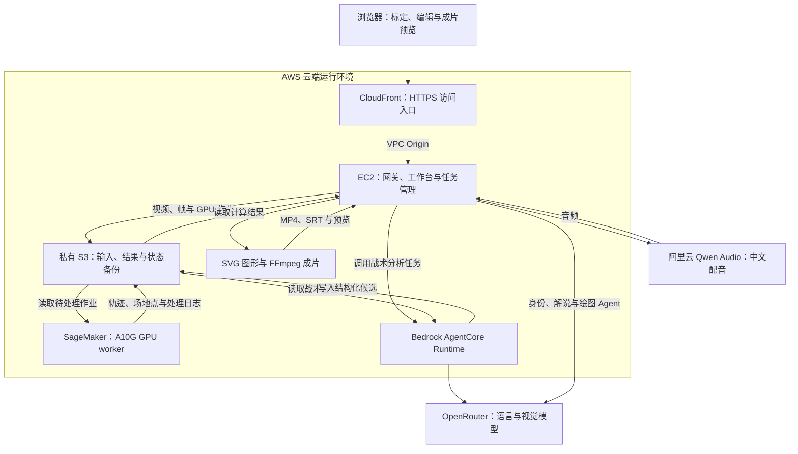
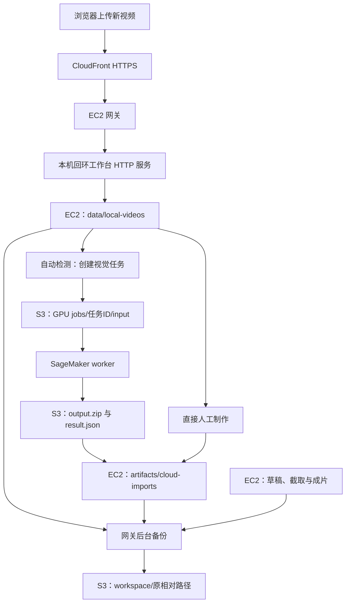

# CourtStory AWS 云端部署

[返回产品介绍](../../README.md) · [本地部署](../local/README.md)

本版把交互服务部署到 AWS，浏览器通过 HTTPS 访问同一套 CourtStory 工作台。EC2 承载交互、草稿与渲染，SageMaker GPU worker 执行视觉任务，S3 交换作业并保存备份，AgentCore 承载战术分析适配器。与本地版一样，语言 / 视觉理解和节点绘图使用 OpenRouter，中文配音使用 Qwen Audio 在线服务；两版主要差别是服务、存储和调度。具体模型 ID 由服务端配置确定，切换部署位置不自动改换模型。

**现有部署工程沿用赛事环境，不是面向任意 AWS 账号的一键部署。** 以下说明区分已有实现、部署操作和验收；2026-10-10 的上线事实与后续修复见[历史运行记录](../../docs/aws-live-deployment.md)，不据此判断资源现在仍在线。本页整理没有创建、更新或检查云端资源。

## AWS 技术架构与服务分工


本页说明 AWS 部署中承载制作流程的资源：哪些服务负责交互，哪些执行计算，以及结果如何传递。共用的五步制作流程见[产品 README](../../README.md#五步制作流程)。

CourtStory 将任务分为三类：**需要持续交互和保存状态的工作台任务、需要 GPU 的视觉计算、通过模型 API 完成的语义分析**。围绕这三类负载组合 AWS 服务，让用户的编辑状态、计算任务和最终视频形成一条可追踪的制作链路。



AWS 承担应用运行、GPU 计算、Agent 执行、数据交换和交付入口。OpenRouter 与阿里云 TTS 是明确的外部模型依赖；AgentCore 在本项目中负责运行战术分析适配器，模型推理请求由该适配器发往 OpenRouter。

| AWS 服务 | 为什么选择它 | 在 CourtStory 中实际完成什么 | 实现入口 |
| --- | --- | --- | --- |
| **Amazon EC2** | 工作台需要同时运行 Python、Node.js、FFmpeg，维护草稿并执行较长的视频制作任务 | `t3.large` 承载网关、HTTP 服务、Agent 子进程、任务编排和成片；systemd 管理服务 | [基础设施](../../infra/ec2-workbench/app.py)、[启动脚本](../../infra/ec2-workbench/bootstrap.sh) |
| **Amazon SageMaker** | 球员检测、跟踪与场地模型需要独立 GPU 环境，适合与交互服务分开运行 | 在 `ml.g5.2xlarge` / A10G Notebook 实例上运行 GPU worker，执行 YOLO、BoT-SORT 与 48 点场地模型 | [GPU worker](../../infra/sagemaker-vision/worker.py)、[启动与恢复](../../infra/sagemaker-vision/start_worker.sh) |
| **Amazon S3** | 视频、帧证据和结果包需要在不同执行环境之间传递；草稿状态需要独立备份 | 通过私有作业目录交换 GPU 输入、请求和结果；保存 Agent 证据与候选、发布包和工作区备份 | [GPU 作业适配](../../scripts/cloud_gpu.py)、[备份网关](../../infra/ec2-workbench/gateway.py) |
| **Amazon Bedrock AgentCore Runtime** | 战术分析需要一个与工作台分开的调用入口和运行会话 | EC2 提交 S3 证据引用，Runtime 读取图像与输出约束、调用模型、写回候选；工作台取回后继续校验 | [调用适配](../../scripts/cloud_tactics_agent.py)、[Runtime 实现](../../infra/ec2-workbench/agent_main.py) |
| **Amazon CloudFront** | 浏览器需要统一 HTTPS 入口，前端、API 和视频使用同一访问路径 | 通过 VPC Origin 连接 EC2 网关；直接进入工作台，网关校验 Host / Origin 并转发请求 | [交付栈](../../infra/ec2-workbench/app.py)、[网关](../../infra/ec2-workbench/gateway.py) |
| **AWS IAM** | EC2、AgentCore 和 GPU worker 的资源访问应与各自职责对应 | 通过角色、赛事权限边界和资源路径授权访问 AWS；运行服务不复制开发电脑的 AWS 登录凭据 | [工作台角色](../../infra/ec2-workbench/app.py)、[GPU 基础设施](../../infra/sagemaker-vision/app.py) |
| **AWS Systems Manager** | 云端维护需要执行服务检查、读取日志和更新操作 | EC2 使用 SSM 维护通道，配合服务日志定位运行问题 | [运行维护](../../docs/aws-live-deployment.md) |
| **AWS CDK / CloudFormation** | 环境的创建、交付和恢复需要有代码依据 | 用基础设施定义描述工作台、AgentCore、角色和 CloudFront，结合发布包与状态恢复脚本重建环境 | [CDK 定义](../../infra/ec2-workbench/app.py)、[恢复准备](../../infra/ec2-workbench/prepare_rebuild.py) |

现有网关实现直接进入工作台，不要求访问码或会话 Cookie；旧 `/login` 链接跳转到首页。网关继续检查请求来源，并保持密钥文件与静态资源隔离。

GPU 选型还考虑了赛事账号的实际约束：部署时 EC2 GPU 按需配额为 0，因此使用已有 SageMaker GPU 资源承接视觉任务。这里采用的是 **Notebook 实例上的自定义 worker + S3 作业交换**，具体验证与维护方式见[云端运行记录](../../docs/aws-live-deployment.md)。

### 服务如何协作完成一次视觉任务

以第一步的检测与跟踪为例，一次 GPU 任务按下列顺序流转。这里展开的是云端调用过程；作品制作的数据依赖见[共用制作流程](../../README.md#五步制作流程)。

1. **接收输入**：EC2 为视频或图像任务生成独立作业 ID，把输入上传到 S3。
2. **发布请求**：在结果占位对象创建后，写入操作类型、模型组合和截止时间；工作台轮询该任务的结果对象。
3. **GPU 处理**：SageMaker worker 读取作业，执行检测跟踪或场地推理，把结构化结果、输出包及失败日志写回同一任务目录。
4. **返回结果**：EC2 取回结果并接入标定工作台，完成这次视觉任务。轨迹随后进入第二步的身份校正，供后续讲解和绘图使用。

S3 在这条实现中承担的是对象存储与作业交换；GPU worker 采用轮询处理。计算结果会继续进入身份校正、战术制作和渲染，形成服务间有实际数据流转的组合。


## 视频、草稿与 S3 的数据流

**浏览器新上传的视频先写入 EC2 磁盘，再按用途进入 S3。当前实现没有浏览器直传 S3 或分片续传入口。短片截取由 EC2 上的后台作业执行并轮询结果，沿用工作台共用接口。** 导入、GPU 计算和备份是三条相关但不同的路径：



| 用途 | EC2 / S3 路径 | 何时写入 |
| --- | --- | --- |
| 浏览器导入原片 | EC2 `data/local-videos/` | HTTP 上传完成、校验可解码且内容已登记后 |
| 工作台自动检测 | `s3://<bucket>/<gpuPrefix>/jobs/<id>/input`、`request.json`、`result.json`、`output.zip` | 选择自动处理且 GPU worker 心跳有效时；手工准备不需要 GPU 作业 |
| 场地推理 | 同一 GPU 作业目录，输入为帧图像数组 | 请求自动场地模型时 |
| 战术 Agent 证据和候选 | `s3://<bucket>/<prefix>/agent-jobs/<id>/input.json` 与 `result.json` | AgentCore 战术任务调用时 |
| 工作区备份 | `s3://<bucket>/<prefix>/workspace/<仓库相对路径>` | 网关后台扫描允许的状态文件，上传后核对大小和摘要元数据 |
| 发布包和内置样例 | `<prefix>/release/`、`<prefix>/datasets/` | 运维打包上传；不是浏览器导入接口 |

`<bucket>`、`<prefix>` 与 `<gpuPrefix>` 来自实际部署配置，不能照抄其他账号的值。GPU `input` 保留任务输入字节，格式由请求中的 `sourceSuffix` 描述。

数据流实现依据：[浏览器上传](../../tools/player-review/video-library.mjs)、[HTTP 导入](../../scripts/serve_player_review.py)、[原片落盘与模式分流](../../scripts/local_video_library.py)、[GPU 作业传输](../../scripts/cloud_gpu.py)、[AgentCore 适配](../../scripts/cloud_tactics_agent.py)、[后台备份](../../infra/ec2-workbench/gateway.py)。

网关备份约每 10 秒扫描一次，文件稳定至少 2 秒后才尝试上传；不能将“浏览器导入成功”视作“S3 备份已完成”。允许备份的目录包括 `data/local-videos/`、`data/local-workbench/`、`artifacts/cloud-imports/` 和 `artifacts/cloud-trims/`；完整范围及排除规则见 [state_archive.py](../../infra/ec2-workbench/state_archive.py)。

## 部署前的配置与环境

### 工程入口

| 路径 | 用途 |
| --- | --- |
| [infra/ec2-workbench/](../../infra/ec2-workbench/README.md) | EC2、AgentCore、CloudFront、网关与恢复工程 |
| [infra/sagemaker-vision/](../../infra/sagemaker-vision/README.md) | SageMaker GPU 环境、权重准备、worker 与启动脚本；历史 Notebook 验证按原日期阅读 |
| [prepare.py](../../infra/ec2-workbench/prepare.py) | 首次准备发布包与样例；即使不加 `--upload` 也会读取 AWS 账号与环境 |
| [prepare_rebuild.py](../../infra/ec2-workbench/prepare_rebuild.py) | 基于已有配置的 discovery、离线恢复打包、不可变对象上传 |
| [update_release.py](../../infra/ec2-workbench/update_release.py) | 为已有部署打包更新；`--upload` 才上传代码包 |
| [bootstrap.sh](../../infra/ec2-workbench/bootstrap.sh) | EC2 依赖安装、产品配置加载和 systemd 服务 |
| [start_worker.sh](../../infra/sagemaker-vision/start_worker.sh) | 在已有 GPU 环境启动 worker；需要运维渲染部署占位值 |

部署电脑需要 Python、AWS CDK v2 CLI 与 Python 依赖（`aws-cdk-lib`、`constructs`），以及对应账号已有的 AWS 登录状态。AWS 运行依赖清单在 [requirements.txt](requirements.txt)，包含共用工作台依赖与固定版本的 `boto3`：

```powershell
python -m pip install -r engineering/deploy/aws/requirements.txt
```

该命令准备 Python 运行依赖，不安装 CDK CLI 或自动创建资源。应用自身依赖由 bootstrap 安装；GPU 环境与权重单独准备。不要把本地 `.venv` 当作 GPU Notebook 的运行环境复制。

### 现有环境约束

- 主要工程固定使用 `us-east-1`；首次准备脚本使用 `nba` profile、赛事参与者角色、赛事权限边界和既有团队私有桶。
- CDK 定义需要实际账号、VPC、子网、镜像、发布对象、角色权限边界与 CloudFront 配置；依赖主办方既有环境时按赛事约束完成检查。
- SageMaker 方案使用 Notebook 实例上的自定义 worker，不是 SageMaker 实时推理 Endpoint；worker 复用已准备的 CUDA、依赖和权重。
- API 密钥不放入代码 ZIP、前端、Git 或文档。当前工程将产品配置和 Agent provider 配置作为私有对象独立加载，计算资源使用各自角色访问 AWS。
- 新账号没有这些前置资源时，先适配配置与权限边界，再审查 CDK 变更；不能将历史私有配置当作通用模板。

### 服务运行模式

显式运行 AWS 服务时使用 `--deployment-mode aws`。该模式要求已提供 `HKS_BUCKET` 和 `HKS_PREFIX`，但这只是配置完整性检查，不会验证凭据、连通性或创建资源。远程 GPU 仍需 `HKS_GPU_PREFIX`，AgentCore 仍需 `HKS_AGENT_RUNTIME`；二者未配置时不能声称相应服务已可用。

现有 `bootstrap.sh` 的旧启动命令省略模式，继续按默认 `auto` 兼容环境变量分流。`auto` 不等于已经验收的 AWS 部署；新指导与人工启动应明确选择预期模式。

### 运行配置如何对应

| 配置入口 | 用途与要求 |
| --- | --- |
| `HKS_DEPLOY_CONFIG` | CDK 使用的私有部署 JSON 路径，保存在被忽略的本机目录 |
| 配置的 `bucket` / `prefix` | 发布、Agent 证据和工作区备份的对象范围 |
| 配置的 `gpuPrefix` → `HKS_GPU_PREFIX` | 启用远程 GPU 的路径；EC2、worker 和 IAM 授权范围必须一致 |
| AgentCore Runtime ARN → `HKS_AGENT_RUNTIME` | EC2 战术调用入口；由实际基础设施输出取得 |
| 配置的 `envKey` | EC2 产品配置对象，bootstrap 写入仅服务可读的配置文件 |
| 配置的 `providerKey` | AgentCore 模型适配器读取的独立 provider 配置对象 |
| OpenRouter 与 Qwen 配置 | 分别提供模型理解和配音；字段见[本地版在线 AI 配置](../local/README.md#在线模型与配音) |

首次 `prepare.py` 生成的配置不包含全部后续 GPU / 产品密钥选项；`gpuPrefix`、`envKey` 等要在已有部署流程中明确配置。缺少 GPU 路径不会凭空准备远程 worker，缺少 API 配置也不能通过代码包自动获得模型能力。

## 发布、更新与恢复顺序

以下是操作顺序；具体账号、路径、资源输出和部署差异由执行时核对。命令从仓库根目录运行，`tmp/<...>` 表示需要替换的私有路径，每次使用全新的输出目录。

1. **准备依赖与配置**：核对 AWS 账号、区域、现有私有桶、网络、权限边界、CDK 环境、GPU 配额/实例、模型权重和产品凭据配置。
2. **准备发布包**：首次部署阅读 `prepare.py` 的环境约束；已有环境更新使用 `update_release.py`，恢复使用 `prepare_rebuild.py`。下列打包命令本身不部署资源。
3. **审查基础设施**：为目标配置设置 `HKS_DEPLOY_CONFIG`，进入 `engineering/infra/ec2-workbench/`，按实际 core / delivery 阶段执行 CDK synth、diff，核对角色和资源变化。
4. **上传并部署**：在需要发布时执行对应上传与 CDK 部署流程。S3 上传成功只代表对象存在，还需要让实例加载该版本，并配置 CloudFront 与实际 EC2 origin。
5. **准备并启动 GPU worker**：使用独立 SageMaker 工程和匹配部署参数的 `start_worker.sh`；确认与 EC2 指向同一 GPU 作业前缀。
6. **验收再提供访问入口**：完成下节的逐项检查，记录代码版本、资源配置时点与输出证据。

已有部署的离线更新打包示例：

```powershell
python engineering/infra/ec2-workbench/update_release.py --config tmp/<已有部署>/config.json --output tmp/<新更新目录>
```

有已有配置与 Agent 包时，可先构造离线恢复包：

```powershell
python engineering/infra/ec2-workbench/prepare_rebuild.py build --source-config tmp/<已有部署>/config.json --agent-zip tmp/<已有部署>/agent.zip --output tmp/<新恢复目录>
```

恢复包标为需要重新 discovery 时，先运行其 `discover` 操作取得新的只读环境记录，再带 `--inventory` 重新打包并上传。`build` 不接触 AWS；`discover` 会读取 AWS，`upload` 写入 S3，但二者都不等于 CloudFormation 部署。不要将 `prepare.py` 无 `--upload` 与离线 `build` 混为一谈。

状态备份与恢复使用 [state_archive.py](../../infra/ec2-workbench/state_archive.py) 和 [restore_bootstrap.py](../../infra/ec2-workbench/restore_bootstrap.py)。恢复前验证归档完整性，代码和制作状态分别处理；工作区仍有写入时不能假设快照已经一致。

## 运行状态与验收

| 检查层 | 应检查的结果 |
| --- | --- |
| HTTPS 入口 | CloudFront 能访问工作台，静态资源及视频请求正常；当前网关无访问码门户，`/login` 跳转首页 |
| EC2 服务 | `hks-workbench`、`hks-gateway` 在运行；网关检查后端监听，启动阶段返回 503 |
| 新视频导入 | 浏览器上传完成后，EC2 原片可打开，登记的内容摘要与源文件一致 |
| S3 备份 | 网关备份状态无错误，目标文件大小和摘要核对通过；与 HTTP 导入分别验收 |
| GPU | `courtstory-gpu` worker 心跳未超过 90 秒；真实请求返回有效结果或明确错误 |
| AgentCore | 会话与独立证据目录对应，输入和结果路径校验通过，调用结束后停止会话 |
| 在线模型与配音 | OpenRouter / Qwen 分别完成明确授权的测试任务；模型候选仍需人工审核 |
| 截取与成片 | 分别检查短片的时长/内容、草稿保存、MP4/SRT 输出与浏览器下载 |
| 恢复 | 在目标范围核对备份和恢复结果；完成视频可继续打开，制作状态不被新任务错误覆盖 |

GPU、AgentCore 的代码回归入口分别为 [`test_cloud_gpu.py`](../../scripts/test_cloud_gpu.py) 与 [`test_cloud_tactics_agent.py`](../../scripts/test_cloud_tactics_agent.py)。这些离线测试不能代替云端实际连通性和浏览器验收。

运维通过 SSM 查看 `journalctl -u hks-workbench -u hks-gateway`；GPU 实例查看 `journalctl -u courtstory-gpu`。不要从日志或配置中公开密钥。资源启停和费用按实际使用管理，历史记录不表示仍需持续开机。
