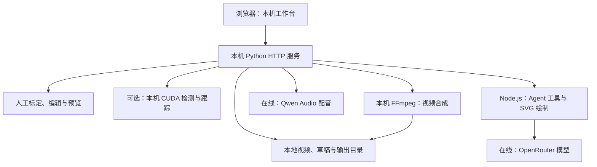

# CourtStory 本地部署

[返回产品介绍](../../README.md) · [AWS 云端部署](../aws/README.md)

本地部署把工作台服务、视频、草稿和渲染任务放在自己的电脑上，**基础工作台不要求 AWS 账号、S3 或 AgentCore**。与 AWS 版一样，语言 / 视觉理解和节点绘图使用 OpenRouter，中文配音使用 Qwen Audio 在线服务；两版主要差别是服务运行、存储和任务调度的位置。具体模型 ID 与音色以服务端配置为准。

本指导不安排在本机部署语言模型或 TTS 模型；下文的本机 CUDA 是可选的球员检测 / 跟踪能力。手工制作与已有结果浏览可以使用本机资源。本页的“本地”不表示全离线。

本文依据仓库实现说明安装和操作，不代表已在每一种硬件或操作系统重新验收。完整产品流程和 Single 成果见[产品 README](../../README.md)。

## 本地技术架构



浏览器连接 `127.0.0.1` 上的工作台，视频导入和短片截取都由同一个 Python 服务处理。前端的 React / JavaScript、Node.js 工具、Python 处理和 FFmpeg 与云端复用相同实现。此模式不启动 AWS 网关或云端备份进程。

| 功能 | 依赖 | 没有该依赖时 |
| --- | --- | --- |
| 打开已下载样例、导入视频、手工编辑 | Python 工作台依赖、完整视频、Node.js；转换及导出需 FFmpeg | 先准备基础依赖与视频 |
| 自动检测与跟踪 | 独立视觉 Python、匹配权重、CUDA GPU、Ultralytics 8.4.171 | 选择“直接人工制作”；当前球员检测执行器不提供 CPU 自动回退 |
| 可选场地关键点模型 | 48 点权重及视觉依赖 | 可人工处理；场地模型自身支持 GPU 或 CPU，不能据此推断球员检测支持 CPU |
| 身份初稿、解说与节点绘图 | OpenRouter 凭据与网络 | 保留人工编辑，配置后再请求机器候选 |
| 保留的 Codex CLI 战术兼容入口 | 如需该入口，使用可用并已登录的 Codex CLI | 不影响 OpenRouter 解说 / 节点绘图或基础工作台启动 |
| 自动中文配音与带配音成片流程 | 北京地域 Qwen Audio 凭据与网络 | 该配音流程不可用；现有已保存视频仍可查看 |

本地启动显式使用 `--deployment-mode local`。[`serve_player_review.py`](../../scripts/serve_player_review.py) 在加载环境文件后关闭 `HKS_GPU_PREFIX` / `HKS_AGENT_RUNTIME` 两个 AWS 分流入口，保留在线 AI 配置；[`local_video_library.py`](../../scripts/local_video_library.py) 随后调用本机推理。基础依赖清单不安装 AWS SDK，使用本地模式不需要 AWS 登录。

## 基础安装与启动

需要 Git / Git LFS、Python 3.12、Node.js 22.19.0 或更新版本及 npm、FFmpeg。带姓名叠加的导出还需要 OpenCV，按对应功能与模型环境准备。以下 PowerShell 命令均从**仓库根目录**运行，工作台使用端口 `8892`：

```powershell
powershell -NoProfile -ExecutionPolicy Bypass -File scripts/setup-git-identity.ps1
git lfs pull
python -m venv .venv
.venv/Scripts/python -m pip install -r engineering/requirements-review.txt
npm ci --prefix engineering/tools/player-review
npm ci --prefix engineering/tools/player-review/agents
npm install --prefix tmp/node-deps --no-audit --no-fund sharp@0.34.5
$env:NODE_PATH = "$PWD/tmp/node-deps/node_modules"
.venv/Scripts/python engineering/scripts/serve_player_review.py --library data/videos/tactics/acceptance/review-library.json --port 8892 --deployment-mode local
```

打开 `http://127.0.0.1:8892/`。若端口已占用，使用其他端口；macOS / Linux 将 Python 路径改为 `.venv/bin/python` 并使用对应 Shell 的环境变量语法。工作台监听回环地址，不能把这个命令直接当作局域网或公网服务启动器。

`--deployment-mode local` 会防止继承的云端变量让本机处理误走 AWS。`--env-file` 指定本机要启用的功能配置；普通配置仍由已有同名进程环境变量优先。旧命令省略模式时使用兼容的 `auto`，因此本地指导始终显式传入 `local`。

前端构建产物已入库；修改 JSX 后运行 `npm run build --prefix engineering/tools/player-review`。自动识别依赖与权重不是“直接人工制作”的前置条件。

## 自动识别与在线 AI

### 本机视觉模型

按[模型环境说明](../../../environment/local/model-runtime.md)准备独立推理 Python、CUDA 与经过校验的权重，然后向服务传入自己的实际路径：

```text
--inference-python <视觉环境的Python路径>
--models <检测权重目录>
--court-model <48点场地权重路径>
```

默认检测权重文件名与 SHA-256 在 [`workbench_runtime.py`](../../scripts/workbench_runtime.py) 中，运行时同时检查 CUDA、Ultralytics 8.4.171 和权重。`--court-model` 延迟加载；Linux / macOS 不应沿用默认的 Windows 推理 Python 路径。已有环境说明包含历史实验路径，应按自己的机器准备，不能直接复制作者的虚拟环境。

### 在线模型与配音

本地版与 AWS 版沿用相同的 OpenRouter / Qwen Audio 路线，不因部署位置改换模型。下面只说明配置入口；实际模型 ID 以供应商接口和服务端已有配置为准。

向启动命令添加 `--env-file .env` 显式指定本机配置文件。配置文件只在本机保存，勿提交到 Git。按需要启用功能：

| 配置项 | 用途 |
| --- | --- |
| `OPENROUTER_API_KEY`（兼容 `OPEN_ROUTER_KEY`） | 当前身份初稿、解说与节点绘图调用 |
| `DASHSCOPE_API_KEY`（兼容 `QWEN_API_KEY`） | 北京地域 Qwen Audio 中文配音 |
| `QWEN_TTS_MODEL`、`QWEN_TTS_VOICE` | 可选配音模型与音色；默认见 `commentary_tts.py` |
| `--commentary-model-config <JSON路径>` | 可选的服务端模型与能力配置；与实际模型服务相符 |
| `--tactics-agent-cli <程序路径>` | 可选 Codex CLI 入口，使用该电脑已有登录状态 |

默认 Qwen 配音模型为 `qwen-audio-3.1-tts-flash`，音色为 `anmingyuan_v3.1`。配置缺失会让对应自动功能不可用；不会自动切到另一个收费服务。TTS 当前没有 AWS Polly 回退。具体依赖见 [`commentary_jobs.py`](../../scripts/commentary_jobs.py)、[`commentary_tts.py`](../../scripts/commentary_tts.py) 和 [`tactics_agent.py`](../../scripts/tactics_agent.py)。

## 本机数据流与保存位置

```text
浏览器选择文件 → POST /api/video-library/import → data/local-videos/
                          ↓
          手工准备 / 本机检测 → artifacts/player-review-imports/
工作台截取短片                         → artifacts/player-review-clips/
战术、解说、绘图草稿与成片             → data/local-workbench/tactics/
```

短片截取是独立后台作业：创建请求返回任务，再由前端轮询进度与结果。它与原片上传、自动检测分开检查；任务创建成功不代表截取已完成。

HTTP 导入目前支持 MP4、MOV、MKV、WebM、AVI，单次上限为 2 GiB；更大文件可以放入 `--video-folder` 指定的本机目录后扫描。导入先校验可解码性和内容摘要，再准备相应方案。自动检测失败不代表原始导入文件已丢失。

| 服务参数 | 默认保存位置 |
| --- | --- |
| `--video-folder` | `data/local-videos/` |
| `--import-cache` | `artifacts/player-review-imports/` |
| `--trim-root` | `artifacts/player-review-clips/` |
| `--tactics-folder` | `data/local-workbench/tactics/` |
| `--state-file` | `artifacts/vision-player-refinement/review-server.json` |

这些目录按忽略规则留在本机。共享样例由 [data/videos](../../../data/videos/README.md) 管理；已选定成片在 [deliverables](../../../deliverables/README.md)。本地模式不自动向 S3 备份；备份前先保存草稿并停止写入，保留所使用的原视频、上述缓存与草稿目录。云端 `state_archive.py` 的默认白名单使用 `cloud-imports` / `cloud-trims`，不能直接认为它已覆盖本地默认缓存。

## 运行状态与验收

1. 核对 `python --version`、`node --version`、`ffmpeg -version` 和 Git LFS 下载状态。
2. 启动后打开工作台，确认 Single 样例可加载，并选择“直接人工制作”验证自己的短视频导入。
3. 核对保存后重新打开的草稿和本机输出；截取、生成与下载应分别检查任务结果，不能仅凭进度条判断成功。
4. 需要自动检测时查看模型运行状态及实际处理日志；缺少 GPU 或权重时使用手工模式。
5. 需要在线 AI 时分别核对理解、绘图与 TTS 状态；真实调用会消耗相应服务额度，只有完成的请求和输出才算验收。

工程检查可使用 `npm test --prefix engineering/tools/player-review` 与 `python scripts/validate_video_data.py --check-index`。上述步骤是部署后的检查方法，本文不将未执行的功能测试或实际模型调用写成已通过。

更多服务选项：`python engineering/scripts/serve_player_review.py --help`。产品流程与各功能代码见[产品 README](../../README.md#代码与文档入口)。
