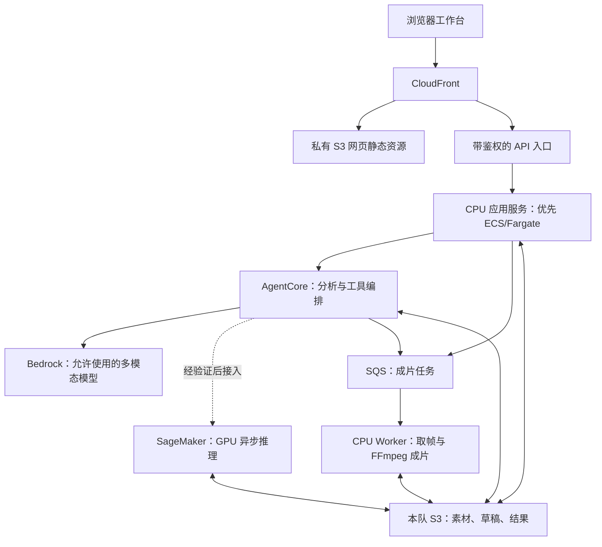

# 工作台 AWS 部署选型与实施顺序

日期：2026-10-06 15:46，Asia/Shanghai。范围：回答当前工作台如何部署、S3 / EC2 / SageMaker 如何分工、Codex 能否协助执行。以下为工程建议，尚未形成团队选型或部署结果。

后续证据：同日 20:25 已完成 [19 项服务独立实测](../../environment/aws/services-live-audit-20261006.md)，包括 AgentCore Runtime、Fargate / Batch、CPU EC2 与 CloudFront。下文 15:46 / 16:02 的只读记录保留当时范围；服务基本功能已测不代表本架构或完整工作台已经部署，SageMaker GPU 仍未启动验证。

## 1. 推荐架构

保留工作台的人工编辑、候选核对与 MP4 制作体验。首版采用 **CloudFront + 私有 S3 + AgentCore + Bedrock + CPU 容器服务**；CPU 服务优先评估 ECS/Fargate，EC2 是容器迁移受阻时的备选。需要 CUDA 的检测 / 球场模型经真实视频验证后，接入 SageMaker 异步推理端点。

S3 是对象存储，EC2 是虚拟服务器，SageMaker 是模型开发与托管运行平台；三者职责可以组合。SageMaker 不必承载整个网页，S3 不执行 Python 或 FFmpeg，AgentCore 负责运行实际 Agent。

图中为较完整的拟议资源与调用关系，不表示首版必须同时实现全部拆分。首版 CPU 后端与渲染可以先作为一个应用部署；SQS / 独立 Worker 可在需要可靠排队和重试时引入。API 入口可采用 ALB，具体网络、鉴权、配额和费用在实现时核实。原片与成品采用授权访问；S3 的 CloudFront OAC 只保护源站，不能替代观看者鉴权。

| 服务 | 对应项目工作 | 首版设计重点 |
| --- | --- | --- |
| S3 | 官方视频、提取帧、模型输出、人工草稿、成片与 manifest | 引用预置本队桶；按数据集 / 任务 ID 分前缀；保存输入摘要、版本和产物关联；保持私有 |
| AgentCore | 读取证据、调用模型与工具、校验候选、提交后续处理 | 把实际分析与工具编排部署进去；耗时任务返回任务 ID，不让浏览器一直等待 |
| Bedrock | 从帧和已核实指标生成结构化分析 / 叠加建议 | 先适配本队已通过文本调用的 Qwen3-VL；图像、结构化输出和工具调用需单独实测 |
| ECS/Fargate | Python / Node 应用服务与 CPU 渲染 Worker | 固定依赖、健康检查、日志、可恢复任务；CPU 与 GPU 镜像分开 |
| EC2 | CPU 应用 / Worker 的备选运行位置 | 适合较少改动迁移现有进程，但需自行维护系统、进程与容量；不承担本队 GPU 路线 |
| SageMaker | YOLO / 球场等已有 CUDA 模型的推理 | Notebook 可用于单片验证；最终评估异步端点，由应用或 Agent 调用 |
| CloudFront | 网页、授权播放与作品访问入口 | 静态资源缓存；任务 API 禁止共享缓存；分开处理素材与 API 授权 |
| CDK / CloudWatch | 可重复部署，以及查询耗时、错误和日志 | 以相同任务 ID 串联 Agent、推理、渲染及产物 |

SQS 用于持久保存待渲染任务，Worker 完成结果落盘后再确认消息；需实现幂等、可见性超时续期和失败隔离。初版低并发任务状态可放 S3，明确单写入者及条件写入；多写入者状态竞争增多时，再评估 DynamoDB。上述队列及状态方案尚未实现。

## 2. 本队证据与可用性边界

### 本轮实查

- `aws --version` 为 2.37.9，CDK 为 2.1144.0；`nba-sso`、`nba` profile 存在。
- `nba` 的 STS 查询成功，角色为 `NBAHackathonParticipantRole`；本轮资源查询使用 `us-east-1`。
- AgentCore Runtime 列表计数为 0。
- Fargate 按需及 Spot vCPU 配额均为 140。它们是配额上限，不是空闲容量、费用预算或完整创建权限证明；首版不依赖可能被回收的 Spot。
- Docker CLI 存在，但 `docker info` 无法连接 Docker Desktop Linux 引擎；容器构建条件尚未就绪。
- AWS Core 插件文档检索实际返回 `UNAUTHORIZED`，提示重新认证。没有通过该插件执行云 API；本机 CLI 的成功不能证明插件连接已恢复。
- CloudFront 本轮列表命令没有返回可解释的数量 / 对象结果，不作为新的空列表证据；历史为空的结论仅按此前记录理解。

### 本日其他会话已保存的证据

- 两段官方训练片及 manifest 已上传本队私有 S3，并核对远端 SHA-256，见 [S3 记录](aws-cloud-preflight-20261006.md)。本轮没有重传或重做对象摘要检查。
- Bedrock Qwen 文本调用已成功；Sonnet 4.6 在白名单内但协议尚未就绪，见 [模型权限](../../environment/aws/bedrock-model-access-20261006.md)。不能把目录中的其他模型当作本队获准模型。
- `ml.g5.xlarge`：Notebook 1、按需 Training 1、Endpoint 2；G6 / G6e 也有相应用途额度。已查 G 系列的 Processing / Batch Transform 均为 0，见 [SageMaker 核验](../../environment/aws/sagemaker-gpu-availability-20261006.md)。不能拿 Notebook 额度启动 Processing Job，也不能把非零额度说成开机成功。

## 3. SageMaker 怎样接入

建议先用单台 G5 Notebook 验证必要的 CUDA 模型、依赖、S3 输入输出及真实视频耗时 / 显存；这一步只是开发验证。模型准确率要与现有人工参照比较，不能把“GPU 成功启动”当作效果验收。

确定模型有实际价值后，封装为 SageMaker 推理容器，并评估 **Asynchronous Inference**：请求载荷放 S3，调用返回标识与输出位置，SageMaker 排队处理后把结果写回 S3。AWS 文档给出的单次请求上限为 1 GB、处理时间最长一小时，并支持配置缩容至零。这适合视频任务的等待方式，实际机型支持、镜像兼容性、Endpoint 配额、角色权限与容量仍要逐项验证。

缩容至零需要配置扩缩容与积压请求唤醒，启动和空闲窗口仍会影响费用及延迟；正式演示是否保留一台温热实例依据实测决定。Notebook 开发验证后停止计算；持久卷等仍可能计费。Qwen3-VL 的 Bedrock 调用继续由 Bedrock 承担，不在单张 G5 上自行部署该大模型。

GPU 检测是可选增强。官方指标叠加、人工确认与 CPU 成片应能独立走通；完整跑动轨迹复原不作为本届强制交付，依据 [运行要求复核](../../requirements/aws-runtime-clarification-20261006.md)及其引用的指南。

## 4. 当前代码要改哪里

| 已有入口 | 已核实的问题 | 拟做改造 |
| --- | --- | --- |
| [serve_player_review.py](../scripts/serve_player_review.py) | ThreadingHTTPServer，多处写请求只允许本机 Host / Origin | 正式应用入口、健康检查、鉴权和可配置可信来源；不能仅删除现有检查 |
| [tactics_agent.py](../scripts/tactics_agent.py) | 发现并调用本机 Codex CLI | 抽离业务工具和结果校验，以 AgentCore 运行云端 Agent，适配允许的 Bedrock 模型 |
| [qwen-provider.mjs](../tools/player-review/agents/qwen-provider.mjs) | 阿里云 DashScope 端点与 QWEN_KEY | 新增 Bedrock provider；验证图像传参、模型输出和工具语义，不能只改模型名 |
| [workbench_runtime.py](../scripts/workbench_runtime.py) | CUDA 不可用即报错 | 把 GPU 推理交给 SageMaker，页面仍能走人工 / CPU 成片流程 |
| [tactics_render.py](../scripts/tactics_render.py)及 [production-worker.mjs](../tools/tactical-overlay/production-worker.mjs) | FFmpeg / Sharp 及部分本机依赖发现逻辑 | 固定 Python、Node、Sharp、FFmpeg、字体等依赖；任务化执行，读写 S3 |
| 草稿、任务与素材路径 | 主要依赖本机目录 | S3 对象键 + 任务 ID；容器磁盘仅作缓存；重启后可查进度与结果 |

目前未找到 `cdk.json` 或 Dockerfile。CPU 容器和 GPU 容器分别构建；AgentCore 的打包方式与运行协议按届时官方契约核对，不能把同一个 CUDA 镜像用于全部服务。

## 5. 实施和验收顺序

1. **完成 CPU 容器与存储适配。** 恢复可用的 Linux 构建环境，打包现有依赖；使用已上传的官方片验证取帧、人工编辑、保存、渲染。明确音轨保留策略，不能把当前静音导出称为保留了原声。
2. **接通 AgentCore + Bedrock。** 定义内部输入、候选结果与工具接口，真实执行取证、分析、结果校验及后续任务提交；记录模型、输入版本、失败与重试。内部协议标为内部约定，不能冒充尚未取得的赛事统一 schema。
3. **完成 CDK 与网页入口。** 建议新代码放 `engineering/infra/`。引用预置桶；定义应用、Worker、队列、日志、访问控制及 CloudFront。应用资源目标为 `us-east-1`，新建 IAM 角色带 `NBAHackathonParticipantBoundary`；**不运行 cdk bootstrap**。在实际工程中依次 synth、diff、核对资源与权限后部署。
4. **追加必要 GPU 推理。** 单片验证成功后部署 SageMaker 异步端点，接回同一任务流程；检测未通过时保留失败与人工修订入口。
5. **完成外部浏览器验收。** 关闭开发者本机工作台，使用 CloudFront 访问，提交一段新任务，看到进度、修改候选、生成可下载 MP4；验证失败重试、刷新、重启、任务隔离与授权访问。保存运行日志、耗时、资源配置及产物摘要。

训练包仍缺独立官方指标表，赛事统一输入输出完整契约也仍待核实。它们不妨碍先建设通用存储 / 渲染基础，但最终赛事验收必须用真实指标与正确契约，不能用虚构数据补齐。

## 6. 怎样体现 AWS 使用深度

[既有正式指南采集](../../requirements/portal-access-20261005.md)记录：评分强调托管服务的有效使用、深度、组合协作和完整工程链，托管服务相较 EC2 自建组件权重更高。本轮直接打开飞书原文失败，赛事判断沿用 10 月 5–6 日已保存的实读记录，不声称本轮重新打开成功。

可展示的工程证据包括：

- S3 将每次输入、人工修订、模型输出与成片关联，可追溯是哪段视频、哪个版本产生的结果。
- AgentCore 实际决定并执行工具步骤，对缺失数据、错误输出给出可恢复处理；日志可对应到产物。
- SageMaker 自动接收任务并产出结构化检测结果，有实际质量 / 耗时评估，按负载管理 GPU。
- 渲染队列支持重复投递、重试与失败隔离；网页可查询状态和继续修改。
- CDK 能重现运行资源；CloudWatch 可追踪一段视频的完整处理过程。

这些是本项目建议的验收证据，不是官方逐项给分表，也不保证某个服务能获得具体分数。

## 7. Codex 能承担的工作与本轮范围

可在后续部署任务中完成：代码适配、依赖打包、CDK 编写、已授权的 CLI / 插件操作、部署故障排查、真实任务验收与文档归档。登录、账号权限与实际容量由 AWS 决定，不能通过插件绕过。

当前可用执行通道为本机 AWS CLI；AWS Core 插件恢复认证后需单独核验所连账号、角色与区域，再用于执行。OpenAI 官方说明将插件分为技能指导与 MCP 工具连接等能力；安装技能本身不代表取得 AWS 账号权限。

本轮只做读取、方案整理和文档修改，没有创建计算实例、部署应用、调用模型、修改云配置或提交赛事作品。Git 已 fetch，HEAD / origin/main 均为 `be5c43d17c78f04b4df55eda38aa6f82fde8f803`；开放 Issue 为空。保留多会话未提交内容，本轮文档未提交 / 未推送。

收尾再次 `git ls-remote` 时连接 GitHub 超时，未获得新的远端结果；上述 SHA 仅代表本轮成功 fetch 时的状态，不声称收尾时已经重新核对最新远端。

## 8. 本地、EC2、ECS/Fargate 与用户交互（16:02 补充）

本地电脑能运行全流程，说明现有应用有可运行基础；上云主要改变运行位置、访问方式、身份和数据持久化，不会自动改善模型精度。现在的浏览器访问本机地址，Python / Node、CPU / GPU 和磁盘都在同一台电脑；云端则让浏览器访问 CloudFront，后台运算与持久文件放在赛事账号，开发者关机后仍能服务。

EC2 最接近一台远程电脑，可安装依赖、运行常驻进程。ECS 是管理容器运行的服务，底层可选 EC2 或 Fargate；选 Fargate 后由 AWS 管理运行容器所需的主机，我们仍负责应用、依赖、权限、存储和网络。Fargate 不是 GPU 服务，也不保证比 EC2 更快或更便宜。

本项目继续优先评估 ECS/Fargate 的依据，是本轮重新实读指南的托管服务评分偏好，以及减少主机维护的工程价值。EC2 是完全合理的 CPU 承载选项；如果容器适配在当前阶段成本过高，可用 EC2 完成相同应用流程，仍保留 AgentCore、S3、SageMaker 和 CloudFront。无论选哪种 CPU 服务，EC2 GPU 配额为 0 的约束都不能靠换名规避。

用户交互始终在我们开发的工作台网页中，拟议流程为：

1. 打开提交的 CloudFront URL，加载工作台页面。
2. 在页面选择 / 上传视频及数据；程序把数据存入私有 S3，并建立任务。
3. 点击分析，后端调用 AgentCore；需要 GPU 的处理交给已经部署了代码和权重的 SageMaker 推理接口。
4. 处理结果和状态返回工作台，用户检查、标注和修订；保存进入 S3。
5. 点击生成成片，后台执行 FFmpeg，结果写回 S3，页面通过 CloudFront 授权播放 / 下载。

CloudFront 负责入口和转发，不会自动生成编辑界面，也不替我们运行模型。页面 / 静态文件可从 S3 取得，`/api/` 请求转发后端且禁用共享缓存；长任务返回任务 ID，再由页面查询进度。评委不需要到 AWS 控制台手动操作 S3 / SageMaker。赛事机器评分还会基于代码仓库重跑，不能用网页展示替代可复现工程。

如果“Uploader”指上传组件，它只需负责传文件和调用 API；只有需要 GPU 的模型推理部分才放 SageMaker，具体脚本入口待实现时对应。SQS 若引入，只传任务信息 / S3 对象引用，不用来存放视频或执行模型。

本轮服务页与账号核验见 [环境报告](../../environment/aws/compute-services-availability-20261006.md)。本节补充的是设计解释与查证，不代表已部署、已选定团队方案或已收到创建资源指令。

## 9. 来源

公开技术资料查阅日期：2026-10-06；账号状态以本节上方实际查询及有时间标注的本地证据为准。

- [AWS S3 概述](https://docs.aws.amazon.com/AmazonS3/latest/userguide/Welcome.html)
- [AWS EC2 概述](https://docs.aws.amazon.com/AWSEC2/latest/UserGuide/concepts.html)
- [ECS/Fargate 容器运行](https://docs.aws.amazon.com/AmazonECS/latest/developerguide/AWS_Fargate.html)
- [SageMaker 异步推理](https://docs.aws.amazon.com/sagemaker/latest/dg/async-inference.html)
- [AgentCore Runtime](https://docs.aws.amazon.com/bedrock-agentcore/latest/devguide/runtime-how-it-works.html)
- [CloudFront 私有 S3 源站访问](https://docs.aws.amazon.com/AmazonCloudFront/latest/DeveloperGuide/private-content-restricting-access-to-s3.html)
- [OpenAI 插件构成](https://developers.openai.com/plugins/concepts/plugins)
- [赛事运行要求复核](../../requirements/aws-runtime-clarification-20261006.md)、[CDK 补充通知](../../requirements/cdk-deployment-notice-20261006.md)
