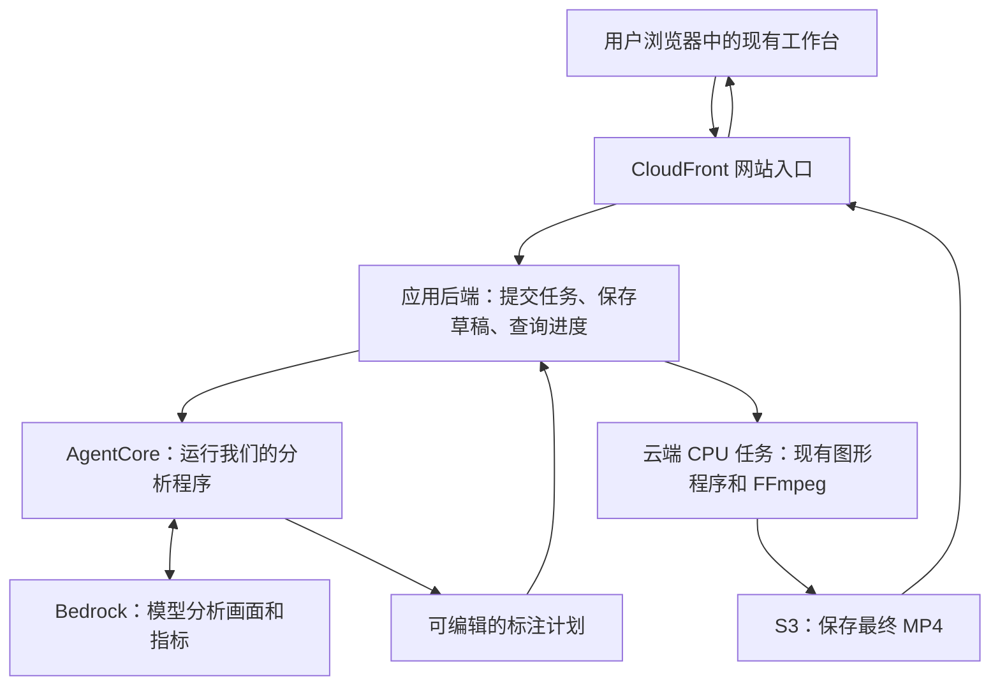

# 现有工作台如何部署到 AWS

核查日期：2026-10-05 22:03，Asia/Shanghai。本文解释已有工作台的云端迁移方式；架构为工程建议，未创建云资源，也不代表团队已确认选型。赛事约束见[Portal 核验](../../requirements/portal-access-20261005.md)，本机训练包实测见[素材核验](../../requirements/training-package-check-20261005.md)。

更新：2026-10-05 22:33，Asia/Shanghai。本队 S3 临时文本上传、读回及清理通过；Bedrock Qwen 的一次真实文本请求通过。以下仍是迁移说明，工作台应用尚未部署。测试范围见[AWS 环境记录](../../environment/aws/README.md)与[本轮交接](../../handoffs/Linzeyu912/2026-10-05-2233-s3-bedrock-connectivity.md)。

## 0. 从本机到云端，分别要做什么

用户询问云服务使用及部署操作，不构成“改成纯对话、禁止人工操作”的产品决定。这里保留现有工作台的交互方式，说明后台如何接云服务。

| 动作 | 放什么、放在哪里 | 本项目怎样操作 |
| --- | --- | --- |
| 推送代码 | 源码及版本放到私有 GitHub 仓库 | 继续按 main 协作流程同步；GitHub 推送本身不启动 AWS 程序。 |
| 上传素材 | 视频、已核实的数据文件放到本队 S3 桶 | 开发阶段用 AWS CLI 上传；接好应用后由网页上传接口处理。桶可以理解成云端文件容器，文件各有自己的对象键。 |
| 调用模型 | 程序向 Bedrock 发送问题、图像及所需数据，读取响应 | 把现有本机 Codex / 阿里云 provider 接口适配到 Bedrock；不把整个工作台上传给模型。S3 文件也不会自动触发模型分析。 |
| 部署 Agent | Agent 程序与依赖运行在 AgentCore Runtime | 打包、声明权限和运行入口，通过 CDK 部署，再验证真实任务调用。 |
| 部署网页和渲染任务 | 网页通过 CloudFront 访问；视频合成程序运行在云端计算服务 | 用 CDK 配置入口和计算资源，把现有视频渲染代码及依赖打包，成片写回 S3。计算服务选型尚未确定。 |

一段训练片的目标流程：上传原片到 S3 → 在工作台发起任务 → AgentCore 中的程序读取素材并调用 Bedrock → 生成经过校验的分析 / 标注计划 → 现有画布预览、调整 → 云端视频程序合成 MP4 → 写回 S3 → 浏览器通过 CloudFront 播放。模型负责分析；实际 MP4 由我们的渲染代码生成。此流程尚未完成端到端部署。

本机仍是开发和测试环境；应用部署完成后，使用者访问 CloudFront 地址，后台计算才可以脱离开发者电脑。开发者负责发布新代码，使用者负责发起任务及现有界面中的必要操作；Agent 自动执行哪些步骤由程序设计和赛事接口决定。

### AWS Core 与 Data Analytics 插件的作用

- **AWS Core 插件**向开发助手提供 Bedrock、AgentCore、CDK、容器、权限等操作指引。本会话可以结合已安装的 AWS CLI 和 `nba` 登录身份执行操作；插件本身不提供额外云额度或绕过比赛账号权限。插件名称里的 Core 与云服务 AgentCore 是两个不同概念。
- **AWS Data Analytics 插件**提供 Glue、Athena、Redshift、S3 Tables 等数据整理和查询能力。以后若要查询大量比赛、球员或回合指标，可以按需求使用；当前两段视频的首次部署不需要先搭建整套数据平台。它不会自动补出训练 ZIP 中缺失的官方指标。
- 部署依次推进：已完成基础接通测试 → 适配现有模型 / 存储接口并打包 → 编写 CDK 工程并检查变更 → 部署 AgentCore、网页和渲染任务 → 用一段官方训练片验收。基础接通成功不代表视频理解效果或应用上线验收成功。

## 1. 最终使用体验

用户打开一个 CloudFront 网站，选择视频，发起分析，查看并调整图形，生成、播放或下载成片。网页交互仍发生在用户浏览器中；分析、任务管理和最终视频生成由 AWS 上的程序承担。目标是开发者电脑关机后仍可完成新任务。

GitHub 保存源码和版本。代码已推送 GitHub，并不表示程序已在 AWS 运行；本轮未发现现有工程已经配置这条自动部署流程。部署需要打包依赖、准备云端运行环境、配置存储和权限，并把网页连接到后端。

### 作品提交入口与制作工作台

2026-10-06 补充：上面的上传、编辑、生成是应用使用与制作流程，不能直接当成评委必须执行的流程。本轮重新实读官方确认：人工评审通过 CloudFront 观看考试视频的完整作品成片，要求打开即可观看；机器评分从绑定的私有仓库拉代码重跑。事实、来源和仍缺的接口规范见[评审路径澄清](../../requirements/judging-operation-clarification-20261006.md)。

工程建议：同一作品网站优先展示已完成的考试成片、关键指标解释和数据来源，并提供清晰的播放与内容查看交互；保留“进入工作台”入口用于展示上传、分析、编辑与生成能力。提交地址可以指向网站内直接展示最终作品的页面。具体页面设计不是官方指定模板，也不能据此宣布仅播放器就已满足全部 UX / Web 交互要求。

验收应分开：第一条从外部浏览器检查最终作品无需制作操作即可播放、数据说明可查看且审核期间可用；第二条按已取得的官方契约检查工程重跑。当前尚未取得完整评测接口、输入输出与超时规范，不能声称机器验收已通过；原有新任务端到端检查仍用于验证应用功能。

## 2. 每个名字对应什么

| 名称 | 在本项目里的作用 |
| --- | --- |
| AWS CLI | 本机操作 AWS 的命令行工具；登录、检查账号和资源时使用。 |
| AWS CDK | 用代码描述应用需要哪些云资源，并部署这些资源。它是部署工具，安装完成不会自动上传工作台。 |
| AWS SDK | 写进应用里的开发库，让 Python / JavaScript 程序调用 AWS API。它和 CDK 是不同工具；本轮用户所指的上一条安装项按 CDK 执行。 |
| Amazon Bedrock | 调用托管 AI 模型的服务。程序把视频关键帧、已有指标和问题发给模型，取得解释和标注计划。模型计算由服务提供方承担，不需本队先申请 GPU 来运行大模型。 |
| Agent | 我们编写的处理程序：按任务查看证据、调用模型和工具、检查结果、生成可编辑初稿。 |
| AgentCore Runtime | 在 AWS 上运行上述 Agent 程序的托管环境。仍需提供自己的 Agent 代码和工具，不能仅安装 SDK 就获得完整应用。 |
| S3 | 保存输入视频、任务资料、草稿快照和最终 MP4 的云端文件存储。已有本队桶应核对后引用。 |
| CloudFront | 向浏览器分发网页、视频和其他内容的入口；计算任务由它后面的应用服务执行。 |
| CPU 渲染 | 用普通处理器把原视频帧、箭头、文字等合成并编码成 MP4。本项目现有正式渲染路径已经使用 CPU 编码。 |

“调用比赛账号允许的 Bedrock 模型”就是：用当前参赛身份让我们的程序调用赛事提供的模型接口，接收模型返回的分析结果。模型可调用性仍需真实小请求验证。现有阿里云 Qwen 接口和本机 Codex CLI 登录，不能只改一个模型名称就替换为 Bedrock。

“推理”在这里指让已经训练好的模型处理输入、给出回答，不是训练新模型。官方投篮难度、引力等数值必须来自可核对的数据源；模型负责解释和编排，不能凭空补官方指标。

## 3. 视频在哪里生成

建议的生产流程如下；这张图表达目标分工，尚未部署：

例如分析一段 21.55 秒的训练片：Agent 取得关键帧和真实指标，生成“什么时刻画什么”的结构化计划；用户可在原画布调整。点击生成成片后，渲染器逐帧画图并输出 MP4。Bedrock 在这个方案里生成分析和标注计划，MP4 由现有视频程序合成。

CPU 渲染与 Bedrock 推理是两项分开的工作。没有本队 GPU 配额不妨碍调用 Bedrock，也不妨碍用 CPU 编码视频，但不能据此保证原有 GPU 检测流程原样可运行，或保证云端处理速度。

## 4. 现有代码已具备什么，需要接什么

本轮 fetch 后，远端 main 为 `82a8257dd5bce2ba3dc671813dee43713b368192`，本地 HEAD 为 `b90f816af07fa5b1b3e64de19d672a2547942408`。两条远端增量是流程资料和快照，`engineering/scripts/`、`engineering/tools/` 没有代码差异；最新 005 V2 流程已通过 `git show origin/main:...` 阅读。工作区有其他未提交资料，且 `docs/status.md` 与远端重叠，本轮未强行拉取或暂存他人工作。

| 现有部分 | 核查到的行为 | 云端迁移工作 |
| --- | --- | --- |
| [工作台网页](../tools/player-review/README.md) | 已有视频操作、人工编辑、Agent 候选和成片入口 | 保留交互，连接云端 API 与视频地址。 |
| [Python 服务入口](../scripts/serve_player_review.py) | 使用 ThreadingHTTPServer，监听 127.0.0.1，部分写入请求校验本机 Host / Origin | 补正式服务入口、访问控制和可配置来源；不能仅删除来源检查再公开暴露。 |
| [战术 Agent](../scripts/tactics_agent.py) | 寻找本机 Codex CLI 并启动子进程 | 抽出模型调用和工具接口，接 Bedrock，把实际 Agent 放到 AgentCore。 |
| [Qwen provider](../tools/player-review/agents/qwen-provider.mjs) | 使用阿里云端点、QWEN_KEY、qwen3.8-max | 保留本地路径；云端另做 provider 适配及结果验证。 |
| [成片任务](../scripts/tactics_render.py) | PyAV 解码、Node/Sharp 绘图、FFmpeg libx264 编码，任务保存在本机目录 | 这条路径已有 CPU 编码；打包依赖，输入输出对接 S3，任务状态可恢复。当前正式成片命令使用 `-an`，不保留原音轨。 |
| [图形渲染进程](../tools/tactical-overlay/production-worker.mjs) | Sharp 依赖可能从本机 Codex 运行时目录回退查找 | 云端显式安装依赖和字体，去掉对某台电脑环境的依赖。 |
| [检测环境探针](../scripts/workbench_runtime.py)、[跟踪准备](../scripts/prepare_tracking_variants.py) | 当前路径明确要求可用 CUDA GPU | 新增并实测 CPU 路径，或为首版选取关键帧 / 已核对数据 / 人工校核流程；Bedrock 不是 YOLO 跟踪器的直接替代。 |
| [球场标定](../scripts/court_calibration.py) | 已有无 CUDA 时选 CPU 的分支 | 仍需确认权重、依赖、耗时和当前视频效果，不能由代码分支推导验收通过。 |
| 草稿、任务文件、素材路径 | 主要依赖本机目录 | 区分临时缓存与持久资料；用任务 ID、对象键和明确的保存接口接云存储。 |

无需重写整个工作台。主要改动集中在服务入口、模型接口、文件存储、任务执行和打包部署。已有曲线、暂停、预览、人工修订与成片逻辑可继续复用。

## 5. 建议如何实施部署

1. **保全并整合 main。** 整理当前未提交资料和远端两条文档提交，保留双方工作。当前 GitHub 没有开放 Issue，尚无可据此核对的部署任务负责人。
2. **打包现有应用。** 将 Python、Node、Sharp、FFmpeg、字体和所需权重明确装进可复现的运行包。容器可以理解为装好程序与依赖的运行包；本轮尚未新增 Dockerfile 或容器镜像。
3. **完成一段官方片的本机验证。** 直接使用已经找到的训练包；测 CPU 导入 / 渲染耗时，记录原视频 PTS。先保留现有画布和编辑体验；补齐真实指标来源与对应事件，不能把 005 风格样例当官方数据。
4. **接模型和 Agent。** 先做小型 Bedrock 请求，再把取帧、读指标、生成和校验候选的程序部署到 AgentCore。两段训练片都有音轨，是否保留原声需在产物流程中明确，不能沿用静音输出后声称音轨完整。
5. **编写 CDK 工程。** 建议放在 `engineering/infra/`。引用本队 S3，配置 AgentCore、网站入口、应用和渲染任务、权限与日志。2026-10-06 收到的[CDK 补充通知](../../requirements/cdk-deployment-notice-20261006.md)明确：主办方已完成 bootstrap，本队不要执行 `cdk bootstrap`；把 `"@aws-cdk/core:permissionsBoundary": { "name": "NBAHackathonParticipantBoundary" }` 合并到实际 `cdk.json` 的 `context`，保留其他配置。
6. **检查后部署。** 使用赛事 SSO 身份链，在实际工程目录执行 `cdk synth --profile nba`、`cdk diff --profile nba`，核对 Stack 目标区域 `us-east-1`、资源和权限，并检查生成的 IAM 角色均附带指定边界，再在实际部署授权范围内执行 `cdk deploy --profile nba`。边界不替代 S3 / Bedrock 等业务授权。CloudFront 是全球内容分发服务；应用资源按赛事区域要求配置。
7. **从外部浏览器验收。** 打开 CloudFront 链接，提交新任务、查看进度、修改初稿、生成并下载 MP4；验证过程中不依赖开发者本机服务，且不同任务、重启和失败重试不会覆盖草稿。

计算服务的初步候选是 ECS/Fargate：可运行装有 Python/Node/FFmpeg 的容器；Agent 单独在 AgentCore 运行。2026-10-06 晚间已在本队账号实际运行最小 Fargate 任务并部署调用 AgentCore，配额、结果及清理见[服务实测](../../environment/aws/services-live-audit-20261006.md)。这些结果尚未验证现有应用的依赖、视频处理性能或最终费用，也未构成团队选型。具体选择仍需一段真实视频的 CPU 耗时与内存测量。

## 6. 环境与素材前置条件

CLI、CDK、Node/npm、profile、登录身份及预置资源的当前状态统一维护在[AWS 环境准备](../../environment/aws/README.md)。安装过程保留在[22:03 交接](../../handoffs/Linzeyu912/2026-10-05-2203-cdk-workbench-cloud-guide.md)。

两段训练片的规格、2662 帧完整解码与指标文件缺失情况见[训练包核验](../../requirements/training-package-check-20261005.md)。本轮未修改工作台功能、调用 Bedrock、创建资源或上传原片。

## 7. 来源

以下 AWS 文档均于 2026-10-05 查阅；技术说明与本届赛事要求分开使用。

- [CDK 安装与配置](https://docs.aws.amazon.com/cdk/v2/guide/getting-started.html)
- [S3 文件、桶与访问方式](https://docs.aws.amazon.com/AmazonS3/latest/userguide/Welcome.html)（22:30 再次查阅）
- [Bedrock 服务概述](https://docs.aws.amazon.com/bedrock/latest/userguide/what-is-bedrock.html)
- [AgentCore 与 Runtime](https://docs.aws.amazon.com/bedrock-agentcore/latest/devguide/what-is-bedrock-agentcore.html)
- [CloudFront 内容分发](https://docs.aws.amazon.com/AmazonCloudFront/latest/DeveloperGuide/Introduction.html)
- [ECS/Fargate 运行容器](https://docs.aws.amazon.com/AmazonECS/latest/developerguide/AWS_Fargate.html)
