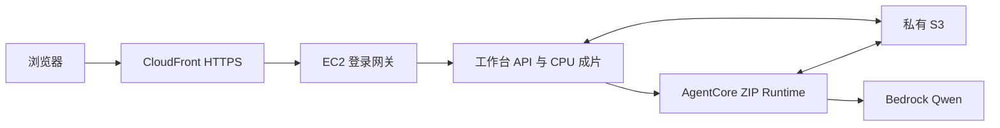

# 当前版本云端部署与 CloudFront 交互复验

日期：2026-10-07，Asia/Singapore（UTC+8）。范围来自本聊天用户：在现版本上拆分服务并部署，通过 CloudFront 打开页面、进行交互。沿用[首轮部署](ec2-code-deployment-plan-20261007.md)的原生 EC2、AgentCore ZIP、私有 S3 与 CloudFront，复用既有资源。

## 实际服务分工

| 服务 | 本轮职责与实际边界 |
| --- | --- |
| CloudFront | HTTPS 统一入口，经 VPC origin 到登录网关；页面、接口、视频均回 EC2，禁用共享缓存。静态前端没有独立搬到 S3。 |
| EC2 | 登录网关、现版本工作台前后端、视频读取与上传、草稿保存、候选校验、Python / Node / FFmpeg CPU 成片。 |
| AgentCore + Bedrock | 独立 Python ZIP Runtime，接收战术任务，通过 S3 交换输入输出并调用本队允许的 Qwen 视觉模型。 |
| S3 | 既有素材、不可变发布包、Agent 任务文件、草稿和成片的异步备份。主工作状态仍先写 EC2 EBS。 |



保留前端与 API 的同源相对 URL，当前状态与任务仍由单台 EC2 管理。CPU 渲染未拆成独立分布式 Worker；没有新建 SQS、GPU、容器或另一套应用栈。此前“静态资源可独立 S3 回源”仍是后续选项。

## 当前版本及更新保护

- 开工时本机 `main` 比远端少两条提交；选择性保存四份重叠文档后快进到 `9e18beed87e30fdaa2c8c1081c1ed19b89ce0e55`。两处进度文档冲突同时保留双方记录；恢复已有未提交文件，没有新建分支或 PR。开放 Issue 列表为空，任务范围按本聊天。
- 旧云端工作包与当前已有工程文件存在 57 处 SHA-256 差异，故发布完整前后端兼容包。当前包基于上述 main，加上工作区原有云端适配器与部署工程；不是纯 Git commit 的无修改快照。
- 新增 [更新打包器](../infra/ec2-workbench/update_release.py)：复用原部署配置和三段样例，纳入当前工程模块与依赖、两处已有回放 JSON；仅生成工作台包，不重建 AgentCore 或复制凭据。
- 初次更新包为 `20261007-224937-1aa0238f`。随后把页面实测发现的按钮修复纳入最终工作台包 `20261007-225910-a8c7860e`：366 个归档文件，7,053,024 字节；SHA-256 `1256e3e0a092f82eb7fe6041876bcd711886bb831e1ce080f2da4d2ba37e2ae4`。两个包均保留，未覆盖历史对象。
- 上传至原部署前缀内的新对象键，条件写入不覆盖历史包；S3 元数据与完整下载回读 SHA-256 一致。
- 远端先验证包摘要，停工作台及网关后备份用户目录、原代码和网关配置，再在既有 release 目录原位更新；保留 `cloud-library.json` 与 `/opt/hks/current` 指向。失败路径按备份完成阶段恢复代码，并保证尝试重启服务。
- SSM 更新成功；365 个文件写入（样例库保留原件），初次更新的 29 个既有用户文件逐一摘要不变；按钮修复包再次更新时共 42 个用户文件摘要不变；两个 systemd 服务均 active，启动后仍识别原 4 个素材入口（三样例加已有人工导入记录）。

工作台代码更新没有重跑初始化 UserData；随后为修复 Agent 启动，仅经 CDK 更新了 Runtime 的代码对象引用。将来重建 EC2 时，须显式使用本次工作台更新包与恢复方案；不能直接复用早期配置中的旧 `workbenchKey` 而声称恢复了当前版本。换机自动恢复仍未实现。

## 本轮验证

| 检查 | 实际结果 |
| --- | --- |
| 定向回归 | 网关 6、云适配器 3、战术 Agent 27、前端战术 191、更新打包器 3 项，合计 230 项通过；另有 Runtime 启动 2 项通过。前端测试运行于本机 Node 24；服务器 Node 22 的兼容性以实际云端成片另验。 |
| 发布闭包 | 366 个归档成员与 manifest 的长度 / SHA 一致；隔离解包真实启动，API 返回三样例；首页及回放依赖的 72 个 UI 资源（66 个 MJS）全部 HTTP 200。 |
| 云端版本 | `/api/cloud-state` 返回新发布标识；5 个关键页面模块 / 样式经 CloudFront 下载后与新包 SHA 一致。 |
| 视频 | CloudFront Range 请求返回 206，读取 1,024 字节及正确 Content-Range；网页实际播放 005 并定位 0.500 秒。 |
| 人工交互 | 在 `qa=1` 隔离草稿建画布、增加 0.500 秒讲解暂停（额外 2.5 秒）、绘制 0.500–3.500 秒路线、保存版本 1；独立 API 读回 1 图形和暂停配置。 |
| 保存恢复 | 刷新后画布恢复；另有独立服务端读回，未只用浏览器缓存判断保存成功。 |
| 访问边界 | 未登录访问 API 跳到登录页；已登录但 Origin 错误返回 403。 |
| S3 状态 | 更新后备份状态 `error=null`；版本 2 MP4 从 S3 完整下载后，与浏览器下载 SHA-256 完全一致。 |
| CPU MP4 | 从页面生成，自动保存版本 2；1920×1080、218 帧、7.266667 秒、静音。浏览器媒体 readyState 4，实际播放 / 下载成功；完整解码 218 帧。成片 3,914,566 字节，SHA-256 `425c7df2ff63dab0aebaf5c6fe1df517d21f3d745e22c1e6094b8a9435731ada`。 |
| AgentCore | 首轮真实任务初始化超过 30 秒；修复后已取得真实模型 JSON，启动超时不再出现。但两轮候选分别为空图形、参与者证据帧不合规，自动修复后仍被业务校验拒绝；未采用进草稿。 |

当前源代码仍有“本地 / 保存到本机”等文案；本轮云端页面对应的是 EC2 上的保存。上传网关单请求上限 220 MiB，界面原有 2 GB 文案不能用作云端承诺。本轮未重做大文件或并发压测。

## AgentCore 启动排查与更新

首轮页面任务及自动修复出现 `Runtime initialization time exceeded`。原 Runtime / DEFAULT 虽然 READY，不能替代真实调用；运行日志只有 session 终止消息，没有足够证据断言具体 SDK / 凭证错误。

原入口在 HTTP 监听前导入 boto3 并创建客户端。此次将导入与客户端创建移至首次有效请求、用缓存复用，让 `/ping` 的启动不依赖 SDK 初始化；增加不含输入 / 凭据的 `HTTP_READY`、`CLIENT_INIT start / ready` 阶段日志。保持 V1 平台、Python 3.12、HTTP 契约、IAM 权限和模型参数。

- 新 Agent ZIP：16,640,396 字节，SHA-256 `a5adea72ecd829c6905e4ba18d19755fc0d4f8cc81e9ef1e72060b38c953edce`；新对象上传 / 完整回读一致。
- CDK strict synth 通过，真实 changeset diff 仅 `AWS::BedrockAgentCore::Runtime.AgentRuntimeArtifact` 的 S3 对象键变化，没有资源替换。
- 核心栈更新成功；Runtime 版本 2、DEFAULT liveVersion 2 均 READY。EC2、CloudFront 和存储资源未替换。
- 第一次点击旧任务的失败段重试时，因为成片已自动保存为版本 2，来源校验正确拒绝将旧任务混入新草稿；随后从当前版本重新发起页面分析。
- 修复后真实日志出现 `HTTP_READY`，前两次 `CLIENT_INIT ready` 耗时分别为 0.642 / 0.849 秒；模型已返回合法 JSON，初始化超时没有再出现。这证明调用链路恢复，不证明候选可用。
- 当前阶段分析及自动修复返回 schemaVersion 4、一个阶段，但 annotations / actions / participants 均为空；页面以“Agent 未生成可用图形”拒绝。随后将目标缩小为单个持球人重点圈，两次均返回 1 个图形 / 2 个参与者，但第二个参与者 `evidenceFrames=[]`，低于 schema 的最少 1 项，故失败；不是视频帧号越界。
- 只读核对四份实际 schema 均含 `evidenceFrames` 的必填、1–40 项和非负整数规则；16 帧文字证据与 3 张附图都在分析区间内。适配器与 Runtime 完整传递 schema，未发现接口漏字段。此处是模型未遵守生成约束，没有修改校验。
- 页面保留人工草稿并提供“继续人工编辑”；已实际点击返回，原路线与讲解暂停仍在。未为得到成功结果而放宽校验、手工伪造模型输出或覆盖原稿。

## 已发现及未覆盖

- 已修复本轮发现的 Agent 按钮禁用问题：`saveAnnotation()` 在设置与解除 `editBusy` 时重算现有按钮条件。新增回归先在旧代码失败，再验证编辑 / 保存后恢复，同时任务正在生成时继续禁止重复提交。修复已发布；云端页面重新选择绘图工具后，生成与人工编辑按钮均为可用。未改动其他业务流程。
- 战术 Agent 走 AgentCore；身份 Agent、OCR、Qwen 地面轨迹 Agent、GPU 检测 / 跟踪的云端依赖和认证仍未接齐。服务器 `ubuntu` 的 Codex 登录不代表 `hks` 服务用户已经授权。
- 当前版本战术 Agent 的候选生成 / 采用闭环本轮未通过；模型内容质量、十人完整身份 / 轨迹精度、生产多用户、断点续跑、换机恢复和赛事评测接口未验收。早期版本的成功验收不能替代本次结果。
- 这次是现版本制作工作台的云端更新与复验；没有提交赛事作品或向组外共享。

## 证据、来源与复跑

原始证据保存在被忽略的 `tmp/cloud-refresh-20261007/`：`release-fixed/release-manifest.json`、`apply-fixed-result.json`、`cloud-verification.json`、`saved-current-draft.json`、`manual-decode.json`、`manual-cloud-result.mp4`、`manual-s3-result.mp4`、`runtime-fix/manifest.json`、隔离验证目录与浏览器证据。模型业务校验诊断在 `tmp/ec2-workbench-20261007/agent-diagnosis-business-validation.json`。资源 ID、网址、访问码和 Cookie 不写进共享记录；访问码仍在原部署的本机忽略目录。

从仓库根目录准备下次更新（输出目录须全新）：

```powershell
python engineering/infra/ec2-workbench/update_release.py --config tmp/<existing-deployment>/config.json --output tmp/<new-release> --upload
```

打包成功只表示包已生成 / 校验，不自动停止服务或应用到 EC2。应用前先检查运行中任务、验证包、备份并保留现有状态路径，再运行真实网页复验。

2026-10-07 实读 [CloudFront VPC origins 官方说明](https://docs.aws.amazon.com/AmazonCloudFront/latest/DeveloperGuide/private-content-vpc-origins.html)与 [AgentCore Python 直接代码部署](https://docs.aws.amazon.com/bedrock-agentcore/latest/devguide/runtime-get-started-code-deploy-python.html)；本轮分工是沿用已部署工程的实施选择，不据技术文档增加赛事要求。旧验收与限制见[首轮记录](ec2-cloud-interaction-acceptance-20261007.md)。

本轮云端更新已执行，Git 工程与记录仍是本地未提交 / 未推送状态；两者分别报告。23:10（UTC+8）通过 `git ls-remote` 核对，远端 main 仍与本机 HEAD `9e18bee` 一致，工作区修改保留。接续见[独立交接](../../handoffs/Linzeyu912/2026-10-07-2312-cloud-current-version.md)。
