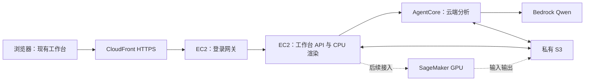

# EC2 直接代码部署：拆分、上传与网页交互验收

日期：2026-10-07，Asia/Singapore（UTC+8）。本聊天用户指定 AgentCore、CloudFront、S3、EC2，暂不使用自建容器，SageMaker GPU 作为后续可能接入项。用户进一步明确：今天要通过 CloudFront 打开现有前端，操作页面，验证云端各部分已拆分并串联。该范围替代此前本聊天的 ECS/Fargate 优先建议，不代表其他成员已表达共同决定。

执行结果：首轮真实部署与浏览器交互已完成，见[网页验收、产物校验与已知限制](ec2-cloud-interaction-acceptance-20261007.md)。下面的职责和边界保持有效；第 6 节为部署前采集的历史状态，不能再据此判断当前资源数量。

## 1. 首轮实际拆分

| 部分 | 上传内容 / 部署方式 | 负责什么 |
| --- | --- | --- |
| EC2 工作台 | `workbench.zip`，保留仓库相对目录；Linux 上安装 Python、Node、FFmpeg、Sharp 和字体，以 systemd 管理进程 | 提供现有网页与 API，视频解码、人工编辑、候选校验、CPU 合成 MP4 |
| AgentCore Runtime | `agent.zip`，Python 3.12 直接代码部署；HTTP `/ping` 与 `/invocations` | 从 S3 读取当前任务的提示、schema、画面，调用本队允许的 Bedrock Qwen，将 JSON 候选写回 S3 |
| S3 | 既有官方素材；本次不可变代码包与样例；任务证据、模型结果、工作台备份 | 跨服务交换文件，保存可校验的上传与生成产物 |
| CloudFront | 通过 CDK 配置分发和 EC2 VPC origin，无需上传一个“CloudFront 程序包” | HTTPS 统一网址；本轮网页、API、视频均回源 EC2，禁止缓存用户草稿、会话和 API 响应 |
| SageMaker（本轮不启动） | 后续上传 GPU 推理脚本、权重、依赖及输入引用 | 仅承接需要 CUDA 的检测 / 跟踪 / 场地模型；GPU 不影响本轮人工制作与 CPU 成片验收 |

本轮将网页和业务后端保留在一个 EC2 发布包内，复用现有相对 URL 和视频 Range 服务；这是最少修改的第一步。以后可将公开展示页或静态资源移到 S3 + CloudFront 的独立 behavior。现在不能把“前端放 S3”写成已经实现。



工作台继续执行现有候选 schema、来源绑定及人工采用规则。接上云端模型不表示篮球分析质量、自动标定或 GPU 功能全部通过。身份 Agent 和 Qwen 地面轨迹 Agent 的旧 provider 也不因本轮战术 Agent 适配而自动迁移。

## 2. 上传与目录

使用本队原有私有桶；不改官方训练素材对象，不上传 `.git`、凭据、用户配置、模型缓存、全部资料仓库或 Windows 虚拟环境。

```text
workbench/datasets/broadcastcode-training-20261005/  # 已有两段官方素材
workbench/deployments/<release>/
  release/workbench.zip
  release/agent.zip
  datasets/005.mp4
  agent-jobs/<request-id>/input.json
  agent-jobs/<request-id>/result.json
  workspace/data/local-workbench/...
  workspace/data/local-videos/...
  workspace/artifacts/cloud-imports/...
  workspace/artifacts/cloud-trims/...
```

EC2 下载发布包到 `/opt/hks/releases/<release>/`，`/opt/hks/current` 指向当前版本。包内仍用 `engineering/`、`data/`、`research/` 等相对路径，不复制开发者绝对路径。视频另从 S3 下载并对照 SHA-256；代码包记录文件级清单。AgentCore 使用独立的代码与依赖 ZIP，不带视频、Node 渲染器或 CUDA 权重。

首轮 S3 持久化是 **EC2 本地保存成功后，每 10 秒扫描并备份**，不是已经完成的 S3 原生存储层。备份状态可经登录后 `/api/cloud-state` 查询，必须等备份成功再验收；重启同一 EC2 使用 EBS 中的原草稿。换机恢复、正在生成任务的断点恢复和多用户写入仍需单独实现，不能据此宣称全部完成。

## 3. 网页和服务连接

1. 用户通过 CloudFront 的 HTTPS 页面输入临时测试访问码；网关签发 Secure、HttpOnly、SameSite 会话 Cookie。
2. 网关先检查准确的 CloudFront Host / Origin 和会话，再向回环工作台转发。既有后端保持监听 `127.0.0.1:8876`；不直接删除原有本机来源限制。
3. 页面继续使用已有 `/api/...` 与 `/video.mp4` 相对路径。任务 API、会话和草稿不作 CloudFront 共享缓存。
4. 现有“战术 Agent”任务通过 `CloudTacticsExecutor` 把输入写入 S3，EC2 角色签名调用 AgentCore。模型结果回 S3，EC2 读取后沿用原有 schema 校验、一次修复及人工采用过程。
5. 现有预览和导出按钮触发 EC2 的 Python / Node / FFmpeg；结果经现有视频接口播放，并同步到 S3。当前正式渲染仍为静音链路，音轨策略没有在本轮自动改变。

CloudFront 采用 VPC origin 私有回源。测试 EC2 保留公网出站能力以安装依赖、调用 AWS API；安全组不开放公网入站或 SSH。创建 VPC origin 后应将 8080 入站进一步限定为 CloudFront 服务管理安全组。现有默认子网情况、最终实际规则和可访问性以本次部署结果为准，不能将这个方案描述为已建好完整私有子网 / NAT 架构。

## 4. 今天的验收顺序

| 步骤 | 必须取得的证据 | 仅此项通过不能说明什么 |
| --- | --- | --- |
| 上传 | 对象大小 / SHA、部署包清单、官方输入 SHA 核对 | 不说明程序已启动 |
| 启动 | EC2 两个 systemd 服务正常、AgentCore Runtime 和默认端点 READY | 不说明网页交互成功 |
| CloudFront 前端 | HTTPS 登录页与现有工作台实际截图，脚本 / 样式加载成功 | 不说明保存 / 渲染 API 通过 |
| 视频交互 | 选择样例、播放 / 拖动、人工制作入口能使用 | 不说明 GPU 检测可用 |
| 保存与重读 | 创建图形、保存、刷新后读到对应版本 | 不说明 S3 已备份 |
| CPU 成片 | 点击生成、真实任务完成、播放 / 下载同一 MP4，解码与时长核对 | 不说明模型输出准确 |
| S3 备份 | 草稿和 MP4 对象存在且下载 SHA 与 EC2 结果一致 | 不说明换机恢复已实现 |
| AgentCore | 从界面发起任务；EC2 → S3 → AgentCore → Bedrock → S3 → 页面有真实响应；区分候选成功与校验失败 | 不以 HTTP 200 代替可采用候选或质量验收 |
| 访问隔离 | 未登录不可读写工作台；错误 Origin 被拒绝；EC2 不可从公网直连 | 不宣称完整多用户账号系统 |

GPU、OCR、身份 Agent 与地面轨迹 Agent 分别记录未接入状态，不把未测试按钮当已成功。完整赛事评测接口仍按官方后续规范适配。

## 5. 工程入口与发布

- [CDK 与部署文件](../infra/ec2-workbench/README.md)：`app.py`、`bootstrap.sh`、`prepare.py`、`gateway.py`、`agent_main.py`。
- [云端 Agent 适配器](../scripts/cloud_tactics_agent.py)：通过可选环境配置启用，本地默认仍使用已有 provider。
- `cdk synth --strict` → `cdk diff` → `cdk deploy`；引用主办方既有 bootstrap，所有新角色带 `NBAHackathonParticipantBoundary`，不执行 bootstrap。
- 代码包和测试参数各自版本化；桶名、资源 ID、临时访问码、运行日志放被忽略的 `tmp/`；共享报告只保存去标识化验证结果。
- 失败时保留日志与输入，不覆盖已有正式素材。测试资源是否保留和实际费用状态在完成记录中写清。

## 6. 本轮已核对的前置条件

2026-10-07：CLI 2.37.9 与 CDK 2.1144.0 可用，`nba` 身份实际为本队参赛角色；CDKToolkit 为 UPDATE_COMPLETE。AgentCore 与活动 / 停止中 EC2、SageMaker Notebook 查询为空。CloudFront CLI 的空输出不作为数量结论；最终以部署 API 和端到端访问验证为准。原有两段官方 S3 对象及本次发布材料另行实查。

Git HEAD、origin/main 与实际远端均为 `043d257bc86c3c442075d653e6ba29e3d84b07d2`，工作区已有其他任务未提交修改；开放 Issue 为空。本轮任务范围来自用户，不代分配队友负责人。AWS 插件要求重新认证，本轮使用已成功验证的本机 CLI / SDK。

## 7. 来源

以下 AWS 官方资料于 2026-10-07 查阅；赛事规则沿用仓库已保存的 10 月 6 日核验，没有将技术文档变成赛事新增要求。

- [AgentCore Python ZIP 部署](https://docs.aws.amazon.com/bedrock-agentcore/latest/devguide/runtime-get-started-code-deploy-python.html)：无需自建容器；Linux ARM64 依赖及 HTTP 入口要求。
- [AgentCore Node.js ZIP 部署](https://docs.aws.amazon.com/bedrock-agentcore/latest/devguide/runtime-get-started-code-deploy-node.html)：后续 Node Agent 也可直接代码部署；现有文件系统与工具依赖仍需适配。
- [AgentCore HTTP 契约](https://docs.aws.amazon.com/bedrock-agentcore/latest/devguide/runtime-http-protocol-contract.html)。
- [CloudFront VPC origin](https://docs.aws.amazon.com/AmazonCloudFront/latest/DeveloperGuide/private-content-vpc-origins.html)、[CloudFormation VPC origin](https://docs.aws.amazon.com/AWSCloudFormation/latest/TemplateReference/aws-resource-cloudfront-vpcorigin.html)。
- [SageMaker Notebook](https://docs.aws.amazon.com/sagemaker/latest/dg/nbi.html)：后续可先验证 GPU 脚本与权重，Notebook 不是已部署的生产推理端点。
- [赛事运行要求](../../requirements/aws-runtime-clarification-20261006.md)、[CDK 通知](../../requirements/cdk-deployment-notice-20261006.md)、[两条评审路径](../../requirements/judging-operation-clarification-20261006.md)。
