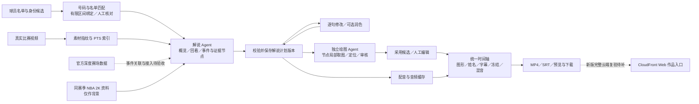
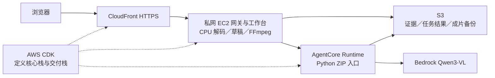

# CourtStory 决赛答辩：技术路线、演示结构与证据

整理：2026-10-10，Asia/Singapore（UTC+8）。09:05 初稿以 `main@0c219ae` 为基线；本次发布先核对 `53b1fc8`，随后同步 `7cd78d6`，纳入官方 001 成片、单屏工作台、TEAM25、Amazon Polly 代码、视频身份初稿和火箭比赛名单补强。后续实跑结果引自对应成员的验收文档，本轮未重跑云端或模型。本文按用户要求整理现有成果与答辩准备，不宣布新的团队选型、人员分工或部署完成。

官方依据见[决赛要求与交付核对表](../../requirements/finals-defense-requirements-20261010.md)。本页是团队答辩建议；其中的页数、演示安排、补证据顺序不是组委会新增规定。

用户于 2026-10-10 补充了八项推进工作，[第 13 节](#13-推进中的工作与更新位置)按最新可核对记录区分已实现、部分验收与待补项。TEAM25 已明确为参赛队伍标识并完成本地 UI 验收；其余条目只在已有证据覆盖的范围内更新。

## 1. 答辩主线

**CourtStory 的目标：把真实篮球回合中的数据和动作，制作成观众能看懂、制作人员能核对和修改的比赛解读。**

建议围绕“这次出手为什么形成、数据说明了什么、观众如何看懂”讲一个完整回合。先展示作品，再解释制作链路和技术取舍。最终作品必须接入可追溯的官方深度赛场数据；当前仓库尚缺这部分完成闭环的充分证据，不能用已有解说和图形能力替代这一要求。

当前最有依据的技术特点是：

1. **先确定讲什么，再决定画什么。** 解说 Agent 读取视频证据、形成事件和讲解节点；独立绘图 Agent 按保存的节点定位与绘图，避免两个阶段各自解释一次比赛。
2. **每段讲解关联实际画面。** 使用视频摘要、真实解码帧和 PTS（帧的显示时间戳）定位证据；身份、时间、引用及版本经过程序校验，保留未知和人工修正。
3. **图形、字幕、姓名与语音共用成片时间轴。** 同一源帧的讲解和图形共享冻结，按实际语音长度编排，避免各模块分别插入暂停导致错位。
4. **候选可审核、可编辑、可追溯。** 上游计划变化会使旧绘图失效；局部重试保留其他成果，文字及声音配置相同的语音可以缓存复用。

来源：[解说与联合成片](commentary-narration-workflow.md)、[已实施的分工设计](specs/2026-10-09-commentary-led-tactics-design.md)、[出手反馈](shot-feedback-agent.md)。

**最新可展示进展：官方 001 已生成 36.2 秒、1080p 的真实配音成片，姓名/号码、绘图与投篮反馈均进入 MP4。** 原片 21.5382 秒，四处讲解定格延长了成片；任务保留 `partial` 内容质量状态，仍有姓名 pending、身份冲突、字幕与记分牌重叠及节奏问题。完整解码和抽帧检查通过，不等于逐帧身份准确率或自然节奏验收。[001 实跑记录](official-astra-names-and-reliability-20261009.md)

此前 005 已通过修复后恢复的真实 Astra 理解、润色、四节点绘图/审核和 Seed TTS 联合成片，输出 1080p、24.6333 秒 MP4；原片为匿名人物、4.7667 秒短片。[005 实跑记录](full-commentary-astra-20261009.md) 两份历史成片都使用 Seed TTS。当前 `53b1fc8` 已将配音代码换为 Amazon Polly，60 项相关本地测试通过；尚无真实 Polly 合成与中文试听记录，不能把历史成片当作 Polly 验收。[配音切换交接](../../handoffs/chuali-zi/2026-10-09-2327-polly-tts.md)

## 2. 一张图讲清输入、处理和输出

下图描述当前产品逻辑及赛事所需的数据入口；虚线部分是待补齐或待验收项，不代表已完成。

球员检测和跟踪用于提供可核对的位置候选，不是“所有球员在所有帧都识别正确”的保证。完整球场映射也不是解说的前置条件。当前 `player-review` 已移除可见的 2D 轨迹核对流程，共享投影算法及旧稿仍保留；答辩不把完整轨迹复原列为主成果。[当前工作台范围](core-workbench-layout-20261009.md)

## 3. 分层技术路线与选型理由

| 层次 | 当前方法与输出 | 为什么这样做 | 应展示的证据 |
| --- | --- | --- | --- |
| 素材与时间 | PyAV/FFmpeg 解码；视频摘要、帧序号、真实 PTS；保留裁切来源关系 | 变帧率、裁切和冻结之后，不能只用“帧号÷标称帧率”连接所有模块 | 同一事件的原片帧、解说节点与成片时间 |
| 身份与位置 | YOLO/E-BARD 等检测跟踪候选；清晰号码/球队证据与比赛名单匹配；姓名和位置绑定分开 | 候选 trackId 不等于真实身份；遮挡和切镜后不盲目传播姓名 | 正确姓名示例、未知/冲突示例、有限区间绑定 |
| 视频理解 | Pi 工具循环：先看概览，再按需读取窗口、高清帧、裁图和已有观测 | 给模型补看证据的能力，控制请求、工具和时间预算 | `tool-calls.json` 与对应图像证据；一个“补看后修正”的真实例子 |
| 讲解计划 | 事件、cue、人物引用、证据节点、播放/暂停方式；逐句编辑与版本保存 | 先稳定叙事依据，再交给呈现模块；文字润色只改表达 | 保存前后版本、句子到节点的对应、旧候选失效 |
| 独立绘图 | 读取已保存节点的局部画面，生成原生图形并独立审核；支持采用、手改、重试 | 让内容判断与坐标绘制分开验收，限制重复分析和无依据扩写 | 出手者重点圈、传球/跑位示意与原画面对照 |
| 联合成片 | 配音、字幕、姓名和图形共用源帧到输出时间映射；按实测音长冻结；CPU 渲染 MP4 | 控制声画同步，保证预览与交付使用同一份结果 | 完整播放、关键帧截图、媒体解码和时间轴记录 |
| 云端交付 | 已有 CDK 定义的 EC2、AgentCore、S3、CloudFront 部署路径；新版链路需重新验收 | 按赛事承载和交付要求运行，并提供可复现入口 | 实际运行版本、调用记录、成片 URL 与仓库提交对应 |

这一层次划分是对现有工程的归纳，不意味着每层均已在当前赛事账号生产运行。算法与模型属于工具，答辩中要说明它们解决了哪个错误、用什么结果验证。

## 4. 两个 Agent 的边界

| 项目 | 解说 Agent | 独立绘图 Agent |
| --- | --- | --- |
| 输入 | 当前视频、实际读到的图像、有效人物快照、可用背景资料 | 保存版本的解说节点、人物引用、局部真实画面 |
| 负责 | 识别事件、组织讲解、给出证据与不确定性；确认出手时记录离手节点 | 按节点定位与绘制；输出可采用的原生标注，并进行图形审核 |
| 不负责 | 直接生成绘图坐标 | 改写解说、重新决定上游出手评价 |
| 交接 | 宿主校验并保存带 revision/digest 的计划 | 校验所依据计划仍有效，再采用到当前战术文档 |
| 失败处理 | 有界重试、保存已有草稿、保留未知 | 按节点重试；网络审核失败与明确审核驳回分开处理 |

当前网页解说路径默认配置为 OpenRouter 的 `openai/gpt-6-astra`；独立理解 CLI 还保留 Qwen Token Plan 路径。绘图默认继承保存计划的模型，可通过受信配置覆盖。**这些是当前工程的配置事实，不是官方指定模型或已确认的最终赛事运行方案。**

现有 AWS Runtime 则使用 Bedrock `qwen.qwen3-vl-235b-a22b`。两者 provider、模型和执行入口不同，不能把外部 API 实验结果直接写成 Bedrock 实测结果；也不能因为旧 Runtime 已创建，就声称新版解说、绘图、润色与配音均已在 AgentCore 运行。

代码依据：[解说调度](../scripts/commentary_jobs.py)、[理解入口](../scripts/commentary_agent.py)、[绘图配置](../scripts/commentary_drawing.py)、[绘图任务](../scripts/commentary_drawing_jobs.py)、[AgentCore 入口](../infra/ec2-workbench/agent_main.py)。

## 5. 实现深度：重点讲三个工程问题

### 5.1 把模型判断绑定到可核查证据

解说节点必须引用实际读取过的帧，宿主检查视频来源、范围及引用。身份模块把“这个人叫什么”和“这些帧的位置属于谁”分开，避免一次号码识别自动授权整条跟踪。人工确认优先，冲突与弱证据保留未知。

`7cd78d6` 将球员标定接到共用视频工具，先生成可人工修改的身份与有限姓名初稿，再由第三部分读取保存后的快照。真实旧任务有 1 段合法结果；对其首份模型方案离线重放新保存策略后保留 15 段、9 个 P 槽位，其中 13 段带名单姓名候选。该重放未追加模型调用，也未把原任务改写为 15 段；它证明初稿保留、编辑和衔接，不是身份准确率提升。[身份初稿与验收](video-identity-review-20261010.md)

可以展示姓名 v4 的同片对照：旧版 **2549/11153 = 22.85%**，新版 **10078/11027 = 91.39%**。指标是“有有效显示位置的球员帧记录中，能显示可采用姓名的比例”，是覆盖率，不是姓名准确率。新版排除不可靠合框后分母减少 126，不能把这部分当成新增证据。该结果来自一个经过定向复核的官方 001 样例，不能外推任意视频。

来源：[方法与限制](player-name-optimization-20261007.md)、[结构化覆盖对照](../../data/videos/demos/player-name-v4-20261008/coverage-comparison.json)、[共享完整回放](../../data/videos/demos/player-name-v4-20261008/README.md)。

### 5.2 避免多个模块使用不同版本

解说保存产生新版本；绘图、出手反馈及成片绑定该版本。改句子、节点、姓名或出手者后，旧依据须重新核对，不能直接混入新成片。人工改过的图形保留并提示核对，不被自动重试覆盖。逐句保存检测同句冲突，保留其他句子的未保存草稿。

这能解释“为什么不直接把大模型 JSON 画上去”：系统还承担引用验证、状态管理、人工修正和一致性控制。来源：[逐句编辑接口](commentary-cue-editing-api.md)、[整合与验证](../../handoffs/thy-0629/2026-10-10-0055-commentary-remote-integration.md)。

### 5.3 控制暂停之后的声画同步

源视频时间与成片时间分开记录。图形和解说位于同一源帧时只插入一次冻结，长度由图形展示需要和实际语音长度共同决定；字幕和姓名跟随同一映射。语音缓存校验文字、完整声音配置、音频摘要与格式，修改图形不重复合成，改单句只重做受影响语音。

出手反馈新规则读取出手前约一秒的实际画面，在确认的离手帧高亮出手者，冻结至少 2.5 秒，配音更长时延长同一次冻结。机会和压力各自分级，证据不足显示灰色未知。来源：[联合时间轴实现](../scripts/commentary_joint.py)、[联合渲染](../scripts/commentary_joint_render.py)、[出手功能与验收](shot-feedback-agent.md)。

## 6. 数据准确性：四种来源分别说明

| 数据类别 | 可支持的表达 | 不能替代什么 | 当前证据状态 |
| --- | --- | --- | --- |
| 官方深度赛场指标 | 以实际字段、单位和事件粒度解释这次出手或回合 | 不允许模型凭画面补造官方数值 | 已核实要求；本轮未找到官方指标导入、事件关联并叠加到考试成片的完整验收记录 |
| 比赛名单与公开统计 | 结合号码/球队证据核对姓名；提供有来源的比赛背景 | 名单存在不证明该人出现在每一帧 | 姓名 v4 单样例有共享回放；`7cd78d6` 补强 3 场火箭相关比赛名单，对应 36 个现存视频路径；79 行名单调用验证中，60 行出场返回唯一候选，19 行 DNP 排除，不代表图像识别准确率 |
| NBA 2K 同赛季能力 | 作为风格与能力背景，保留游戏版、来源及 null | 不能等同本次出手预期命中率、官方引力或实际防守强度 | 背景读取已接入，逐字段约束见出手反馈文档 |
| 视频观察与模型推断 | 描述可见动作，解释投篮机会/防守压力，注明推断和证据 | 绿黄红反馈不是官方 xFG、引力或胜率指标，也不是概率估计 | 005 与带姓名/2K 的 001 已有真实联合成片；001 保留局部质量缺口，泛化与自然节奏仍待验收 |

建议为最终演示事件准备一张**内部证据表**：来源 URL/采集时间、比赛与球员、官方原字段/原值/单位、事件与视频帧的对应依据、成片出现位置、人工核对结果。列名只是团队建议，不冒充官方评测 schema。选择能解释当前回合的实际可用指标，不为凑齐三类名称而补值。

火箭名单补强的来源、赛季、覆盖与缺失项见[比赛名单入口](../../data/player-rosters/README.md)。2024–25 当前没有火箭标签，已关联素材来自 2025–26 的 3 场比赛；这不是两季全部比赛覆盖，也不能替代官方深度指标接入。

## 7. AWS 架构：已有路径与当前缺口

已有部署工程的关系如下；它描述 10 月 7 日的实现与历史实测，不是对当前账号资源仍在线的确认。

| 组件 | 当前工程中的职责 | 答辩时应能出示 | 边界 |
| --- | --- | --- | --- |
| AgentCore | 承载已实现的云端战术候选 Runtime，读证据、调模型、回写结果 | 当前运行版本和真实请求结果 | 新版解说/独立绘图的完整智能体流程在此运行尚缺证据 |
| Bedrock | 现有云入口调用 Qwen3-VL | 实际模型、输入证据、有效输出、耗时和失败记录 | 不能拿外部模型运行记录冒充 |
| S3 | 已有素材/任务对象与成片、状态备份路径 | 成片回读摘要、素材来源、产物路径 | 备份不等于已经验证换机自动恢复 |
| EC2 | 当前原生 Python/Node 工作台、网关和 CPU 渲染 | 任务启动、保存、完整成片日志 | 这是当前配套计算选择；不是官方要求 Agent 必须在 EC2 |
| CloudFront | 当前工程经 VPC origin 回源，提供 HTTPS Web 入口 | 评委可访问页面、完整成片与交互 | 首轮配置关闭 CDN 缓存；不能声称已经完成缓存优化或并发扩展 |
| CDK | 核心栈与交付栈定义主站资源，新角色附赛事权限边界；SageMaker 独立栈复用既有角色 | 实际工程、synth/diff 与部署记录 | 已有代码不等于重置后当前环境已重新部署 |
| SageMaker GPU Notebook | 独立视觉开发环境，复用既有工作负载角色；两组跟踪各 30 帧与场地关键点已用 CUDA 实测 | 10 月 10 日去标识化环境报告、运行版本和设备信息 | 当日 09:33:46 已确认停机；尚未接入工作台远程调度，不是在线全链路验收 |
| Amazon Polly | `53b1fc8` 配音实现，默认 Zhiyu / neural / us-east-1；16 kHz 单声道 PCM 转 WAV | 代码、缓存隔离与模拟 SDK/测试音验证记录 | 真实中文合成、试听和云端权限部署待验收；不能沿用 Seed 成片证明 Polly 质量 |

代码：[CDK 栈](../infra/ec2-workbench/app.py)、[部署工程](../infra/ec2-workbench/README.md)。历史证据：[首轮云端交互](ec2-cloud-interaction-acceptance-20261007.md)、[后续版本复验](cloud-current-version-20261007.md)、[重置后恢复计划](plans/2026-10-08-cloud-reset-redeployment.md)。

后续版本云端复验中，人工编辑、保存、CPU 成片及 S3 回读通过；模型连接修复后能返回 JSON，但候选仍因空图形或证据不足被业务校验拒绝。因此不能只引用更早一次成功任务，宣称自动成片已稳定。也不能将服务可用性测试数量当作作品实际使用的服务数量。

Quick Start 鼓励有效、深入地使用 AWS 托管服务。答辩应解释现有服务如何协作以及 EC2 的用途。SageMaker 已有独立 GPU 小样实测，Polly 已完成代码替换；二者尚无新版在线联合任务的完整验收，Step Functions、SQS 也不能画成已上线主链路。历史真实配音实验使用火山 Seed TTS；外部 API 最终使用边界和赛事部署方式仍需核对。来源：[GPU 环境记录](../../environment/aws/gpu-openrouter-bootstrap-20261010.md)、[当前配音工作流](commentary-narration-workflow.md)。

## 8. 可使用的证据与不能越过的结论

以下产品与云端结果均来自仓库已有记录，本轮没有重跑模型或部署。本轮资料发布的本地工程检查另见[发布交接](../../handoffs/Linzeyu912/2026-10-10-1158-finals-gpu-publication.md)，不能与下表的历史产品测试混算。

| 证据 | 能证明什么 | 不能证明什么 |
| --- | --- | --- |
| 姓名 v4：单片 21.538 秒、10 个唯一姓名、覆盖 91.39% | 该复核样例的姓名显示覆盖与完整回放 | 独立准确率、任意比赛自动泛化 |
| 10 月 9 日解说表达实跑：三段视频、20 句真实 TTS、4 个成片 | 该版本的真实理解/润色、配音和字幕链路可工作 | 新版出手评价与联合绘图质量；梗卡必然优于仅指南 |
| 收尾新增 `da87412`：005 真实 Astra 理解/润色、四节点绘图与审核、4 句真实 Seed TTS、9 个图形；成片 24.6333 秒/1080p，739 帧及完整音轨解码、浏览器播至结束；18 项 Node/42 项 Python 通过 | 修复并恢复后的新版短片真实联合流程，包括一次出手高亮与机会/压力反馈 | 一次无错无人值守成功、姓名/2K 全链路、001 长片通过、自然节奏、官方指标或云端上线 |
| 官方 001 后续复跑：Astra 姓名识别、四节点采用 8 个图形、4 段真实 Seed TTS；36.2 秒/1080p、1,086 帧完整解码并人工看图 | 在保留局部质量缺口、阶段恢复与重试记录的情况下完成带姓名/号码和出手反馈的成片 | 任务全部质量通过、逐帧身份准确率、Polly 语音质量、任意视频泛化 |
| TEAM25 与单屏工作台已合入 main；发布回归及两档桌面、390 宽手机检查已有记录 | 固定顶栏图案、队伍标识与核心编辑操作同屏的已验收范围 | 所有设备或完整云端任务已验收 |
| `53b1fc8` Polly 替换：60 项相关本地检查，使用模拟 SDK 响应及测试音 | 请求、音频格式、缓存隔离、任务与渲染接口兼容 | 真实合成、中文听感或云端权限已生效 |
| 10 月 10 日 SageMaker：两组跟踪各 30 帧、48 点场地模型使用 CUDA；同机 Astra 固定文本请求成功 | 该环境与现有视觉代码兼容、文本 API 连通 | 完整视频精度、工作台远程调度、比赛画面理解或当前资源仍在线 |
| `7cd78d6` 身份初稿：真实任务、合法部分离线恢复、HTTP 采用/保存、人工保护和第三部分读取；火箭 3 场名单有来源与逐项校验 | 有限机器初稿可审核、修改、保存并被下游读取，已有素材有当场名单依据 | 真人身份准确率、最新版提示效果、完整浏览器验收或完整云端运行 |
| 10 月 10 日出手反馈：168 项 Python，849 项 Node 通过、1 项可选跳过；真实素材配测试输入输出 1080p 并完整解码 | 合同、保护规则、渲染和回归结果 | 测试音是真实配音；测试评价是模型正确判断 |
| UI 发布回归：852 项 Node 通过、1 项可选跳过，168 项 Python 通过 | 该发布版本的回归状态 | 所有后来提交仍已全量重测 |
| 布局版本 `2fc1edf`：117 个不同 Node 用例、33 项服务检查；005 静音成片 1080p/4.7667 秒/143 帧 | 该布局与制作入口衔接、真实渲染 | 真实模型/TTS 内容质量或当前云端部署 |
| 10 月 7 日云端后续复验：人工闭环通过，模型候选校验未通过 | 云端存取与人工成片路径及已知失败 | 新版全自动流程已在当前赛事环境稳定运行 |

证据入口：[姓名](player-name-optimization-20261007.md)、[解说表达实测](../../research/agents/commentary-personality-20261009/README.md)、[005 新版真实全流程](full-commentary-astra-20261009.md)、[001 后续复跑](official-astra-names-and-reliability-20261009.md)、[出手实施交接](../../handoffs/thy-0629/2026-10-10-0156-shot-feedback-agent.md)、[UI 发布](ui-publication-20261010.md)、[TEAM25](ui-team25-publication-20261010.md)、[单屏工作台](single-view-workbench-20261009.md)、[Polly 交接](../../handoffs/chuali-zi/2026-10-09-2327-polly-tts.md)、[GPU 记录](../../environment/aws/gpu-openrouter-bootstrap-20261010.md)、[云端复验](cloud-current-version-20261007.md)。不同日期、不同集合的测试数不能相加后称为同一次全量验收。

005 实跑曾修复图片元数据不可见、候选占位字段、匿名动作引用、多节点合并和 Windows 音频缓存路径等问题，再恢复有效候选并对一个节点重新生成/审核；不是一次无错误运行。001 初次因中断、连接错误和保存超时未完成，后续通过阶段恢复与重试生成了 36.2 秒成片，仍保留 n4 匿名投手无法定位、姓名 pending/冲突与节奏问题。早期失败和后续成功应一起展示。两份媒体和原始模型记录留在作者被忽略的本机目录，不会随本次 Git 同步自动取得；上台前必须实际取得并播放成片。

## 9. 按 5 分钟组织 7 页答辩

决赛权重：视觉与作品效果 40；架构 18；实现深度 18；数据准确性 15；讲解答辩 9。下列安排用 4 分 45 秒，预留 15 秒应对换页/播放；不把评委问答算进这 5 分钟，也不自行承诺问答时长。

| 页 | 时间 | 页面内容 | 可直接采用的讲述要点 | 主要得分项 |
| --- | --- | --- | --- | --- |
| 1｜把一次出手讲清楚 | 0:00–0:25 | 产品名、一个回合、观众要理解的问题 | “CourtStory 把视频中的动作、可核查的数据和讲解组织到同一画面，让观众看到这次机会是怎样形成的。” | 表达、作品 |
| 2｜先看完整效果 | 0:25–1:25 | 约 35–45 秒成片或完整短回合；其余时间指认关键变化 | 指出球员、一个真正对应本回合的官方指标、关键图形和一句解释。少切页面，让评委完整看懂一次进攻。 | 视觉 40、数据 15 |
| 3｜从输入到作品 | 1:25–2:00 | 第 2 节流程图的简版，已完成/待接入状态明确 | “先理解和保存事件节点，再按节点独立绘图，最后统一编排配音、字幕与图形。”说明官方数据在哪一步进入。 | 架构 18 |
| 4｜最难的不是画箭头 | 2:00–2:55 | 证据绑定、版本一致、统一时间轴三张小图 | 用一个前后对照讲清：目标错接怎样控制、改稿后旧图怎样失效、冻结为何不会把配音和画面错开。 | 深度 18 |
| 5｜每一个结论都能核对 | 2:55–3:40 | 一个真实事件的来源—字段—帧—成片证据；旁列单片覆盖结果 | 区分官方指标、名单、2K 背景和模型推断。91.39% 只称覆盖率；展示一处保留未知的情形。 | 数据 15、深度 18 |
| 6｜在 AWS 怎样跑起来 | 3:40–4:25 | 实际运行架构、提交版本、一次任务记录 | 按 AgentCore、Bedrock、S3、渲染、CloudFront 的职责说明协作；只使用最终实际部署证据。尚未接通处如实标注。 | 架构 18 |
| 7｜回到作品价值 | 4:25–4:45 | 回放关键结果、Web 入口和一句价值主张 | “我们把分析结果做成可以观看、核对和修改的比赛解读。”用已证实成果收尾，不新增没有演示的能力承诺。 | 视觉、表达 |
| 机动 | 4:45–5:00 | 不增加内容 | 留给播放器启动、换页或一句补充。 | 时间把控 |

**第 2、5、6 页存在必须补的真实材料。** 005 和后续 001 成片可以用于说明制作能力，但不能替代带官方指标的最终考试作品。官方指标闭环、最终考试成片、当前 AWS 新版运行证据未补齐前，这是一份可直接制作 PPT 的内容母稿，不是已经具备全部证据的最终答辩稿。UI、人工测试、火箭队数据和云端工作的新增结果，按[第 13 节](#13-推进中的工作与更新位置)补入对应页；沿用 5 分钟框架，以新证据替换旧材料。

建议主讲人串联叙事，其他成员按实际职责应答；本轮不指定人选。不要把安装软件、浏览过的论文数量或开发中的所有功能挤进 5 分钟。

## 10. 演示脚本与备份

建议演示仅覆盖一条完整路径：打开作品页 → 播放已生成成片 → 定位一次出手 → 查看该事件的数据来源和图形依据 → 展示一处可编辑结果。推理耗时用已有真实记录说明，不要求在 5 分钟讲解中临时等待整个模型任务。

准备材料清单（团队建议，不是官方格式要求）：

- 一段完整、能播、数据已核对的最终比赛成片；训练样例和考试作品清楚标注，不能混用。
- 一张流程图、一张实际 AWS 架构图；待接入项不画成实线完成链路。
- 一页数据证据、一页模型/程序/人工分工，说明缺失值和不确定性处理。
- 作品使用 AI 生成解说时，在说明或页面明确声明；视频和数据来源一并披露。
- 主演示入口、已验证的本地视频备份、导出 PDF/PPT；断网时说明播放的是预制结果。
- 同一次最终任务的输入版本、代码提交、模型/运行位置、处理时间、输出摘要与失败记录。只引用已测成本，不将单次 API usage 当作完整账单。
- 在实际演示设备检查声音、字幕、字号、视频编码、播放权限与外链；曾出现内置浏览器 MP4 有时长但画面空白，不能只凭播放器 readyState 判定可播。[已记录兼容问题](../../research/agents/commentary-personality-20261009/README.md)

## 11. 评委问答准备

| 可能问题 | 当前可据实回答的要点 |
| --- | --- |
| 和普通视频问答有什么区别？ | 除理解外，还把事件绑定到实际帧，生成可编辑的原生图形，处理版本依赖、时间映射及声画合成。拿具体例子说明这些控制解决了什么错误。 |
| 为什么分两个 Agent？ | 讲解决定内容和证据节点，绘图只落实视觉表达，便于独立审核与局部重试；不是为了增加 Agent 数量。 |
| 数据从哪里来？ | 官方指标须出示实际来源、字段和事件；姓名来自号码/球队证据与名单；2K 只是背景；机会/压力是视频推断。不能用后三者填补缺失的官方指标。 |
| 91.39% 是准确率吗？ | 不是，是一个样例的姓名位置覆盖率；没有独立逐帧真值准确率。分母变化和人工定向复核也要说明。 |
| 三色反馈能预测进球吗？ | 不能。它表示有图像证据支持的机会和压力等级，不是校准过的概率，也不是官方深度指标。 |
| 人工参与到什么程度？ | 当前允许核对姓名、改稿、采用/修改图形；自动输出先作为候选。最终演示需统计哪些步骤自动、哪些人工完成。机器重跑对人工步骤的要求待正式接口确认。 |
| 遮挡、模型幻觉或网络失败怎么办？ | 有限区间绑定、证据不足保留未知、预算与有限重试、检查点/局部重试；不把非法输出强行改成成功。实际云端候选曾被校验拒绝。 |
| 为什么使用 EC2？是否满足 AWS 要求？ | 当前 EC2 承担既有工作台与 CPU 视频处理；AgentCore、CloudFront、CDK 是硬性项，最终需展示它们实际承载的完整链路。EC2 的存在本身不证明 AgentCore 要求已满足。 |
| 为什么演示结果用了外部模型/TTS？ | 历史成片使用 OpenRouter/Qwen Token Plan/火山语音，与 Bedrock 路径分开。当前配音代码已换为 Polly，尚未真实合成试听；理解等其他模型未因此替换。最终外部服务边界及完整赛事部署仍待确认。 |
| 能实时运行吗？如何推广到更多视频？ | 当前是离线视频制作流程；005 和后续 001 已有成片，001 保留身份与局部绘图质量缺口，没有实时或跨比赛准确率验收。可复用工具、来源约束和编辑流程；吞吐、费用、更多长片与自然节奏仍需独立测试。 |

## 12. 答辩前优先补齐的证据

| 优先级 | 待完成事项 | 完成证据 | 当前状态 |
| --- | --- | --- | --- |
| P0 | 官方指标与指定视频关联并进入作品 | 至少一个实际事件的原始来源、字段/单位、身份/时间映射和最终画面可互相核对 | 本轮未找到完整验收；不能由三色反馈或 2K 替代 |
| P0 | 当前赛事环境的完整 Agent 链路 | 精确提交版本、CDK/运行版本、AgentCore 实际调用、有效候选、成片和 CloudFront 访问同属一次验收 | 仅有历史云端部分通过记录；新版尚缺 |
| P0 | 确认外部模型/TTS 的比赛使用边界 | 官方明确口径；最终实际 provider 与运行位置写入说明 | 不能从旧培训自行推导全面允许或全面禁止 |
| P0 | 考试成片与作品入口提交 | 指定考试素材、已核对完整成片、有效 Portal 提交和访问检查记录 | 本轮只整理文档，没有提交作品 |
| P0 | 官方机器评测契约与复现 | 入口、输入、输出路径、超时/重试、人工步骤及读取提交的明确约定；据此复跑 | 已读页面未取得完整契约 |
| P1 | 新版长片、姓名/2K 与自然节奏 | 在更多真实视频检查人物、事件、离手帧、图形、字幕、听感与成本/耗时 | 005、001 已有历史真实 Seed 成片；001 质量缺口、四次定格的自然节奏与新 Polly 真实配音仍待验收 |
| P1 | 完成 5 分钟彩排与最终文件提交 | 4:45 内容彩排；10 月 11 日 09:00 前最终 PPT/演示材料提交凭证 | 页序已整理，PPT 与提交待实际执行 |

这些优先级是本轮基于官方要求与已有证据给出的建议，没有分配队友职责，也没有将待办标为完成。后续补齐后，应更新相应证据与页内状态，保留本次基线和历史失败记录。

## 13. 推进中的工作与更新位置

### 13.1 用户确认的推进清单

来源：2026-10-10 用户补充的六项推进工作，以及“火箭队数据强化”“在界面上增加 team ID”。09:17 初稿将八项记为推进中；本次发布按 main `7cd78d6` 及其祖先的代码与验收记录更新如下。**W8 的静态参赛队伍标识已实现并验收；W1/W2 已有具体实现与本地验收，W7 已有名单补强证据，其余工作按已取得的部分证据记录。** 下表建议不属于组委会新增要求。

| 编号 | 正在推进的工作 | 预留填写的位置 | 建议保留的完成证据 | 更新到答辩哪里 |
| --- | --- | --- | --- | --- |
| W1 | 设计适配后端流程的 Tab 和交互按钮 | `d1192f2` 已实现球员、战术与解说单屏编辑；[单屏记录](single-view-workbench-20261009.md)含工具切换、实际绘图与保存检查 | 已有本地页面和交互证据；最终云端同版本全流程仍待补 | 第 3 节工程链路；第 9 节第 3 页；第 10 节演示路径 |
| W2 | UI 适配 | Broadcast Studio、TEAM25 与单屏布局已合入 main；[TEAM25 发布](ui-team25-publication-20261010.md)、[单屏验收](single-view-workbench-20261009.md) | 已有桌面与手机布局检查、截图及前端回归；最终演示设备仍需彩排 | 第 9 节第 2、7 页，以最终页面和作品效果替换旧截图 |
| W3 | 整体流程的人工测试 | 005 与 001 有真实模型/Seed 成片及失败恢复记录；单屏工作台有隔离交互和静音导出；新身份初稿有真实 API、编辑保护、保存和下游读取检查 | 历史成片与局部人工检查可引用；新身份初稿的完整浏览器验收、当前 Polly 版本的真实全流程和试听仍待补 | 第 8 节证据、第 10 节演示、第 11 节人工参与回答 |
| W4 | 成品仓库转移 | 来源仓库与提交；目标仓库与提交；迁移范围；赛事绑定仓库的交付对应关系：待补 | 目标文件清单、依赖/素材获取说明、从新副本启动与运行的记录；绑定关系核对结果 | 第 7 节交付、第 9 节第 6、7 页、第 10 节复现记录 |
| W5 | README 编写架构与作品亮点 | 本母稿和 TeamHub README 已提供技术路线、证据与入口；成品仓库 README 的最终架构/亮点仍待实查 | 图文与实际代码/演示一致；每个亮点指向验收记录；运行方法需在迁移副本复跑 | 第 1、2、7 节和第 9 节第 3、4、6、7 页 |
| W6 | 云端服务器部署与测试 | SageMaker GPU 环境及固定文本 Astra 请求已实测；Polly 代码已接入；[GPU 报告](../../environment/aws/gpu-openrouter-bootstrap-20261010.md)记录快照与停机时间 | 工作台远程 GPU 调度、新账号主站恢复、真实 Polly 与完整 AgentCore/CloudFront 链路仍待验收 | 第 7 节 AWS 路线、第 8 节证据、第 9 节第 6 页 |
| W7 | 火箭队数据强化 | `7cd78d6` 已补强 3 场 2025–26 火箭相关比赛名单，对应 36 个现存视频路径；[来源与验证](../../data/player-rosters/README.md)保留 personId、号码和出场/DNP 状态 | 79 行名单调用验证通过；2024–25 无现有火箭标签，图像身份准确率与官方深度指标闭环仍未证明 | 第 5、6 节数据依据、第 9 节第 5 页；只展示已验证覆盖 |
| W8 | 界面增加 team ID | 用户确认参赛队伍为 TEAM25；`58e3d15` 顶栏右侧 TEAM 白色、25 深蓝 `#1D428A`，字号层级与灰色线条图案已定稿 | [发布与截图](ui-team25-publication-20261010.md)已有本地验收；这是静态参赛队伍标识，不是比赛球队数据字段 | 第 1、7 页及交付信息 |

W1、W2 及 W8 的已审核实现和设计资料已按用户授权发布到 main。旧 `codex/courtstory-ui-broadcast` 已在确认内容完整保留后删除；后续引用 main 中的发布与验收记录，不再把该分支列作活动工作入口。

W4 的历史目标见[成品仓库记录](product-repository-proposal-20261007.md)：10 月 7 日记录指向私有仓库 `Linzeyu912/courtstory`，当时仅有简短 README。本轮未重新核验该仓库当前文件或绑定状态；迁移完成栏以后续实查填写。成品仓库和赛事绑定仓库分别记录，提交说明应能定位实际可运行的作品版本。

W7 当前证据限于现存素材与当场名单补强，以及有限姓名初稿的数据衔接；火箭队数据、名单、2K 背景和官方深度赛场指标沿用第 6 节的来源分类，不能互相替代。W8 的 TEAM25 来源为用户直接确认，不从 NBA 球队字段或比赛编号推导。

### 13.2 每项工作的更新模板

后续按 W1–W8 分别复制填写，或链接到已有实施/验收记录；不要求另建重复文档。没有结果的字段保留“待补”，已有部分结果时写明覆盖范围。

| 更新字段 | 预留内容 |
| --- | --- |
| 工作编号 / 最近更新 | W＿；日期、时区：待补 |
| 当前状态与范围 | 推进中；已做部分/剩余部分：待补；负责人由团队确认后填写 |
| 实现版本与环境 | 仓库、分支、提交、配置及本地/云端环境：待补 |
| 本次具体变化 | 改前问题、改后行为、相关实现记录：待补 |
| 验收结果 | 素材/步骤、预期/实际结果、通过/失败、人工介入、复测结果：待补 |
| 展示证据 | 截图、录屏、成片、日志或共享文件的相对路径/可访问链接：待补 |
| 可写入的亮点 | 已有证据支持的一句话结论及对应答辩页：待补 |
| 剩余问题与改进空间 | 尚未覆盖的场景、已知问题、下一次改进及验证方式：待补 |

状态按“推进中 → 待验收 → 已验收”更新，并注明验收环境。完成本地测试、完成云端测试、材料已同步和赛事已提交分别记录；各状态只在取得相应证据后填写。补入新结果时保留日期与版本，对早期失败补充后续修复结论，不删除历史事实。

### 13.3 README 与答辩材料的补充位置

成品 README 按用户本轮提出的“架构与作品亮点”预留以下内容；本页只准备素材结构，实际 README 以成品仓库对应版本更新：

| README 内容 | 可复用的现有材料 | 后续需要填入 |
| --- | --- | --- |
| 产品定位与最终效果 | 第 1 节产品主线、第 9 节第 2 页 | 最终作品截图/视频与已验证的入口 |
| 架构与制作流程 | 第 2、3、4、7 节 | 最终 Tab 与后端流程的对应关系、实际部署服务和提交版本 |
| 作品亮点与证据 | 第 5、8 节 | 每项亮点的具体变化、真实样例和验收范围；火箭队数据与 UI 效果验证后再补入 |
| 本地与云端运行 | 现有工程/部署文档 | 迁移后的真实目录、依赖、配置项和经过复跑的启动方法 |
| 数据来源与标识 | 第 6 节及 W7、W8 | 火箭队数据来源/范围、TEAM25 参赛队伍标识、AI 解说与素材来源声明 |
| 已知限制与版本记录 | 第 8、12 节及各工作更新记录 | 未通过场景、改进方向、代码与演示版本对应关系 |

答辩仍保持第 9 节的 7 页、5 分钟安排。W1/W2/W8 已有的验收材料可进入流程、页面和队伍信息；W3 的历史成片需注明版本与质量边界。W7 后续结果用于数据说明，W4/W5/W6 取得新证据后更新仓库、架构和运行记录。新增内容替换对应页的占位材料，细节放入附录或 README；有证据支持的成果进入主讲，推进中的工作保留明确状态。
