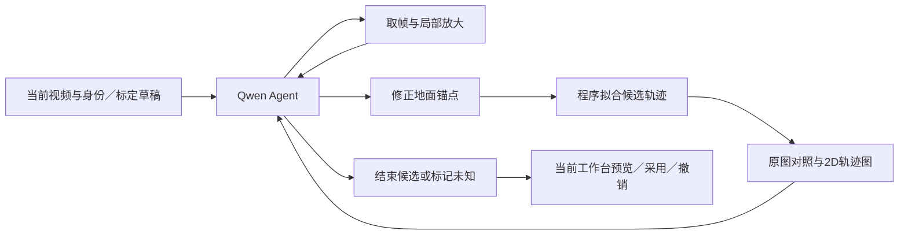

# Qwen3.8-Max 地面轨迹 Agent 首版实施计划

实施更新（2026-10-05，Etc/UTC）：用户随后明确授权开始代码实现并要求多子 Agent 协作，真实测试留给本地。首版已实现 Pi／Qwen worker、帧与绘图工具、地面拟合、有序准备重放、后台任务及现有工作台接入；基本语法和构建检查通过。运行方法、首版限制及尚未验收的真实链路见[实现指南](../qwen-ground-trajectory-agent.md)。下文“尚未实现”指制定／发布计划时的历史状态；不表示真实模型效果已验证。

日期：2026-10-05，Etc/UTC。状态：按用户要求整理可审阅的实现方案；本任务尚未实现 Qwen 功能、调用 Qwen 或完成视频效果试验。初稿核查基线为 `main@572594030abf23f684c8608b67e5af5f01a0d2f7`；发布前同步远端新增 `0bda1e9` / `6d914d7` 后，实施接入基线更新为 `6d914d75292ba218108404dec345f1c80a70fd0b`。

发布前补充核查：远端已实现独立 2D 准备、可采用区间平滑、IndexedDB 与服务端准备快照、导出 / 战术读取 preparedByPlayer。本计划据此改为扩展现有 courtPreparation，不再建设并行的 groundTrajectory 主存储。下文现状以本次更新为准；历史研究 / 交接中的“只有显示平滑”和“完整 2D 工作流尚未实现”保留当时事实。新能力的真实视频 / 模型验收仍有待办，见[现有工作流指南](../2d-first-tactics-workbench-guide.md)。本次用户授权发布的是准备、讨论与计划，不是开始实现 Qwen 功能。

前置讨论和固定源码依据见[轨迹 Agent 研究](../../research/qwen-video-trajectory-agent-20261005.md)、[固定来源](../../research/qwen-video-trajectory-agent-20261005-sources.json)。本计划只扩展该讨论中的地面轨迹闭环，复用已合入的[完整 2D 工作流](2026-10-05-2d-first-tactics-workbench-plan.md)，不重新执行整个改造。

## 1. 本版交付目标

在**现有球员检查工作台**选择球员和时间范围，点击“Qwen 修正 2D 轨迹”，后台 Agent 反复查看原视频帧、球员局部图和候选 2D 轨迹，提出地面位置锚点、生成连续曲线、查看修改后的图，再按需要补帧和改点。用户可以预览、采用、撤销；采用后的工作台 2D、轨迹备份、战术路径使用同一份有效坐标。

首轮真实实验针对约 10 秒视频、两名身份较稳定的球员。任务接口和数据结构支持多个 P 槽位；先逐人修正，保留其他球员作为相对位置参照。十人整段批处理在首版单人闭环验收后扩展，不能把两人实验结果写成全场有效。

2D 坐标表示球员的**水平地面位置估计**。起跳期间可以继续水平移动；脚离地后不再将空中脚点直接当作地面观测，也不将整段跳跃简单冻结。首版保留模型使用的“该观测是否能代表地面位置”和支持帧作为轨迹来源信息。跳跃、投篮、掩护等动作事件的自动识别、分类、时间轴和统计留到后续，不新增这类 UI 或事件模块。

首版的模型职责是取证和修正位置关系；曲线由可重复的程序生成，前端负责画图。Qwen 不直接输出一张替代轨迹数据的示意图片。

## 2. 对现有代码的核查及接入决定

| 已有能力 / 文件 | 核查结果 | 本版接入方式 |
|---|---|---|
| `engineering/tools/player-review/trajectory.mjs` | `buildTrajectories` 整理 P 的图像观测；`exportReview` 输出 `courtTrajectory` | 图像观测保留；增加有效 2D 轨迹及原始投影的来源记录 |
| `ground-position.mjs` | 人工点、姿态双踝、框底中心逐级选点；双踝不是已确认接地 | 作为待核对的定位证据，不直接当作真实地面真值 |
| `court.mjs` | `buildCourtTrajectories` 将地面候选经 H 映射；人工 `courtAnchors` 优先 | 保持原始构建入口；模型结果写入准备层，不污染原始投影和准备重放输入 |
| `court-preparation.mjs` / `court-smoothing.mjs` | 新远端已有 rawByPlayer / preparedByPlayer、依赖摘要、修订和可采用区间平滑 | 扩展准备契约和操作重放，Qwen 修正进入 preparedByPlayer；人工锁点保持优先 |
| `court-preparation-ui.mjs` / `court_preparation_store.py` | 已有预览 / 采用 / IndexedDB / 服务端不可变历史；保存会按原来源重放现有算法 | 复用 UI 和存储，加模型操作类型及可信候选来源校验；不允许客户端任意覆写 prepared 点 |
| `workspace.mjs` / `workbench-shell.mjs` | 已有数据核对区、2D 抽屉和播放器 | 在当前“2D 核对 / 数据处理”区域加工具和候选预览，不新增工作台、页面或导航体系 |
| `app.mjs` | `change`、历史栈、`saveDraft`、`sessionRevision` 支持采用 / 撤销；courtPreparation 单独写入 IndexedDB | 采用作为一次 `change`；预览只使用候选副本，不修改当前草稿，不把大点列放进 localStorage |
| `identity-agent-client.mjs` | 已有异步任务、轮询、取消、迟返和草稿变化检查 | 复用交互模式；新任务独立，不挪用身份识别候选结构 |
| `serve_player_review.py` / `identity_agent.py` / `tactics_agent.py` | 已有本地任务入口、来源校验、后台执行 | 新增同模式的 `ground-trajectory-agent` 任务路由和执行器 |
| `tactical_workbench.py` | PyAV 精确解码，检查 SHA / 帧时间 / 尺寸，返回 PTS、JPEG；每次最多 40 帧 | 复用抽帧与缓存能力；工具的小批量请求不另建解码器 |
| `tactical-overlay/validation.mjs` / `geometry.mjs` | source 有白名单；新版 observedPoint 优先读取有效 courtPreparation，无准备时重投影 | 扩展模型来源和待复核属性，复用 prepared 坐标通路，并测试它与保存 / 导出一致 |
| `player-review/court-trails.mjs` | 可用轨迹 source 有限制 | 支持有效派生轨迹，不改变临时 T 候选的含义 |
| `tactics-ui.mjs` | `syncSnapshot` 通过 reviewDigest 更新来源快照 | 采用 / 撤销后沿用该同步机制；关联图形按现有失效规则重新核对 |

当前 NBA 坐标系来自 `COURT`：28.6512 × 15.24 米，原点 `left_baseline_far_sideline`。模型提示、拟合器、图例、导出都直接引用同一模板，不另造归一化坐标或翻转左右半场。

## 3. 技术路线和执行闭环



### 3.1 Agent 框架和模型接口

- 使用 Pi 的轻量 `@earendil-works/pi-agent-core` 和 `@earendil-works/pi-ai`，不运行完整 coding agent CLI。已核查官方源码提交 `b2b5c42f6138b73ec4b2f49ec0ca468800f88586`；2026-10-05 也通过 npm 查询核实两个包均有 `1.0.2`，最低 Node `22.19.0`。实现时固定 `1.0.2` 和 lockfile，并核对发布包与所研究源码的相关接口。
- 使用 Pi 的 Agent 消息循环、工具执行、图片结果回传、流式事件和取消能力；不开放 bash、任意文件编辑或联网搜索。Codex / OpenCode 作为协议与工作模式参考，不同时部署三个框架。
- 模型 ID 默认 `qwen3.8-max`，由后端自定义 OpenAI Chat Completions 模型配置接入。图片通过 `image_url` Base64 Data URL 传入；本版先用可控帧序列和拼图，不依赖原生视频附件的抽帧策略。
- `QWEN_KEY` 仅在后端读取。默认 Base URL 为北京地域官方兼容地址 `https://dashscope.aliyuncs.com/compatible-mode/v1`。阿里云当前建议业务空间专属域名，并明确现有域名仍能使用；若已有工作区地址，允许后端 `QWEN_BASE_URL` 配置 `https://{WorkspaceId}.cn-beijing.maas.aliyuncs.com/compatible-mode/v1`。真实试跑先检查模型、密钥和地域是否匹配；不默默改模型或跨地域重试。
- SDK 的工具图片转换是否被阿里云实际接受，必须先用真实 API 烟测确认：文本调用 → 带真实视频帧调用 → Function Calling → 工具返回图片后模型继续读图。文档支持与本地模拟不等于这一步已通过。

### 3.2 后台运行方式

现有 Python 服务拥有视频、clip、任务和来源上下文。新增 Python 任务执行器启动一个受限 Node ESM worker；Node worker 运行 Pi + Qwen，通过 JSONL 双向 RPC 请求 Python 抽帧 / 读缓存，调用共享 JavaScript 拟合与渲染模块。stdout 专用于协议，普通日志用 stderr；图片实际传回模型，不能只在工具文本里写本机文件路径。

任务依次执行修改，避免同一候选被多个工具同时写入。取消同时中止模型请求与 worker；每次修改保存候选版本和证据引用。网络失败可有限重试读取请求，修改操作带 operationId 保证幂等。服务重启后未完成任务显示为中断；保留已完成的候选和复现材料，不承诺首版自动恢复完整模型会话。

### 3.3 如何提供视觉上下文

1. 初次读取约 12 个覆盖全段的真实时间点，含首尾帧，生成两张带 `frame / time / sourceTime / P 标识` 的时间拼图。全局图保留球场和其他球员，不只裁人物框。
2. 同时提供原始 2D 轨迹图、当前标定控制点、可用映射区间、人工锚点、身份连续区间、未知 / 遮挡区间及已有脚点候选。
3. 模型可针对疑问追加连续帧，初始建议间隔 0.1–0.2 秒，也可选择更细的有效源帧；关键脚部和落地区域取原分辨率 crop，避免缩略拼图中的脚点过小。
4. 每张图的 tile / crop 元数据保存原始图像尺寸、裁剪原点和缩放比例。若使用像素指点，先换回源图坐标；本版位置写入工具统一要求 NBA 米制坐标，避免把拼图坐标当作球场坐标。
5. 使用源 PTS 和 clip 的实际时间记录，禁止按 `frame / fps` 替代时间轴。样片第一帧 time=0.12，并不是零起点。
6. 上下文保留任务目标、人工硬约束、当前候选、证据索引和最新对照图。旧的重复图片可移出消息正文，按 frame / asset ID 重新读取；不能丢掉位置锚点和时间关系。

## 4. 首版 Agent 工具

| 工具 | 输入 / 输出 | 作用和边界 |
|---|---|---|
| `get_context` | 返回目标 P、范围、时间映射、身份段、球场模板、人工锚点、原始投影、未知段 | 初始及必要时刷新候选上下文；不改变身份 |
| `inspect_frames` | 帧列表、目标 P、全景 / crop 请求；返回真实图片和源时间、crop 元数据 | 主动补看动作前后、遮挡、镜头运动；单次小批量，按来源绑定缓存 |
| `inspect_trajectory` | 候选版本、范围；返回原始 / 当前候选的 2D 对照图、编号点、位移信息 | 发现跳点、漂移、转向及断段，指标仅提示疑点 |
| `set_ground_anchors` | 候选版本、P、frame、米制 x/y、证据帧、定位依据及不确定性说明 | 新增 / 更新模型锚点；不能改人工锚点、身份、视频或标定 |
| `set_unknown_ranges` | P、范围、原因、支持帧 | 无法定位就留空；短遮挡桥接需显式提出并标记估计 |
| `fit_and_render` | 锚点集、候选版本、分段 / 转向约束 | 输出逐帧候选、2D 对照和选定帧的地面反投影，返回新版本与真实图片 |
| `finish_candidate` | 最新候选版本、已处理 / 未处理范围、关键支持帧 | 结束并交给用户预览；预算结束的部分结果明确显示“未完成” |

每次改点后可以重新拟合、查看新图，再继续取帧或改点。结束候选前至少读过当前版本的绘制反馈；修改后旧版本的图不能充当最新结果反馈。这是任务状态与证据一致性的检查，不是再调用另一个模型充当固定二次审核门禁。循环次数由问题决定。

默认开发预算建议：最多 12 次模型请求、64 个不同源帧、每次工具图像回复不超过 8 张，任务总时限 5 分钟；均允许后端配置。它们是防止无休止处理的资源上限，不是预期耗时 / 成本承诺。记录实际 usage、轮数、工具调用、重复读取、独立帧数和时延。

## 5. 修正地面轨迹和曲线生成

### 5.1 Qwen 判断的内容

模型结合全景位置、场地线、身体姿态、镜头运动和前后帧，判断原始地面观测是否可信，并给出需要修正的锚点。重点区分：

- 像素上移主要由离地造成，还是沿球场真实移动；
- 球员起跳前后存在真实水平位移，不能因“跳跃”一律停住；
- 多个球员共同漂移是否来自相机或场地映射误差；
- 跑动、急停、折返是否被局部平滑错误压平；
- 遮挡后是否仍是同一人。身份有矛盾则返回待处理区间，不擅自重绑 P/T。

模型不能从证据不足的单目图像恢复唯一真实位置。它可以给出明确标记的估计和需补证据位置；UI 与导出保留这一性质。来源为模型的点不能自动变成“人工已确认”。

### 5.2 程序拟合的内容

- 每个连续身份 / 镜头段独立拟合，以原始米制轨迹为初始参考、模型修正锚点为更新依据、人工球场锚点为硬约束。
- 初版用按时间参数化的**保形分段三次 Hermite 插值**生成逐帧坐标；两点段线性插值。只在有支持锚点的区间生成曲线，不向整段未知区外推。转向 / 急停点作为分段节点，必要时允许速度不连续；不能为追求“光滑”消除真实拐点。
- 明确静止段保持稳定；起跳但有水平移动的段根据起跳前、落地后及中间可见水平证据补充锚点，生成平面移动曲线。两端证据不足时保留未知。
- 范围首尾保留可用的原位置 / 人工约束，衔接不到已有轨迹则断开并显示边界，不硬拉一条线。
- 切镜、身份冲突、显式镜头外、未知段默认断开。短遮挡只有明确的支持帧与模型估计记录才能桥接，仍标为估计。
- 不默认把所有点裁到场内：越界可能是真实边线外站位，也可能映射错误。显示并返给 Agent 核查；仅拒绝非有限数值和明显不可用的数值范围，不制造沿边线贴墙的轨迹。
- 高速 / 高加速度用于提示重新查看，不作为速度硬限幅器或正确性判定。计算使用实际时间间隔。

反投影图帮助检查候选地面位置与场地相对关系，不要求起跳时球场点恰好贴到空中脚上；以此作为唯一指标会把错误重新引入。

## 6. 数据版本、采用和一致性

### 6.1 拟新增草稿结构

复用现有 `session.courtPreparation` 和其 schemaVersion / revision / rawByPlayer / preparedByPlayer / dependencies。拟增加可选的 `refinement` 元数据和有序 `operations` 记录；旧准备没有新增字段时沿用现有 smoothingPatches 重放路径。结构草案：

```javascript
courtPreparation: {
  // 现有 schemaVersion、revision、dependencies、frameMapping、maps 等保留
  rawByPlayer, preparedByPlayer, smoothingPatches,
  operations: [/* 按采用顺序记录原平滑和 qwen_ground_fit 操作 */],
  refinement: {
    schemaVersion: 1,
    versions: [{
    id, jobId, parentId, createdAt,
    model: 'qwen3.8-max',
    sourceBinding: {
      videoSha256, trackingFingerprint, trackingRevision,
      frameMappingDigest, sourceSessionDigest, courtTemplate
    },
    scope: { entityIds, startFrame, endFrame },
    anchors, unknownRanges,
    entities: { P1: { points, segments } },
    evidence: { assetIds, frames, revisionFeedbackIds },
    fit: { method: 'shape_preserving_hermite_v1', parameters },
    completion: 'complete' // 或 partial
    }],
    activeSelections: [{ entityId, startFrame, endFrame, versionId }]
  }
}
```

refinement / operations 是待实现的准备契约扩展；现有准备存储已经存在。`points` 保存实际逐帧 `frame,time,x,y`，并带 `source:'qwen_refined'`、`versionId`、支持帧和 `reviewRequired:true`。细粒度轨迹依据用于定位，例如 `groundObservationUsable` 和 `groundEstimationBasis`；不会自动写入 entity.events。图片资产、完整对话和成本日志放在被忽略的实验 / 任务目录，草稿只保存引用及必要的可追溯摘要。

服务端目前以 buildCourtPreparation + replayCourtSmoothing 重建并严格比较准备结果，不能直接保存模型生成的任意逐帧点列。本版须扩展共享重放函数：按 operations 顺序重放平滑 / 模型锚点拟合；模型操作绑定后端已生成且经采用的候选摘要，使用相同拟合器重算逐帧点并比较。维持 rawByPlayer 不可改写、锁点不变、expectedVersion 和不可变历史校验。旧稿的 smoothingPatches 迁移成等价有序平滑操作，禁止先统一平滑再统一修正而改变实际采用顺序。

### 6.2 有效坐标的优先级

1. 身份冲突、镜头外、用户明确排除的位置仍为不可用。
2. 有效人工球场锚点优先；拟合必须经过该点。
3. 来源绑定有效、用户已采用、覆盖当前帧的 Qwen 派生版本。
4. 原始 groundImagePoint → H 投影。

候选预览使用独立副本，原始观测与原始投影始终可查。导出沿用 courtPreparation.rawByPlayer / preparedByPlayer 和 entity.courtTrajectory，coordinatePolicy 增加所用模型版本和拟合方法，不再增加第二套有效轨迹容器。现有 `metricAccuracyValidated:false` 不因采用模型结果改成 true。

来源摘要包括视频 SHA、跟踪版本、全部相关 P 身份依赖、真实时间映射、切镜 / 直播范围、画面状态、人工图像 / 球场点、脚点选择和标定。派生版本自身和 UI 显示开关不参与 sourceSessionDigest，防止“采用后把自己判为过期”。工程上可先采用保守的全几何摘要，名字等展示字段不触发失效。

修改身份、标定或人工位置后，受影响版本显示过期并回退原投影；不悄悄重用旧估计。剪辑 / 换跟踪版本不迁移旧派生坐标，保留原草稿以便查看。首版按球员 / 区间采用最新候选，重叠范围替换、非重叠范围保留；activeSelections 必须不重叠。操作为一次可撤销草稿变更。

### 6.3 战术消费者的最小必要改动

`geometry.observedPoint` 新版已有准备坐标优先通路，不重建第二条通路。须补充模型派生点的来源绑定 / 帧时间 / 支持帧、raw imagePoint、估计来源与待复核信息；无准备时的原始观测通路仍重算 H。保存后的准备快照继续通过 CourtPreparationStore.verify_document 校验，再进入战术任务。

模型点在轨迹预览和可编辑战术绘制中可使用，但不自动通过人工身份 / 连续性 / 米制准确度审核。所有涉及 reviewed 状态的代码保持“模型估计 ≠ 已审核观测”。采用后通过现有 syncSnapshot / reviewDigest 更新战术来源，已有图形按照当前来源更新规则重新核对；导出与保存必须包含同一有效轨迹版本。

## 7. 后端和现有 UI 的具体接口

拟新增路由：

```text
GET  /api/ground-trajectory-agent/status
POST /api/ground-trajectory-agent/jobs
GET  /api/ground-trajectory-agent/jobs/{jobId}
POST /api/ground-trajectory-agent/jobs/{jobId}/cancel
POST /api/ground-trajectory-agent/jobs/{jobId}/adopt
```

创建任务传入 `sample,variant,qa,session,clientRevision,entityIds,range,goal`。后端从当前视频库加载真实 clip 和路径，验证 session，计算来源摘要；浏览器不能指定任意视频路径或 API 地址。返回 jobId / 状态 / 当前处理步骤 / 候选版本 / 支持帧引用。`status` 只报告是否配置凭据、运行时和模型参数，不返回密钥。

采用请求带候选版本、选定范围、当前 session、准备摘要 / revision 和 clientRevision。服务器与浏览器均检查任务来源和当前几何摘要；迟返、切换素材、换模型或期间编辑均不能覆盖当前草稿。adopt 返回经验证的 courtPreparation 操作更新，浏览器通过 `change` 写入当前准备，不代替整个 session。用户随后复用现有“保存准备版本”，让最新快照进入战术流程。Qwen 不能直接调用 adopt。

任务状态建议：`queued → observing ↔ refining ↔ rendering → ready`，失败 / 取消为 `failed / cancelled`；达到预算但有可查看结果时为 `partial`。UI 展示“正在查看第几秒 / 修改哪段 / 当前第几轮”，不暴露思考链原文。

当前数据处理区域新增一个简洁工具块：

- 当前 P / 选定时间段、可选多个已关联 P、“Qwen 修正”、取消。
- 原始 / 候选切换与叠加对比，保留同一个 2D 场地、同一个播放器和时间轴。
- 证据帧点击定位、未解决范围和简短修正说明。
- “采用所选区间”“撤销”，未完成 / 过期状态清晰显示。

不增设独立聊天工作台、全新战术编辑器或动作面板。缺少 key 时准确提示后端配置 `QWEN_KEY`；已经可预览的旧候选仍能查看。

## 8. 实现任务顺序和文件范围

以下新文件名为拟定实现位置，不表示已经存在。以可运行的纵向闭环优先，每阶段完成后再扩大范围。

| 阶段 | 拟修改 / 新增 | 交付与退出条件 |
|---|---|---|
| M0 接口及素材烟测 | `engineering/tools/player-review/agents/package.json`、lockfile、`qwen-provider.mjs`；`engineering/scripts/probe_qwen_ground_agent.py` | 固定 Pi 依赖；用真实视频帧验证图片、工具调用、工具图片回传、多轮继续及取消；保存请求配置摘要与 usage。模型协议问题在写主流程前暴露 |
| M1 派生轨迹核心 | `player-review/ground-trajectory.mjs`、`ground-trajectory-fit.mjs`、对应 `.test.mjs`；扩展 `court-preparation.mjs` / `court-smoothing.mjs`、`court_preparation_store.py`、`tactical-overlay/workbench-cli.mjs` 和必要的 `trajectory.mjs` / `review_session.py` | 原准备 raw 点不变；人工锁点优先；真实时间拟合与断段；有序操作可重放；服务端能验证保存模型准备；显示 / 导出一致 |
| M2 视觉工具及 Agent | `player-review/agents/ground-trajectory-worker.mjs`、`ground-trajectory-tools.mjs`、`ground-trajectory-render.mjs`；`engineering/scripts/ground_trajectory_agent.py`；扩展 `serve_player_review.py` | 真实抽帧、清晰时间拼图、crop、2D 与反投影反馈，至少一次修改后读图；能主动补证据、重复修改、结束未知段、取消 / 部分完成 |
| M3 当前工作台接入 | `ground-trajectory-agent-client.mjs`、`ground-trajectory-agent-ui.mjs`；扩展 `court-preparation-ui.mjs`、`workspace.mjs`、`app.mjs`、现有 HTML / CSS；`court-trails.mjs`、`tactical-overlay/validation.mjs` / `geometry.mjs` | 复用当前 2D 准备 UI 完成范围 → 运行 → 对比 → 采用 → 撤销 → 保存 / 恢复 / 导出；战术来源使用保存的准备快照；旧稿与原有 Agent 可用 |
| M4 同片真实实验 | `engineering/scripts/evaluate_ground_trajectory.py`、首版使用说明、实验报告 | 两人 10.68 秒真实 Qwen 结果；三组对照、独立参考点和逐段评语；记录失败段 / 成本 / 时延；在当前工作台审阅真实结果 |

图像处理仅复用现有 PyAV / Pillow；绘图优先共享可在浏览器和 Node 使用的坐标 / SVG 渲染函数，服务端用已有或固定的小型光栅化依赖生成可回传 JPEG / PNG。渲染不得依赖重新建立一个页面或手工截图。若现有渲染基础无法直接复用，只补该模块的运行依赖，不另建产品。

## 9. 约 10 秒真实试验方案

### 9.1 素材与当前准备状态

- 视频库 sample：`nba-lal-min-005`，默认跟踪 `team-stable`。不能误用另一个名为 `005` 的 SAS–MIA 短片。
- 视频：`data/videos/nba/2024-25/clips/005_LAL-MIN_Q2_catch-shoot_10.8s_720p.mp4`，库元数据记录 **10.68 秒 / 267 帧 / 1280×720 / 25 FPS**。
- LFS SHA-256：`e76feffb09ede3e1b336c2e470370bcf1ee0937326bdf672e3e7e4bc5b661885`；对象大小 **6,987,539 字节**。
- 已经通过授权 GitHub 连接读取远端 `nba-lal-min-005-team-stable.json`，核实 267 帧；首帧 time=0.12、PTS=1536、time_base=1/12800；末帧 time=10.76；全片出现 19 个临时 T 编号，不代表已稳定确认 19 个真人。
- 本次尝试精确范围 `git lfs pull` 失败：当前 shell 没有可用的私库 LFS Git 凭据；GitHub 文件连接只能读到视频的 LFS 指针，不能提供视频二进制。**素材已选定，视频字节尚未下载、未解码、未目视检查**。下载阻塞与普通 Git fetch 成功需分开记录。
- 当前执行环境检查仅确认 `QWEN_KEY` 未提供；未读取或打印任何密钥。尚未进行真实 Qwen 调用。

恢复已授权仓库的正常 LFS 凭据后，仅拉这一对象：

```bash
git lfs pull --include='data/videos/nba/2024-25/clips/005_LAL-MIN_Q2_catch-shoot_10.8s_720p.mp4' --exclude='' origin
```

随后校验大小 / SHA、真实解码尺寸 / 时长 / 逐帧 PTS，再在当前工作台选择该 sample。已有 10.68 秒片段可直接测试，不另剪一个“10 秒”素材增加时间映射复杂度。

此 sample 在 review-library 中未登记专属 courtCandidates / feetCandidates；不能假定已有可用标定或脚点。视频下载后先核查实际 clip：有已有有效标定则复用，否则用当前工作台人工选少量关键帧控制点并沿用现有传播流程。首次实验可保留这项前置人工输入，不把“自动修复全场标定”扩为本版任务。

### 9.2 对照设置与参考点

在现有 QA 空间复制同一个身份 / 标定草稿，固定视频、跟踪版本、P 绑定和标定，运行三组：

1. A：原始框底 / 已有脚点 + 当前球场 H。
2. B：A + 新版现有区间平滑，复用 courtPreparation 的预览 / 采用和保存，记录强度参数；旧显示平滑只作历史背景。
3. C：Qwen 主动看帧、改锚点、拟合并读取结果反馈；仅采用候选地面轨迹。

先选两名可辨认、连续观察的球员：优先一名包含起跳 / 落地或明显脚点失真，另一名包含真实跑动 / 停止 / 转向。如果视频目视后没有这些动作，则如实缩小该片验证结论，另从现有视频库选对应动作片段，不虚构样例。

建立约 12–20 个可解释的地面参考点，覆盖稳定接地、移动及转向；由人工结合原帧和场地控制点标注。少量点提供给 Agent 作为硬约束，其余留出用于评价，不把评估点全部发给模型。标定另留可见场地核验点；人工参考同样有不确定性，不能写成动作捕捉级真值。

### 9.3 评价与通过标准

| 要回答的问题 | 证据 |
|---|---|
| 位置是否更正确？ | 留出参考点距离的中位数 / 分位数、场地区域 / 相对站位一致性；结合标定核验误差解释 |
| 跳跃造成的假位移是否减少？ | 目视确认的原地起跳区间内不合理平面漂移及起落两端误差；移动起跳单独评价，不能以“越静止越好”打分 |
| 真实运动有没有被抹掉？ | 跑动距离、方向、停住位置、转向帧偏差，逐段原视频对照 |
| 是否更稳定？ | 同一有效时间段的位置抖动、速度 / 加速度异常与曲线断裂；使用实际 dt，不用平滑度替代准确率 |
| Agent 是否按新证据修正？ | 每轮读取帧 / crop、锚点修改、生成的图与 revisionId；展示实际修改后读取反馈的轨迹，不只记录文本回复 |
| 产品链路是否一致？ | 采用后 2D / JSON / 战术路径在相同帧使用相同有效坐标；撤销 / 恢复后相同；原视频和跟踪 SHA 不变 |
| 实际代价？ | 模型请求数、token usage、图片 / 独立源帧数、总耗时、失败 / 未处理范围；价格按实际官方计费记录计算 |

工程闭环全部通过，真实样片中 C 相对 A / B 在独立定位参考上有可见且可量化改善，同时没有明显损伤真实运动，才将该试验标为“首版效果有效”。若只有更平滑而位置更差，判为效果不通过；保留候选和反例继续改提示 / 锚点策略。首轮不预先许诺厘米级精度、百分比提升或全比赛泛化；报告实际测值。

必要功能测试聚焦人工锚点保留、空中脚点失真 / 真实水平移动、真实时间间隔、切镜断段、未知段、版本失效、迟返 / 取消、采用 / 撤销、旧草稿兼容及所有消费者一致。完成相关 Node / Python 测试、现有前端构建和浏览器 QA；模拟协议用于工程测试，不能替代真实 Qwen 图片闭环和真实视频效果。

## 10. 官方接口与框架依据

检索 / 核查日期：2026-10-05。公开文档能力不表示当前 key 的权限和实际试跑已经验证。

- [阿里云 OpenAI 兼容 Chat API](https://help.aliyun.com/zh/model-studio/qwen-api-via-openai-chat-completions)：兼容端点、旧域名仍可使用、Base64 图像、Qwen3.8-Max 图像参数及工具参数。
- [阿里云 OpenAI 接口兼容说明](https://help.aliyun.com/zh/model-studio/compatibility-of-openai-with-dashscope)：北京 / 其他地域、业务空间域名和配置方法。
- [阿里云 Function Calling](https://help.aliyun.com/zh/model-studio/qwen-function-calling)：工具调用和多轮结果回传。
- [阿里云视觉理解](https://help.aliyun.com/zh/model-studio/vision-model)：Qwen3.8-Max 的视觉与工具能力说明。本版先采用明确抽帧图片路径。
- [Pi Agent loop 固定源码](https://github.com/earendil-works/pi/blob/b2b5c42f6138b73ec4b2f49ec0ca468800f88586/packages/agent/src/agent-loop.ts)、[OpenAI 图片 / 工具适配](https://github.com/earendil-works/pi/blob/b2b5c42f6138b73ec4b2f49ec0ca468800f88586/packages/ai/src/api/openai-completions.ts)。具体审计记录见前置研究。
- [Pi Agent Core npm](https://www.npmjs.com/package/@earendil-works/pi-agent-core)、[Pi AI npm](https://www.npmjs.com/package/@earendil-works/pi-ai)：本次只查询版本 / engines，未安装或新增产品依赖。

## 11. 本轮完成与接下来的执行边界

已完成：现有代码接入点核查、官方模型接口与 Pi 发布版本核实、远端样片选择 / LFS 指针与跟踪时间核查、上述实施和同片评价方案。

待执行：恢复素材下载、配置 QWEN_KEY 后真实协议烟测、M1–M3 Qwen 扩展实现、M4 效果试验。本任务未创建上述模型产品代码，未将计划冒充实现或验收结果；现有远端 2D 工作流功能来自其他会话，已保留并作为接入基础。本轮研究 / 计划按用户新授权发布，实际提交和推送核对见[发布交接](../../../handoffs/chuali-zi/2026-10-05-0610-qwen-preparation-publication.md)。
