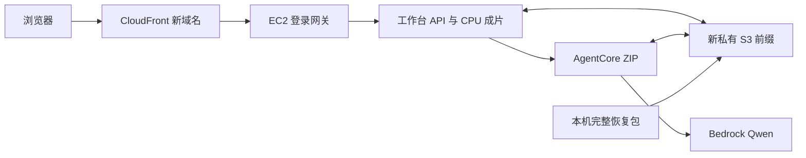

# 10 月 8 日账号重置后的工作台重新部署计划

编写：2026-10-07，Asia/Shanghai（UTC+8）。目标：保持当前工作台和 Agent 的总体架构，在赛事 AWS 账号重置后，按本文件重新创建应用并完成 CloudFront 实际交互验收。

**重置时间和范围由本聊天用户明确提供：2026-10-08 09:00，北京时间，账号内全部资源。** 本地现有赛事资料尚未找到该通知原文；这里按全部云资源失效准备，不推断任何桶、实例、角色、Agent 或分发会被保留。当前云端和恢复工具的完成程度分别记录，不能将演练当成重置后已部署。

## 1. 固定服务分工与文件位置

| 内容 | 部署到哪里 | 目录 / 接口约定 | 重置后的来源 |
| --- | --- | --- | --- |
| HTTPS 网页入口 | CloudFront，VPC origin 回源 EC2 | 页面、API、视频同源；登录网关监听 8080；新分发产生新域名 | CDK Delivery 栈重新创建 |
| 原工作台前端与 API | Ubuntu 24.04 EC2，`t3.large`、40 GiB gp3 | 代码 `/opt/hks/releases/<release>`，`/opt/hks/current` 指向本次目录；工作台仅监听 `127.0.0.1:8876` | 本机 `workbench.zip` |
| CPU 视频制作 | 同一 EC2 的 Python / Node / FFmpeg / Sharp | 图形编排、视频读取、手工制作、成片任务；暂不拆独立渲染服务 | 固定应用包及依赖版本 |
| 战术模型执行 | AgentCore Python 3.12 ZIP Runtime，平台 V1 | `/ping` / `/invocations`；首个有效任务才初始化 SDK；通过 S3 交换输入输出 | 本机 `agent.zip`，含当前入口与 SDK |
| 视觉模型 | Bedrock `qwen.qwen3-vl-235b-a22b` | AgentCore 的 IAM 角色调用；工作台保留候选验证与人工采用 | 重建角色后真实调用验证 |
| 三段基础视频 / 轨迹参照 | 私有 S3 ＋ EC2 发布目录 | S3 `workbench/deployments/<new>/datasets/<sample>/<sha>/video.mp4`；EC2 沿用库中相对路径 | 本机包中的全部三视频，不能依赖旧 S3 datasets |
| 用户导入视频、草稿、任务、成片 | EC2 工作目录先落盘，私有 S3 异步备份 | `data/local-workbench/`、`data/local-videos/`、`artifacts/cloud-imports/`、`artifacts/cloud-trims/`，以及 `cloud-library.json` / `artifacts/cloud-state.json` | 重置前下载到本机的 `state.zip` |
| 配置和权限 | 实例 IAM Role、AgentCore Role、`/etc/hks/` | `runtime.env` / `gateway.json` 首启重新生成；新访问码留本机忽略目录 | 新账号只读发现、CDK 输出和新域名 |
| 恢复材料 | 本机，与赛事 AWS 账号分离 | 被忽略的 `tmp/reset-recovery-20261008-ready/`；代码与说明在工程目录 | 不随 AWS 重置丢失；重置完成前不要清理此目录 |



继续采用原生 EC2 / ZIP 部署。身份 Agent、OCR、地面轨迹 Agent、YOLO / 球场模型与 GPU 仍按各自状态单独接入，不能因工作台网页恢复就标为可用。实例上 `ubuntu` 的 Codex 登录是个人工具环境，不复制认证文件，也不当作 `hks` 服务用户的模型凭据。

当前应用仍从 release 根读取部分状态，不能仅把这些目录改到别处。此次通过“新 release 首启前恢复 + 受限路径迁移”保证可重建；未来如拆出稳定状态卷，应另做变更和验收。

## 2. 重置前必须完成

1. **停止添加新任务，保存浏览器草稿到服务端。** 新 CloudFront 域名对应新 origin，旧浏览器 localStorage / IndexedDB 不自动迁移。只有服务器已经保存的版本进入本次备份。
2. 取一致性状态快照：当前任务无运行中条目，逐文件读取前后签名及整个目录清单一致；如果有新增、删除或修改，快照失败并重新取，不能使用部分包。
3. 将快照下载到本机，核对 ZIP SHA 和每个文件 SHA。同账号 S3 副本仅是传输中转，不是跨重置备份。
4. 在全新输出目录生成完整重建包：工作台代码、Agent 代码及依赖、三段视频、状态 ZIP、逐文件清单。所有新对象使用本次新前缀。
5. 保留当前工程和原始快照。即使 Git 尚未推送，恢复包也必须包含实际工作区版本；包清单记录 Git HEAD 和工作区是否有修改。

建议执行窗口为 **10 月 8 日 08:30—08:50 北京时间**，这是操作建议，不是主办方规定。今晚的包是已测检查点；若此后代码或用户数据有变化，必须再次打包 / 快照。没有设置自动唤醒或自动部署，届时由用户在本聊天发起继续操作。

本轮工具：

- [prepare_rebuild.py](../../infra/ec2-workbench/prepare_rebuild.py)：离线构建、只读环境发现、不可变上传与重试校验。
- [state_archive.py](../../infra/ec2-workbench/state_archive.py)：状态快照、完整核验、仅向新建或空目录恢复。
- [relocate_state.py](../../infra/ec2-workbench/relocate_state.py)：只迁移已知路径字段，不改视频、tracking metadata、来源指纹、草稿内容或历史日志。
- [restore_bootstrap.py](../../infra/ec2-workbench/restore_bootstrap.py)：首次启动前，先在纯状态临时目录恢复 / 迁移，再安装到尚无用户状态的新 release。

取最终快照时，通过 SSM 把当前 `state_archive.py` 放到现网临时目录，在确认无运行中任务后执行：

```sh
python3 /tmp/state_archive.py snapshot --root /opt/hks/current --output /tmp/<fresh-state>.zip
python3 /tmp/state_archive.py verify --archive /tmp/<fresh-state>.zip
```

计算整个 ZIP SHA，用实例角色上传到当前私有前缀的 `workspace/recovery/<new>/state.zip`（新对象，不覆盖），再由本机 AWS CLI 下载并运行同一 `verify`；整个 ZIP 摘要也必须相同。只有本机下载完成才计为跨重置保全。本轮实际传输脚本和 SSM 参数保留在 `tmp/reset-rehearsal-20261007/`，下一次需要新文件名 / 对象键和新的实例核验，不能盲目重发旧命令 ID。

受限迁移必不可少：导入 / 裁切清单含旧 release 的绝对路径，简单复制后会被当前缓存根校验拒绝。保留 metadata 原字节可以保持 tracking fingerprint；迁移后的样本仍须与旧服务比较视频摘要和来源指纹。

## 3. 重置后执行顺序

以下从仓库根运行，`python` 指向带 `boto3` / `aws-cdk-lib` 的部署 Python 环境；纯离线打包、快照与迁移仅需 Python 标准库。具体账号、资源 ID、配置和访问码只放忽略目录，不写进共享文档。

### A. 等待账号可用，重新发现基础环境

先核对本次用户授权与主办方重置状态，重新登录 AWS，执行 STS 核对本队角色和 `us-east-1`。重新查询桶、VPC、子网、IGW / 出站路由、可用 IPv4、AMI、权限边界、CloudFront 托管策略和 CDKToolkit。

```powershell
python engineering/infra/ec2-workbench/prepare_rebuild.py discover `
  --source-config tmp/reset-recovery-20261008-ready/config.json `
  --output tmp/reset-20261008-inventory.json --profile nba
```

输出路径必须全新。工具只读，发现结果一小时后过期。账号内资源已全部重置，旧账号字段仅用于识别原队伍，不能直接复用旧实例、私有 DNS、Runtime ARN、角色、分发、域名或服务安全组。

**如果预置团队桶、权限边界或 CDKToolkit 缺失，停在此步，记录缺项，等待主办方初始化或明确指示。** 已有 [CDK 补充通知](../../../requirements/cdk-deployment-notice-20261006.md)要求不执行 `cdk bootstrap`；不自行补造赛事权限边界或擅改跨账号配置。此门槛不能靠恢复脚本跳过。

### B. 构建并上传新发布

```powershell
python engineering/infra/ec2-workbench/prepare_rebuild.py build `
  --source-config tmp/reset-recovery-20261008-ready/config.json `
  --inventory tmp/reset-20261008-inventory.json `
  --agent-zip tmp/reset-recovery-20261008-ready/agent.zip `
  --state-archive tmp/reset-recovery-20261008-ready/state.zip `
  --output tmp/reset-20261008-deploy

python engineering/infra/ec2-workbench/prepare_rebuild.py upload `
  --bundle tmp/reset-20261008-deploy --profile nba
```

这一步基于执行时工作区打包，因此执行前应核对最终要部署的版本；视频从本机登记路径读取并逐字节校验。新访问码重新生成，旧线上访问码不沿用。上传只写新前缀，完整回读 SHA；中断重试遇到已有对象时仅复用完全一致的字节，绝不覆盖不同对象。

本机完整包已独立保存三视频，即使原登记路径丢失，也可按 `release-manifest.json` 的 `videos[].path` 从包中 `datasets/` 恢复后再构建。发布包不是仅有 S3 URL 的清单。

### C. 先创建 Core，再等待真正就绪

设置 `HKS_DEPLOY_CONFIG` 为新 `config.json` 的绝对路径；在 `engineering/infra/ec2-workbench/` 运行：

```powershell
cdk synth WorkbenchCore --strict --profile nba
cdk diff WorkbenchCore --profile nba
cdk deploy WorkbenchCore --profile nba --outputs-file <本机忽略目录>/core-outputs.json
```

该工程的 `cdk.json` 使用部署 Python。若当前环境不匹配，显式 `--app "<部署Python> app.py"`。Windows jsii 临时路径问题可将本次 PowerShell 的 `TEMP` / `TMP` 指向仓库 `tmp/` 下新建目录。不能把离线合成时用的 `HKS_ALLOW_UNVERIFIED_CONFIG=1` 带进真实部署。

Core 创建当前 CPU EC2、实例与 AgentCore 角色、AgentCore ZIP Runtime。EC2 首启依次安装固定依赖、核对工作台包 SHA、核对三视频、恢复状态 / 路径迁移、生成新配置、设置 `hks` 权限、启动两个服务。后端 `/api/library` 有实际样本才算首启完成；健康等待失败则停服务并报错。

必须核对：CloudFormation 成功、EC2 / SSM Online、cloud-init 完成、两个 systemd 服务 active、后端库包含期望的三样例及已恢复导入素材、AgentCore DEFAULT 指向当前 Runtime。新平台仍需核对实际 MMDSv2 与模型权限；READY 不代替真实模型调用。

### D. 绑定新实例，创建 Delivery，再收紧回源

1. 将 Core 输出的 **新** `InstanceId` / `PrivateDns` 写入同一新配置的 `instanceId` / `privateDns`。
2. 执行 `cdk synth WorkbenchDelivery --strict` → `cdk diff WorkbenchDelivery` → `cdk deploy WorkbenchDelivery`，保存输出。
3. 等待 VPC origin 和 CloudFront distribution 为 `Deployed`，读取实际新域名。
4. 在新 VPC 内发现 AWS 创建的 `CloudFront-VPCOrigins-Service-SG`，把 ID 写入 `cloudfrontSecurityGroup`；Core diff 应只涉及回源规则，再部署收口。不要修改 AWS 服务管理安全组本身。
5. 通过 SSM 将 **新 HTTPS origin** 写入新实例 `/etc/hks/gateway.json`，保留其余本次配置和文件权限。网关默认空 origin 会拒绝访问，这一步不能漏。
6. 用新访问码登录新 CloudFront 地址。旧分发地址不作为恢复成功的判断依据。

CloudFront 建 VPC origin 要求源站先可用；`us-east-1` 的 `use1-az3` 不支持。当前实例公网 IPv4 用于系统安装 / AWS API 出站，应用入站经私网 origin 与安全组控制；不能在没有替代出站通路时移除它。

### E. 逐项验收再交付地址

| 层级 | 必须实际通过的检查 |
| --- | --- |
| 包与服务 | 包 SHA、三视频 SHA、服务启动、关键模块完整、实际 API 库 |
| 保存恢复 | 已保存草稿版本 / 内容一致、导入素材路径可读、来源指纹不变、原成片可下载 |
| CloudFront | 登录、页面加载、视频 Range / 播放 / 拖动、同源接口，未登录与错误 Origin 拒绝 |
| 人工闭环 | 隔离草稿绘制、暂停、保存、刷新恢复、生成新 MP4、实际播放 / 下载 |
| S3 | 新草稿与新成片进入本次前缀，下载回读摘要一致 |
| Agent | `/ping`、实际视觉调用、返回候选、通过业务校验、人工采用分别记录；不以配置 available / READY 代替结果 |

目前已知战术 Agent 的云调用链路连通，但最新候选有空图形 / 空证据帧违规，**生成与采用没有通过本轮验收**。该问题单独修正，不因重部署就宣称模型质量已好。GPU 等未接齐功能不会阻止人工制作恢复，但应在交付中明确。

## 4. 提前测试与本机检查点

2026-10-07 23:30（北京时间）前已完成以下实测；结果来自真实云端状态、完整本机包和既有 EC2 上的新隔离目录。

| 检查 | 实际结果 |
| --- | --- |
| 本机完整包 | `tmp/reset-recovery-20261008-ready/`：374 个工作台归档成员、Agent ZIP、3 视频、状态 ZIP；6 个上传对象合计 221,587,577 字节，所有对象 / 归档成员逐字节 SHA 校验通过 |
| 状态备份 | 73 文件、原始 38,225,352 字节；ZIP 22,331,628 字节；下载至本机并完整核验。ZIP SHA-256 为 `8e43fa23659ad98b36dcedf362bfa8ba1007a5d8be2f907c361466e5a38e7692` |
| 真正换根恢复 | 云端新隔离目录恢复 73 文件，4 份记录中的已知绝对路径完成迁移；原快照保持不变 |
| 服务读取 | 恢复后的工作台在新的随机回环端口实际启动，返回三样例及原导入素材，共 4 个入口；4 个素材的视频 SHA / tracking fingerprint 均与现网相同 |
| 草稿 / 旧成片 | QA 草稿版本 2 完整内容与现网相同；旧 MP4 通过恢复服务下载，SHA 与原成片一致 |
| 恢复后重新制作 | 通过恢复服务 API 生成新的 1920×1080、218 帧、7.266667 秒 MP4；SHA 与原成片完全一致：`425c7df2ff63dab0aebaf5c6fe1df517d21f3d745e22c1e6094b8a9435731ada` |
| 定向测试 | 重建打包 8 项本机通过；Linux 上状态 22、迁移 10、网关 7、Runtime 启动 2，41 项全部通过（含 Windows 无权限执行的真实 symlink 分支），合计 49 项；bootstrap `bash -n` 通过 |
| AWS 基础发现 | 当前账号只读 discovery 已实际成功；只是验证发现工具，明早必须重新发现，不能复用今天的证据 |
| CDK | 未经新发现的配置确实被拒绝；Core / Delivery 两栈在专用离线配置下 `synth --strict` 成功，未部署此配置 |
| 现网保护 | 演练使用独立目录 / 回环端口，进程已停止；当前两个 systemd 服务和原工作台保留，没有重建 EC2 / AgentCore / CloudFront。仅用既有私有前缀中转测试包与备份 |

实际演练复用了现有 Linux 系统依赖，**没有新建一台空机器执行 apt / pip / npm，也没有模拟主办方整账号重置**。因此“完整新实例首启、主办方基础设施重新供应、新 CloudFront 创建”仍在明早 C—E 阶段验收。Node、Python 包、Sharp 和系统工具的安装仍需要官方包源与出站网络。

原始证据位于 `tmp/reset-rehearsal-20261007/`：`acceptance.json`、`rehearsal-result.json`、`snapshot-head.json`、`inventory.json`、`cdk-gate-result.json` 与 `cdk-out/`；里面含私有环境定位，不提交。现有网页闭环基线见[10 月 7 日当前版本复验](../cloud-current-version-20261007.md)。独立交接见[本轮记录](../../../handoffs/Linzeyu912/2026-10-07-2330-cloud-reset-readiness.md)。

更新的网关备份范围、恢复及首启工具已进入本机恢复包，**尚未覆盖到当前线上服务**；现网本轮数据已通过独立完整快照保护。不要把今晚工具演练描述为明早新部署已完成。

## 5. 失败时保留什么、如何继续

- 基础环境缺失：保存发现错误，等待主办方初始化；不沿用旧 ID、不随意创建比赛基础设施。
- 上传中断：重试同一完整包，已有对象必须完整摘要一致；若内容不同则生成新包 / 新前缀。
- 首启恢复失败：保留原始本机 `state.zip` 与日志；不启动工作台，不在已有用户状态上反复覆盖。受限迁移途中崩溃时，丢弃本次临时恢复目录，从原 ZIP 重新开始。
- 运行中服务更新：仍使用[现网更新流程](../cloud-current-version-20261007.md)，不得把首启 UserData 当作在线更新命令。
- 新 CloudFront 尚未就绪：继续查看对应事件和状态；不切换为公开裸 EC2 接口绕过网关。
- 用户尚未保存的浏览器状态：回原页面保存后再做最终快照；无法回原 origin 的未上传状态不能声称已恢复。

本次“可重建”不承诺无停机切换、固定域名、生产多用户或所有模型效果合格。原始发布包、状态 ZIP 和工作区均应保留到新部署通过完整验收。

## 6. 来源与执行入口

- 重置时间 / 全资源范围：本聊天用户，2026-10-07；尚无本地官方通知原文，不改写成赛事正式规则。
- AWS 官方 [CloudFront VPC origins](https://docs.aws.amazon.com/AmazonCloudFront/latest/DeveloperGuide/private-content-vpc-origins.html)、[AgentCore Python ZIP](https://docs.aws.amazon.com/bedrock-agentcore/latest/devguide/runtime-get-started-code-deploy-python.html)、[Runtime CloudFormation 属性](https://docs.aws.amazon.com/AWSCloudFormation/latest/TemplateReference/aws-resource-bedrockagentcore-runtime.html)，2026-10-07 实读。
- 赛事既有约束：[Portal 要求整理](../../../requirements/portal-access-20261005.md)、[CDK 补充通知](../../../requirements/cdk-deployment-notice-20261006.md)与[评审操作说明](../../../requirements/judging-operation-clarification-20261006.md)。技术恢复建议不增加赛事要求。
- 工程：[ec2-workbench](../../infra/ec2-workbench/README.md)。届时向本聊天提出“按 10 月 8 日重置重部署计划执行”，先完成 A 阶段新环境核验，再继续 B—E。
