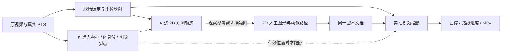

> 已被后续方案替代：本文件保留 2026-10-06 的第一版“人工主创作”讨论稿。用户随后明确要求模型主导、人工仅兜底，当前方案见 [模型主导实施方案](../2026-10-06-workbench-reliability-and-api-parallel-plan.md)。除归档标记与相对链接修复外，正文按当时记录保留。

# 工作台实施方案：2D 手工战术创作、实拍投影与可选轨迹增强

日期：2026-10-06，Asia/Shanghai。状态：**可评审规划初稿，尚未授权实施**。本轮只编写方案，不接入新 API、不运行模型、不修改界面、不发布代码。本方案建立在当前仓库已实现的工作台之上，不覆盖 10 月 5 日的历史计划和验收记录。

## 1. 本轮目标与主线调整

用户最新方向是：自动轨迹有抖动、失真或断点时，可以不使用；在第二部分的 2D 球场手工标注跑位战术，再把同一组图形投影到第三部分的真实比赛视频。第三部分所说的“3D 视频”，本方案对应的是**真实镜头中的球场平面透视投影**；单应映射描述地面平面与图像平面的关系。[OpenCV 官方说明](https://docs.opencv.org/4.12.0/d9/dab/tutorial_homography.html)

因此实施顺序调整为：

1. **先完成 2D 手工创作 → 实拍投影 → 保存与导出的最小闭环。** 不要求先识别齐十人，不调用 Qwen 或身份模型作为绘图前置。
2. 补齐球场映射质量、人物身份 / 脚点的独立质量提示，以及按需要定位参与球员的流程。
3. 需要时再做 Qwen 轨迹对照、身份 API 适配和有限并发；十人全片轨迹作为可选扩展。

第一部分不完全准确，**会影响第二部分读取的自动球员位置，也会影响第三部分的真实跟随标记**。但纯手绘 2D 跑位图形可以不依赖人物轨迹；它的实拍落点主要依赖球场映射。身份准确不能补救错误映射，平滑也不能把错人或错脚点变成正确位置。

本方案推荐第二部分作为 2D 主创作区、第三部分作为实拍投影与交付区。当前人工制作默认中央为视频，2D 入口已有但在高级入口中；**新的默认流程尚未实施**。第二、第三部分的最终布局和导航名称仍需讨论，不先重做一套编辑器。

## 2. 当前事实：哪些可以复用，哪些还需要实现

| 功能 | 当前核实情况 | 本方案的处理 |
| --- | --- | --- |
| 固定 P1–P10 与临时 T 关联 | 已有候选、慢放、参考身份、有限区间续接、分窗队列和人工采用 | 保留，作为按需人物定位；全片十人准确仍未验收 |
| 球队 / 号码 / 姓名 | 文字 OCR、记分牌队标视觉候选、红蓝组采用、赛季 + 球队 + 号码查名已有本地接入 | 保留三条证据链；号码 / 名单资料不自动认证全片人物 |
| 球衣参考与实际球队 | 本地修复已分别保存；名单表单可恢复已采用球队代码 | 不重新建设；未知号码、未确认姓名继续明确表示 |
| 图像位置到 2D | `buildCourtTrajectories` 已用脚点和当前帧映射投影 | 复用算法；新增分项质量和消费策略 |
| 2D 准备 / 平滑 / Qwen | 已有独立准备、预览采用、原始点保留及 Qwen 地面 Agent | 观测参考可关闭；其效果不作为手绘路线的前置 |
| 2D 手绘 | `createCourtAnnotation` 已支持 `space:'court'`，球员关联可为空 | 将现有工具作为第二部分主入口，复用同一文档与几何 |
| 秒级选区、曲线、暂停、进度校正 | V2 / 人工编辑链路已有 | 复用；补 2D 编辑器修改区间时的 VFR 进度重排缺口 |
| 2D / 视频投影 / MP4 | 同一标注几何已有投影、缺映射检查和正式渲染链路 | 第三部分围绕同一文档预览和导出，不另写渲染器 |
| 无人物准备的纯手绘 | 无 `courtPreparation`、0 observed 实体 / 0 participants、有有效标定且 `entityId=null` 时，文档校验与 `compileProduction` 内存检查成功编排 183 帧 | 是核心复用基线；实际 save → refresh → MP4 尚需首期验证 |
| 来源变化 | 准备目前保守整段失效；原战术保留，但可能需重新绑定 / 定位 | 先清楚提示并保持旧稿；按球员 / 范围失效为后续优化 |
| 身份多模态 API | `MultimodalApiProvider` 是明确不可用的预留适配器，当前身份调用走 Codex CLI | 后续按需接入；不能把占位接口写成已接通 |
| 身份批量并发 | 后端身份作业池目前 `max_workers=1`，客户端保留一个当前 job，采用校验完整 session | 并发任务集合、调度和统一合并均属拟实现 |

现有 Qwen 地面轨迹模块已经有独立 API / Pi SDK 调用；它与“身份续接的多模态 API adapter”是不同能力。前者存在不表示后者或全工作台统一并发已经完成。

### 2.1 本聊天前一轮真实单例的有效结论

当前 17.5 秒、1050 帧导入视频中，白衣 `00` 从 T2 接到 T39。所选 9.50–12.50 秒的 181 帧内，有原始检测位置的覆盖从 **52 帧增至 156 帧**，25 帧仍未知。28 张依据帧另由 Codex 视觉复核，抽样中未见串人；这不是独立人类逐帧真值，也不是十人全片准确率。

实际 QA 页面再次跑通：IND / BKN 候选 → 人工绑定红蓝组 → P6 参考号码 `00` → 查找 / 勾选 / 采用有限片段。该副本中全片 P6 有位置帧为 622 → 726，逐帧确认始终只有参考 1 帧。该片没有球场标定，本例没有证明脚点、米制 2D 坐标或投影成片的准确性。

单例 reference / continuation 的 ready 观察上界分别为 22.32 / 53.63 秒，包含轮询间隔。此前“十人可能约一小时”仅是单例线性推算；API、图片数量、窗口数量、并发限制与人工核对都会改变总耗时，**本方案不承诺十人完成时限**。

## 3. 两条数据链必须独立



### 3.1 手工战术创作链：优先交付

- 2D 跑位、传球、挡拆和独立角色标记属于作者图形，保存在现有 `annotations.items`。手绘动作路径使用球场坐标、Bezier 控制点、源视频区间和进度校正；不回写检测框、脚点或真实轨迹。
- 不选球员也能绘制，可用独立圈表示作者示意角色。当前真实 `participants` 来自已关联的 review；独立命名角色作为可选规划，不等价于已识别 P1–P10 人物。关联 P 只是可选语义 / 吸附工具，不要求全片十人位置齐全。
- 路线裁短由作者设置的动作时间及进度点驱动。默认线性源时间进度可以手工校正，不用抖动的自动跟踪点自动推动手绘箭头。
- 2D 与第三部分只改变视图，图形、控制点、颜色、对象区间与讲解点保持同一文档来源。暂停只延长成片时钟，不推进源动作进度。
- 纯 2D 图形可以在缺映射时创建、保存、修改。要在真实视频中随镜头贴地显示，必须有覆盖图形所用源帧的映射；缺失位置不制造透视落点。

### 3.2 可选观测链：按需启用

检测位置、人工身份关联、脚点候选、Qwen 地面修正和保守平滑提供观察参考。用户可关闭整层，不影响手工工具和已画路线。采用自动参考的位置、跟随脚圈、基于轨迹的建议或距离 / 速度指标时，才检查其身份、脚点、映射与来源状态。

“从观测轨迹生成图形”必须是明确的预览 / 采用动作：写入作者图形及出处，随后可独立编辑；不能用新的 Qwen 输出默默替换已调整的手绘路线。若以后提供沿手绘路径移动的角色图标，应明确为作者编排动画，不称为真实球员跟踪；这不是当前首轮闭环的必要功能。

## 4. 第一部分：分项质量与球场标定优先级

### 4.1 身份、脚点、映射分别记录

| 分项 | 需要核对什么 | 不能由什么替代 | 对下游的影响 |
| --- | --- | --- | --- |
| 固定人物身份 | P 是否持续对应同一个真人；T 换号 / 同队交叉时是否串人 | 编号一直显示、读到一次背号、查到姓名 | 错人会使自动 2D 点、跟随圈和轨迹建议贴到另一人 |
| 队伍 / 号码 / 姓名 | 当前视频队伍归属、`0/00` 等文字号码、赛季名单候选 | 红蓝行、文件名、模型主观分数 | 用于认人和资料；不是地面定位证明 |
| 图像脚点 / 接地 | 标的是地面接触位置、框底中点还是踝点；遮挡 / 跳起时是否可见 | “人物框正确”、单帧身份确认 | 脚点偏移经映射变成 2D 位置偏移；不能用平滑掩盖 |
| 球场映射 | 点名对应、方向 / 篮侧、镜头变化、支撑范围和独立参照点对齐 | 四点数值可解、拟合控制点残差很小 | 错映射影响自动 2D 点，也影响所有手绘 2D 图形的实拍投影 |
| 来源 / 时间 | 当前视频、跟踪版本、源帧映射、选区和准备 / 草稿版本是否一致 | 浏览器显示成功、旧候选仍在页面 | 来源错误会使正确图形落在错误时刻或镜头 |

当前 `buildCourtTrajectories` 主要检查坐标和映射能否数值计算，`frameIdentityConfirmed`、`projectionReviewedAt` 等并没有共同构成完整准确性硬门槛。已有绿点不能当成“身份、接地和映射全部准确”。本方案拟新增三列质量与区间汇总，以及各消费者的显式使用策略。

沿用现有颜色合同：蓝为机器候选待确认，绿只表示对应本帧已有人工审核，黄为估计 / 修改待核对，红为缺失 / 冲突，灰为出画 / 无结果。分项状态配文字、来源和待处理区间，不另加含义不清的“全部准确”绿灯；模型分数始终标为未校准的估计。

当前状态需要与未来消费策略区分：

| 当前输入状态 | 当前数值 / 显示行为 | 尚不能声称 |
| --- | --- | --- |
| 机器人物有坐标，但本帧身份未确认；映射为可数值使用的 `accepted_reference` | 可投影为 `projected`；满足平滑的其他条件时可平滑 | 人物、接地与标定已准确 / 人工确认 |
| 标定仍为拒用的 `needs_review` 状态 | 该映射不进入有效投影 | 有候选控制点就已完成标定 |
| 新稿 `maxGapSeconds=0` | 缺口保持空值 | 所有历史稿都没有估计 |
| 显式启用短缺口插值且满足边界保护 | 生成估计来源点，不能跨出画 / 冲突等保护边界 | 新增了真实观测或人工真值 |
| 图像 missing，但有人工作出的 `court_manual` | 2D 点有明确人工来源并待核对 | 原图已经检测到球员或身份已确认 |

### 4.2 优先核对所选片段的球场映射

1. 在原视频选可辨认的场地线交点，给足非共线参照；将拟合用点与独立检查点分开。
2. 回投球场线、手绘起终点和至少可见的独立参照，检查方向、近远端尺度以及球场外推区域。仅测参与拟合的四点不算独立精度验证。
3. 冻结参考帧先建立可评审例子；连续镜头还要覆盖动作区间内的镜头变化。切镜处拆段，不跨镜头插值。
4. 实拍主投影复用 `calibrationAt` 的逐帧映射。历史 `productionCamera` / `approximate` 相机只能作为明确标记的示意来源，不能替代已经核对的真实标定。
5. 对不支撑的源帧给出对象名称、源秒数和范围，保留 2D 图形，允许补标定、缩小显示范围或拆段。无需先填齐其他球员。

### 4.3 按球员与区间使用，保留未知

拟提供汇总：`所选 P / 9.50–12.50s / 181 帧 / 身份待核对 X / 脚点未验证 Y / 映射缺口 Z`。统计按实际源帧计数，出画独立统计，不用“所有十人全片完成”作为进入第二部分的总开关。

身份冲突、出画和未知默认不自动补位置。新草稿 `maxGapSeconds=0`；旧稿可能已有短缺口插值，应保留其设置和 `interpolated/court_estimated` 来源，不能把“目前默认不补”写成绝对禁止估计。

人工仍可在 2D 添加当前帧 `courtAnchors`：现有代码允许图像 `missing` 帧出现显式 `court_manual` 位置，保持待核对和人工来源；它不证明原图曾检测到该人，也不抹掉图像缺失。身份冲突 / 出画的优先保护规则不能被这个入口绕过。

| 下游操作 | 推荐规划策略 |
| --- | --- |
| 原图 / 2D 候选预览 | 可显示机器候选、估计和人工点，来源明确；冲突不自动选赢家 |
| 独立 2D 手绘 | 不依赖人物位置；可直接进行，按作者图形保存 |
| 明确吸附到球员 / 真实跟随圈 | 核对所选 P 和当前位置；无位置时隐藏或提示，不换到另一人 |
| 米制距离 / 速度等指标 | 单独要求身份、地面和映射满足所用指标的质量标准；候选预览不可冒充指标真值 |
| 手绘图形实拍投影 | 必须有来源有效的映射；与十人身份完成率无关 |
| 正式导出 | 保留现有缺映射 / 失效来源拒绝规则；是否允许“映射数值有效但审核不足”的警告导出，待用户决定 |

## 5. 第二、第三部分的推荐界面草图

这是本方案推荐布局，尚未改界面。导航标题、视频窗比例和第三部分是否保留编辑工具均待讨论。

### 5.1 第二部分：2D 战术主创作

```text
① 人物 / 球场   ② 2D 战术创作   ③ 实拍投影与交付

当前片段 [开始 3.000] [结束 5.000] [定位起点]  [保存] [撤销]
映射：这段可投影 / 缺口2处 [回原视频核对]

┌───────────────────────┬─────────────────────────┐
│ 2D 球场 · 主创作       │ 原视频同步核对小窗       │
│                       │ 只用于认人 / 对齐场地    │
│ 手绘路线与角色标记     ├─────────────────────────┤
│ 观测轨迹默认可关闭     │ 当前对象：跑位 A         │
│ 起终点 / 曲线手柄      │ 动作时间 3.00—5.00       │
│                       │ 完整 / 剩余路线          │
│                       │ [此刻走到这里]           │
└───────────────────────┴─────────────────────────┘
[选择] [跑位] [传球] [挡拆] [独立角色圈]
可选观察参考 [显示球员点 □] [观测轨迹 □] [Qwen / 平滑 ▾]
对象时间条：A [─────────)  B [─────)
原片时间轴：───◆3.0────◆4.2────5.0── [＋ 暂停讲解]
[查看实拍投影 →]
```

无需进入“2D 轨迹准备并全部完成”才显示手绘工具；准备 / Qwen 保留为观察参考模块。若用户希望更大视频窗，可改同步窗尺寸，仍保留 2D 为主创作的任务分工。

### 5.2 第三部分：同一图形的真实视频表现

```text
③ 实拍投影与交付                  [返回2D修改] [保存]
┌─────────────────────────────────────────────────┐
│ 原视频 + 同一组2D图形投影                        │
│ 暂停讲解 / 逐步绘制 / 恢复 / 剩余路线             │
│ 编辑辅助线不进入成片                            │
└─────────────────────────────────────────────────┘
[播放所选片段] [上一帧] [下一帧] [0.25×/0.5×/1×]
源时间：3.200s     成片暂停：单独显示输出时间
对象：A 可投影；B 4.10—4.30s缺映射 [定位] [修复]
[成片效果预览] [生成 / 下载 MP4]
```

第三部分优先承担投影检查、暂停与路线进度检查、预览和导出。若保留局部调整，应写回同一 2D 几何；不能维护独立视频坐标稿来替代原对象。最终是否在第三部分开放全部绘图工具为待讨论选项。

### 5.3 按需人物质量面板

```text
当前 P6  [清晰参考] [球队/号码] [慢放核对]
所选区间 9.50—12.50s       [人物续接（可选）]

身份       脚点 / 接地       球场映射
待抽检     框底中点待核对    当前片段已数值建图、待视觉核对
T2 → T39   原始/人工分开     缺口跳转 [4.10s]

[仅看参与者] [查看候选] [人工补点] [保留未知]
```

## 6. 同一文档、时间和失效处理

### 6.1 复用现有核心

- `tactics-court-editor.mjs`：独立球场图形、Bezier 编辑和对象选区；不因没有球员轨迹拒绝创建。
- `tactics-annotations.mjs` 与 `tactics-court-projection.mjs`：同一几何在 2D / 视频中展示，利用 `courtProjectionGaps` 检查图形实际覆盖的源帧。
- `tactics-manual-editor.mjs`、`tactics-time-range.mjs`：真实 PTS 区间、作者进度校正；`annotationProgress` / 剩余路线行为沿用已有合同。
- `tactics-keyframes.mjs`、`tactics-presentation.mjs`、`tactics-production.mjs` 与 `tactics_render.py`：沿用已验证的讲解、显示修正、冻结 / 成片编排及正式编码。观测驱动的 presentation 路线保持其来源，不把它直接当成独立手绘路线。

第二部分和第三部分的视图共享一个编辑状态控制器与 `TacticsDocument`。页面入口 / 布局可拆，文档、历史、保存版本和标注 ID 不拆。优先调整既有 `tactics-ui.mjs` 的视图和挂载位置，不复制一份编辑器。

### 6.2 需修的明确时间缺口

`tactics-court-editor.setAnnotationRange` 目前按帧数比例重排进度点。VFR 的帧间时间可能不同，规划改为复用 `tactics-manual-editor.retimeProgress` 的真实 PTS 语义，并验证暂停引用 / 区间联动。已有人工视频链路的正确性不能替代此 2D 分支验收。

新对象继续使用零起点半开范围 `[startFrame,endFrameExclusive)`，源秒数转换由真实帧映射和经确认的 `mediaEndTime` 完成。身份续接现有 API 的 `start/end` 为含末帧区间，适配边界明确转换，不直接混用。预览慢放、输出 FPS 与额外暂停均不改源 PTS。

### 6.3 来源变化时保留原战术

当前 `preparationDependencies` 针对整个 session 的身份 / 地面 / 标定等摘要；变化后准备整体失效。`frameConfirmations` 未纳入其独立质量依赖，需要规划补齐审核状态摘要：审核变化刷新质量提示，几何变化刷新坐标，不能让旧质量灯继续表示最新审核结果。

当前 `refreshSnapshot` 只自动重绑定脚圈；其他手绘图形虽保留坐标，可能因全量 `reviewDigest` 变化而失效 / 隐藏，需再次定位。因此本计划的 2D 优先**不能只换导航或默认画布**。首个闭环必须把独立手绘的绘图坐标基线 / 相机映射，与人物轨迹准备拆开。

后端已核实一个明确的条件耦合：review 没有 `courtPreparation` 时，不强制验证已保存准备；一旦 snapshot 顺带附上准备，即使独立手绘不消费它，`Store.verify_document` 仍要求它已服务端保存并与身份 / 标定依赖匹配。因此 M1 同时处理 **A 完全没有准备**、**B 曾建立但未保存 / 已失效的可选准备仍存在** 两种情形。独立人工稿的保存 / 渲染快照只附带实际消费的轨迹准备，保留另外保存的原准备及来源；关闭观察层不删除原始数据，也不绕过真正跟随 / 观测对象的准备验证。已通过无 prep 的内存编排不是完整服务端保存与真实 MP4 已验收。

独立手绘箭头（`entityId` 可为空）拟只依赖所用视频、PTS、球场坐标定义、自身区间，以及投影时必要的镜头映射；无关人物的审核 / 跟踪变化不让全部手绘消失。跟随脚圈、自动点和观测驱动图形仍依赖目标身份 / 位置。标定变化保留原 2D 几何并提示重新核对投影，不清空图形，也不静默迁移成另一个球场坐标系。现有历史来源校验保持兼容，不能简单删除全量校验而让旧稿伪装已适配新来源。

准备快照按球员 / 范围局部重算是后续优化，当前仍整体失效；它与首期“独立手绘不依赖人物准备”是两项不同任务。

来源变化时：保存旧几何、区间、暂停和版本 → 标出受影响对象及原因 → 用户对照旧 / 新来源重新定位或绑定 → 再检查实拍投影。换视频不能仅凭相同 P 编号重用旧落点。对于仅独立手绘且只发生无关人物跟踪变化的对象，未来允许通过依赖差异复核后保留有效状态，需独立回归证明。

没有可靠映射时，仍可保存 2D 稿。用户可以明确选择现有固定像素标注作为临时制作方式，保存 `space:'video',videoMode:'fixed'` 及参考尺寸；它不随镜头贴地移动。不能自动把米制手绘图形转换成固定像素稿并称作投影成功。

## 7. 可选后续：身份 API 与有限并发

**本节不是 2D 手工主线的开工前置。** 只有需要缩短身份核对耗时、扩大可选定位范围时再实施；Qwen 轨迹效果不合格时可以不采用，不以继续加调用来强行填满。

### 7.1 adapter 边界与运行配置

继续复用服务端 `VisionProvider.status/generate` 与 `create_provider`，新增真实 adapter；前端不持有密钥或任意 endpoint。API 提供方、地域、模型、图片 / JSON schema 支持、凭据来源、计费与默认参数尚未确定。接入前用选定服务的官方文档核对，先做隔离 QA 的单请求与取消 / 错误验证，再打开批量能力。

地面 Qwen 和身份 adapter 分别保留目的、参数和来源。若共享账号额度，进入统一额度记账；不把一次 CLI 成功视作 API 成功，也不静默改用另一模型绕过错误。

### 7.2 调度建议：初始最多 3 个模型请求

建议以服务端可配置并发上限 **3** 作为第一次 API 对照试验，不代表所选供应商实际允许或最优。先做 1 / 2 / 3 的同素材比较，再根据限流、延迟、正确性与费用决定。不要一开始为十人同时发满任务。

- 用队列控制在途请求，同时按账号 / 模型维护 RPM、TPM 预算，检查供应商是否还有图片、并发、秒级或动态限额。单任务内 scan → refine 或多轮读反馈保持顺序；并行用于跨球员 / 独立窗口，不并行跳过因果步骤。
- 分配请求前预留估计输入与最大输出 token；响应后用实际 usage 调整。限流时尊重返回的等待信息，采用有限指数退避和随机抖动，平滑请求，不循环重试到无上限。
- 排队、准备、推理、校验、等待复核和失败各有状态。失败仅影响该子任务；已完成候选与人工稿保留。
- 取消后不再调度后续窗；若已发送请求无法立即取消，记录结果但不自动采用，并如实记录可能已经产生的费用。
- 超时后返回结果是否已产生不明确时，先核对 provider 请求 ID / 本地日志；供应商支持幂等键时复用同一键。不把未知结果的重发当作免费重试。

以阿里云官方限流说明为一个候选供应商规则示例：RPM / TPM 和短时请求峰值都可能影响接收请求，账号下多个 key 也可能共享限制。这里不预设当前账号额度或选定阿里云；实际 adapter 必须按最终服务核验。[官方限流说明](https://www.alibabacloud.com/help/zh/model-studio/rate-limit)（本方案 2026-10-06 核对，页面标注更新 2026-10-03）。

### 7.3 共享帧缓存与任务集合

一个 task set 表示“在同一不可变来源快照上，对所选球员 / 窗口进行识别”。建议新增服务端集合及客户端队列模型，继续兼容现有单作业接口。参考数据结构如下，字段名为设计草案：

```text
TaskSet
  id / purpose / source(videoHash, trackingFingerprint, frameMappingDigest)
  immutableBase(snapshotDigest, sourceRevision)
  selectedPlayers / windows / providerConfigurationDigest
  tasks(jobId, playerId, range, referenceDigest, readDependencies, state)
  results(candidateDigest, evidenceFrames, usage, requestId, timings)
  mergePreview(conflicts, preservedManual, expectedDraftVersion)
```

完整帧缓存键包括视频哈希、准确源 PTS / 解码帧、输出分辨率和解码 / 编码版本；人物裁图再加 ROI、检测框 / 跟踪指纹。多个球员复用同帧解码和可复用拼图，不因“时间相近”混用不同帧。缓存只减少准备和重复传输，不把旧模型结果冒充新的识别。

检测原始输出、参考与证据快照保持只读，候选不得直接写 session。task set 与子任务状态存本机任务目录，恢复页面可继续查看；正式 / QA 上下文继续隔离，不把照片、密钥或大运行缓存加入 Git。

### 7.4 统一合并：不能只把线程数改成 3

当前客户端以完整 session JSON / revision 判断过期，服务端采用也校验原完整摘要。若直接并行，先采用 P1 会令同一底稿上的 P2 等结果因 session 变化而失效。这是现有安全保护；不能删除它而不增加合并规则。

拟采用 **不可变基线 + 当前人工草稿 + 全部候选的三方合并**：

1. 任务均从同一冻结基线读取；记录实际读取的 P 参考、身份区间、源检测、切镜与相关依赖。结果回传不替换整份 session。
2. 在程序侧构建所有候选的占用表 `(sourceFrame,T) → P`。同一帧同一 T 被多名 P 竞争时，显示冲突；不以响应先后、P 编号顺序或未经校准的模型分数自动选赢家。
3. 人工锁点、身份分界、取消关联与出画记录优先保留；相容候选可提议，互斥内容进入差异表。模型不得覆盖用户等待期间的新修改。
4. 用户可以预览已返回的部分结果并选择采用。采用 P1 后，P2 的原结果仍可保留待复核；重查 P2 的读取依赖和 T 占用，只使实际相交 / 竞争片段失效，不让无关结果因完整 session 摘要变化一并丢弃。
5. 若用户修改 P2 参考、交换 P1/P2、改变检测 / 源 PTS 或相关区间，则相关结果必须过期 / 重跑。不能用“局部合并”绕过这些变化。
6. 生成合并预览与摘要；服务端按当前版本原子校验 / 提交一次选择，重复采用幂等，一次撤销恢复采用前状态。其他页先保存时重新计算差异，不强行覆盖。

任务集合内可增量返回候选，但“返回 ready”“抽样判断匹配”“人工采用”“逐帧人工确认”保持四种状态。完全遮挡仍无真实坐标，不由并发或大模型自动补成已测轨迹。

## 8. 分阶段任务清单、依赖和文件落点

以下勾选框均为拟实施。路径以仓库根为基准；带“新增”的模块名是建议落点，尚未创建。不要把每个阶段都做成第二套工作台。

### M0：冻结范围与回归底稿

- [ ] **P0 / 范围定稿**：确认第二部分 2D 主创作、第三部分实拍投影的分工；收集用户仍想补充的布局 / 交互，不冻结未回答的选项。落点：本方案及相邻产品草图文档。
- [ ] **P1 / 保护与基线**：记录新视频 / 帧映射 / 草稿版本，保存正式稿与 QA 副本；选一个冻结帧和一个 3–5 秒连续片段，列出现有手绘 / 投影 / VFR 回归。承接已查明的准备条件耦合，固定 A 无准备、B 有未保存 / 失效可选准备两份基线，定位 P2a 的最小拆分点；不以可创建前端图形或内存编排代替完整服务验收。落点：`tactical_workbench.py`、`tactics-document.mjs`、`engineering/scripts/smoke_manual_tactics.py`、已有 `smoke_2d_workbench.py` 与新的忽略 QA 目录。依赖 P0；验收：没有模型调用也能打开测试源，原视频和正式草稿哈希 / 状态未被改写。

### M1：2D 手工 → 实拍投影最小闭环（首要里程碑）

| 任务 | 具体交付与主要落点 | 依赖 | 验收 |
| --- | --- | --- | --- |
| P2 共享编辑状态与第二部分主入口 | 调整 `tactics-ui.mjs`、`workbench-shell.mjs`、`workspace.mjs`、`index.html` / 样式；同一控制器呈现 2D 编辑和视频检查 | P1 | 没有 P 位置或 Qwen 结果也可画跑位、传球、挡拆；切页后对象 ID / 几何 / 历史一致 |
| P2a 独立手绘依赖解耦 | 按 P1 结果最小调整 `tactics-document.mjs`、`tactics-annotations.mjs`、`tactics-production.mjs` 和 `tactical_workbench.py`；拆绘图坐标 / 镜头映射与人物准备依赖，只附带实际消费的准备，保留历史合同和另存准备 | P1，与 P2 并行 | A 无准备、B 有未保存 / 失效可选准备均不阻断独立手绘保存 / 编码；改无关球员后路线仍在；真正跟随 / 观测对象保留准备与身份验证；改标定保留2D几何、要求复核投影 |
| P3 所选片段球场映射核对 | 复用 `calibration-guide.mjs`、`court.mjs` 与现有标定 UI；明确拟合点 / 检查点、逐帧支撑与切镜断点 | P1，可与 P2 并行 | 原图投影线和独立参照可核对；缺映射逐对象报范围，不制造落点 |
| P4 2D 图形 / VFR 时间修复 | `tactics-court-editor.mjs` 复用 `tactics-manual-editor.retimeProgress`，补 `tactics-court-editor.test.mjs` / 时间相关回归 | P2 | 改对象区间按源时间重排进度；暂停不推进动作；撤销一次恢复，片尾 / 跨切镜规则一致 |
| P5 第三部分同源投影与编码 | 复用 `tactics-annotations.mjs`、`tactics-court-projection.mjs`、`tactics-production.mjs`、`tactics_render.py` 和既有交付 UI | P2、P2a、P3、P4 | 2D 改一控制点，视频预览和 MP4 同步；缩小范围后只该对象变化；正式映射缺口导出保持拒绝 |
| P6 无轨迹完整实操验收 | 扩展现有 smoke 入口，空观测 / 无 Qwen 结果的 QA；分别测试 A 从未建立准备、B 曾建立未保存 / 失效可选准备但关闭观察且全部手绘；对象由界面绘制 | P5 | 两例都完成建图 → 2D 三种图形 → 暂停 → 进度校正 → 视频投影 → 保存刷新 → 下载 MP4 完整解码；原准备 / 来源保留，另用真正跟随对象证明验证未被绕过 |

M1 先用确定性合成映射验证几何 / 时间，再用真实片段核对视觉贴地效果；合成通过不能替代真实镜头精度。此阶段不新增角色沿路线移动的动画系统，不重做已工作的 V2 文档或 renderer。

### M2：质量与按需人物定位

| 任务 | 具体交付与主要落点 | 依赖 | 验收 |
| --- | --- | --- | --- |
| P7 分项质量与区间摘要 | 建议新增 `review-quality.mjs` 与必要服务端质量校验；接 `tracking-display.mjs`、`court-preparation.mjs`、身份 / 标定 UI | P6；契约讨论可提前 | 身份、脚点、映射三列独立；frameConfirmations 更新不会留下旧审核状态；绿色语义不扩张 |
| P8 可选人物点 / 观测层 | 调整 `identity-ui.jsx`、`identity-coverage.mjs`、`court-preparation-ui.mjs` 及 `tactics-ui.mjs` 的观察层入口 | P7 | 按 P 和选区核对；隐藏轨迹不影响手绘；`court_manual` / 插值 / Qwen / 原始观测来源可区分 |
| P9 来源变化与对象依赖 | `tactics-production.mjs`、`tactics-annotations.mjs`、`court-preparation.mjs` 先做明确重绑提示；后续再做局部依赖摘要 | P7、P8 | 旧图形仍在；相关来源过期不能投影；无关人物修改不丢失人工稿；局部失效需另有回归后启用 |
| P10 人工真值与失败案例集 | 新增小型 `research/vision/` 专题及标注规约，复用现有 probe / evaluate；记录球场参照、脚点和人物身份各自真值 | P3、P7 | 包含同队交叉、遮挡、重新入画、切镜 / 移动镜头；可报告误差和未知率，不用 28 帧模型复核代替人工真值 |

M2 的“无号码人物参考”与“NBA 实名资料”需分开定义：现有 Agent 保存参考仍要求球衣描述与号码；无清晰背号时可继续人工关联 / 手绘。是否允许仅凭外观建立待确认参考并调用续接，作为后续独立试验，不伪填号码来绕过现有门槛。

### M3：可选 API / 并发 / Qwen 增强

| 任务 | 具体交付与主要落点 | 依赖 | 验收 |
| --- | --- | --- | --- |
| P11 身份真实 API adapter | `vision_provider.py` 与建议新增 `multimodal_api_provider.py` / 对应测试；可信配置和当前官方 schema 核验 | P10；供应商 / 模型 / key 与预算明确 | 实际 QA 单请求返回可验证 JSON；超时 / 取消 / 无读数不改稿；usage / requestId 留证据 |
| P12 调度与共享帧缓存 | 建议新增 `vision_job_scheduler.py`、`vision_frame_cache.py`；接 `identity_agent.py` 的现有作业 | P11 | 1 / 2 / 3 同素材测试；在途不超上限，RPM / TPM / 峰值限流受控，重复帧只解码所需次数 |
| P13 task set 与统一合并 | 建议新增 `identity_task_set.mjs` / `identity_candidate_merge.mjs` 及服务端对应集合校验，接既有作业 / 采用入口 | P7、P12 | 同帧 T 竞争、P 交换、并行期间人工修改、部分失败 / 早采用、重复提交均有定向回归；一人采用不使无关结果整体过期 |
| P14 可选 Qwen 质量对照 | 复用 `ground_trajectory_agent.py`、地面 Agent UI 与回放；保持与作者路线分开 | P8、P10；可独立于 P11 | 抖动 / 失真 / 缺口不合格就不采用；关闭后完整手绘闭环仍通过，不重写人工点 |
| P15 扩大参与者 / 十人范围 | 用相同人工真值集逐步从单人短段到多人连续段，再决定全片十人任务 | P13；用户仍需要时 | 报质量、未知、总耗时、人工核对时间和费用；时限目标先定再测，不依据单例承诺 |

首要交付是 P2–P6。P11–P15 可整体不做，不影响用户完成 2D 战术贴图和实拍视频制作。

## 9. 验收指标与证据记录

### 9.1 可直接设置为必须通过的行为条件

- 不要求十人齐全 / 全片轨迹完成才能画图；纯手绘可在关闭观测层、未配置身份 API 和未运行 Qwen 的情况下完成。
- 作者几何只有一份；第二、第三部分和正式 MP4 读取相同文档版本 / 摘要。新视图不能引入同名但不同步的图形。
- 源时间、VFR 进度、暂停与输出时间不混用；首尾范围、连续调整和一次撤销有定向测试。
- 缺映射时 2D 稿能保存，实拍缺口能定位；数值无解 / 切镜失效不伪造像素位置，现有正式导出硬校验保持。
- 人物冲突、人工补点、短缺口估计、出画、参考保存与实名查询分别有来源；候选采用不把整段标成已人工审核。
- 来源变化保留原稿；并发候选不覆盖等待期间的人工修改，同帧 T 竞争无静默赢家。
- API 不可用、超时、无读数、任务失败或取消后，手工编辑 / 保存继续可用。

### 9.2 人工真值与精度指标：先建立基线，再定产品阈值

| 维度 | 应记录的指标 / 方法 | 当前限制与阈值状态 |
| --- | --- | --- |
| 身份连续性 | 可见人物的正确 P 归属率、串人次数、断裂 / 误续接、遮挡恢复时间；按片段分组 | 分母限定人类可判读的帧 / 区间，另报未知；允许误续接率上限待定 |
| 可用覆盖 | 原始观测、采用候选、人工点和未知各自覆盖；出画独立计数 | 不把提高覆盖当作提高准确率；单例 156/181 只是有位置覆盖 |
| 脚点 | 人工接地参照下的像素误差中位数 / P95、接地不可判读比例 | 框底中点不是脚点真值；可见性不足保持未知 |
| 球场映射 | 独立检查点的回投像素误差、逐帧漂移、支撑 / 外推范围；若有独立米制参照再报米误差 | 仅拟合残差不足；视觉展示与精确指标的容差分别待定 |
| 手绘投影 | 同一地面点跨源帧的落点偏差、箭头端点稳定、暂停 / 恢复连续性 | 几何往返检查与真实视觉核对都要有，验收容差先按测试片讨论 |
| 可选 Qwen | 与原观测 / 人工参照逐帧对照的抖动、异常跳跃、转向保留、误补 / 误删 | 平滑数值变小不足以证明效果更好；不合格候选可舍弃 |
| 交互与性能 | 选区 / 拖点响应、源帧定位、预览和正式编码耗时、峰值内存 | 使用真实运行记录；前端交互目标与素材规模待定 |
| API 任务 | 准备 / 排队 / 请求 / 校验 / 合并时间、P50/P95、重试、429、取消等待、人工复核耗时 | 区分 ready 观察上界与纯推理时间；十人总时限未定 |

人工真值由人对照原始视频标注，第二人复核争议并保留无法确定项。参考帧不能与测评帧完全重合；遮挡前后与同队交叉应作为困难样本。模型自述 confidence 和另一个模型的复核只能作为补充证据。

### 9.3 耗时与费用记录

每次真实后续试验保存：任务集合 / 子任务 ID、视频 / 跟踪 / 参考 / 准备摘要、provider / 模型 / 地域 / 参数、实际送出的图片数量 / 尺寸 / 范围、各阶段起止、requestId、输入 / 输出 / 缓存 token、重试次数、结果状态、人工复核与采用时间。

费用仅在供应商给出实际 usage 且已核对当时单价时计算；包含图片 / 输出 / 重试费用，未知记 `null`，不填零。任务预算上限和超预算行为待用户确定。并发改善的是等待安排，不保证质量提升，也不按“3 个并发 = 耗时除以 3”承诺。

## 10. 失败回退与暂不扩大的范围

- 人物识别不好：关闭观测层，手工画所选战术；需要认人时慢放 / 参考 / 区间关联，完全遮挡留空。
- Qwen 轨迹不好：不采用或撤销，原始观测保留；作者路线继续编辑。
- 映射不好：回原视频补标定 / 独立检查，或缩小片段；2D 稿保留。选择固定像素制作时明确其限制，不能拿示意相机伪装已验证贴地。
- API 失败：保留已有结果和人工内容，允许停止 / 重试该任务 / 保留未知，不自动改为另一收费模型。
- 来源变化：保留图形，按原因重新绑定 / 定位；全片准备失效保持现状，局部失效需后续验收才启用。

本方案不扩展到三维人体 / 球场重建、准确球在空中轨迹、实时赛事自动战术识别、统一十人轨迹精度承诺或云端部署。它先解决用户可控的 2D 创作和真实视频贴图需求。

## 11. 待用户讨论的决策

| 决策 | 推荐起点 | 尚需明确 |
| --- | --- | --- |
| 第二 / 第三部分布局 | 2D 主创作 + 视频同步小窗；第三部分大视频投影 / 交付 | 最终标题、窗比例、第三部分是否开放全部绘图工具 |
| 可选观测层 | 可关闭，候选与作者图形分开 | 是否默认隐藏轨迹；参与者名称 / 标记如何显示 |
| 自动人物能力 | 只为需要定位的球员 / 区间启用 | 是否仍需要十人全片；无号码参考的采用门槛 |
| 投影质量 / 导出 | 保持结构、来源及缺映射硬校验 | 数值有效但尚未审核的映射是否允许警告导出；具体像素 / 米容差 |
| API | 服务端 adapter；最多 3 作为第一次试验建议 | 提供方、模型、地域、key 配置、额度、费用预算与超预算行为 |
| 全片处理性能 | 先记录单段与多人实测 | 目标视频长度、人数、允许耗时与人工核对成本 |

实施前以用户最新补充更新本方案；此表不表示已同意默认值，也不启动实现。

## 12. 核实来源

代码核实于当前本地工作区；10 月 6 日入口 / OCR / 队标 / 参考资料衔接仍包含本地未提交成果。旧指南中的发布状态和默认画布按其当时事实保留。

- [现有 2D 工作流与来源失效](../../2d-first-tactics-workbench-guide.md)、[10 月 5 日原规划](../2026-10-05-2d-first-tactics-workbench-plan.md)。
- [现有人工视频操作](../../manual-tactics-workbench-guide.md)、[实际保存 / VFR / MP4 验收](../../manual-tactics-workbench-acceptance.md)。
- [身份 provider 契约与未配置 API](../../identity-vision-provider.md)、[Qwen 地面 Agent 的独立能力](../../qwen-ground-trajectory-agent.md)。
- [本轮单球员真实试验及有效范围](../../../../research/vision/player-identity-continuation-20261006/README.md)、[181 帧区间评估](../../../../research/vision/player-identity-continuation-20261006/evaluation.json)。
- [投影及人工 2D 点规则](../../../tools/player-review/court.mjs)、[准备依赖与当前整体失效](../../../tools/player-review/court-preparation.mjs)。
- [2D 手绘编辑器](../../../tools/player-review/tactics-court-editor.mjs)、[同源标注与投影](../../../tools/player-review/tactics-annotations.mjs)、[正式编排](../../../tools/player-review/tactics-production.mjs)。
- [当前身份单作业客户端](../../../tools/player-review/identity-agent-client.mjs)、[后端串行作业与完整快照校验](../../../scripts/identity_agent.py)、[API 占位 adapter](../../../scripts/vision_provider.py)。
- [候选供应商的官方限流规则示例](https://www.alibabacloud.com/help/zh/model-studio/rate-limit)，采集 2026-10-06；不代表已选择该提供方。
- [OpenCV 4.12 平面单应映射与透视变换说明](https://docs.opencv.org/4.12.0/d9/dab/tutorial_homography.html)，采集 2026-10-06；仅用于解释平面投影，不替代本视频标定与视觉验收。
