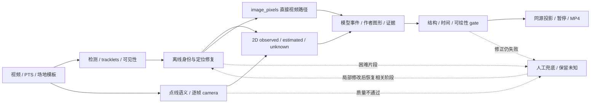

# 工作台实施方案：模型主导的身份、2D 恢复、战术生成与实拍投影

修订日期：2026-10-06，Asia/Shanghai。状态：**可评审方案，尚未授权实施**。

**修订说明：用户本轮明确否定上一稿“手绘主流程”，要求主要由模型完成、人工仅兜底；本文件整体按此方向替换。** 上一稿保留在[已被替代的手绘主线归档](archive/2026-10-06-workbench-v1-manual-first-superseded.md)。人工工具继续保留，但不是常规生产步骤。本方案不改写 10 月 5 日历史实施 / 验收记录或本聊天前一轮本地成果。本轮只修订计划，不安装 / 调用模型、不接 API、不修改生产代码或发布。

**本轮新增保护：当前战术标注的布局、工具、模块组成、撤销 / 保存、预览 / 导出行为冻结。** 不重排、拆分或迁移现有战术模块；未来优先通过新增外部薄 adapter 和后端 runner 调用既有能力。若新合同必须改核心，先列差异与影响供讨论，不视为已授权改动。

## 1. 目标与自动化边界

目标是同一条可复跑流程：

**原视频 → 专业检测 / 跟踪 / 重识别 → 离线联合身份与运动修复 → 按坐标路径准备像素位置或球场映射 / 2D 数据 → 模型战术事件 / 解释性图形 → 确定性贴图 / 投影 / 编码 → 自动质量门控。**

两条推荐路径并存：`image_pixels` 用于有效逐帧像素位置上的视频跟随标记或局部冻结图形，可不先求球场映射；`court_meters` 用于跑位路线、多球员空间关系和统一贴地投影，需要 H(t)。球场 2D 可全程在后台作为数据层，不要求用户额外操作 2D 画布，也不规定所有任务必经米制球场。稳定贴地需要几何关系，但数学上也可研究参考帧地面平面 + 帧间 homography；该路径仅为未来选项，未在冻结模块验证，不新增当前支持 mode / 第三套编辑器。

专业 CV 模型、几何优化与视觉大模型协作就是模型主导。大模型负责认回人物、解释事件、选择证据和调用工具；逐帧坐标不能主要依靠它在整帧中自由猜测。常规区间自动通过策略进入下一阶段，难恢复、低质量或互相冲突的区间才交人工。

三个问题需一起解决：

1. 第一部分错人、漏框、框底脚点不准会影响后续位置；P 编号稳定、读到背号或查到姓名不证明位置准确。
2. 第二部分不能只对已有点再平滑；短遮挡需利用前后证据恢复或明确估计，漏框、无映射和出画需分诊。曲线更顺不证明身份或米制位置更准。
3. 第三部分的球场贴地路径需可靠相机映射，直接像素标记需有效像素位置；两者均检查战术结构、源时间和可绘性。模型产结构化事件 / 几何，现有程序负责贴图 / 投影和 MP4。

不承诺十人全片完美，也不把长遮挡伪装为真实轨迹。自动化成功不是填满所有帧，而是常规任务无需逐窗口人工采用，失败能准确报告原因并从局部恢复。

API 化包含两层：**模型 provider 替换接口**与**第三方调用整条工作流的 API**。M0 定义两层合同，M4 接通验证；未来外部客户端与现有界面可调用同一 runner，当前战术 UI 不因此改布局或行为。

## 2. 现有能力、证据与缺口

| 当前层 | 已核实可复用 | 当前限制 |
| --- | --- | --- |
| 检测 / 临时 T 跟踪 | 视频导入、YOLO / 跟踪器、逐帧候选、原始检测、真实 PTS | T 不等于真人；同队交叉、遮挡和切镜会串人 / 漏框 |
| 固定 P 与资料 | P1–P10、区间关联、OCR、队标视觉候选、名单查询、参考资料衔接 | 号码 / 红蓝组 / 名单不证明全片身份或接地 |
| IdentityAgent | 用清晰参考在有限区间匹配已有 T，保护原始观测和人工记录 | 仅匹配已存 T；候选帧须有原 row 且通过风险限制，不能恢复漏框；球衣描述 + 号码仍是人工参考硬门槛 |
| Qwen 地面 Agent | 读帧 / 裁图、锚点、拟合 / 回投反馈、准备来源和采用 | `rawByPlayer` 对应原始点无有限坐标的锚点会被拒绝，原空值断段；不能桥接真正 missing / uncalibrated |
| 球场与映射 | 自动点 / 线候选、鲁棒拟合、传播、人工参照、`calibrationAt`、源切镜 | 数值可解不保证点线语义、连续稳定或米制精度；approximate 相机不是已核对标定 |
| 2D 准备 / 平滑 | 原始点保留、断点 / 人工锁点、服务端重放、版本保存 | 当前整体摘要失效；审核依赖不全；平滑不等于定位恢复 |
| 战术 / 成片 | V2、秒级范围、Bezier、进度校正、暂停、同源 2D / 视频、正式渲染 | 自动候选不等于自动全流程；2D 改区间仍有 VFR 重排缺口 |
| 作业 / 接口 | 身份 / 地面 / 战术单阶段作业、provider 边界 | 身份 API adapter 是不可用占位；身份池单 worker / 客户端单 job；完整 runner / 第三方 workflow API 尚无 |

Qwen 地面已有独立 API 调用，不表示身份 adapter 或统一并发已接通。本轮专业模型候选只有官方来源核查，未新增安装 / 本项目试跑。

### 2.1 本聊天前一轮真实单例

17.5 秒 / 1050 帧导入片中，白衣 `00` 的 T2 接回 T39：9.50–12.50 秒的 181 帧，有原始检测位置覆盖 **52 → 156 帧**，25 帧仍无位置。这 25 帧的事实是**原始跟踪无可用 row**，不是人工已判定人物完全不可见；下一阶段需逐帧分诊漏检、部分遮挡或真遮挡。

28 张依据帧另由 Codex 视觉复核，抽样未见串人；它不是独立人类逐帧真值、十人准确率或脚点精度。QA 页面再次跑通 IND / BKN、参考 `00` 及有限片段采用；P6 全片有位置 622 → 726，人工逐帧确认仍只有参考 1 帧。该片无球场标定，没有证明米制 2D 或贴地成片准确。

reference / continuation 的 ready 观察上界为 22.32 / 53.63 秒，包含轮询。此前“十人约一小时”仅为单例线性推算，不能作为时限承诺。

### 2.2 保留的工程约束

- 战术标注保护基线包括现有 UI / 工具 / 模块 / 撤销 / 保存 / 预览 / 导出；新增 adapter 的回归要证明这组行为未变化，不能把“后端能调用”当作可重组模块的授权。
- 新稿 `maxGapSeconds=0`，旧稿可能有短插值；不能靠调大 maxGap / 删除 guard 冒充恢复算法。
- 当前 `sourceCuts` 来自素材 / 人工来源；自动 shot boundary detection 是新增任务，不能称现有流程已自动识别所有切镜。
- `court_manual` 可在图像 missing 帧提供明确人工 2D 点，但不确认原图身份 / 检测，冲突 / 出画保护保持。
- 准备依赖未完整覆盖 `frameConfirmations` 等质量状态；当前准备整体失效，按 P / 范围失效属计划。
- `refreshSnapshot` 仅自动重绑脚圈；其他图形几何仍在，但全 review 摘要变化可能使其隐藏 / 失效。
- 无 `courtPreparation`、0 observed 实体 / participants、有效标定、独立 `space:'court'` 图形的内存校验 / 编排成功 183 帧，尚非完整 save → MP4。快照顺带附未保存 / 失效 prep 时，后端仍会拦，即使图形没消费它。

## 3. 自动阶段 DAG 与统一 runner



runner 持久保存 session、阶段 / 子任务状态、快照、候选、机器接受决策与结果；浏览器离线不终止流程。现有单阶段服务逐步成为内部工具，第三方不靠模拟点击来复现。

| 阶段 | 自动输入 / 输出 | gate / 失败处理 |
| --- | --- | --- |
| S0 建源 | 哈希、真实 PTS、有效片尾、镜头边界、模板与 manifest | 来源完整、可解码；不猜 fps / 片尾 |
| S1 检测 | 框、tracklets、外观 / 可见性、角色 | 原始输出保留；异常进入定位 / 身份修复 |
| S2 身份 / 定位 | 多参考、前后段、T 竞争、局部再检测 / 点或 mask 证据 | 每帧 T 排他；证据不足有限查询或 unknown |
| S3 相机（球场路径） | 点线语义、模板、多帧运动 / 支撑、独立回投 | court_meters 投影时须通过；像素跟随 / 冻结标记可不依赖它 |
| S4 坐标数据 | image_pixels 观测，或脚点 + 映射的 court_meters；估计 / 不确定度 | 两空间明确；estimated 分开；球场消费者保存合法准备，像素消费者不强绑 prep |
| S5 战术 | 有效区间、角色、所选坐标数据 / uncertainty、源帧、原作者图形 | 模型产事件 / 图形 / 暂停 / 依据，不覆盖人工锁定 |
| S6 成片 | 同一文档、已接受映射、版本与 PTS | 校验→有限修正→自动渲染；失败给对象 / 帧 / 原因 |

人物与 camera 分支可独立运行后 join，各自报告缺口；不能用人物插值掩盖映射缺失。可交替 refinement，但各轮快照固定，设轮数 / 时间 / 费用预算。后台自动选清晰参考 / 参与者，按所选坐标路径建立 / 保存实际消费的准备并产合法候选、校验与渲染；V3 球场分支需准备，像素分支不强制先做米制 CourtPreparation。常规区间自动接受记录 `machineAccepted` 与 machine-policy audit，不写 `human frameIdentityConfirmed`。

首个自动验收使用同一 QA 视频**一次 submit**：自动检测 → 缺口分诊 / 修复 → 身份 → camera / 2D → 战术候选验证 → 同源成片，不在浏览器手选参考 / 逐窗采用 / build / save。可先限单人跑位短段，再 3 人配合、10 人扩展。M1 用既有战术与渲染做小范围整链验收，M3 再深化多角色事件与生成质量。

失败 run 返回 `needs_attention`，附对象 / 帧范围 / 原因、最少证据与最小人工动作；修完从相关 stage 恢复，不重做全部。仅候选 ready、每步等待人点采用或全手绘不算自动流程通过。

## 4. 数据来源、缺口分类、不确定度与自动质量

图像 x/y 与球场 x/y 都是二维，但单位和含义不同；接口必须指定 source_space，不能将图像点直接当米制球场点。

### 4.1 类型合同

| 类型 | 定义 | 必须保留 |
| --- | --- | --- |
| observed | 当前帧有可见像素证据的检测 / 定位结果，仍非精确真值 | frame / PTS、框 / 脚点方法、可见性、归属、模型 / 人工来源 |
| recovered observation | 对漏检重新定位，有当前帧证据的新候选 | 原漏检记录、新工具 / ROI / 图像证据；不伪造原 T row |
| estimated | 无直接位置观测，利用前后 / 运动 / 映射推断 | 范围、算法、端点 / 支撑、不确定度 / 误差，不能标 observed |
| unknown / out_of_view | 无法可靠恢复或不在画面中 | 位置空、原因、是否需人工；身份可保留 |
| authored | 模型生成 / 人工修改的解释性事件、路线与图形 | 几何 / 时间 / 依据 / 作者来源，不回写真实点列 |

2D 点由图像位置与映射派生，另记接地方法和映射质量。observed 图像框也可能脚点不准；框底中点、踝点、ground-estimated 不隐藏。误差 / 支撑必须可解释，只有经测评校准的方法才能把模型分数当概率或给业务协方差。

### 4.2 缺口分诊

- 可见但漏检测：局部再检测、裁图、可见体 mask / 点追踪产生有像素依据的恢复候选，再判身份。
- T 换号 / 串人：多帧外观、队伍 / 号码、运动与共同排他约束，不整 T 盲合并。
- 短遮挡：同连续镜头、前后身份唯一、端点 / camera 可用、运动合理、不确定度过 gate 才离线补估。
- 长遮挡 / 同队无法区分：unknown / 竞争、最少人工证据，不要求模型硬填。
- 出画：位置空，回来后再关联，不自动补到画面外。
- 切镜 / 无 camera：分镜或先修映射，不扩大插值制造跨镜头路线。

需新增恢复 / 估计来源合同及定位机制，再让 Qwen / 准备层消费；不能只删除其原始无点 guard。短 gap 时长、速度与不确定度阈值由真值评估，不默认所有遮挡都补。

### 4.3 分项质量与机器接受

| 分项 | 自动检查 | 人工兜底 |
| --- | --- | --- |
| 身份 | T 排他、多参考 / 前后一致、队伍 / 号码矛盾、交叉风险 | 竞争难消解、模糊单帧、参考变化 |
| 脚点 / 地面 | 可见证据、接地方法、跳跃、估计支撑 / 不确定度 | 足部不可判读、长遮挡、误差超容差 |
| camera | 模板 / 篮侧、点线对应、稳定性、切镜、独立回投、漂移 / 外推 | 语义不明、支撑不足、无映射或回投失败 |

常规区间无需人工逐窗采用；记录策略版本、输入 / 结果摘要、检查项和残余未知。人工 review 状态独立，机器通过不染成人工绿。现有绿只代表对应本帧人工审核，不代表身份 + 接地 + 映射全准确。

当前机器有坐标、`accepted_reference` 有效映射已可数值投影 / 平滑；拒用的 `needs_review` 映射不能这样消费。新 gate 补在现有事实之上，不以“全部点变绿”验收。导出容差 / 是否允许审核不足的警告导出待定，来源失效 / 数值无解 / 投影缺口硬检查保留。

## 5. 离线身份与运动联合修复

TAPIR 的角色是追踪**给定种子点**：未来由 detector / keypoints 自动提供种子，输出逐帧 image x/y、occlusion 与 expected_dist。它不识别人物姓名 / 战术，不输出米制球场或标注三维视频，也不直接生成战术贴图；其结果可供像素跟随，或另经 H(t) 转球场坐标。遮挡与误差输出仍需评估，不能承诺估计准确。[官方实现](https://github.com/google-deepmind/tapnet/blob/main/tapnet/models/tapir_model.py)

tapnet 整库可用于三处候选增强：人物像素点 / 可见性辅助；固定球场背景点辅助 camera 拟合（仍需几何与标准球场注册）；直接视频点标记可不先转米制。官方仓库包含 TAPIR / BootsTAPIR / TAPNext / BootsTAPNext PyTorch / TAPNext++ / TRAJAN，后续先比较官方 PyTorch TAPIR 与 TAPNext++，未安装或验证本项目精度 / 性能，不整体替换现 tracker。[官方 README](https://github.com/google-deepmind/tapnet)

官方 [Rainbow notebook](https://github.com/google-deepmind/tapnet/blob/main/colabs/tapir_rainbow_demo.ipynb) 和 [viz_utils 的背景单应工具](https://github.com/google-deepmind/tapnet/blob/main/tapnet/utils/viz_utils.py) 可参考背景点 RANSAC camera 补偿；其平面背景 / 相机纯旋转前提、半自动流程与阈值敏感性不等于 NBA 场地识别或米制注册。

优先补现 baseline 的明确缺层，再用同片 A/B 决定追加模型，不一次安装整套候选。

1. 自动选参与者和多帧清晰参考，保留朝向、可见性、队伍 / 号码证据；mask / 点跟踪提示由 detector / keypoints 生成，不逐人让用户点击。匿名 P 持续跟踪不以图库实名为前置；自动参考与 NBA 资料 / 人工确认分开，解除手填 team / jersey 门槛，不伪填未知号码。
2. 按风险、切镜、人工边界拆 tracklet，识别同一 T 中途换人 / 重复占用 / 跳跃。
3. 全片离线联合外观、运动、队伍 / 号码与一对一排他关联。允许看前后帧，不反向伪称缺口帧有观测。
4. 对漏框区间用专业再检测 / 可见性 / 受控定位工具恢复当前帧候选。VLM 选工具、核对人物和解释竞争，不自由输出全帧坐标作真值。
5. 短 gap 双向约束估计，带误差 / 证据，比较是否优于保留未知；长 gap 不强制补。身份 / camera 不可靠时不生成假米制路径。
6. 从 3 人到 10 人联合分配，统一同帧占用与重叠窗。先独立续接十人、再按响应先后占 T 不合格；人工锁定是不可覆盖约束。

每次恢复保留原检测与新增候选差异。定位 / 身份 / camera 的迭代输入输出有版本，常规自动接受与人工接管分别计数。未知不是错误自动接受的替代指标，不能为了覆盖率牺牲错人率。

## 6. 稳定逐帧 camera 与 2D

本节服务 court_meters 路线与球场空间关系；不是 image_pixels 跟随标记 / 冻结图形的统一前置。参考地面平面方案仅未来研究，不以现有 `videoMode:'fixed'` 声称可随镜头贴地。

球场地面与图像平面可通过单应映射连接，不能由此声称三维人体 / 跳起位置已重建。[OpenCV 官方说明](https://docs.opencv.org/4.12.0/d9/dab/tutorial_homography.html)

自动校准顺序：多候选点 / 线语义 → 场地模板 / 篮侧 / 点名验证 → 鲁棒拟合 → 镜头运动 / 背景地面可见性 → 多帧优化 → 独立回投 checks → 区间质量 gate。

NBA / FIBA 模板、尺度 / 坐标与索引不混用，记录 template ID / 版本。连续镜头约束漂移、切镜独立初始化；当前实际主投影复用 `calibrationAt`，approximate 相机只是明确示意来源。未参与拟合的独立点 / 线检查近远端、方向与外推；四个拟合点 residual 小不算完整精度证明。

通过的映射才进入对应源帧 2D / 投影；有限修正仍失败则需要人工标定，不能自动用示意相机掩盖。传播中要排除运动球员 / 遮挡点，image point tracking 不自动等于地面锚点。

复用 `buildCourtTrajectories`、原始 / 准备点与服务端重放，引入 recovered / estimated 来源，传播身份、脚点和 camera 不确定度。当前脚点敏感度不含相机误差，不能叫总米制误差。

Qwen 可协同查脚点 / 地面异常并 refinement，结果仍走共享来源校验；不能隐去原漏框。拟合 / 平滑保留停顿、折返、身份边界与切镜，不能只凭顺滑自动接受。

真实 PTS / 经确认片尾、原始数据、镜头映射、质量与准备版本分别记录。先保守失效，再做按 P / 区间重算；审核 / machine-policy 变化也刷新质量摘要，不复用旧绿灯。

## 7. 自动战术结构与确定性实拍渲染

模型读取有效区间、参与者 / 角色、2D observed / estimated / unknown、源帧、质量 / 缺口和已有 authored 图形，输出事件 / 关系、动作 / 显示时间、依据帧、Bezier 路线 / 标记、进度点和暂停讲解。

作者曲线可示意化但不写回真实轨迹。生成后自动检查结构、时间 / 引用、切镜、坐标边界、投影可绘性与来源摘要；优先复用既有 bounded 一次修正，配置 / 总预算约束后仍失败则 needs_attention。常规候选按机器策略接受、保存合法版本、确定性编码，不停在“候选 ready 等用户点”。

现有 V3 球场分支要求已保存 prep、匹配的 `preparationDigest / range / evidence` 且 annotations `minItems=1`；不能把该分支门槛泛化到所有像素标记。像素 adapter 优先复用既有 video 标注合同，无法安全适配时只列差异待讨论。新阶段合同需支持 `no_valid_tactic / insufficient_evidence / partial`；不能为了过 schema 造箭头，空候选 / 结构失败或 ready 不算目标自动成片成功。

### 7.1 冻结核心、外接工具与待讨论差异

- 当前 V3 / `tactics-agent.mjs`、court editor、annotations、presentation、production、worker / `tactics_render.py` 的组成与现有 UI 行为冻结；外部薄 adapter 只调用已有入口，不重排 / 拆分 / 迁移，不新造引擎。
- `tactics-court-editor.setAnnotationRange` 的帧比例缺口仍是事实；未来 Agent adapter 优先调用已有 `retimeProgress` 处理新候选并做 VFR 回归。若必须改现核心，列为差异待讨论，不默认修当前模块 / 行为。
- authored 对象按实际媒体 / PTS / 坐标系 / 区间 / camera / 目标人物绑定。消费 adopted 2D 的模型路径保存其证据 / 版本，无关人物审核不让全部独立作者图形消失。
- A 完全无 prep、B 曾建立未保存 / 失效但没消费的可选 prep，独立对象不被无用依赖拦保存 / render；不删原准备，不绕过真正跟随 / 观测对象校验。
- 标定变化保留 2D 几何并重核投影，不清空 / 静默移坐标系；换源 / PTS 需重新定位，不能凭同 P 复活旧图形。

### 7.2 Agent 的明确贴图 / 投影操作（仅预留，尚未实现）

建议外接 `check_projection`（检查坐标 / 时间 / 来源与缺口）、`preview_projection`（在快照上生成预览）、`render_projected_video`（提交确定性编码）。可包装现有 `space:'video' / 'court'`，API 用 `source_space:'image_pixels' / 'court_meters'` 明确单位，不重建战术模块。

预览 wrapper 组合既有 `projectAnnotations / renderAnnotationsSVG` 与准确源帧；源帧读取接口本身不是投影预览，旧报告 export 也不是正式视频渲染。现有 `followEntity` 仅支持已声明 P 的 spotlight，TAPIR 任意 query → P / 观测的绑定是待实现外接合同，不称任意点已可直接跟随；无安全绑定时返回错误 / 待处理。

现有 video 合同不可扩大：普通 `space:'video'` 且无跟随 / authoredPath / fixed 时只在 anchorFrame 显示；V2 `videoMode:'fixed'` 需 referenceSize 和 `timingMode:'manual'`，区间内固定像素、不随镜头；`player_foot` 仅 spotlight + 已声明 P + 有效原图轨迹，缺映射仍可圈，映射可选用于塑形，但不证明接地 / 身份。wrapper 须明确解析并返回参考帧、固定区间、声明球员跟随或球场投影的显示 / 绑定意图，不只看 source_space；参考帧意图不是新增原生 videoMode，当前原生枚举仍仅 fixed。

TAPIR 若使用裁图 / 缩放，须记录 query / 输出的像素顺序、原图 / 模型尺寸及坐标 transform，转回原视频像素再消费；不能把模型尺寸坐标直接当原图落点或 court 米制。

共同输入：source video SHA、docId + docVersion、基于真实 PTS / frameMapping 的 range、source_space、style、expectedVersion 与幂等键；court_meters 另要求 calibrationRef（来源 / 版本 / 支撑范围）。输入文档必须存在且版本匹配，style 只作用于任务快照 / 派生候选，不覆盖用户手工样式。共同输出：jobId / status、缺口或结构 / 时间 / 来源错误、preview / result artifacts、实际版本与 manifest。

Agent 读取不可变快照，不直接修改用户 draft。生成内容存派生候选 / 新结果，保护 manual locks、版本冲突与幂等；预览 / 编码不偷偷采用或重绑。需要提交候选时走另行明确的版本 / 机器策略合同，不能绕过当前保存与用户稿保护。

### 7.3 语义与失败

未来路线虚线仍表示之后**实际观察到**的路线，不同时表示预测、低质量或遮挡估计。estimated / unknown 单独表示，样式与能否用于跟随 / 指标待定。源动作进度、暂停和输出时钟独立；慢放 / 编码 FPS 不改源 PTS。

跟随圈没有可靠位置时不漂到另一人。贴地成片缺映射不能假造落点；固定像素静态标注是显式人工降级，保存其模式 / 尺寸，不称随镜头投影。人工可校正时间进度 / 曲线，但不是常规生产主步骤。

## 8. 两层 API、持久 run、manifest 与并发

### 8.1 模型 provider

复用服务端 `VisionProvider.status/generate`、`create_provider` 注册真实 adapter；专业 CV / 地面模块是受控工具。提供方、模型、地域、key、图片 / JSON / 工具能力待定。密钥不在前端 / manifest，usage / 错误 / 取消映射明确；现 Codex CLI 与 Qwen 地面能力保留，身份 HTTP adapter 仍需实施。

### 8.2 第三方 workflow API（M0 定合同、M4 交付）

工作流的 Agent 投影步骤调用 §7.2 外部工具；图像像素直贴与球场米制投影在输入 / 结果中区分。新增后端入口 / 外部客户端承载这些操作，不在当前战术页面增加按钮或改变模块。

| 接口草案 | 合同与必要行为 |
| --- | --- |
| `POST /api/workflows/runs` | 登记视频 / 上传来源、模板、范围、目标、质量政策、配置版本、幂等键；返回持久 runId |
| `GET /api/workflows/runs/{id}` | 整体 / stage / 子任务状态、问题范围、usage；断线可恢复，不靠浏览器 session |
| `GET /api/workflows/runs/{id}/result` | manifest、身份 / 2D / 事件 / 图形、质量 / 证据、文件引用；明确 partial / estimated / unknown |
| `POST /api/workflows/runs/{id}/cancel` | 停调度 / 可取消调用，保留已有来源 / 结果，不自动采用迟到输出 |
| `POST /api/workflows/runs/{id}/retry` | 按 stage / 范围创建 attempt，合法缓存复用；原失败 / 请求 / 费用留存 |
| review action 合同 | 写困难段人工修正 / 保留未知，再从相关 stage 恢复；UI 与第三方同合同 |

run 状态至少有 queued / running / completed / needs_attention / failed / cancelled；stage 状态包含排队、准备、推理、校验、机器接受、保存、渲染和结果。needs_attention 给对象 / 帧 / 原因 / 最小动作；不把模型返回候选或 HTTP 200 叫端到端完成。

来源、可访问 run / 文件、期望版本和幂等受服务端控制。错误区分来源 / 输入冲突、模型、限流、预算、质量和取消。接口合同在前期确定，避免最后发现 runner 依赖 UI 点击不能 API 化。

### 8.3 manifest 与复跑

固定视频哈希 / 源 PTS / 片尾、模型权重 / 代码 / runtime 的版本与 hash、模板 / 坐标系、prompt / schema / 工具版本、provider / 模型 / temperature / top_p、阶段配置 / 质量策略、读取依赖、接受决策 / 文档与 artifact hashes、requestId / usage / 计时、人工动作及编码环境。模型参数记录实际支持情况，seed 支持时记录取值，不支持记 null。

视觉输入记录实际证据帧与 ROI、输入图片 SHA、缩放 / 裁图坐标 transform；保留 raw model responses 与完整 tool audit，能还原某次运行真正送入 / 收到的内容，不只笼统保存“参数相同”。凭据不进入这些文件。

区分**保存模型输出后的确定重放**与**按 manifest 重新推理**。前者几何 / 时间 / 同源渲染应可验证；后者 VLM / 模型不保证逐字或 bitwise 一致，保存新 attempt 与差异。MP4 字节一致还取决于固定编码依赖 / 参数 / 元数据，单独测试，不跨机器笼统承诺。

### 8.4 有限并发 / cache / 合并

首轮比较 1 / 2 / **最多 3** 在途请求，3 只是试验建议，不是额度 / 速度承诺。本地 GPU 另按显存 / 峰值独立限并发，API 3 不等于本地重模型同时跑 3 个。scan → refine / 工具反馈保持顺序；并行用于跨球员 / 独立窗口。限流同时考虑 RPM、TPM、短峰值和其他模型限制，有限退避 / 预算；取消、超时重发可能已计费。[官方限流示例](https://www.alibabacloud.com/help/zh/model-studio/rate-limit)

共享帧 cache 按视频哈希、准确 PTS / 帧、分辨率 / 解码版本，裁图另含 ROI / 框 / 跟踪指纹；不以近邻帧或旧输出冒充新推理。

当前全 session 摘要保护不能直接配多 worker：P1 先采用会使 P2 全摘要过期。拟用 task set 不可变基线 + 当前草稿 + 所有候选三方合并，记录实际读依赖，统一 `(frame,T)→P` 排他、重叠窗、人工锁定。相容结果机器接受，竞争 / 人工新改动不按响应先后或原 confidence 自动覆盖。

一次采用只使真正相交依赖失效，无关候选保留。服务端原子校验当前版本 / 差异摘要，重复接受幂等；P 交换、参考 / 检测 / PTS 变化仍使相关结果过期。不能删原保护来假装支持并发。

## 9. 分阶段任务、依赖、落点与验收

所有勾选项均为计划；新增模块名是建议落点。本轮仅修订方案与相关文档，没有修改生产代码。

### M0：真值 / taxonomy / 自动基线 / API 合同

- [ ] **T0 真值与失败分类**：`research/vision/` 标注规范 / 小集，涵盖单人、同队交叉、漏框 / 遮挡、出画、移动 / 切镜；两人复核争议与未知。增加清楚可见片段的人工像素遮挡 / 隐藏检测对照，用保留的未遮挡原图真值评恢复 / 估计（两种支路均不提供该目标帧真值派生的原检测框、脚点或2D坐标；像素遮挡支路也不泄露对应未遮挡目标图像）；真实完全不可见区间只报 unknown / estimated 及不确定度，不以模型自填点验精度。人工真值是测评，不变为日常生产前置。
- [ ] **T1 同片自动基线**：复用 probe / evaluate / 回放，记录错误自动接受率、任务自动完成率、人工接管、身份 / 位置覆盖与错误、camera 漂移、端到端视觉、耗时 / 费用；正式草稿与原视频保护，仅 QA。
- [ ] **T2 合同**：observed / recovered / estimated / unknown、自动参考、machine audit、stage / run、manifest、两层 API 与 §7.2 投影操作；区分 image_pixels / court_meters / calibrationRef。冻结战术保护基线，核实 prep / V3 / 编码耦合；核心改动需求只列差异待讨论。

**验收：** 基线与人工真值可复核，28 帧模型复核不替代真值；参数 / 模型候选明确待评估；全流程 API 可实施而非点击脚本。

### M1：单人 + 单连续镜头自动修复与小范围整链

| 任务 | 交付 / 落点 | 依赖 | 验收 |
| --- | --- | --- | --- |
| T3 自动参考 / 定位恢复 | 扩 `identity_agent.py`、`identity-continuation.mjs`；建议 `vision_position_repair.py` 与测试 | T0–T2 | 不手选参考 / 伪填号码；漏框恢复有当前像素证据，原 T row 保留 |
| T4 双向身份 / 短 gap 估计 | 现有关联 + 显式恢复 / 估计层，接 `ground-trajectory.mjs` / 准备 | T3 | 可见漏检先定位；不可见且合条件才 estimated；长 gap / 切镜 / 出画留未知 |
| T5 自动 shot / camera gate | 新增 shot detection，复用候选、`calibration-guide.mjs`、`court.mjs` / 传播；独立点线检查、多帧优化 | T0、T2，与 T3/T4 并行后 join | 素材 / 人工 cuts 与自动 cuts 分来源；模板 / 方向 / 独立漂移可验证，不只 H逆变换往返或四点拟合残差 |
| T6 统一 runner / 机器接受 / 保存 | 建议 `workbench_pipeline.py`，接 `serve_player_review.py`、作业 / Store，调用现战术 / 正式渲染做单人例 | T3–T5 | 一次 submit 自动检测→修复→身份→camera/2D→合法战术→投影/MP4；无逐窗采用或手工 build/save |

短 gap 时长 / 速度 / 误差阈值由 M0–M1 评估。M1 不把仅生成 2D 候选当整链成功；难点 run needs_attention 是明确失败 / 接管证据，不伪称自动完成。

### M2：3 → 10 人联合身份、稳定 camera 与 2D

| 任务 | 交付 / 落点 | 依赖 | 验收 |
| --- | --- | --- | --- |
| T7 联合关联 / T 竞争 | 建议联合分配 / `identity_candidate_merge` 模块，接现身份服务 | T4、T6 | 先 3 再 10 人；同队交叉 / 重叠窗无静默覆盖 / 双占 T |
| T8 多镜头 / 准备依赖 | 相机 / 2D 分层，补 frameConfirmations / machine 质量依赖，保守失效后范围化 | T5、T7 | 切镜断开，估计 / 原始可追；相关变更重算，原人工内容保留 |
| T9 常规自动 / 难点包 | 外部客户端 / API 的 runner review package；人工沿现有慢放 / 关联 / 脚点 / 标定工具兜底，战术UI冻结 | T7、T8 | 常规不逐窗采用；难点最小动作、相关 stage 重试，人工锁点不可覆盖 |

**验收：** 分人数报告错误自动接受、自动完成与接管比例，不只报十人都有点；全片十人质量 / 时限先定目标再实测。

### M3：多角色模型战术 / 质量 gate / 确定性成片

| 任务 | 交付 / 落点 | 依赖 | 验收 |
| --- | --- | --- | --- |
| T10 外接战术 Agent 候选 | 新薄 adapter 调用既有 V3 / 战术能力，接所选坐标 / uncertainty / 证据与空结果合同；核心扩展另列差异 | 单人可自 T6；多人依 T9 | 模型产事件 / 时间 / 曲线 / 暂停；不造假成功或改用户稿；现工具 / 模块不变 |
| T11 adapter 时间 / 依赖检查 | 外接层复用已有 retimeProgress、验证 / Store 入口，核实际消费与 A/B；核心修复需求不自动实施 | T2、T10 | 新候选 VFR / 片尾 / 暂停正确；真消费 prep 仍验证；现保存 / 撤销行为冻结 |
| T12 Agent 贴图 / 投影 / 编码操作 | 新增 check_projection / preview_projection / render_projected_video 包装既有投影 / production / worker | T10、T11；court路径另依T5 | image_pixels / court_meters 两路径、明确缺口与产物；同快照真MP4解码；当前预览 / 导出不变 |
| T13 冻结工具 / 兜底回归 | 只调用现曲线、暂停、脚点、关联、撤销及既有 smoke 验证行为；不改布局 / 模块 | T12 | 难点仍可处理；原撤销 / 保存 / 预览 / 导出不变，估计与 later observed 语义分开 |

**验收：** 原片到成片同 runner 自动完成常规任务；独立测战术正确、参与者、时间、落点与人工介入，渲染成功不等于语义正确。

### M4：provider + 第三方 API / headless / manifest / 并发

- [ ] **T14 provider**：`vision_provider.py` + adapter / tests；可信配置和所选官方图片 / schema / 工具 / usage / 取消 / 错误协议。未定供应商不写已接。
- [ ] **T15 workflow API**：按 T2 实现持久 submit / status / result / cancel / retry / review 与 §7.2 外接投影操作；外部客户端 / 第三方走同 runner，无需浏览器，不重组当前战术 UI。
- [ ] **T16 复跑 / 恢复**：固定 manifest，模型输出重放与重推理分开；服务重启、断线、重复提交、stage 重试恢复。
- [ ] **T17 调度 / cache / 原子合并**：有限并发、RPM / TPM / 费用预算，scan→refine 顺序；重叠窗 / P 交换 / 人工变更安全合并，先比 1/2/3。

依 T2 提前合同、已验 runner / gate / 成片；供应商 / key / 额度 / 预算待用户。验收 UI 与 headless 结果 / 版本关系、失败 / 取消 / 重试、费用留存与可重放，不能为赶接口先移除质量保护。

## 10. 验收指标与耗时 / 费用记录

| 优先维度 | 记录方法 | 边界 / 阈值 |
| --- | --- | --- |
| 错误自动接受 | 经独立真值核验的 machineAccepted 错人 / 错点 / 错映射 / 错事件比例与失败分类 | 优先于覆盖、平滑或模型 confidence；阈值 M0–M1 后定 |
| 任务自动完成 / 人工接管 | 一次 submit 成功率、needs_attention 范围、人工分钟与动作数、恢复成功 | 常规不逐窗采用；测评真值成本另记 |
| 身份 / 位置 | 人类可判读的 P 正确率、误续接 / 断裂、漏框恢复错率、observed / estimated / unknown 覆盖 | 明确分母 / 出画；编号稳定不是真人正确 |
| 脚点 / camera / 2D | 接地像素误差中位数 / P95、独立回投误差 / 漂移 / 外推；有独立米制参照再报米误差 | 框底不是真值；拟合 residual / 几何往返不替代视觉验证 |
| 战术 / 投影 | 事件 / 参与者 / 关系 / 区间、缺证据幻觉、地面落点、暂停 / VFR / 片尾、同源成片 | 合成验几何，真片验视觉；183 帧内存编排不叫 MP4 已验收 |
| 性能 | 准备 / 排队 / 推理 / refinement / 合并 / 编码 P50/P95，显存 / 内存、取消 / 重试 | 单例 / 3 并发不保证十人时限 |
| 费用 | provider / 模型 / 参数、图片数量尺寸、usage、请求 / 重试 ID、当时单价、预算 / 耗尽状态 | 未知 null 不填0；取消也可能计费，未选供应商不编预算 |

真值覆盖常规跑动、同队交叉、漏框 / 部分或全遮挡、重新入画、移动和切镜；两人复核争议，无法判定保留 unknown。参考 / 训练与测评帧分开，模型复核只辅助。

硬行为条件：原始来源 / 人工锁定保留，估计不标 observed，机器不标 human，同帧排他，质量失败不造坐标 / camera，PTS 一致，版本冲突不强覆盖，同一几何只渲染一套。数值精度容差经过基线再定。

## 11. 推荐 UI：看自动进度，人工只接难点

**当前战术 UI / 布局 / 工具 / 模块及操作行为冻结。** 下方仅是外部客户端 / API 状态的逻辑示意，不是重布局或增加现战术按钮的任务；自动 runner 不要求用户打开额外 2D 画布。未来若要在现 UI 展示状态，另列差异讨论。

```text
素材 / 范围 / 模板    [运行自动流程] [取消]
检测→身份/定位→camera→2D→战术→成片
自动完成___  错误/待复核___  unknown___  预算/耗时___

① 人物/球场：自动多帧参考、队伍/号码各有来源
难点P6 10.37—10.78s：原始无row，原因待分诊
[证据前后帧] [人工修正] [保留未知] [相关stage重试]

② 2D与模型战术
┌────────────────────┬────────────────────────┐
│ observed/estimated │ 同步原视频/证据        │
│ unknown断段        │ 事件/人物/动作时间     │
│ 模型authored图形   │ [仅修改难点] [重算选段]│
└────────────────────┴────────────────────────┘
身份/脚点/映射三列质量；machine通过与human审核分开

③ 实拍投影：同一文档、暂停、剩余路线、最终gate
[预览] [下载MP4] [返回难点] [manifest/结构结果]
```

保留现有视频 / 2D 绘图、曲线、时间校正、圈和撤销用于兜底。独立作者角色不冒充已识别 P；常规生产不要求用户从空白画图。

## 12. 官方候选、待定决策与来源

### 12.1 不堆模型，按解决层做同片 A/B

| 候选 / 官方来源 | 可解决哪层 | 不解决哪层 / 接纳条件 |
| --- | --- | --- |
| [SportsMOT，ICCV 2023](https://openaccess.thecvf.com/content/ICCV2023/html/Cui_SportsMOT_A_Large_Multi-Object_Tracking_Dataset_in_Multiple_Sports_Scenes_ICCV_2023_paper.html) | 体育变速 / 相似外观的 motion+appearance 关联方向 / 评测参考 | 旧 SOTA 非当前结论；同片身份错率 / 未知优于 baseline 才追加 |
| [SAM2](https://github.com/facebookresearch/sam2) / [SAM3.1 官方发布](https://github.com/facebookresearch/sam3/blob/main/RELEASE_SAM3p1.md) | 视频 mask / 可见体区域，联合多对象共享内存方向 | 不保长期真人ID / ground；未安装，先评本机显存 / 速度 / 错关联，不搬用H100大对象数宣传 |
| [CoTracker3](https://github.com/facebookresearch/co-tracker) | offline 联合点跟踪 / visibility，地面背景点辅助camera / 身体点定位 | 图像点不是身份或接地；过滤动态点，同片camera漂移改善才接 |
| [TAPIR 官方实现](https://github.com/google-deepmind/tapnet/blob/main/tapnet/models/tapir_model.py) / [tapnet 当前仓库](https://github.com/google-deepmind/tapnet) | 给定种子点→逐帧image x/y + occlusion/expected_dist，未来detector自动给种子；像素跟随 / 可见性候选 | 不认姓名 / 战术，不产court米制或3D标注；误差非校准保证；TAPNext++未试跑 |
| [KaliCalib](https://github.com/CEA-LIST/KaliCalib) | 篮球court registration，历史本机对照可复用 | 原生FIBA模板注意NBA尺度 / 点名 / 坐标，不当drop-in精确相机 |

先现 baseline + repair / visibility 机制，再选一个对应失败层的候选实验；本轮官方核查不等于安装 / 本视频验证。参数和具体模型仍为候选。

### 12.2 待定

- 自动目标：视频长度 / 镜头、先哪一短段 / 三人，十人质量 / 时限和 unknown 容忍度。
- 质量：错误自动接受上限、短 gap / 速度 / 不确定度阈值、脚点 / camera 容差、估计可用于哪些展示 / 指标。
- 投影 / 导出：审核不足但数值有效是否警告导出，低质量 / 缺映射片段的 partial 交付方式。
- 专业模型 / GPU：同片 A/B 与实测预算，不能一次全部叠加。
- provider：提供方 / 地域 / 模型 / key、图片 / 工具、usage / 预算及超预算行为。
- workflow API：来源上传 / 注册、访问 / 部署、结果保留、服务恢复和第三方 review 合同。
- 接口 / 展示：先外接工具与后端数据；当前战术布局 / 模块 / 行为不动，后台2D不强迫用户操作。任何核心差异 / 新UI要求单独讨论，不作为既有授权。

### 12.3 本地与官方来源

- [前一轮单人试验 / 边界](../../../research/vision/player-identity-continuation-20261006/README.md)、[181帧评估](../../../research/vision/player-identity-continuation-20261006/evaluation.json)。
- [身份provider](../identity-vision-provider.md)、[现IdentityAgent](../../scripts/identity_agent.py)、[Qwen地面](../qwen-ground-trajectory-agent.md)、[地面锚点合同](../../tools/player-review/ground-trajectory.mjs)。
- [现2D与失效](../2d-first-tactics-workbench-guide.md)、[人工兜底](../manual-tactics-workbench-guide.md)、[VFR/MP4历史验收](../manual-tactics-workbench-acceptance.md)。
- [投影/人工点](../../tools/player-review/court.mjs)、[准备依赖](../../tools/player-review/court-preparation.mjs)、[同源标注](../../tools/player-review/tactics-annotations.mjs)、[正式编排](../../tools/player-review/tactics-production.mjs)。
- [OpenCV平面单应](https://docs.opencv.org/4.12.0/d9/dab/tutorial_homography.html)、[百炼官方限流示例](https://www.alibabacloud.com/help/zh/model-studio/rate-limit)：实施时重核账号 / 文档，不表示选定提供方。

来源核查日期：2026-10-06。实施需后续授权；自动gate、runner、API和模型效果在验收前不得标为已完成。
