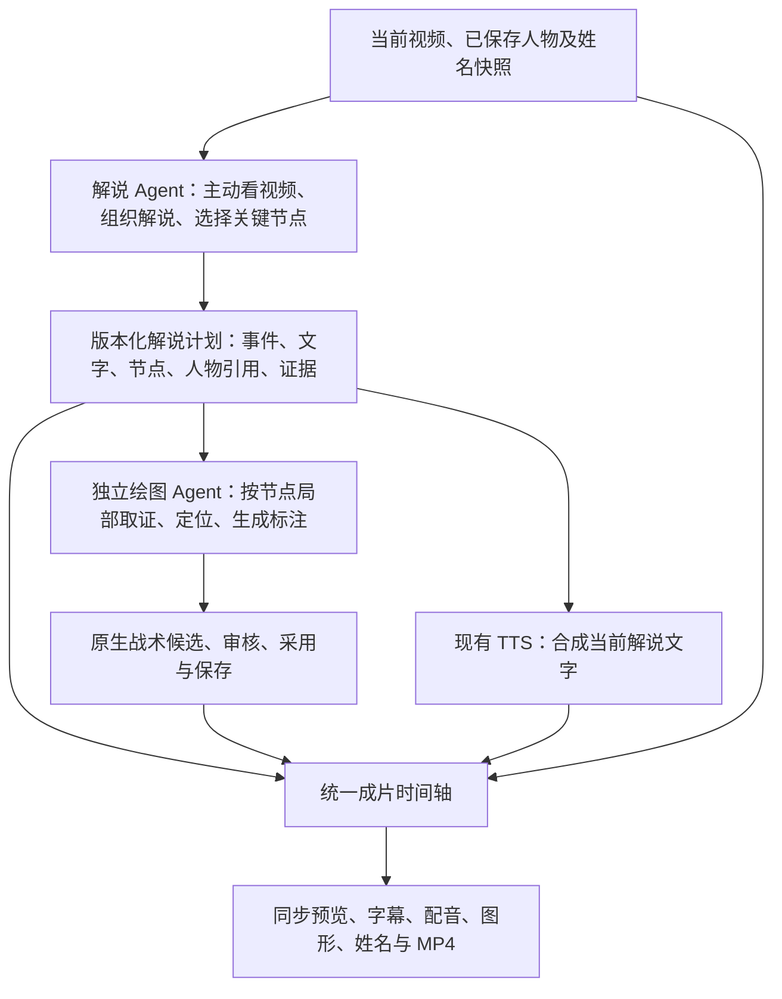

# 解说先行、独立绘图与姓名接入设计

日期：2026-10-09，Asia/Shanghai。源码基线：`1a14be3`。用户于 2026-10-10 批准本设计并授权实施，见[实施计划](../plans/2026-10-10-commentary-led-tactics-implementation.md)。提交、运行验证和部署状态以实施交接为准。

## 1. 已确认的任务边界

- 先由解说 Agent 沿现有 Pi 视频工具与 API 调用方式分析视频，生成解说和关键时间节点。
- 再由独立绘图 Agent 根据已保存的解说内容、重点和时间节点，切入相应画面并生成战术图形。两个 Agent 各有上下文、工具、任务状态与失败边界。
- 绘图默认继承解说的模型配置，保留绘图模型的独立覆盖接口（2A）。新主流程使用解说侧的 API 调用通道。
- 复用已有姓名识别和人工确认结果，优先融入解说及画面姓名展示；不重做姓名识别（1A）。
- 本轮交付覆盖工作台预览以及字幕、配音、战术图形、姓名的联合成片。
- 出手冻结、出手前一秒防守分析、2K 攻防评价暂缓。关键节点强调是一般解说制作能力，不预设每次投篮必须冻结。

## 2. 顺序与职责

解说 Agent 不输出路线控制点、绘图坐标或调用画图工具。它只交付“讲什么、涉及谁、在哪个节点强调”。绘图 Agent 不修改解说或重新建立另一套全片战术故事；它可以看节点附近的真实画面来确定几何位置，并核对描述是否有图像支持。

工作台按“生成解说 → 根据当前解说绘图 → 联合成片”显示阶段。可以由宿主顺序衔接两个独立任务，也保留单独重跑、编辑和取消入口，不增加强制的逐阶段人工批准步骤。绘图只能读取一个已保存且来源匹配的解说版本；文字任务失败时不启动下游，绘图失败时解说仍可用。

## 3. 解说到绘图的版本化交接

保留当前 `summary/events/cues/uncertainties`。现有字段与工具定义见 [commentary-tools.mjs](../../tools/player-review/agents/commentary-tools.mjs) 第 104–116 行。新增解说计划版本和关键节点，不把现有自然语言 `participants:string[]` 当作可靠人物主键。

| 层级 | 拟议字段与职责 |
| --- | --- |
| 计划 | `schemaVersion/planId/revision/digest/sourceRef/nameSnapshotRef/producerJobRef/producerConfigSnapshot`，由宿主分配、计算和验证；记录生成本计划的实际模型配置，后续文字编辑保留分析来源 |
| 来源 | 视频摘要、跟踪版本、帧映射摘要、当前已保存 session 摘要；明确资产帧与父原片帧的映射 |
| 人物 | `participantId`、可空 `entityId`、可空姓名记录引用、有效范围、身份状态；匿名人物仍有稳定的局部 ID |
| 关键节点 | `nodeId/eventId/cueIds/anchorAssetFrame/evidenceWindow/participantRefs/focus/uncertainties`；帧及窗口均属于当前视频资产，表达时间与讲解重点，不含坐标 |
| 时间 | 宿主按下表补充当前资产解码时间、片内相对秒和已验证的父原片映射，不让模型独立猜算多个时间字段 |
| 证据 | 已实际返回的图片资产及其源帧引用；保留图像观察与战术解释的区分 |

`anchorAssetFrame` 必须是解说 Agent 实际读取的有效证据帧，属于本事件/节点可用窗口，并绑定当前视频资产摘要。重点可以是掩护形成、传球启动、空间拉开等，不强制使用区间中点。节点窗口与切镜边界分别保存，不能跨镜头默认续接人物或路线。

2026-10-10 实施接口约定：新计划的每条 cue 必须且只能归属一个节点，多条 cue 可以共用一个节点。普通播放句也保存证据锚点，但不会仅因存在节点就冻结；实际停顿由 delivery、语音长度和图形编排共同确定。旧稿保持独立字幕成片能力，不自动补造节点。

时间字段使用明确的坐标域，禁止直接按历史同名字段连接：

| 坐标域 | 规范字段与转换来源 |
| --- | --- |
| 当前资产帧 | `assetFrame` 为当前视频的解码帧序号；关键节点用 `anchorAssetFrame` 引用 |
| 当前资产解码时间 | `assetPts/assetTimeBase/assetPtsSeconds` 取实际解码记录；现有 commentary 的 `sourceTime` 对应这里的绝对 PTS 秒 |
| 当前资产片内时间 | `clipTimeSeconds = assetPtsSeconds - firstAssetPtsSeconds`；不能直接当作父原片时间 |
| 既有 review 时间 | `reviewTimeSeconds` 来自已验证的 `sourceFrameMapping[assetFrame].time`；通过逐帧对应表校验与解码时间的关系，不假定等于 `clipTimeSeconds` |
| 父原片位置 | `parentFrame/parentTimeSeconds/parentVideoSha256` 仅取已验证的 review 帧映射及其原片摘要；其中 mapping 的 `sourceFrame/sourceTime` 属于父原片。缺少映射时保持 `null`，不能由资产 PTS 推算 |
| 输出成片位置 | `outputFrame/outputTimeSeconds` 仅由统一编排生成，冻结后可有多个输出帧对应同一资产帧 |

帧映射摘要覆盖逐帧对应关系；资产与映射不匹配时阻止采用。现有字段差异可对照 [commentary_video.py](../../scripts/commentary_video.py) 的 `_index_video` 和 [trajectory.mjs](../../tools/player-review/trajectory.mjs) 的 `exportReview`。适配旧接口时显式转换，不改变历史字段含义。

保存采用 `expectedRevision` 防止后台任务覆盖用户的新编辑；每个计划版本不可变。绘图请求携带 `commentaryPlanRef={planId,revision,digest}` 和 `nodeIds`。结果还记录绘图任务版本、实际模型、节点摘要与证据，采用前再次核对来源及上游版本。原保存位置和任务机制见 [commentary_jobs.py](../../scripts/commentary_jobs.py) 第 250–258 行，目前直接覆盖 `plan.json`，需扩展。

## 4. 独立绘图 Agent 与图像证据

新绘图 worker 创建独立 Pi Agent，可复用 provider、Python/Node JSONL RPC、视频解码与缓存；不复用解说 Agent 的消息历史或工具状态。复用入口见 [commentary-provider.mjs](../../tools/player-review/agents/commentary-provider.mjs)、[commentary_agent.py](../../scripts/commentary_agent.py) 和 [commentary_video.py](../../scripts/commentary_video.py)。

绘图工具范围为：读取节点与解说快照、读取节点窗口/精确帧、裁图、查询已有位置、保存图形候选。后端按节点窗口限制取帧；缺少必要前后证据时返回明确的窗口扩展请求，由编排器在事件及预算范围内补给并记录原因，不允许自行退回全片分析。解说看过一张图，不代表绘图 Agent 看过它；绘图证据集只登记本次实际发送的图片。

发现上游描述与画面冲突时，返回 `needs_upstream_review`、节点 ID、原因和证据，不擅自改稿。几何不足时返回节点级 `partial/unavailable`，其他有证据节点可继续；候选状态必须说明哪些节点未完成。

### 坐标与证据的必要修正

当前 `full` 图会缩至最长边 1280 并加 28 像素标题，sheet 有格子偏移，region 有裁剪偏移（[commentary_video.py](../../scripts/commentary_video.py) 第 318–353、389–393 行）。绘图工具优先提供原尺寸、无标题的关键单帧；如提供缩放/裁图，则附明确的 `assetId/sourceSize/transform`，模型坐标标注所属资产，宿主统一逆变换到原视频像素并校验边界。

当前 `inspect_region` 跳过缺框帧后，`details.frames` 仍包含全部请求帧（同文件第 382、396 行）。共享取证层应分开 `requestedFrames/returnedFrames/unavailableFrames`，证据登记以实际资产为准；这个修正同时防止两个 Agent 引用未收到的图像。

输出继续转换为现有原生 annotation、tacticKeyframe 与候选数据，保留原校验、独立图形审核、编辑、采用、保存和共享 SVG 渲染。默认 V4 的 [tactics_visual_facts.py](../../scripts/tactics_visual_facts.py) 第 78–102 行需适配“节点内几何事实”职责；该提示有白名单，必须显式传入节点任务与人物映射，不能只把计划塞入未消费的 pack 字段。

## 5. 姓名作为解说输入和显示依据

复用 [player-name-identity.mjs](../../tools/player-review/player-name-identity.mjs) 的 `nameIdentityAt()`，以及 [app.mjs](../../tools/player-review/app.mjs) 的 `playerNameOverlaySnapshot()`。生成前从当前已保存 session 构造只读姓名快照，绑定视频、跟踪、人物区间和快照摘要；连续且相同的逐帧结果可压成区间。

优先级沿用现有解析器：人工姓名、人工确认档案、有效区间内已采用机器姓名。符合现有采用规则且没有身份歧义、位置绑定不为 `needs_review` 的 `machine_accepted` 记录可用于解说，但保留机器来源与 `identityVerified:false`，不升级为人工确认。候选、冲突和未知使用有画面依据的队色号码、持球人或场上位置称呼。

姓名附属于明确的人物与时间区间，不能只按同一个 P/T 编号跨全片复用。解说、绘图和姓名层共享人物引用；句子保存其称呼使用的姓名记录，保存前核对引用的来源和有效范围。语言模型不得凭外貌或常识补姓名；不把屏幕 `?/~` 状态符念进音频，不自动创造中文译名。已有显示名或别名同时供字幕与配音使用。

最终保存的 `cue.text` 是字幕和 TTS 的同一输入。姓名开关只控制屏幕可见性，不撤销身份，也不自动改写解说。名字没有可靠位置时可在有证据的事件文字中使用，但不把标签画在缺测或错接位置；句子对当时人物的引用仍必须可靠。

当前解说请求只拿注册 clip，未包含用户刚采用的姓名结果（[commentary-ui.mjs](../../tools/player-review/commentary-ui.mjs) 第 238–246 行、[commentary_jobs.py](../../scripts/commentary_jobs.py) 第 175–183 行），因此需显式传递、验证这份快照，不能只改提示词。

## 6. 模型默认同步，调用与职责分别独立

将当前解说服务硬编码的模型抽成共用配置，初始默认保持 `openai/gpt-6-astra`，沿用现有 OpenRouter API 通道和服务端凭据读取方式。绘图配置语义为 `effectiveDrawingModel = explicitDrawingOverride ?? selectedPlan.producerConfigSnapshot.model`，清除覆盖即可恢复继承。只为绘图增加覆盖，不新增姓名识别模型配置。

解说任务创建时锁定 provider、模型、能力配置引用与推理参数等非密钥配置，成功保存时写入计划的 `producerJobRef/producerConfigSnapshot`。绘图任务创建时从所选计划快照或显式覆盖解析并锁定有效配置，在状态/结果中显示“继承/独立设置”及实际模型；重试沿用该绘图任务快照。全局解说模型改动只影响新解说任务：解说以 A 生成后全局切到 B，依赖原计划且未设覆盖的绘图仍使用 A。

旧计划缺少生产配置来源时，须通过显式升级补齐可验证来源或为绘图明确配置模型，不能静默继承当前全局值。覆盖无效则报告配置错误，不静默回退 Codex CLI 或其他收费通道。

共享 provider 目前把上下文容量、推理能力、价格等写为 Astra 常量（[commentary-provider.mjs](../../tools/player-review/agents/commentary-provider.mjs) 第 14–21 行）；允许模型覆盖后，须从可信模型配置取得对应能力，缺失项目显式未知，不能复用 Astra 常量冒充其他模型能力。具体 API/SDK 适配实施前以官方文档核对。

## 7. 一个输出时间轴负责联合成片

沿现有战术生产映射整合解说节点和 TTS 实测长度。编排器一次生成输出位置到当前资产帧/时间的映射，父原片位置作为独立来源信息保留，供视频、图形、姓名、字幕和音轨共同消费。

- 有明确节点时，暂停锚点使用该节点，而不是解说区间中点。
- 同一资产帧多个图形/讲解共用一次暂停。暂停内多句语音顺序安排，停留时长覆盖完整语音、绘制过程和已有人工时长；不同模块不能各追加一次冻结。
- 保留人工 cue 与图形编辑；图形展示范围和讲解范围分别保存，节点强调不把所有标注限制为仅冻结时显示。
- 所有采样使用第 3 节明确的时间域与已验证的逐帧转换，禁止以 `秒×fps` 替代原帧选择。VFR、非零起始 PTS、裁剪偏移及切镜均保留来源映射；缺少父原片映射不妨碍当前资产解码，但原片位置必须保持未知。
- 最终 TTS 时长参与编排，SRT 使用输出时间。语音合成前的预览标注为时长估算，最终预览与 MP4 使用同一份已保存编排快照。

接合位置为 [render_commentary_narration.py](../../scripts/render_commentary_narration.py) 的 `build_timeline/mux_audio`、[tactics-production.mjs](../../tools/player-review/tactics-production.mjs) 的 `compileProduction` 及 [tactics_render.py](../../scripts/tactics_render.py)。现有 `compileProduction.frames.sourceFrame/sourceTime` 实际对应当前资产帧与 `mapping[frame].time`，适配层将它们明确转为 `assetFrame/reviewTimeSeconds`，不得传入父原片帧/时间，也不悄悄重定义旧字段。现有战术编码使用 `-an`，需要真正接入音轨；不能把共用节点视为已经完成联合成片。图片仍使用现有共享 SVG，姓名仍走已有姓名消费链。

## 8. 编辑、重跑和失效边界

| 变化 | 下游处理 |
| --- | --- |
| 视频、裁剪或帧映射变化 | 旧分析/姓名绑定/绘图/编排标记来源过期；旧产物可查看，不能当成当前版本采用 |
| 姓名、人物绑定变化 | 相关具名解说和人物图形待重核；相关 TTS、字幕及成片过期，已有纯视觉证据可保留 |
| 解说重跑、节点/参与者/时间变化 | 相关图形依据过期；按节点重做，不覆盖用户修改或删除旧图形 |
| 编辑一句文字 | 该句 TTS/字幕/时长编排过期；依赖此句内容的绘图标待核对，不能假定文字改动必然不影响语义 |
| 只改图形 | 重新编排/成片，保持已完成解说和可复用音频 |
| 只改音色 | 重新 TTS 与时长编排/成片，保持分析和图形 |
| 改姓名显示开关 | 更新预览及成片展示快照，解说内容和身份不变 |

任务失败、取消、服务重启及迟到返回不得覆盖新版本。保留分阶段结果，重试只重跑失败阶段/节点，继续使用既有预算和明确错误状态，不无界循环调用模型。

## 9. 兼容与改动范围

保留现有解说 `understand/render/save`、独立 CLI、手动画图、旧草稿、姓名识别及开关。新默认绘图入口携带解说计划引用和节点，不再调用旧 Codex 全片理解；旧执行器及 2D V3 仅作为明确的兼容入口，不冒充新主流程。旧模型参数不得在新 API 通道中悄悄套用。

旧解说计划可继续阅读、配音和独立渲染；没有精确节点时不得静默生成“已确认节点”。提供显式升级操作，利用已有证据补节点并生成新版本；必要补图仍由解说阶段完成，不要求用户重做全部姓名识别。新联合渲染请求锁定解说、图形、姓名、音频与编排版本，不拿不同历史版本拼成当前结果。

主要改动集中在现有 commentary worker/tools/provider/jobs、独立 drawing worker/tools 和调用适配、工作台两个面板、姓名快照输入与生产编排/音轨接入。保持既有渲染类型、手工编辑和数据来源约束；不扩大为全站 UI 改版、跟踪模型重训或云资源部署。

## 10. 验收条件

1. 调用记录证明解说先保存成功，之后启动独立绘图 worker；解说工具无绘图写入能力，绘图工具无解说写入能力，主路径无 Codex CLI 全片重分析。
2. 文字、人物、关键节点和图形可按计划/节点 ID 与摘要追溯；修改上游时旧候选不能被错误采用。
3. 默认模型继承、绘图单独覆盖、恢复继承、任务中途改配置均有明确实际模型记录；覆盖“解说 A 保存后全局切 B，原计划的绘图仍继承 A”与重试快照不变；无静默后端回退。
4. 人工姓名、已采用机器姓名、未知、冲突、换人/切镜和有效范围均经过覆盖；字幕与 TTS 使用同文，名字和画面人物一致。
5. 原图/缩放/裁图坐标回映射正确；缺框请求不登记为已看图；没有证据时保留节点级缺口，不编造路线。
6. 同一资产帧多句与多个图形不重复暂停，语音无截断；VFR、非零 PTS、裁剪和人工 cue 均保持映射，预览与 MP4 同帧同图同名。测试样例同时包含非零资产 PTS、不同的父原片裁剪偏移和缺失父映射，证明三个时间域不会串用。
7. 真实视频至少核对两个不同战术回合的解说节点、图形和姓名，并进行联合成片完整解码及音画抽检；模型调用成功不等于内容准确率验收。
8. 原有解说/手绘/姓名/旧草稿的相关回归通过；失败、重启、取消和迟到结果保留用户草稿。

设计签署时的核查仅证明接口方案与当时代码对应。2026-10-10 已实施本地代码与联合渲染验证；最新测试、独立复核和未验证边界以实施交接为准。真实模型/TTS内容验收与云端部署不由设计签署或模拟测试替代。
