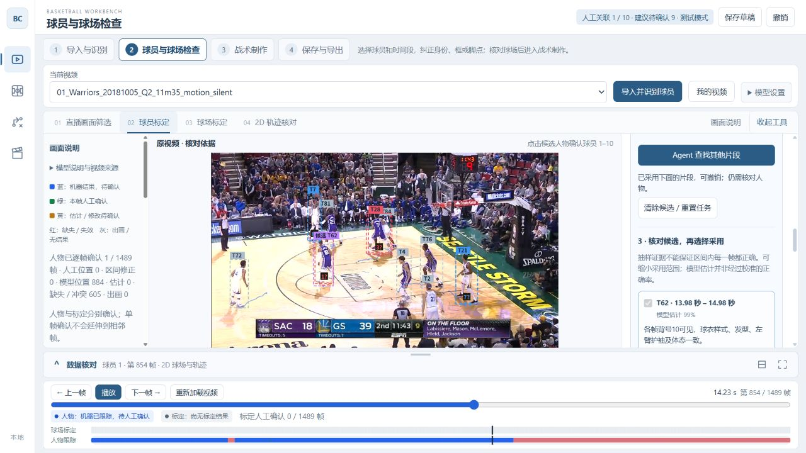
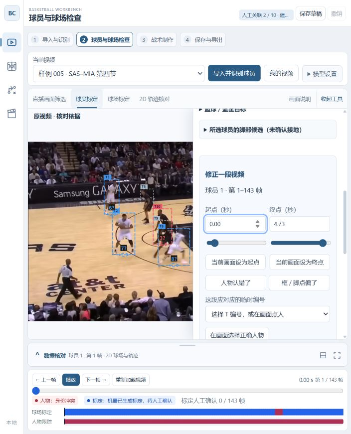
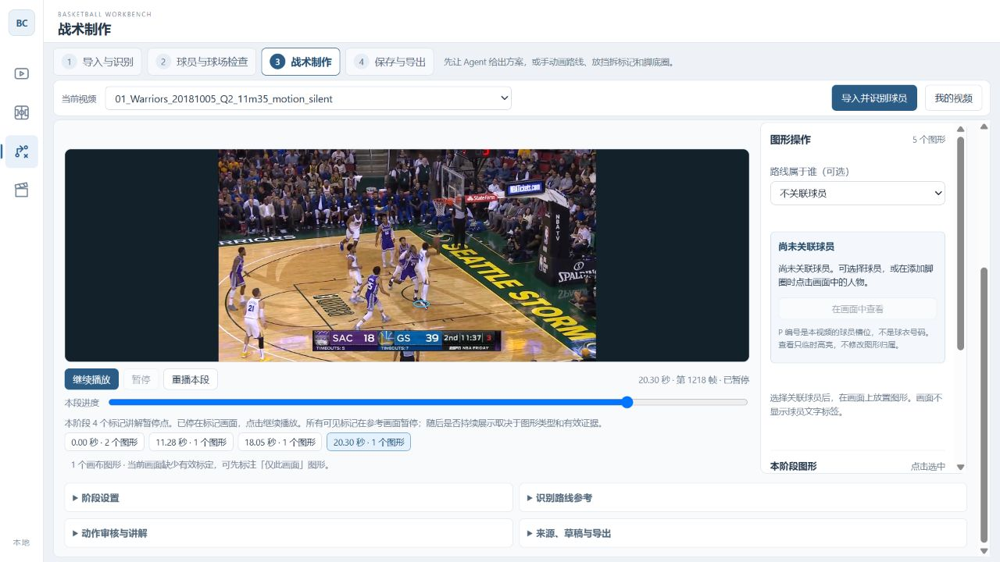
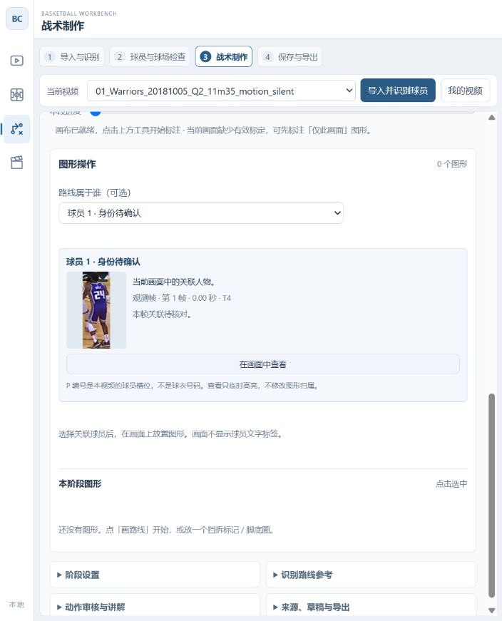
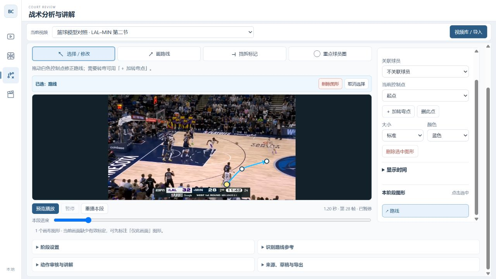
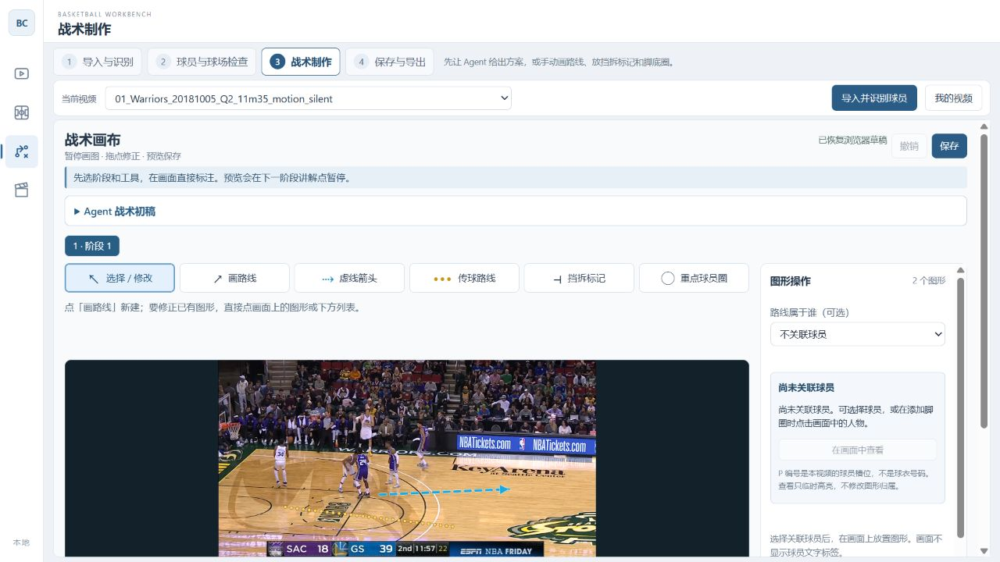

# 战术工作台操作说明

适用版本：2026-10-04。主导航仅保留左栏，按「球员与球场检查 → 数据核对与处理 → 战术制作 → 保存与导出」操作。标题下方重复的横向主导航已移除；顶部视频选择、导入和「我的视频」仍保留。

## 先说明：为什么换了视频，只看到原视频？

球员识别会产生人物框和临时 T 编号；战术箭头、挡拆和脚底圈需要在第三步生成或添加。换视频不会套用其他视频的图形。「本阶段图形」为 0 时，看到原视频是正常状态。

工作台初始只保留 **005 · SAS–MIA** 示例。其他素材在「我的视频 → 已归档」中，可以恢复；原始文件与旧草稿仍保留。

## 开始新视频：导入与识别

1. 点击顶部 **「导入并识别球员」**，选择本地视频。
2. 默认使用篮球检测器和 BoT-SORT，上传后直接开始识别。可在「我的视频」查看排队、处理、失败或完成状态。
3. 完成后自动打开这个视频，进入 **「球员与球场检查」**。模型不可用时会显示具体原因；旧结果不会冒充本次处理成功。
4. 机器编号是建议。看错人或位置偏了，按下节修改；不必逐帧重新画所有位置。

## 号码已经看清，后面却换了编号：认回同一位球员

第二步 **「球员与球场检查 → 球员标定」** 新增 **「认回同一位球员」**。临时 T 编号可能中途串人；把整个 T 都归给同一人会把错误一起带过去。这里用固定球员槽位和有限时间段续接。

1. 先选一个固定球员槽位。在「定位到秒」输入清楚画面的时间，点「定位」，再在「身份参考人物」选择画面中正确的 T。高亮框应围住目标球员。
2. 填写本视频的「球队 / 球衣描述」与「号码」，例如“紫色球衣 / 10”。也可点 **「Agent 识别号码」**，核对后点「填入识别建议」。看不清就换参考帧；不必选择 NBA 名单。
3. 点 **「保存参考身份」**。这会把球队、号码和这一帧的人物绑定到当前固定球员，只确认这一帧，可以撤销。
4. 在下方「修正一段视频」设置要查找的起止秒数，再点 **「Agent 查找其他片段」**。长片建议分段查找；当前使用抽样，不保证覆盖全部画面。
5. 返回的候选会列出 T 编号、时间范围、判断依据和证据图。点「看起点 / 中间 / 终点」核对，必要时缩小「起帧 / 止帧」。界面帧号从 1 开始，起止帧都包含在内。
6. 勾选正确片段，再点 **「采用所选片段」**。同一固定球员可接上另一个 T；已有人工记录冲突时会拒绝覆盖，先用下方区间修正解决。一次「撤销上次修改」可以撤销这一批采用。

Agent 候选仍是待核对结果，抽样之外不会自动补身份。采用期间修改了草稿或换了球员，旧建议会失效；重新查找即可。身份参考和采用后的区间随原工作台草稿保存，刷新后保留；待采用的任务结果不作为已保存标注。

后续战术中的脚底圈继续关联同一固定球员；返回战术页会同步新位置。模型漏检的画面仍需要补位置，保存号码不会凭空生成框。

## 修正一段视频：身份、人物框或脚点

1. 在 **「球员与球场检查 → 球员标定」** 选择要纠正的球员。
2. 在右侧 **「修正一段视频」** 填写起点和终点秒数，也可以用滑块，或先定位画面再点「当前画面设为起点 / 终点」。
3. **认错人：** 点「人物认错了」，选择正确 T 编号，或点「在画面选择正确人物」后点候选框。修改只覆盖所选时间段，结束后恢复原关联。
4. **框或脚点偏了：** 点「框 / 脚点偏了」，选择修正对象；点「看中间」定位到区间内，再点「在当前帧调整关键帧 1」。拖框边、四角或脚下圆点。偏差随时间变化时，再设关键帧 2。
5. 点「预览这段修改」，用「看起点 / 中间 / 终点」检查，再点「应用这段修改」。「撤销上次修改」一次撤销整段。

截图保留当时的入口与操作面板；其中横向主导航已由左栏统一取代，区间修正功能不变。示例的机器结果、既有人工记录和冲突提示仍需核对，不代表身份准确性已经验收。

位置修正保留原本的跑动，只传播相对偏移和大小变化。缺测、身份变化、冲突或跨镜头处不会硬补到其他人身上。「保留已有人工位置」默认开启。区间修正仍需核对，不会把整个区间自动标成人工审核通过。

## 进入战术制作：Agent 或手工

第三步顶部的 Agent 入口用于 **生成一份可编辑的战术初稿**：选择「整段视频，建立阶段」或「当前阶段，追加初稿」，填写讲解目标，点击「生成战术初稿」。Agent 根据视频画面和已有位置提出阶段、暂停点、未来路线、挡拆与脚底圈。生成后先看暂停帧预览，再点「采用到草稿，继续编辑」。已有人工内容时使用当前阶段追加。

任务可以取消；生成期间改了草稿，旧建议不能覆盖新修改。生成失败会显示原因，仍可使用下面的手工工具。首次使用需要本机 Codex 登录与视觉调用可用；“已配置”只表示找到了运行程序，不代表任务已完成。

### 跳过检查，直接生成和播放

可以先跳过第二步，进入战术制作。身份和球场位置没有核对时，Agent 可以在有依据的画面上生成静态标记，不能据此假定标记会随球员或镜头移动。

1. 生成后，初稿预览按实际标记参考帧展示，不只显示阶段的第一张暂停图。先看各个时间点的画面、图形和说明，再采用。
2. 采用后，视频下方列出 **标记讲解暂停点**，包括秒数与图形数量。也可直接点击时间点查看。
3. 点击 **「预览播放」**，播放器会在下一个标记画面准确暂停并显示图形；点击 **「继续播放」** 前往下一处。解码跳过某一帧时会定位回准确画面，不让单帧标记一闪而过。
4. 静态像素标记只在参考画面讲解；继续播放后隐藏。具有有效球场映射的路线或有人物位置的跟随圈，才在有效时间内继续展示。持续贴地、跟人效果仍需要第二步的数据支撑。

暂停点由当前草稿自动计算，适用于旧草稿、后续新视频和人工图形，不需要逐个视频补阶段。不会因此修改阶段范围、原始图形、人物身份或人工审核状态。新生成的每个图形都会通过实际绘制检查；没有可用位置或无法绘制的图形会使该次初稿校验失败并说明原因，不会只凭“有图形数据”报告成功。可显示并不等于战术判断或球员身份已经核对。

图示为在隔离工作台重放真实模型结果后的播放验证；脚圈为参考画面的静态标记，不代表连续人物跟随已核对。

2026-10-04 早前修正了输入冗余和生成约束：同一整段请求的文字输入缩小约 68%，缺测、身份冲突与人工确认含义保留。当时复跑遇到阶段证据越界及模型网络超时。随后用户成功生成并采用真实初稿，进一步暴露了单帧标记没有配套暂停点的问题，现按上面的展示流程处理。模型服务的网络超时仍可能发生；入口“已配置”不等于生成成功。

手工标注按下面步骤操作。重点球员圈可以在球员身上直接点击，自动贴到当前框的脚底；进入战术制作会同步这次球员与位置修正。

### 图形操作里的 P1 到底是谁？

P1–P10 是工作台的固定球员槽位，**不是球衣号码**。没有核对身份时，这个槽位的机器轨迹还可能串人。

- 球员选项使用本视频已保存的身份参考显示队服与号码；没有有效参考时显示「球员 1 · 身份待确认」，不从 NBA 名单推断。
- 选择球员后，查看右侧人物预览与这一帧的核对状态；点 **「在画面中查看」** 临时突出对应人物。当前无可用人物框时，会说明缺测，并可定位到有参考或观测的位置。
- 选中已有图形时，人物预览对应这个图形绑定的人；查看人物不会更改图形归属。临时定位框只供编辑使用，不进入战术播放或导出画面。
- 人物不对时回第二步修正身份。保存一个清楚的号码参考，不代表整段轨迹已经核对。

人工路线和挡拆可以保持「不关联球员」直接绘制；跟随脚底圈需要明确选择人物，或直接点击画面中的人物。静态圈需明确选择静态方式。

图中是当前帧的机器关联，尚未确认姓名与整段身份；查看人物本身不会更改绑定。

先区分两个目标，避免画完后不知道为什么消失：

| 你现在想做什么 | 需要怎样操作 |
| --- | --- |
| 暂停视频，画一条箭头说明接下来的跑位 | 直接按下一节操作，不要求先识别球员或标定球场 |
| 视频继续播放时，箭头贴在球场上，并逐渐只留下剩余路线 | 先完成有效球场标定，再画路线，见第 5 节 |
| 给球员加一个随人移动的脚底圈 | 关联正确球员，并有该球员可用的位置数据，见第 3 节 |

## 1. 从当前页面开始，画出第一条路线

先练习当前暂停画面的标注。没有标定时，这条路线只在添加它的那一帧显示；随播放显示的制作步骤在第 5 节。

1. 点击左侧第三项 **「战术制作」**，核对顶部 **「当前视频」**。如果还没有画布，点击 **「建立画布，开始手工标注」**；已经看到「阶段 1」和画布工具就不用再建。
2. 把视频停在球员即将开始跑动的位置。拖动视频下方 **「本段进度」** 可以定位并暂停；也可以点 **「重播本段」** 后点 **「暂停」**。如果画面已在结尾，先回到动作开始前。
3. 展开下方 **「阶段设置」**，点击 **「用当前帧」→「更新阶段」**。这会把当前画面设为本段的暂停讲解位置。只点「用当前帧」还没有应用设置。
4. 在视频旁的 **「路线属于谁（可选）」** 中先选 **「不关联球员」**。人工画箭头不要求先把 P1–P10 识别清楚。
5. 点击视频上方 **「画路线」**。在视频中依次单击 **起点 → 主要转弯位置 → 终点**，然后点 **「完成绘制」**，或按 `Enter`。使用 2–6 个点即可，第一条建议只放 3 个点。
6. 应该看到一条平滑箭头，**「本阶段图形」** 列表从 0 个变成 1 个。选中后可以把 **「大小」** 调为「较大」或「醒目」，再选颜色。
7. 点击右上角 **「保存」**，确认出现 **「已保存 · 版本 …」**。

图示来自独立测试页，仅演示控制点、删除和属性入口，箭头不是对这次真实跑位的分析结论，也不是该视频的成片。

画路线时是逐个点击关键位置；不要按住鼠标描出所有细碎运动。先看球员将要走到哪里，再用少量转弯点概括路线。绘制未完成时播放、跳帧或切换阶段，会取消这次未完成的绘制。

定位期间会等待视频解码，画图工具暂时禁用；画面更新后再操作。如果保留了旧页面，先保存草稿、再刷新，加载最新界面。

### 虚线箭头与传球路线

画布工具新增两种两点图形，点起点、再点终点即完成：

- **虚线箭头**：直线虚线加实心箭头尖，默认蓝色，用于区别于原来的实线路线。
- **传球路线**：由一串等距黄色小圆点组成的直线，默认没有箭头尖。

选中后拖动两端可改起终点，拖动主体可移动整条线；大小、颜色、显示时间、删除、撤销和保存操作与现有路线一致。这两种图形只用两个端点，不增加转弯点。需要曲线时使用原来的「画路线」。

图形仍遵循所在画面的标定条件：没有球场标定时用于当前暂停帧；有效球场标定下可以设置显示时间，随播放保留尚未完成的部分。保存与完整 JSON 导出会保留图形样式。

图示来自独立测试草稿，用于展示两种样式，并非该回合的战术分析结论。

## 2. 已经画好的路线，怎样修改、加点和删除？

先点 **「选择 / 修改」**，再点击画面中的箭头，或点击旁边 **「本阶段图形」** 中的对应条目。

| 想做的事 | 操作 |
| --- | --- |
| 改起点、转弯或终点 | 拖动选中后出现的控制点 |
| 整条路线挪位置 | 拖动箭头主体 |
| 多加一个转弯 | 在「当前控制点」选一个点，点「＋ 加转弯点」，再在视频中点击新位置；新点插在所选点之后 |
| 删除一个多余的点 | 选择该控制点，点「删此点」；路线至少保留 2 个点 |
| 调整箭头大小、颜色 | 在选中图形的属性中修改「大小」「颜色」 |
| 删除整条路线 | 点视频旁的「删除图形」，或属性中的「删除选中图形」 |
| 恢复刚才删掉或改错的图形 | 点右上角「撤销」，或按 `Ctrl+Z` |
| 只结束选择 | 点「取消选择」；这不会删除图形 |

选中图形后，也可以按 `Delete` / `Backspace` 删除；焦点在文字输入框中时，这些键仍用于编辑文字。

**列表里有图形，但画面看不到：**点击该图形条目，会尝试回到添加它的画面。再看对象提示：可能是仅此画面、当前时间不在显示范围、缺少标定，或阶段/来源变更后需要重新确认，不能直接认定它被删除了。

## 3. 挡拆标记和重点球员圈

### 放置、旋转挡拆标记

1. 点 **「挡拆标记」**，再点视频中掩护发生的位置。
2. 切回 **「选择 / 修改」**，选中这个标记。
3. 拖动蓝色旋转手柄，可以自由转向；也可以点 **「左转 15°」「右转 15°」**。
4. 要精确设置，修改 **「挡拆朝向（度）」**，再点输入框外使其生效。
5. 拖动标记主体可以移动；删除、撤销与路线相同。一次旋转拖动松手后算一次修改，可以一次撤销。

画面上的挡拆符号要用这个工具添加。下方 **「动作审核与讲解」** 中的挡拆动作记录只记录配合关系，不会替你在画面上放置符号。

### 放置脚底圈

1. 点 **「重点球员圈」**，在画面点要强调的球员；命中人物框后自动关联这个人并贴到脚底。
2. 人物重叠时，右侧会出现候选选择，明确选圈应该跟随谁。
3. 选中圈，用 **「跟随谁」** 更换球员，会重新贴到新球员脚底。**「重新贴脚」** 清除偏移；**「微调偏移」** 开启后才可拖动微调。
4. 预览，检查它是否一直跟着同一个人；跟错人到第二步修正身份，脚点偏到第二步修正位置。返回第三步会同步最新位置。

重点球员圈统一使用较淡的白色柔光和极淡脚下光面，同时将其余视频画面适度调暗。重点区域优先使用有效人物框，没有人物框时按原圈大小估算身体范围；边缘柔化，不代表像素级人物分割。多个重点球员同时保亮，背景只调暗一次；没有可见重点圈时不调暗。

Agent 自动添加、点击人物框添加、人工定位以及加载旧圈均使用同一样式，预览和成片复用同一渲染。不附加球员姓名或其他文字，不使用彩色底盘或强亮环。旧颜色字段保留兼容，但重点圈固定显示白色，颜色控件显示白色并禁用；其他图形仍可改色。无需转换旧数据，也没有新增标注类型。大小、选择、移动、其他编辑和保存仍用原有操作。

Agent 新生成的重点圈默认只在关键帧对应的展示时段显示。这是生成时的默认范围；用户可按原方式修改起止时间，圈在范围内的普通播放画面也能显示，不要求处于关键帧或冻结状态。旧圈继续使用已保存的时间范围。

跟随需要该球员在相应画面有可用位置。缺测、身份冲突或切镜等情况下可能隐藏；放一个圈不会自动生成球员跟踪数据。没有球场标定时，如果已有正确的画面脚点，脚底圈仍可跟随。不跟随的画面圈在设置范围内固定在画面位置；有有效标定时，球场空间的圈可以固定在球场位置持续显示。

## 4. 怎样设置“关键时刻暂停，再继续”？

一个 **阶段** 就是一段要单独讲解的视频。建议先分好阶段，再画图，减少之后重新确认图形的工作。

1. 选中阶段，暂停到想讲解的画面。
2. **「阶段设置」→「用当前帧」→「更新阶段」**，必要时修改阶段名称。
3. 需要第二段时，在 **「从此帧分为下一阶段」** 输入分界帧，点 **「分段」**。帧号可看视频下方。
4. 选择新阶段，设置它自己的暂停讲解帧，再添加该阶段的图形。
5. 用 **「预览播放」** 继续当前讲解，**「暂停」** 随时停住，**「重播本段」** 回看本段。到后续阶段的讲解位置会暂停，确认后再继续。

手工新建画布只有「阶段 1」；也可让 Agent 分析整段，建议阶段和暂停位置，再检查并采用。修改阶段范围或更换数据来源后，已有图形可能提示需要重新确认；记录会保留，但不会悄悄套到新阶段上。恢复时，先停到正确画面，选中待确认的图形，点 **「在本帧重新定位」**，核对并修正位置后保存。这个按钮仅在图形因阶段或来源变化而失效时出现，只重新确认参考画面，不会把「仅此画面」图形转成地面图形。

## 5. 怎样让路线贴在地板上，随播放保留剩余部分？

**仅把“显示时间”拉长，不能让没有球场标定的路线随镜头播放。**

1. 先保存草稿，进入第二步 **「球员与球场检查」**。新导入视频默认使用整段；需要裁剪时进入「直播画面筛选」，选好区间再点「应用剪辑，进入球员标定」。裁剪会生成新样本，需要在新样本上制作战术，原视频草稿保留。
2. 切换到 **「球场标定」**，先点 **「自动标定本镜头」**，等待生成候选。
3. 核对投影场地线是否贴合真实球场；不准确时展开 **「不准确？人工选点修正」**。选择左篮侧或右篮侧，在地面上清楚可见的球场线交点至少标出 **4 个不共线点**。点名须与参照图一致，不用篮筐或球员头部代替地面点。
4. 人工修正后点 **「确认修正并跟随镜头」**。批量结果仍需核对，不会把整段标成人工确认。
5. 检查候选后点 **「采用结果并进入 2D」**，回看整个展示区间。镜头移动时一帧标定不能覆盖整段，失效画面需要补校。详细步骤见[球场标定说明](court-calibration-backend.md#当前采用方案与操作流程2026-10-04-确认)。
6. 如果要使用跟随脚底圈，先完成相关球员的关联并检查位置。在 **「04 2D 轨迹核对」** 查看投影是否合理。只画人工地面箭头，不要求先识别好所有球员。
7. 返回第三步 **「战术制作」**，同步刚处理的数据。同一视频、模型和帧范围下，已有草稿会更新来源并保留阶段和图形，但可能要求重新确认；换模型或裁剪后的新视频需要按新来源建立草稿。首次建画布也可在「来源、草稿与导出」中使用当前轨迹。
8. 在有效标定画面上重新画路线。**之前无标定时画的“仅此画面”路线不会自动转换成地面路线**；「在本帧重新定位」也不负责这种转换。
9. 选中路线，展开 **「显示时间」**，设置 **「开始帧」「结束帧」**，点击 **「应用显示时间」**。起止帧必须在本阶段范围内，而且要包含绘制这条路线的参考帧；如果想从更晚的画面开始展示，可以到那一帧重新绘制。用预览检查出现时机、结束时机和跑动节奏。

地面路线在播放中按设定时间逐渐裁短，保留尚未走完的部分。当前裁短按时间均匀推进，并非逐帧精确识别球员已经走到哪里；可通过显示起止帧调整节奏。遇到没有有效标定的画面会隐藏，不会硬套上一帧的位置。

返回战术制作会同步新参与者和最新位置，保留人工图形。删除球员后，其图形进入可恢复的归档；需明确指定归属后恢复。旧地面图形受标定变化影响时，要重新核对和定位。

## 6. 保存、继续编辑，以及查看已完成示例

| 按钮或状态 | 实际作用 |
| --- | --- |
| 「浏览器草稿」 | 浏览器有临时编辑记录；不等于已经手动保存到本机服务 |
| 「保存」 | 保存当前视频、当前草稿；看到「已保存 · 版本 …」再离开 |
| 「当前视频草稿」 | 打开这个视频的工作草稿 |
| 「重新读取已保存版本」 | 重新载入已保存内容；操作前先保存想保留的编辑 |
| 「导出完整数据 JSON」 | 导出含手绘路线、挡拆标记、脚底圈的数据备份 |
| 「导出审核冻结报告」 | 导出原有动作与审核内容；当前不包含新画布图形 |

**「保存」不会生成带箭头的 MP4 成片。当前页面尚未提供把这些新画布图形烧录成视频的一键导出。**

想对照之前的完成效果：先保存当前视频，展开 **「来源、草稿与导出」**，点 **「THY 三阶段示例」**。它会切换到 **005 · SAS–MIA** 的示例。看完后，从顶部视频选择切回原视频，再打开「当前视频草稿」；原视频已归档时，先在「我的视频 → 已归档」恢复。

若地址含 `qa=1`，则使用独立验收草稿。继续编辑时使用创建该草稿时的同一服务地址和入口；正式入口与验收入口的保存记录分开，不要把进入另一份草稿误认为原稿丢失。

## 7. 遇到这些现象时，先检查什么？

| 现象 | 先检查 |
| --- | --- |
| 新视频只有原画面 | 第一步是否识别完成？第三步是否生成并采用建议，或完成手绘？「本阶段图形」是否为 0？ |
| 点了几个位置但没有箭头 | 是否选了「画路线」，并点击「完成绘制」？ |
| 播放后箭头突然消失 | 是否提示「仅此画面」？是否超出显示时间？当前画面是否缺少球场标定？ |
| 找不到删除入口 | 先「选择 / 修改」，再选中图形；也可从图形列表选中 |
| 脚底圈不跟随或跟错人 | 检查「跟随谁」与当前人物框；可点「重新贴脚」，或到第二步修正身份与脚点 |
| 标定好了，战术画布仍提示缺少标定 | 返回第三步同步最新数据；确认当前帧有有效标定。旧的仅此画面路线需要重新绘制 |
| 进度条动了，视频不动 | 先保存后刷新加载本次修复；定位等待解码期间画图工具会暂时禁用 |
| 保存了但找不到成片 | 保存的是可继续编辑的草稿，当前没有一键 MP4 导出 |

## 维护说明

手绘图形进入独立的 `annotations` 字段，与既有 `presentation` 修正兼容，不修改原始 `review`、人物关联或动作审核结论。完整 JSON 和本机保存保留这些图形。视频内不增加球员姓名、编号标签；编辑控制点只用于操作。

旧版 THY 示例在新增篮球路线导出字段前保存的草稿仍可继续保存。兼容范围仅限来源快照完全符合旧版结构，即整体缺少新增的三个篮球路线派生字段；不修改已有 `review`、图形、审核或来源绑定。新字段部分缺失、已有字段被改写或视频来源不匹配仍拒绝保存。
