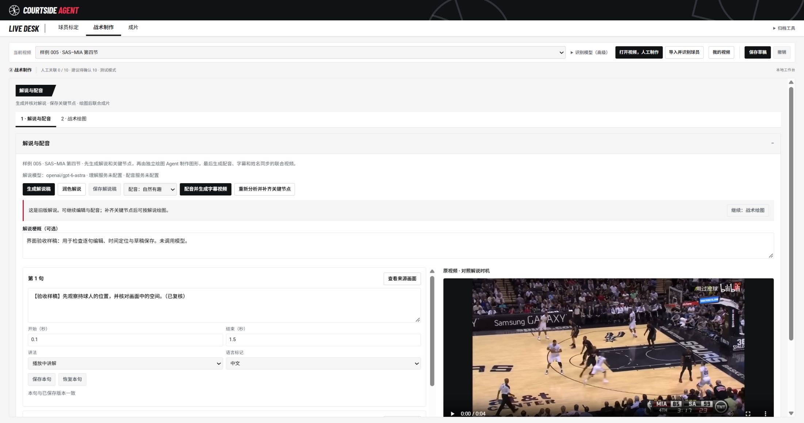

# NBA UI 与主分支同步：解说先行工作流

- 日期 / 时区：2026-10-10，Asia/Singapore（UTC+8）。
- 分支：`codex/courtstory-ui-broadcast`，仅本地 UI 工作区。
- 来源：用户本轮要求；远端 main [`12c7413`](https://github.com/Linzeyu912/broadcastcode-team-hub/commit/12c7413d897908c1b262025af153b096004c19bc)；[主分支整合交接](../../handoffs/thy-0629/2026-10-10-0055-commentary-remote-integration.md)及[实际后端工作流](commentary-narration-workflow.md)。

## 同步范围

开始时 UI 分支基于 `1a14be3`，缺少 main 的 4 个提交：`423d5a7`、`e2db182`、`4cae6b7`、`12c7413`。先以 `64c06b9` 保存此前全部 UI 设计和交接，再将 main 的更新整合到既有 UI 分支。本地 main 仅快进到远端的 `12c7413`，没有写入 UI 设计。

解说润色、候选采用／撤回、逐句编辑／保存／恢复、语言标记、两种配音口吻、计划版本与冲突保护、独立绘图、姓名快照、旧图形依据失效、联合成片和音频缓存均保留主分支实现。后端业务文件与 `12c7413` 一致；服务器仅保留 UI 分支原有的静态设计资源路由及字体 MIME 配置，服务测试同时覆盖新接口和这些资源。

同步中保留了两侧文档和测试。解说编辑器继续独立挂载，并保留 main 的生成前保存、联合成片快照和计划变更通知，防止只合并外观而遗漏新功能。

## 界面调整

- LIVE DESK 恢复本地 Barlow Condensed Bold Italic，正文和其他窄体数字保持既定字体。
- 主导航为「球员标定 → 战术制作 → 成片」。球场映射移至右侧「归档工具」，标明已归档；已有映射数据、球场标定／2D 校验和兼容调用保留。此次归档针对主流程入口，不宣称这部分由用户开发，也不删除其他成员的业务代码。
- 战术制作默认打开「1 · 解说与配音」，随后是「2 · 战术绘图」。两个编辑器都保持挂载，切换暂停隐藏视频，未保存草稿不丢失。首次打开解说也读取已有绘图草稿。
- 解说区展示保存／旧稿状态，完整且已保存的计划可点击「继续：战术绘图」。旧稿继续允许编辑和独立字幕成片，补齐节点后再进入解说驱动绘图。
- 绘图页的「成片效果预览」「导出 MP4」触发解说成片时，先显示解说页签，任务进度和错误不会隐藏在后台面板。
- 成片页增加联合成片入口，并保留原静音战术导出。返回解说／绘图分别打开对应编辑器。逐句保存、语言和口吻选择、取消、重试、采用与手绘等原功能保留。
- 保持黑白文字按钮、灰色分隔、红色 AGENT 和重要提示、蓝色复选勾。块状页签使用底边标记，不给字体加线；窄屏长按钮正常换行。

## 验证与边界

- 前端、Agent、战术叠加全量 Node：837 项，836 通过、1 项原有可选跳过，0 失败。
- Python 13 个模块：123 项，首次 120 通过、3 项因 FFmpeg 不在 PATH 跳过；将本机已有 FFmpeg 加入测试进程 PATH 后，相关渲染模块 5 项全部通过，覆盖此前 3 项跳过。未安装或调用外部模型服务。
- 实际 HTTP 测试覆盖逐句保存 200、过期同句 409、独立绘图路由与取消校验；新增 UI 回归覆盖解说优先加载、切回画布可编辑，以及联合成片状态面板可见。
- 原 HTML 的 295 个 ID 和 97 个按钮全部保留；新增归档容器及联合成片入口后为 297 个 ID、98 个按钮，未出现重复 ID。12 份相关文档的相对链接检查通过。
- `npm run build` 成功，重新生成真实入口使用的 `ui.bundle.mjs`。
- 浏览器检查：桌面与 360px 窄屏；归档展开／进入／返回；默认解说页；逐句临时编辑、跨页签保留及恢复；成片两个入口；无页面横向溢出、无控制台错误。临时编辑已恢复，没有覆盖保存稿。
- 全视频字节校验在 UI 工作区仍受未展开的 LFS 指针限制；元数据及 Git 索引校验通过，10 个数据集、166 条视频。测试所需 005 素材从本机 LFS 缓存展开，原始字节与锁定摘要一致。
- 浏览器当前显示的三句文字是明确标识的旧版验收样稿。此服务未配置真实理解和 TTS 凭据；本轮不声称已经验证真实模型内容质量、真实配音或云端部署。

本轮只在本地同步和保存 UI 分支，没有将其合入 main、推送或部署。再次查询远端 main 仍为 `12c7413`，开放 Issue 列表为空。

