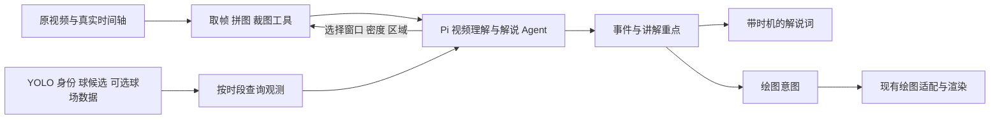

# 独立 Pi 视频理解与解说 Agent：讨论方案

日期：2026-10-07，America/New_York。状态：用户要求先同步思路；非实施完成、非团队共同决策。用户当前负责视频理解、战术重点与解说词，绘图由其他工作负责。依据见[复用核查](../../research/agents/video-commentary-reuse-20261007.md)。

## 1. 建议的结构

新增一个独立任务入口，基于已跑通的 Pi core / ai。输入为原视频和可选前置观测，输出带时间的事件、解说及绘图意图。它不依赖六帧绘图 runner 的分析结果，也不要求先完成十人全片地面轨迹修正。

先用一个 Agent 完成看视频、推敲战术、选重点和组织解说。它可以多轮修改结果，不需要先拆成多个互相转述的 Agent。图片工具负责送达原始视觉信息；不把所有图片先压成另一个模型的文字描述，再让主 Agent 只能相信描述。

## 2. 首轮就要系统阅读

第一轮准备覆盖整片时间轴的多页拼帧，而非固定六时刻。约二十余秒的片段可从约 2 fps 概览试起，再对动作窗口密集读取。总图像预算、每格分辨率和多页批次由最终 provider 的限制决定；按镜头切换分开，不跨切镜假定动作或身份连续。

阅读顺序是全段概览 → 建立事件顺序 → 阅读关键动作的连续窗口 → 核对参与者和战术解释 → 挑讲解重点 → 形成解说。模型可以回退、扩大时间范围、改变裁图区域或撤销之前的战术判断。

持有简短事件笔记、待确认问题和证据引用。上下文保留全段概览及当前关键窗口，旧高清图可按引用重读；不要照搬地面 worker 只留最近两次图片结果的规则。不要把“已经返回图片”写成“动作已经验证”。

## 3. 首版工具足够小

下表为拟议工具，不是目前已经注册的接口。

| 工具 | 用途与输出 | 复用路径 |
| --- | --- | --- |
| get_video_context | 时长、分辨率、帧 / PTS 映射、已知镜头与前置数据能力 | 已有素材与 clip 元数据 |
| read_video_window | 指定时间范围、采样密度或精确帧，返回多页拼图或原图与准确时间；首轮可预载概览 | TacticalWorkbench.frames、帧缓存、inspect_images |
| inspect_region | 指定球员、多人物交互区或任意矩形，返回带前后时间的高清裁图和必要全景参照 | 既有人物裁图，新增通用区域选择 |
| get_observations | 查询相关时段的人物框、身份范围、球候选、可选 2D；附来源与未知 | 读取现有导出，不重新跑 YOLO、不写前置材料 |
| save_commentary_plan | 保存 / 更新事件、解说段、重点、证据与可选绘图意图 | 新增轻量 JSON 输出即可 |

后续绘图端可用时再增加 preview_visual_cues，返回实际预览和无法执行的原因。解说单独交付不以预览工具在线为前提。通过预算和无新信息时停止控制循环，不强制每段固定若干轮。

## 4. 与绘图的协作交付

理解 Agent 顺手产出画什么，绘图模块负责空间实现。建议用同一个 eventId 关联以下结果：

| 内容 | 最少需要的字段 |
| --- | --- |
| 事件 | eventId、源视频区间、动作与关系、参与者引用、可见事实 / 战术解释、证据帧、未决问题 |
| 解说 | cueId、eventId、text、建议源时间窗口、anchorFrame、优先级、是否需要暂停 / 慢放、预计可用讲解时长 |
| 绘图意图 | eventId、anchorFrame、参与者、强调关系、suggestedPrimitive（圈 / 掩护 / 方向箭头等）、证据及未解决定位 |

输入 / 输出共同带 videoRef（现有资产身份）、analysisRevision；引用现有 P 身份或明确有时间范围的 T 片段。不得悄悄把 T7 改成新系统内部的“7 号球员”。姓名未知可以用稳定匿名对象，仍能先完成可支持的战术解说。

示例语义（仅说明格式，不是对实际视频的判断）：某事件中 P2 给 P1 做掩护，解说强调其创造突破空间；绘图意图要求在对应原帧强调 P2 及 P1 的突破方向。绘图侧用同一人物映射和画面坐标实现；定位不足时返回 unavailable 或使用双方约定的示意模式，不能假称已经准确生成路线。

当前 bridge 的通用 route 有已观察动作、连续定位、相机等限制；新理解结果不会因为新增一个 JSON 就天然兼容它。现有 runner 的 build_player_annotations 从内部依赖取分析，也不是现成的任意外部分析导入入口。后续应有一个小适配入口将外部分析转成原生候选，且不再强制重复调用六帧分析。此项需与绘图负责人对齐，不在本轮修改其代码。

## 5. 时间必须分开表示

事件发生时间、解说适合出现时间、最终成片时间不是同一个值。

- 理解模块保存源视频时间 / anchorFrame，作为跨模块稳定依据；analysis 默认可看完整片后制作战术解读。
- 解说段声明适合随播放讲，还是在关键画面暂停讲。未指定风格时可先采用赛后战术解读，明确为初始产品假设。
- 暂停、慢放、剪辑会改变最终输出时间，由制作端的时间映射生成最终字幕 / 配音时点。首版不要把源时间直接当成最终 SRT 时间。
- 未合成语音时，解说时长只是预算；配音后按实际音频时长缩写文案或调整编排。不要把较长因果分析塞进一秒动作窗口。
- 如后续要求模拟实时解说，应限制每句的可用事件信息，避免在结果出现之前提前透露进球或后续传球；当前不实现实时流式输入。

## 6. 实施选择与顺序建议

| 选择 | 评价 |
| --- | --- |
| 在现有绘图 runner 的六帧分析里直接追加解说 | 职责与协作耦合较强，且受到当前 schema、覆盖条件与调用方式限制，不推荐作为主线 |
| 完全从零实现视频、模型与工具框架 | 已有能力重复建设，没有必要 |
| 独立 Pi 解说 Agent，复用读取与 provider，给绘图提供事件 / 意图 | 推荐；可独立验收解说，再逐步对接绘图 |

实施时新增 narration worker / tools 和薄读取 adapter，优先复用现有模块的稳定函数；暂不大规模重构他人维护的公共代码。地面 worker、前置材料和绘图生产路径保持其原任务行为。

1. 跑通整片多页概览、密集窗口与裁图进入同一 Pi 上下文，用一段视频确认模型能主动继续取帧。
2. 输出事件及带时机的中文解说；画面能直接支持什么、什么是战术推断要明确，少数关键点讲清即可。
3. 用两段官方片及一段不同战术片做必要人工对照，检查错人、动作顺序、战术关系、时间与文案长度；记录耗时、帧量和调用量。六帧保留为诊断基线，不作为新方案的主要实现。
4. 同一份结果输出绘图意图，与绘图端确认时间 / 人物 / 事件三个公共引用，再接预览。解说验收与绘图验收分开。

## 本轮边界

本轮完成源码 / 旧调研审阅及作者文档核查，没有实现上述 tools、调用新模型、改绘图、配置新服务或提交推送。官方指标若由其他成员提供，可作为带来源的事件资料输入；当前不将其采集或云部署扩展为用户的解说工作范围。
