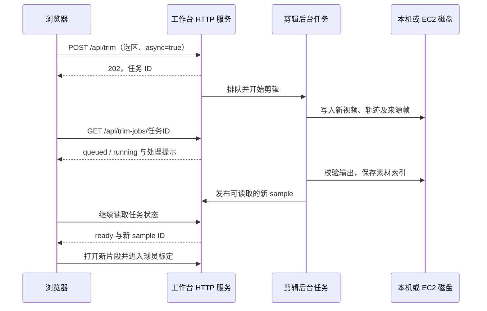

# 片段截取的数据流与卡住问题

更新：2026-10-13，Asia/Singapore（UTC+8）。用户反馈：选择起点、终点并保留区间后，选区变绿；点击“应用剪辑，进入球员标定”后无法继续，本地和比赛期间的云端均遇到过。

## 新片段保存在哪里

剪辑首先在**运行工作台服务的机器**上生成视频和对应轨迹，登记成功后由同一服务读取。不需要先把新片段上传 S3，浏览器才能进入下一步。

| 阶段 | 本地部署 | AWS 部署 |
| --- | --- | --- |
| 原视频 | 共享 `data/videos/` 或本机 `data/local-videos/` | EC2 已下载的共享样例或 HTTP 导入到 `data/local-videos/` |
| 新剪辑视频 | `artifacts/player-review-clips/<cut-id>/video.mp4` | 按现有 bootstrap 参数写入 EC2 `artifacts/cloud-trims/<cut-id>/video.mp4` |
| 对应数据 | 同目录的 `tracks*.json`、`tracks*.meta.json`，以及适用的场地/脚点数据 | 与本地格式相同，保存在 EC2 |
| 新素材索引 | `--trim-root` 下的 `library.json`，另激活工作集合 | EC2 的剪辑索引与工作集合 |
| 浏览器读取 | `/api/clip?sample=<cut-id>` 与 `/video.mp4?sample=<cut-id>` | 经过 CloudFront/EC2 网关读取同样的服务接口 |
| 后续存储或计算 | 保留本机文件，在线 AI 按对应功能请求 | 网关异步备份允许的缓存；如启动 GPU 任务，再单独上传 S3 作业输入 |

路径可由服务参数覆盖；上表为两套指导的默认路径。S3 **工作区备份**与 **GPU 作业输入**用途不同，前者不是打开新片段的前置条件。具体目录、配置及限制见[本地部署](../deploy/local/README.md)和[AWS 部署](../deploy/aws/README.md)。

## 本次修复的流程

- 编码到最后一个保留帧即停止读取源片尾部，不再为短片解码整部视频。
- 剪辑登记与普通样例列表不探测本地 GPU 或 S3 心跳；自动识别功能按需检查自己的运行环境。
- 耗时编码、校验与素材库登记不持有服务的发布锁；识别任务也不持有素材库锁去等待发布锁，消除已复现的锁顺序反转。
- 前端只提交一次创建请求，再轮询任务状态。错误恢复按钮；单请求和总等待都有上限，网络中断不自动重复创建剪辑。
- 单工作线程顺序处理剪辑，队列及完成记录数量有上限。成功剪辑的索引落盘，服务重启后可以重新打开；运行中的任务状态只在内存，服务重启会中断未完成任务，旧任务 ID 返回明确提示。尚不支持断点续编。
- 旧客户端不传 `async=true` 时保留同步响应，输出与来源映射格式兼容。

## 已确认的证据与范围

2026-10-13 在本机用真实 Single（1316 帧）截取零基帧 30–59，即界面第 31–60 帧，未配置或调用 S3：

| 检查 | 修复前 | 修复后 |
| --- | ---: | ---: |
| 同步 HTTP 截取完成 | 8.775 秒 | 1.075 秒 |
| 异步接单 | 无 | 0.0755 秒，HTTP 202 |
| 异步流程完成 | 无 | 1.277 秒 |

这是同一台机器的一次对照，不是吞吐量承诺。输出为 30 帧，2,004,632 字节；素材索引、新 clip 和视频 Range 读取（206）均通过。浏览器实际选择并提交后，已自动进入新片段的“02 球员标定”。多区间、二次剪辑和重启恢复验证也通过。

另以实际素材库工作线程复现了旧版锁反转：剪辑持有发布锁等待素材库锁，而识别线程持有素材库锁等待发布锁。两端会互相等待。它是已确认的卡住风险，但没有比赛现场的请求与日志，不能断言它就是当时每一次失败的唯一原因；本次也未更新或复验运行中的 AWS 服务。

## 保留的剪辑规则

本次不新增多片段拼接、跳过特写或节奏设计。现有实现按原时间顺序保留选区，产出一段视频，并在来源跳跃处保留断点和原帧映射；裁切音轨仍沿用原来的只编码视频规则，原片音轨保留。后续多段如何呈现需另行决定。

实现入口：[后台作业](../scripts/review_trim_jobs.py)、[HTTP 与登记](../scripts/serve_player_review.py)、[实际剪辑](../scripts/review_video_trim.py)、[素材库](../scripts/local_video_library.py)、[前端等待与重试](../tools/player-review/trim-client.mjs)。
