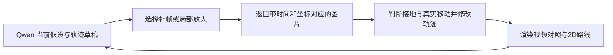

# Qwen3.8-Max 视频轨迹 Agent：讨论稿

日期：2026-10-05，Etc/UTC。状态：用户要求先达成方案共识；本轮只做项目 / 源码调研和讨论，未实现产品、配置 API 或运行模型。

后续：用户已要求结合现有工作台制定首版详细方案，见[地面轨迹 Agent 实施计划](../docs/plans/2026-10-05-qwen-ground-trajectory-agent-v1.md)。该计划明确阿里云接口、Pi 运行方式、工具与数据契约、采用 / 撤销、10.68 秒同片测试和当前素材下载阻塞；本稿保留前轮讨论记录，不将建议写成已经实现的功能。

## 用户已经明确的范围

核心是用现有 **Qwen3.8-Max API** 理解篮球视频，辅助恢复可信、连续的 2D 地面轨迹。凭据变量为 `QWEN_KEY`。不以寻找 / 训练另一个视频模型为主线。

当前困难包括：斜视角下的地面位置误差、跳跃被当作地面移动、镜头运动、轨迹抖动。用户强调视觉任务需要主动反复取证、读图、处理和修正，不能设计成“调用一次产出答案，再用二次门禁判断”。需要 Agent 的工具调用与状态维护能力。

前一轮[视频模型图谱](video-model-to-court-20261005/REPORT.md)保留为背景资料，本稿取代其作为当前讨论主线。新方案及框架选择均是建议，没有宣布团队决策。

## 问题的解释和目标定义

准确的地面对应点可以通过平面映射处理斜视角。起跳时，脚和身体离开地面，单帧中的上移同时包含高度、水平运动和镜头变化；直接将这个像素点当成地面点会得到错误的球场位移。地面映射、可信的地面位置和运动语义是不同层，现有流程把它们混在同一条逐帧点列中时会产生异常。

建议把 2D 点定义为**球员在地面上的平面位置**，以身体垂直投影为概念目标，实际估计使用可见接地证据及时间上下文；不把画面中最低像素永远当作该位置。是否采用这个业务定义仍需与用户讨论。

原地跳跃应近似维持地面位置，跑跳则应保留起跳到落地的水平移动；不能检测到跳跃就锁住 X/Y。急停、转向、跑跳和停留也不能被全局平滑抹去。隐蔽地面位置在单目视频中并非总能唯一恢复，多模态判断给出的应是有证据和不确定性标记的估计。

本方案目标是“位置和运动合理，并消除不合理抖动”。漂亮曲线不单独构成正确性证据。

## Pi 已拉取：具体借鉴什么

Pi 旧地址 `badlogic/pi-mono` 已迁移到当前官方 [earendil-works/pi](https://github.com/earendil-works/pi)。本机已克隆，固定版本为 `b2b5c42f6138b73ec4b2f49ec0ca468800f88586`，当前包名为 `@earendil-works/pi-agent-core` / `@earendil-works/pi-ai`，不能照旧博客继续使用过时包名或路径。

最相关的是 SDK 的运行循环，不是代码编辑 CLI 本身：

- [agent-loop.ts](https://github.com/earendil-works/pi/blob/b2b5c42f6138b73ec4b2f49ec0ca468800f88586/packages/agent/src/agent-loop.ts#L163)：模型返回工具调用，执行工具，将结果追加到上下文，再请求模型；支持继续、用户 steering、follow-up 和中止等状态。
- [图片工具结果类型](https://github.com/earendil-works/pi/blob/b2b5c42f6138b73ec4b2f49ec0ca468800f88586/packages/ai/src/types.ts#L596)：`ToolResultMessage.content` 支持文本和图片。
- [结果进入会话](https://github.com/earendil-works/pi/blob/b2b5c42f6138b73ec4b2f49ec0ca468800f88586/packages/agent/src/agent-loop.ts#L922)：工具图片保留在下一轮可用内容中。
- [OpenAI 兼容序列化](https://github.com/earendil-works/pi/blob/b2b5c42f6138b73ec4b2f49ec0ca468800f88586/packages/ai/src/api/openai-completions.ts#L1406)：先发关联的文本 tool result，再将图片以 `image_url` 附入 user 消息。这说明不能只将图片路径作为文本返回就期待远端模型读到图片。
- [自定义模型配置](https://github.com/earendil-works/pi/blob/b2b5c42f6138b73ec4b2f49ec0ca468800f88586/packages/coding-agent/docs/models.md#L64)：可配置兼容 endpoint、图片输入能力和环境插值，例如凭据引用 `${QWEN_KEY}`。图片尺寸、压缩和接口兼容项仍需按实际 Qwen endpoint 验证。

本轮只追了这些代码路径，没有安装 SDK 依赖、注册 Qwen 或执行 Agent。因此“具备可用架构”与“Qwen3.8-Max 已接通 / 能改善篮球位置”分开记录。

## Codex、OpenCode、Pi 的比较

| 框架 | 本轮已核实的有关能力 | 当前建议 |
|---|---|---|
| Codex，固定上轮提交 `7f892275e31002f0422477c6219189284560e689` | `view_image` 返回真实 `InputImage`，可在工具调用中反复读图；见 [view_image.rs](https://github.com/openai/codex/blob/7f892275e31002f0422477c6219189284560e689/codex-rs/core/src/tools/handlers/view_image.rs#L235) | 借鉴“工具返回图片 → 模型继续”的机制；本轮未证明其整套运行时直接适配当前 Qwen endpoint，不优先为了 API 替换去改 Rust 核心 |
| OpenCode，固定上轮提交 `907b3bc518fa48e90e8ec24dd327d13eee71c36c` | [prompt 循环](https://github.com/anomalyco/opencode/blob/907b3bc518fa48e90e8ec24dd327d13eee71c36c/packages/opencode/src/session/prompt.ts#L1104)处理工具后继续；[消息转换](https://github.com/anomalyco/opencode/blob/907b3bc518fa48e90e8ec24dd327d13eee71c36c/packages/opencode/src/session/message-v2.ts#L294)处理图片附件，不支持 tool 媒体的 provider 可用单独 user 消息承载 | 如果需要直接使用完整 Agent 应用及现有交互，可考虑扩展工具；本轮没有验证 Qwen3.8-Max 配置或新篮球工具 |
| Pi 当前官方 SDK | Agent 核心、定制工具、图像结果和兼容 provider 组织明确，MIT 许可证 | **优先研究候选**：用 Agent 核心服务于现有工作台，并定义读图 / 轨迹工具；不是在产品中另塞一个通用代码编辑器 |

现有 `identity_agent.py` 已有带 frame / T 标签的参考裁剪和联系图，但其 prompt 明确写着“不要调用工具”；`vision_provider.py` 的多模态 API 分支仍是占位。可复用图像和时间证据的生成方法，不能称现有调用已具备自主循环读图能力。

## 更贴近用户要求的公开项目

| 项目 | 本轮读到的实际机制 | 可以复用的部分及限制 |
|---|---|---|
| [IG-VLM](https://github.com/imagegridworth/IG-VLM)，`00d11ab4` | [GridViewCreator](https://github.com/imagegridworth/IG-VLM/blob/00d11ab4f835d4930cd19376a2dc5f73b7206f5a/vision_processor/gridview_generator.py)把视频帧拼成单张网格；[API 输入](https://github.com/imagegridworth/IG-VLM/blob/00d11ab4f835d4930cd19376a2dc5f73b7206f5a/model_processor/gpt4_model_processor.py)使用 base64 图片 | 与用户描述的“视频帧拼图喂现有 VLM”直接对应。源码示例固定 6 帧，网格函数本身未提供完整帧 / PTS / crop 坐标契约；它主要是单次 VQA 方法，**只借图像组织，不能单独满足 Agent 迭代需求**。BSD-3-Clause |
| [VideoAgent tools](https://github.com/yuanyunchen/VideoAgent)，`81400d43` | [graph 循环](https://github.com/yuanyunchen/VideoAgent/blob/81400d43ead0b75065d3bff79e8558bf6cc6c79d/video_agent_tools/graph.py#L383)为 agent → tools → agent；[view_frame](https://github.com/yuanyunchen/VideoAgent/blob/81400d43ead0b75065d3bff79e8558bf6cc6c79d/video_agent_tools/tools.py#L1201)真正返回图片；[下一轮消息](https://github.com/yuanyunchen/VideoAgent/blob/81400d43ead0b75065d3bff79e8558bf6cc6c79d/video_agent_tools/graph.py#L1161)附帧号 / 时间与图片 | **最直接的迭代取帧工程参照**。是多工具 VQA 框架，不是篮球轨迹系统；部分工具需要额外模型。其时间换算用帧号 / fps，应替换为当前项目已有 PyAV PTS。它的强制回答和固定交叉来源 prompt 不是我们要照搬的产品流程 |
| [VideoAgent，ECCV 长视频版本](https://github.com/wxh1996/VideoAgent)，`119be7c3` | `main.py` 有回答、置信判断、检索补帧 / 描述的迭代组织 | 借鉴问题驱动的补证据；当前实现主要依赖 caption、CLIP 等转换工具，不能当 Qwen 逐帧直接读图并编辑轨迹的现成程序 |
| [VideoAgent，ECCV 记忆版本](https://github.com/YueFan1014/VideoAgent)，`42e1b70d` | README 描述先构造事件 / 对象记忆，再由 LLM 工具查询；依赖 Video-LLaVA 等工具模型 | 借鉴身份、时段和对象记忆的分离。此项本轮只核查固定 README，没有运行 / 深入审计实现。Apache-2.0 代码 |
| [VideoINSTA](https://github.com/mayhugotong/VideoINSTA)，`3fe1e83a` | 视频片段状态、结构操作、信息足够性判断；实际 [rule_based.py](https://github.com/mayhugotong/VideoINSTA/blob/3fe1e83aaf6d843634325eb0b3fd6a66fdee493d/video_reasoning/operation/decision/rule_based.py)只等待待合并片段，不能仅按标题推断所有决策都自主 | 借鉴分段状态和细化机制；原任务是 QA，已有规则和模型依赖不能直接搬成轨迹修正策略 |
| [VideoTree](https://github.com/Ziyang412/VideoTree)，`605ec8e9` | README 的查询相关树形表示、按相关性细化；预处理帧和特征，最终组织描述供 LLM | 借鉴有限预算下找关键时段；本轮仅固定 README 核查，不能把它写成已验证的图片工具循环。MIT 代码 |
| [VTS](https://github.com/CeeZh/VTS)，`184310c5` | [infer/inference.py](https://github.com/CeeZh/VTS/blob/184310c5eec2193060a5c95bbda4ad443dae4e25/infer/inference.py#L61)明确有 ZOOM_IN / ZOOM_OUT / SHIFT / ANSWER，多轮树搜索可回退 | 借鉴“误判后能扩大窗口、回到之前分支”的动作空间。论文路线包含 SFT / RL；不要求 Qwen 复现训练，也不采纳预算耗尽就强制给确定答案。MIT 代码 |
| [Jump-Aware / SportsJumpMotion](https://github.com/yinmayoo185/SportsJumpMotion)，`597c8a9f` | 官方数据集 README 有逐帧跳跃、人物 tracklet、球衣可见性、分割与可选 H；CVPRW 论文关注跳跃造成的定位偏移 | 与本次具体错误直接相关。公开仓库是数据说明，不是可立即接入 Qwen 的 Agent；数据需另行申请，本轮未下载、未联系作者。论文全文本轮读取被站点拒绝，纠正方法细节未作代码级核查 |

完整版本、README 哈希和静态核查层次见[来源记录](qwen-video-trajectory-agent-20261005-sources.json)。第三方克隆留在共享仓库外，未复制模型模块或安装其权重。

## 建议方案：让模型反复操作一个可视化轨迹工作区

以下是讨论中的设计，不是新功能实现。模型持有一个短视频窗口及其中球员的状态，主动调用读图与轨迹工具。程序负责提供证据、编辑数据和渲染，Qwen 负责结合时间和运动语义选择需要补看的内容、提出并修正地面路线。

**循环不是“重复相同问题”。** 新一轮应补新帧、换局部尺度、扩大时间窗口、比较起跳前 / 落地后，或者看到本次修改的实际图像结果。每次明确记录看了哪些证据、改了哪个时段 / 球员的哪些点、尚有什么不确定。

建议初始工具集合保持具体：

| 工具动作草案 | 给模型的实际能力 |
|---|---|
| 看一个时间窗口 | 返回少量带时间标记的全景帧、现有粗 2D 路线与标准球场；保留当前版本 |
| 补看指定帧 / 时段 | 在起跳、落地、急停、身份交叉等附近更密集取帧，或扩大到窗口之外 |
| 放大球员 / 场线区域 | 原图与裁剪对照，工具返回真实图片和 source/crop 坐标变换 |
| 提出 / 修改地面路线 | 针对指定球员和区间调整锚点、事件区间及对应来源；可以基于标准球场直接提出 2D 位置候选 |
| 生成路线候选 | 将可信位置锚点和运动状态拟合为连续路线，提供不同局部候选；不是让模型在文本中穷举每帧浮点值 |
| 看修改后的结果 | 同步渲染源视频 / 关键帧与 2D 路线、时刻标记；必要时画回源视频核对地面关系，再进入下一轮 |
| 回退 / 修正窗口关联 | 撤销错误修正、恢复前一版、保留跨窗口同一球员身份与前后路径连接 |

第一轮不要求模型使用任意 shell 或改产品代码；这些视觉、几何和轨迹操作已经足以赋予目标所需的 Agent 能力。工具要返回实际图片，只有路径或“截图已生成”的文字不能让 API 模型看见画面。

原片、联系图、脚部裁剪和 2D 图应互相对应，给每张图标明类型、帧 / PTS / 球员及坐标系。联系图适合整体时序，原图和裁剪适合定位；不能把整段所有帧压成一张巨大缩略图并期待可靠脚点。标注放边缘或用可关闭层，保留干净证据，避免编号覆盖脚和场线。

## 模型怎样帮助修正跳跃，而不只是平滑

示例：粗轨迹在一次跳跃中突然向球场远端偏出，落地又返回。

1. Qwen 看整个窗口，识别这是可能的原地跳、跑跳，还是镜头变化；先有假设，不直接盖棺定论。
2. 主动补看起跳前、空中、落地附近的图像，并放大脚部；如果被遮挡，再扩大时段或核对其他参照。
3. 确认可见接地时刻的地面位置锚点，标记 airborne 区间。在该区间降低直接像素投影点的可信权重，结合起落位置、运动方向和前后速度提出地面轨迹。
4. 程序生成 2D 路线候选和同步对照。Qwen 看到具体路线，再判断是否保留了真实水平移动、是否误抹转向或修错人。
5. 必要时继续取证、修改锚点 / 事件边界、回退并再次渲染；不是在第二次输出一个通过 / 不通过标签。

**空中帧的地面投影不能要求贴着空中脚像素。** 回投检查主要核对接地时刻、地板参照、身份和运动连续性；若以“每帧拟合脚像素”为目标，会把刚排除的跳跃误差重新引回去。

模型也能提出直接球场坐标和场上相对位置，允许修正不可信粗几何。比较中要保留直接坐标路线，不能先假设数学候选永远正确。程序的几何与拟合是模型可调用的计算工具，原始投影点不再自动等于最终位置。

## 轨迹状态与停止条件

建议分开保存：原始像素 / 几何观测、模型确认的接地锚点、跳跃 / 移動事件区间、模型修改的 2D 估计、展示用连续曲线。推断点可连续显示，但应有估计标记，不伪装成每帧都有可见接地点。

平滑可用有锚点约束的局部拟合或状态估计作为工具。接地、airborne、停留、转向等状态改变拟合权重或区间，不把全片塞进一个无条件低通滤波。具体算法和数值在实验阶段比较，当前不选定某种滤波器。

停止可以由模型提出：关键事件已解释，图像和路线关系稳定，继续取证没有实质改进；或者预算耗尽仍有不确定性。预算限制是运行资源边界，不是质量门禁；到上限应保留草稿和未解问题，不能把强制结束包装成已解决。

反复用同一模型读同一张图不会自动产生独立证据。评价重点是补证据与实际修正是否有效，不以调用次数或自报 confidence 衡量正确。

## 建议从哪里起步，尚待讨论

建议第一轮是 **同一连续镜头内，1–2 名身份清楚的球员，一个短窗口**，先选原地跳与跑跳两种例子。让 Agent 从现有错误粗轨迹出发，完成“读图 → 补帧 / 放大 → 改地面路线 → 看渲染 → 再改”的闭环，优先证明具体错误可被语义判断修正。

3–5 秒窗口可作为起点；如果运动语境不够，Agent 可以读窗口之外的前后帧。先在标定较可靠的例子隔离跳跃问题，随后加入斜视角下脚部遮挡、镜头推拉、急停转向和多人交叉。实验顺序不是限制目标只做单人；它帮助解释 Agent 到底修正了什么。

后续再将短窗口扩展为有重叠的多窗口，携带球员身份、边界位置 / 速度及必要图像证据，避免分段各自平滑却在连接点跳变。完整十人、多切镜和全片处理不是第一步就宣布具备的能力。

建议评估少量人工可核对的起落地位置、真实水平位移、转向时刻、异常跳变和人工修正次数；同时保存原轨迹、普通平滑和 Agent 修正版。好的变化应表现为“原地跳不虚构位移、跑跳保留位移、曲线少抖但不过度抹平”，而不是只有曲率变小。

仍需讨论：2D 点的业务定义；先修现有粗轨迹还是允许从视频直接提出锚点；Pi SDK 与现有工作台的语言 / 服务衔接。当前倾向为“现有粗轨迹提供起点，Qwen 可修改或重建局部锚点，Pi 作为轻量运行循环候选”。不是用户已批准的实施结论。

## 研究状态与来源边界

本轮已克隆 Pi、IG-VLM、VideoAgent-tools 并追读相关源码，对照已有 Codex / OpenCode；其余项目按来源清单标注 README 或选定源码核查深度。新增文档和第三方克隆是研究产物，未修改产品或上游源码。

Qwen 官方 [Function Calling](https://www.alibabacloud.com/help/en/model-studio/qwen-function-calling) 当前示例使用 `qwen3.8-max`，工具结果回填后继续请求；真实图片输入与工具结果同时使用的兼容性仍需对实际 endpoint 做最小调用验证。当前没有使用 `QWEN_KEY`，没有发起付费推理或上传视频。

Jump-Aware [CVPRW 论文入口](https://openaccess.thecvf.com/content/CVPR2025W/CVSPORTS/html/Oo_Jump-Aware_Player_Position_Rectification_and_Identification_in_Dynamic_Sports_Using_CVPRW_2025_paper.html)及官方数据说明支持该问题定义；全文本轮站点返回 403，未宣称已复现其算法。其他项目的 QA 指标不作篮球 2D 准确率依据。

已有 `5725940` 推送保持完成状态；本轮及上一轮新研究仍留在本地，没有新增提交 / push。
