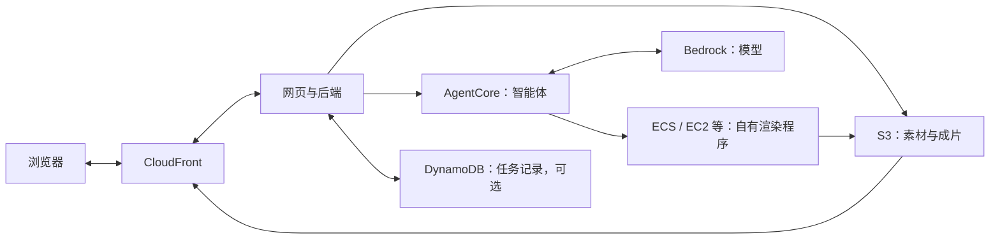

# AWS 服务入门：从篮球视频到网页成片

整理与官方资料采集日期：2026-10-06（Asia/Shanghai）。本文解释服务职责与常见组合；项目例子为理解和选型参考，不是已部署功能、团队选型或新增赛事要求。各服务名称链接到本轮查阅的 AWS 官方文档。

## 1. 智能体与 AI

| 服务 | 主要职责 | 篮球视频场景举例 |
| --- | --- | --- |
| [Bedrock AgentCore](https://docs.aws.amazon.com/bedrock-agentcore/latest/devguide/what-is-bedrock-agentcore.html) | 构建、部署和运行智能体的平台；Runtime 承载智能体程序，其他组件提供工具接入、记忆、身份和运行观察等能力 | 运行“篮球讲解助手”，按用户请求调用模型、查询素材并提交渲染任务 |
| [Bedrock](https://docs.aws.amazon.com/bedrock/latest/userguide/what-is-bedrock.html) | 托管基础模型服务，通过 API 调用模型；输入类型和能力取决于具体模型 | 将视频关键帧、已核实指标和问题交给支持相应输入的模型，生成解释或讲解稿 |
| [Rekognition](https://docs.aws.amazon.com/rekognition/latest/dg/what-is.html) | 图像和视频视觉分析，提供物体、场景、文字等识别能力；具体功能按 API 区分 | 尝试给素材打标签或读取画面文字，效果需要篮球素材实测 |
| [Transcribe](https://docs.aws.amazon.com/transcribe/latest/dg/what-is.html) | 语音转文字，支持文件和流式转写 | 将原解说转成文字，作为字幕制作和检索的输入 |
| [Polly](https://docs.aws.amazon.com/polly/latest/dg/what-is.html) | 文字转语音 | 把审核后的讲解稿合成为配音 |
| [Translate](https://docs.aws.amazon.com/translate/latest/dg/what-is.html) | 文本语言翻译 | 翻译字幕或讲解稿；所选语言、术语和效果仍需检查 |

可以这样理解：Bedrock 提供“模型能力”，AgentCore 提供“智能体运行与管理能力”。智能体程序连接模型和工具，完成多步任务；部署到 Runtime 本身不会自动写好篮球分析逻辑。AgentCore 的模块可以独立使用，并不强制接入所有组件，也不限于 Bedrock 内的模型；比赛账号许可另按赛事和权限记录执行。

Rekognition 的通用视觉能力不构成十名球员身份、遮挡恢复、脚点坐标或战术识别的精度保证；这些是项目需要另行验证的专业目标。Bedrock 的模型解释也不能替代已核实的事实和指标。

音频相关服务的方向：原音频 → Transcribe → 文字 → Translate → 另一语言文字 → Polly → 新音频。只生成新讲解时，可以从 Bedrock 讲解稿直接接 Polly。

## 2. 计算

| 服务 | 主要职责 | 何时使用 |
| --- | --- | --- |
| [Lambda](https://docs.aws.amazon.com/lambda/latest/dg/welcome.html) | 按事件或 API 请求执行代码，AWS 管理底层服务器 | 文件上传后检查元数据、创建任务、更新状态等短任务 |
| [ECS](https://docs.aws.amazon.com/AmazonECS/latest/developerguide/Welcome.html) | 部署、调度和管理容器化应用 | 运行 Python 后端、视频渲染程序或持续接任务的 Worker（后台处理程序） |
| [Batch](https://docs.aws.amazon.com/batch/latest/userguide/what-is-batch.html) | 管理批处理作业、队列和计算资源调度 | 一次处理多段视频，按资源需求安排抽帧、分析或渲染作业 |
| [EC2](https://docs.aws.amazon.com/AWSEC2/latest/UserGuide/concepts.html) | 云端虚拟机，可选择机器规格并管理系统和软件 | 需要直接控制系统、安装自定义依赖、迁移已有服务或使用特定硬件时 |

这四项不在同一层：EC2 提供机器；ECS 管理容器；Batch 管理批量作业；Lambda 提供事件触发的函数计算。ECS 可以使用 EC2，也可以使用 Fargate 等计算选项；Fargate 让团队不用自己维护容器底层服务器。Batch 也会使用底层计算资源，不是额外赠送的算力。

这里 Lambda 的入门例子指常见的 Lambda Functions；常规函数单次调用最长 15 分钟。当前文档还区分 Durable Functions 和 MicroVMs 等能力，因此不能把“整个 Lambda 产品所有工作都最多 15 分钟”作为结论。持续渲染和依赖复杂的任务，应依据时长、资源和环境选择容器或虚拟机。

## 3. 媒体

| 服务 | 主要职责 | 篮球视频场景举例 |
| --- | --- | --- |
| [MediaConvert](https://docs.aws.amazon.com/mediaconvert/latest/ug/what-is.html) | 文件式视频处理和转码，支持字幕、音频及不同输出格式 | 将已生成的视频转为不同分辨率、码率或适合播放的格式 |
| [MediaLive](https://docs.aws.amazon.com/medialive/latest/ug/what-is.html) | 实时视频编码和格式转换，为直播交付生成输出 | 接入正在发生的比赛直播，持续生成直播输出 |

“来源是比赛直播录像”不等于系统在做直播：上传一段 MP4 后生成讲解属于文件处理。若当前自有渲染程序已经输出满足要求的 MP4，可以先复用；有批量转码或多规格交付需求再评估 MediaConvert。两项媒体服务都不会自动理解战术或决定箭头如何运动，自定义视觉表达仍要由模型、数据和渲染逻辑共同实现。

## 4. 存储与交付

| 服务 | 主要职责 | 篮球视频场景举例 |
| --- | --- | --- |
| [S3](https://docs.aws.amazon.com/AmazonS3/latest/userguide/Welcome.html) | 对象存储，用桶和对象键组织文件 | 保存原视频、抽帧、分析文件、配音和成片 |
| [CloudFront](https://docs.aws.amazon.com/AmazonCloudFront/latest/DeveloperGuide/Introduction.html) | 内容分发网络（CDN），从源站分发静态或动态内容 | 向浏览器交付网页、图片和成片，并可转发后端请求 |
| [DynamoDB](https://docs.aws.amazon.com/amazondynamodb/latest/developerguide/Introduction.html) | 托管 NoSQL 数据库 | 保存任务编号、处理状态、参数和成片 S3 路径等结构化记录 |

建议把视频字节放 S3，任务信息放数据库；CloudFront 提供用户访问这些内容的交付通道。CloudFront 后面仍需 S3 或应用服务等源站；通用后端、模型调用和视频渲染仍需要相应计算服务。网页上的上传、编辑和播放交互由前端与后端代码实现。

## 5. 编排与消息

| 服务 | 便于理解的角色 | 示例 |
| --- | --- | --- |
| [Step Functions](https://docs.aws.amazon.com/step-functions/latest/dg/welcome.html) | 流程控制器：协调步骤、分支、等待和错误处理 | 按“检查输入 → 分析 → 配音 → 渲染 → 保存”推进并追踪工作流 |
| [SQS](https://docs.aws.amazon.com/AWSSimpleQueueService/latest/SQSDeveloperGuide/welcome.html) | 任务排队箱：暂存消息，等待消费者处理 | 100 个渲染请求入队，由若干 Worker 按承载能力领取 |
| [SNS](https://docs.aws.amazon.com/sns/latest/dg/welcome.html) | 发布订阅广播：一条消息分发给多个订阅者 | 成片完成后，同时通知多个处理系统或已配置的通知渠道 |
| [EventBridge](https://docs.aws.amazon.com/eventbridge/latest/userguide/eb-what-is.html) | 事件路由：将不同来源事件分发给目标；Scheduler 提供定时调度 | 将“上传完成”“转码成功”等事件送入相应流程，或定时触发工作 |

SQS 队列本身不执行 FFmpeg 或模型，仍需消费者程序；标准队列可能重复投递，处理程序应避免重复产生同一成片。SNS 的广播与 EventBridge 的事件路由有重叠，按实际来源、订阅与路由需求选择即可。Step Functions 负责按定义推进流程，具体工作由被调用的服务执行。

智能体与工作流可以搭配：智能体根据用户目标判断需要哪些工具，Step Functions 执行已经定义好的处理步骤。简单演示可以先由应用代码衔接，不需要把四项编排与消息服务全部加入。

## 6. 理解用的组合示例

这是服务职责示意，不是完整部署拓扑。可按需要在任务链路加入 Step Functions / SQS，用 Polly 加配音，用 MediaConvert 做转码；当前录播片段的示例不需要 MediaLive。具体网络、认证、接口和账户可用性另在部署工程落实。

本仓库已有的[云端架构讨论](../../engineering/docs/aws-deployment-architecture-20261006.md)、[账户计算服务核验](compute-services-availability-20261006.md)和[模型权限核验](bedrock-model-access-20261006.md)回答的是不同问题。本轮只查通用官方文档，没有重新核验账号权限、调用模型或部署服务。
