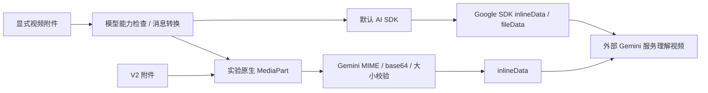

# OpenCode 与 Codex 的多模态视频理解实现研究

采集日期：2026-10-05，Etc/UTC。研究范围：本次实际克隆的公开源码，不外推到闭源桌面应用、ChatGPT 客户端、私有扩展或未来版本。固定提交和全部原始来源见[来源清单](sources.json)。

## 1. 主要结论

**OpenCode 能在底层把视频交给支持视频的模型，但视频输入在不同入口的可达性不一致；Codex 的当前输入协议没有视频类型，视频分析需要先在外部抽帧，再通过图片输入交给模型。两者都没有在 Agent 源码中实现视频语义模型的训练、视觉编码器或视频理解权重。**

| 核实项 | OpenCode | Codex |
|---|---|---|
| 本次版本 | `907b3bc5`，`dev` | `7f892275`，`main` |
| 常规模型输入 | 文件 / 图片通过消息转换进入 provider；有 `input.video` 标记 | `UserInput` 有文本、图片、音频等，没有视频分支 |
| 视频协议路径 | 默认 Google SDK 支持 `inlineData` / `fileData`；实验原生 Gemini 支持视频 MIME | `ContentItem` 有 `InputImage` / `InputAudio`，没有 `InputVideo` |
| 默认上传界面 | 接纳图片、PDF 和文本；实际二进制 MP4 被拒绝 | `exec` 图片参数转成 `LocalImage`，不是视频参数 |
| 内置查看工具 | V1 `read` 接纳图片 / PDF；V2 `read` 的视觉输出限图片 | `view_image` 验证并返回单张图片 |
| 本地视频解码与抽帧 | 检查的输入 / 工具链没有专用视频抽帧组件 | 检查的协议 / 工具链没有专用视频抽帧组件 |
| 时间、镜头与轨迹 | 本链路没有视频帧时间轴或跟踪器 | 图片序列依靠额外文字提供顺序和时间，协议本身没有视频时间轴 |
| 语义理解运行位置 | 外部模型服务 | 外部模型服务 |

“没有本地抽帧组件”限于上述实际追踪的链路。Agent 可通过通用 shell、插件或 MCP 调用 FFmpeg 等外部工具，这是可编排能力；不能据此说内置了视频理解模块。模型是否成功接收、看懂视频还取决于具体服务端能力，本轮没有真实模型调用。

## 2. OpenCode：入口、消息转换与 provider

### 2.1 视频能力标记来自模型目录

[`provider.ts:1339–1360`](excerpts/opencode/model-capabilities.ts) 从模型目录的 `modalities.input` 生成 `capabilities.input`，分别记录 `text/audio/image/video/pdf`。[`transform.ts:1–16`](excerpts/opencode/modality-definition.ts) 将 `video/*` MIME 映射到 `video`；[`unsupportedParts`](excerpts/opencode/modality-gate.ts) 在用户消息中检查当前模型能力，不支持时把附件替换成显式错误文字。

这层负责“是否允许把附件发给此模型”，不负责读取视频的运动信息。界面展示视频标记只说明目录中的能力声明，不证明上传入口、供应商协议和实际模型服务都已跑通。

### 2.2 默认附件界面没有视频入口

[`file-picker.ts`](excerpts/opencode/ui-file-picker.ts) 的接受列表包含 PNG/JPEG/GIF/WebP、PDF 以及文本 / 代码。真正的附件判断是 [`attachmentMime`](excerpts/opencode/ui-attachment-mime.ts)：

1. 已知图片和 PDF 直接接纳。
2. 文件扩展名用于有限的图片 / PDF MIME 回退。
3. 文本 MIME 转为 `text/plain`。
4. 其余内容检查前 4096 字节；有 NUL 或过多控制字节的内容不视为文本。

本轮直接导入并运行上游函数，FFmpeg 生成的真实 MP4 在 `video/mp4`、空 MIME、`application/octet-stream` 三种情形均返回 `undefined`。这是实际入口限制的证据。对 `.ts` 文件，浏览器可能给出 `video/mp2t`，函数会把真实代码文本识别为 `text/plain`；不能把这个 MIME 命中当作视频支持。

### 2.3 CLI 与 API 入口要分别判断

[`run.ts:356–415`](excerpts/opencode/cli-file-entry.ts) 显示，本地 `opencode run --file ...` 将普通文件先标成 `text/plain`，交给文件读取流程，不能据此提供一个已验证的“直接读 MP4”命令。`--attach` 连接远端服务时，客户端会读取本地字节、检查文件和 10 MiB 大小限制，二进制采用检测出的 MIME，再以 data URL 发送。这条分支在源码上能保留视频 MIME，但本轮没有运行完整 CLI / 服务端请求。

API / SDK 中显式构造 `type:"file", mime:"video/mp4", url:"data:video/mp4;base64,..."` 与默认 GUI 上传是不同路径。V1 [`prompt.ts` 文件分支](excerpts/opencode/prompt-file-ingest.ts) 能将指定 MIME 的本地文件变成 data URL；[`message-v2.ts`](excerpts/opencode/message-file-lowering.ts) 将非文本、非目录附件转换为 AI SDK 的 file part。仅仅在提示词里写一个视频路径不会自动等价于显式视频附件。

### 2.4 V1 默认调用路径：AI SDK → Gemini

V1 的 [`llm.ts`](excerpts/opencode/runtime-selection.ts) 明确保留默认 `streamText(...)` 路径；V2 另有后文说明的新路由。模型选择为 Google 时，OpenCode 的依赖是 `@ai-sdk/google@3.0.73`，而不是自己写一套 Gemini 视频识别器。

该依赖的 [`convertToGoogleGenerativeAIMessages`](excerpts/sdk-google/google-file-conversion.ts) 将 user file part 转成：

```text
二进制 / base64 → parts[].inlineData { mimeType, data }
URL 对象       → parts[].fileData   { mimeType, fileUri }
```

[`Google 内容类型`](excerpts/sdk-google/google-content-types.ts) 包含上述两种结构。[`supportedUrls`](excerpts/sdk-google/google-supported-urls.ts) 声明了 Google Files 和 YouTube URL 模式；这不是 OpenCode 已实现上传视频、轮询处理状态的证明。不要把 SDK 内的 Veo 视频生成模型混入本研究，生成视频与理解输入视频是两个功能。

**真实 SDK 离线验证：** 使用固定的 SDK 版本、合成 MP4、替换为内存响应的 `fetch`，调用 SDK 模型对象的 `doGenerate`。捕获实际生成请求并确认：视频 MIME 为 `video/mp4`；`inlineData.data` 解码后与原视频字节完全相等；URL 输入转换为 `fileData.fileUri`。探针只完成协议转换，没有发送网络请求，没有模型推理。

OpenCode 对这个 SDK 的仓库补丁仅移除空的 model 消息。本次验证涉及的 user 视频文件转换没有被补丁修改。

### 2.5 实验原生协议路径：文件 → MediaPart → Gemini

该提交还包含新 V2 Core 和 `@opencode-ai/llm`，不能只读旧 `packages/opencode/src/session` 就概括整个仓库。

- V1 的原生适配器由 `OPENCODE_EXPERIMENTAL_NATIVE_LLM` 开关控制，未支持的情况回退 AI SDK。它把 file part 转成 [`MediaPart`](excerpts/opencode/native-file-lowering.ts)。
- V2 [`FileAttachment`](excerpts/opencode/v2-file-schema.ts) 保存 `uri/mime/name/description`；[`toLLMMessage`](excerpts/opencode/v2-user-message.ts) 将用户附件经 [`media()`](excerpts/opencode/v2-file-lowering.ts) 直接变成 `type:"media", mediaType, data`，走新的 LLM 路由。
- [`MediaPart schema`](excerpts/opencode/llm-media-schema.ts) 的数据是字符串或 `Uint8Array`。字符串并不意味着任意 URL 都可直接发送；具体协议会校验内容。
- [`shared.ts`](excerpts/opencode/llm-media-validation.ts) 明确声明 `video/mp4`、`video/webm`、`video/quicktime`。每个媒体 part 限编码后 28 MiB、解码后 20 MiB，并验证 MIME 与 data URL 一致、base64 格式及规范编码。
- [`Gemini.lowerUserPart`](excerpts/opencode/gemini-media.ts) 使用这份媒体白名单，生成 `inlineData {mimeType,data}`。它没有调用视频解码器，也没有在本地抽关键帧。
- 对比 [`OpenAI Responses.lowerUserContent`](excerpts/opencode/responses-media.ts)：这个原生实现只传 `IMAGE_MIMES`，输出 `input_image`。有通用 MediaPart 不等于每个 provider 都接纳视频。



默认 SDK 的 URL 文件路径与新原生 Gemini 的 inline 路径有差别。[原生 body schema](excerpts/opencode/gemini-body-schema.ts) 未声明 `fileData` 或 `videoMetadata`；这条原生链路不能直接照搬 Google Files URI、视频裁剪起止时间或 FPS 配置。源码的 20 MiB 限制是适配器限制，不应写成 Gemini 所有 API 的统一上限。

### 2.6 read 和工具结果的边界

V1 [`read`](excerpts/opencode/read-media.ts) 专门把图片 / PDF 转为附件，其他二进制失败。V2 [`read`](excerpts/opencode/v2-read-tool.ts) 将支持的图片 base64 转为模型可见 file 输出，其他 base64 内容作为二进制失败。V2 图像规范化默认 2000×2000 尺寸上限、5 MiB base64 上限，来源见 [`Image.normalize`](excerpts/opencode/image-normalization.ts)。

V1 [`isMedia`](excerpts/opencode/media-scope.ts) 仅包含图片和 PDF。工具返回附件的“提升到用户消息”兼容逻辑依赖它，因此不能未经核实把视频工具结果套入既有图片兼容处理。[V2 / 原生 Gemini](excerpts/opencode/gemini-media.ts) 可以处理结构化媒体工具结果，仍须有外部工具先产生合适字节；它不会自动完成视频抽帧。

## 3. Codex：图片输入、图像预算和工具结果

### 3.1 协议类型明确限定了能力

[`UserInput`](excerpts/codex/user-input.rs) 有 `Text`、`Image`、`LocalImage`、`Audio`、`LocalAudio`、Skill 和 Mention；没有 `Video/LocalVideo`。[`ContentItem`](excerpts/codex/content-types.rs) 有 `InputText/InputImage/InputAudio/OutputText`；[`InputModality`](excerpts/codex/model-modalities.rs) 只有 Text/Image/Audio。三处类型定义互相印证，本次公开源码没有一条与图片输入对应的原生视频输入协议。

图片引用可为 `image_url` 或 `file_id`。这个 `file_id` 是 **ImageReference 的一支**，不能看到“文件 ID”就推断能把 MP4 当作图片发给 Codex。

### 3.2 CLI 图片如何进入请求

[`exec/src/lib.rs`](excerpts/codex/exec-image-input.rs) 把图片参数转换成 `UserInput::LocalImage`，再将提示文字加入同一次 user turn。随后 [`from_user_input`](excerpts/codex/local-image-serialization.rs) 读取图片文件、生成编号上下文和 `InputImage`。

当前主路径不是每次都在协议转换时立刻完成缩放：Session 调用 [`LocalImagePreparation::Defer`](excerpts/codex/local-input-defer.rs)，先保存可处理的图片引用，进入 [`prepare_conversation_items_for_history`](excerpts/codex/history-preparation.rs) 再统一准备图像与音频。研究图像尺寸时必须追到这里，不能仅依据旧的局部图像函数给出上限。

[`ResponsesApiRequest.input`](excerpts/codex/responses-input.rs) 保存 `Vec<ResponseItem>`。最终发送的是图像内容，而不是只有本地文件路径字符串。


图中的视频解码和抽帧必须由业务侧实现。Codex 接到多张图后可以用文字时间证据比较前后变化，但这不是携带解码时间戳的原生视频传输，也不能证明逐帧运动理解。

### 3.3 图像处理与分辨率预算

[`utils/image`](excerpts/codex/image-processing-modes.rs) 定义解码、缩放、编码及缓存相关基础设施。旧 `ResizeToFit` 上限为 2048；当前 centralized preparation 使用 [`resize_image`](excerpts/codex/image-budget.rs)：

| 路径 | 策略 |
|---|---|
| DetailBased 的 auto / high | 最大边 2048，32 像素 patch 预算 2500 |
| DetailBased 的 original | 最大边 6000，patch 预算 10000 |
| UnifiedBudget | 用 original 预算准备图像，兼容 detail 字段设置为 original |

尺寸上限和 patch 预算共同约束输出，不等于固定输出上述分辨率。UnifiedBudget 受 feature 与模型能力条件控制。[`resize_image`](excerpts/codex/image-budget.rs) 也会拒绝当前路径不支持的远端图片 URL 或 low detail；协议能表示某字段不等于所有本地准备模式都接纳。

这里是图像预处理，不包含视频编码器、帧率采样、动作检测或目标跟踪。篮球画面中的小球 / 号码可能因缩放而丢失细节，因此需要“全景图 + 有来源的局部裁剪”配合，而不是只提高输入帧数。

### 3.4 view_image 的真实机制

[`view_image`](excerpts/codex/view-image-input.rs) 检查模型是否支持 Image，解析路径和环境，使用沙箱文件系统读文件，并用图片解码检查排除非图片。[`ViewImageOutput`](excerpts/codex/view-image-output.rs) 返回结构化 `FunctionCallOutputContentItem::InputImage`，日志隐藏 data URL 内容。它不是读视频文件的工具。

因此，把 MP4 交给 `view_image` 不是视频理解捷径。正确做法是先产生 JPEG/PNG，再把图片作为模型可见输出。

### 3.5 MCP 扩展点

[`convert_mcp_content_to_items`](excerpts/codex/mcp-multimodal-result.rs) 将 MCP `text/image/audio` 分别转换成模型内容；image 支持 `mimeType` 和 `_meta["codex/imageDetail"]`，audio 也有独立输入分支。未知类型回落为 JSON 文字，没有视频内容的专门分支。

可复用的扩展方式是让视频工具返回多组“时间说明 + MCP image”，或在业务代码中组织多张 CLI 图片。只返回包含图片路径的 JSON、只让工具打印 base64 文字，都不等价于模型收到结构化图像。

## 4. 我们的工作台已经实现了哪一段

本仓库在研究前已快进同步至 `42a1d60`；下面描述该基线真实代码，不将最新 2D 计划写成已完成实现。

### 4.1 视频解码属于工作台

[`TacticalWorkbench.frames`](excerpts/hub/frame-decoder-entry.py) 用 PyAV 按解码序号选帧，校验视频 SHA-256、解码时间与轨迹时间一致、画面尺寸一致；输出 JPEG、frame/time/sourceFrame/sourceTime、JPEG 哈希、PTS 和 timeBase。一次最多读取 40 帧，未取全即报错。

这就是 Codex 缺少、但我们已有的视频到图片证据层。时间使用真实解码结果校验，比直接用“帧号 ÷ 假设 FPS”更适合带可变时间戳或裁剪映射的视频。

### 4.2 战术分析已经是图片序列 + 结构化证据

[`TacticsAgent`](excerpts/hub/tactics-frame-sampling.py) 在区间内均匀抽样并保留关键 freezeFrame，默认图像预算 12，允许配置 4–24。[`_run`](excerpts/hub/tactics-input-pack.py) 保存图片，补充最多 96 点的轨迹抽样 / 图像帧并集、sourceFrameMapping、已有标注、球场资料和图像顺序说明。样式参考图额外加入，不能把默认 12 张误写成总请求图片数量。

[`build_codex_command`](excerpts/hub/codex-cli-command.py) 使用 `codex exec`，通过每张图片一个 `-i` 发送图像，stdin 提交提示，`--output-schema` 限定输出。命令采用 read-only、ephemeral，并关闭额外工具。**这里不是 Codex 自己打开 MP4，而是我们先解码视频，再给 Codex 图像和篮球数据。**

### 4.3 身份续接已有两阶段图像证据

[`IdentityAgent`](excerpts/hub/identity-scan.py) 先生成参考人物图，再抽样扫描区间，将候选人物做拼图。裁剪来自原始检测框，并添加 frame/T 编号，来源见 [`证据裁剪`](excerpts/hub/identity-evidence-crop.py)。随后根据候选形成局部窗口并用额外证据复核，切镜、缺测与身份风险影响窗口边界。

这条流程提供有限抽样的身份建议，不证明全片真人连续性。[`VisionProvider`](excerpts/hub/vision-provider.py) 的可用实现是 Codex CLI；`multimodal-api` 仍是返回“未配置”的占位适配器。OpenCode / Gemini 原生视频没有在本轮接入现有工作台。

## 5. 值得拆出来复用的五个边界

| 模块 | 可复用依据 | 建议输入 / 输出 | 还需要什么 |
|---|---|---|---|
| 媒体准备 | 工作台 PyAV 解码、人物裁剪；Codex 图像预算 | 视频与区间 → 有 PTS、哈希、来源帧的图像 | 镜头边界与任务相关抽样策略 |
| 证据组织 | 工作台图片顺序、sourceFrameMapping、轨迹及人工状态 | 画面 + 时间 + 轨迹 → 不可变证据包 | 明确区分比赛证据和样式参考 |
| 供应商适配 | OpenCode MediaPart / MIME 校验；Codex 图片输入 | 证据包 → 当前 provider 能接收的结构化内容 | 能力声明与实际请求路径联检 |
| Agent 调度 | 两者的模型 / 工具调用机制；现有作业取消与超时 | 任务 → 有界调用 / 候选 | 重试、预算、缓存、长视频分窗 |
| 结果验收与采用 | 现有 schema、版本 / 来源检查与人工采用 | 候选 → 可复核、可编辑的业务对象 | 身份、几何、时序及运动事实独立验收 |

建议下一步优先保留现有 Codex 图片适配器，把媒体准备和证据包做成清晰的业务契约。若要评估原生视频，新增可替换的 Gemini provider，以相同样片、同一任务和同一标注比较两条路径；不要为接入视频而引入整个 OpenCode UI / Session 系统。

对于篮球全片轨迹，视频多模态回答适合场景描述、战术解释与候选复核。连续人物身份、脚下点、球 / 筐位置、球场标定仍需要现有检测 / 跟踪 / 几何证据；模型给出的“看起来像传球 / 挡拆”不能替代逐帧来源及人工核对。最新[2D 优先计划](../../../engineering/docs/plans/2026-10-05-2d-first-tactics-workbench-plan.md)可在这层证据准备完成后接续。

需要长视频时，两个公开 Agent 都没有给这项业务现成解决方案。本轮建议的分窗、切镜加密抽样、全景与局部图组合、按需二次取帧以及窗口结果合并属于后续设计，尚未实现或测量。原生视频链路也应分别处理上传大小、服务端文件准备和时间片段，而不是把超长视频直接塞进一个 data URL。

## 6. 验证、许可证与交付边界

- 当前仓库远端已同步；任务开始时本地 / origin main 均为 `42a1d60999b711dc09acc06db7edfdcf4c396b09`。开放 GitHub Issues 查询为空，范围以用户本轮要求为准。
- 两个完整源码仓库实际克隆完成。摘录锁定提交；46 个片段保留原字节，原文件 / 摘录哈希、行范围、永久链接写入 [sources.json](sources.json)。
- [真实代码离线探针](offline-probe.json) 10 项断言通过：固定上游提交 / SDK 版本、三个 MP4 输入拒绝、图片 / 代码 MIME 接纳、SDK 视频 MIME / 字节往返 / URL 转换。
- JPEG MIME 接纳用例没有验证图片解码；真实视频验证使用合成 MP4。探针的 SDK 响应是固定的测试数据，不代表模型成功看视频。
- 未运行上游完整构建、Rust 测试或真实模型请求；没有准确率、跨视频泛化、延迟或费用结论。源码里没有视频权重不等于厂商模型没有视频理解能力。
- MIT / Apache-2.0 许可证以及 Codex NOTICE 与摘录一同保留，见[许可证目录](licenses)。摘录是研究阅读材料，含外围依赖及局部函数片段，不能当独立模块运行。
- 本轮只产生研究文件、抽取脚本与离线探针，没有修改工作台后端、前端、视频素材或用户草稿。研究成果提交 / 推送状态以本次交接和最终回复为准。
