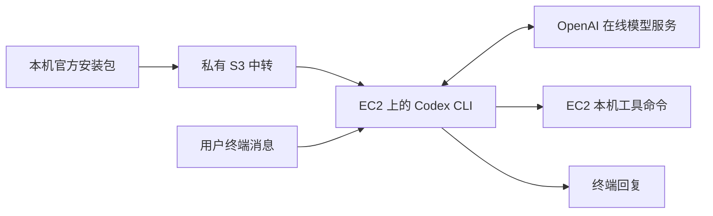

# Codex CLI 在 EC2 上运行的可行性与实测报告

资料采集及实测日期：2026-10-07，Asia/Singapore（UTC+8）；基础调用验证完成于 22:24，报告整理于 23:32。本轮整理复核既有执行证据，没有重新登录、调用模型或变更云端服务。

## 1. 结论

**Codex CLI 已在本队既有 AWS EC2 上安装成功，并通过 ChatGPT 账号登录、真实模型回复和只读终端命令测试。** 本次完成用户要求的“本机下载官方 Linux 包 → 上传私有 S3 → EC2 下载校验 → 用户级安装 → 浏览器授权 → 实际调用”，证明这条路线在本次实例和账号条件下可行。

安装在 EC2 上的是 Codex CLI 程序及其命令执行环境；本轮通过 ChatGPT 账号使用 OpenAI 在线模型服务。EC2 负责发起请求、处理回复和执行获准的本机工具命令，没有在实例上下载或部署模型权重，也没有使用 GPU。实际 `pwd` 返回服务器上的独立工作目录，证明工具执行发生在 EC2；日志不披露模型后端的物理部署位置。

“能回复消息”的直接证据是一次真实 `codex exec` 请求返回 `CODEX_CLOUD_OK`，随后另一次请求成功调用工具并返回 `CODEX_SHELL_OK`。两次测试是独立的非交互调用，尚未验收持续多轮对话、重连恢复或与桌面当前聊天同步。

## 2. 运行位置与职责

| 部分 | 本次位置 / 用途 | 证据与边界 |
| --- | --- | --- |
| 本机电脑 | 下载官方 Linux x64 包，校验并上传 | 本地下载不等于在 Windows 上运行该 Linux 包 |
| 私有 S3 | 安装包传输中转 | 大小一致、AES256 服务端加密；不保存 ChatGPT 登录令牌 |
| EC2 | Ubuntu 24.04、x86_64，运行 CLI 和工具命令 | 复用原工作台 CPU 实例；操作用户为 `ubuntu`，工作目录为 `~/codex-workspace/` |
| OpenAI 在线服务 | 账号认证及本轮模型请求 | 使用用户授权的 ChatGPT 账号；具体模型名称未单独核验 |
| 用户浏览器 | 输入服务器设备码并确认授权 | 用户先开启设备码登录，再完成授权 |
| 原工作台 | 同台 EC2 的既有服务 | 本次未将个人 Codex 登录接入工作台后端 |



EC2 上的个人 Codex 环境与工作台服务用户 `hks` 分开。`ubuntu` 登录成功不能作为工作台已获得同样模型能力的证据。

## 3. 官方依据与安装选择

[官方 CLI 文档](https://learn.chatgpt.com/docs/cli)提供 macOS / Linux 独立安装器及 npm 安装方式，并说明检查代码、修改文件和执行命令的终端能力。[官方认证文档](https://learn.chatgpt.com/docs/auth)支持 ChatGPT 登录，为远程或无浏览器环境提供 `codex login --device-auth`。官方能力说明与下节本队实测范围分别记录。

本次从[官方安装脚本](https://chatgpt.com/codex/install.sh)解析发布路径，固定下载当时 `latest` 返回的 `0.160.1`；这不是永久最新版本声明。

| 安装包项目 | 实际记录 |
| --- | --- |
| CLI 版本 | `codex-cli 0.160.1` |
| 平台 | `x86_64-unknown-linux-musl` |
| 官方包名 | `codex-package-x86_64-unknown-linux-musl.tar.gz` |
| 大小 | 160,785,122 字节 |
| SHA-256 | `340801565906a7028f6baaa9ab6853addaef221f0016a1417a7c1ffdd96c21f0` |
| 用户入口 | `~/.local/bin/codex`，`ubuntu` 登录 shell 可直接找到 |

本机包、官方发布元数据、官方校验清单及实例下载后的 SHA-256 一致。通过既有 Systems Manager 管理实例，由实例角色从已有私有 S3 前缀下载，手动解包保留 standalone 布局；未新增 EC2、开放 SSH 入站或为 Codex 创建 systemd 常驻服务。详细操作见[环境安装记录](../../environment/aws/codex-cli-ec2-20261007.md)。

## 4. 实测结果

| 验证项 | 观察结果 | 可以支持的结论 |
| --- | --- | --- |
| 安装与启动，22:15:02—22:15:09 | 摘要检查 `OK`；`codex --version` 返回 `codex-cli 0.160.1` | 程序能在当前系统启动 |
| ChatGPT 登录 | `codex login status` 返回 `Logged in using ChatGPT` | 此用户环境已完成账号认证 |
| 文本请求，22:24:02—22:24:08 | `CODEX_CLOUD_OK`，CLI 退出码 0 | 当前账号和网络能取得真实模型回复 |
| 工具请求，22:24:43—22:24:50 | `/bin/bash -lc pwd` 返回预期目录，工具退出码 0；最终 `CODEX_SHELL_OK`，CLI 退出码 0 | 基础终端工具在 EC2 正常执行 |
| 凭据权限 | 仅核对文件 owner 为 `ubuntu`、权限 600，账号目录权限 700 | 未读取或输出令牌正文 |
| 原服务状态 | 安装及两次测试后，两个工作台服务均 active | 进程状态正常；不等于全部业务功能回归通过 |

上述时间来自 SSM 执行记录，不是纯模型推理延迟。文件名 `smoke-2221-result.json` 中的 `2221` 是准备标记，实际请求在 22:24 执行。

执行配置使用 `--sandbox read-only --skip-git-repo-check --ephemeral` 和独立工作目录。第一个提示要求固定文本、禁止工具；第二个提示要求执行一次 `pwd`，只在目录符合预期时返回通过标记。验证同时检查真实工具事件及退出码，不只看模型宣称成功；一次 `pwd` 也不构成完整沙箱隔离验收。

初始网页探测曾出现 ChatGPT 首页 HTTP 403、认证发现接口 HTTP 200。后续设备码登录和真实请求成功，说明首页状态不能单独用于判断 CLI 可用性。

原始证据位于被 Git 忽略的 `tmp/codex-cli-ec2-20261007/`：`install-result.json`、`smoke-2221-result.json`、`shell-smoke-2224-result.json`。原始记录含私有环境定位，不直接纳入共享报告；设备码、令牌和认证文件不入库。

## 5. 使用与验证边界

通过现有 Systems Manager 会话进入实例后，保持同一用户及其 HOME：

```sh
sudo -iu ubuntu
codex login status
cd ~/codex-workspace
codex
```

交互入口依据官方使用方式；本次实际测试的是非交互 `codex exec`。项目源码读取、文件改写、构建测试、长任务、全部模型权限、剩余额度和性能费用尚未验收；本次也没有让云端 CLI 处理图片、原始视频或篮球轨迹。后续开发应先明确项目目录与修改范围。

本轮结论属于开发工具运行可行性，不替代既有 AgentCore / Bedrock 工程，不增加赛事官方要求，也不代表已把个人 ChatGPT 账号接成面向公众的后端服务。

另一工作会话的[账号重置计划](../../engineering/docs/plans/2026-10-08-cloud-reset-redeployment.md)记录：用户告知 10 月 8 日 09:00（北京时间，同为 UTC+8）将重置账号内全部资源，通知原文尚未在本地核实。本报告证明的是 10 月 7 日实测时状态；实例如重建，应重新定位、安装、授权及验证，不能假设旧登录缓存保留。认证文件不随应用包备份或共享。

## 6. 来源与关联研究

官方来源采集于 2026-10-07，本报告沿用本聊天已实际读取的资料：

- [Codex CLI](https://learn.chatgpt.com/docs/cli)：安装、终端入口和工具能力。
- [Authentication](https://learn.chatgpt.com/docs/auth)：ChatGPT 认证、设备码设置、缓存和状态检查。
- [官方安装脚本](https://chatgpt.com/codex/install.sh)、[发布元数据](https://releases.openai.com/codex/channels/latest)、[固定版本校验清单](https://releases.openai.com/codex/releases/0.160.1/codex-package_SHA256SUMS)：版本、平台包及摘要。
- 本队证据：[环境记录](../../environment/aws/codex-cli-ec2-20261007.md)、[安装交接](../../handoffs/Linzeyu912/2026-10-07-2216-codex-cli-ec2-install.md)、[授权与调用交接](../../handoffs/Linzeyu912/2026-10-07-2224-codex-cli-ec2-auth.md)。

本报告补充此前的[Codex 视频协议源码研究](agent-video-understanding-20261005/REPORT.md)：本报告验证云端基础运行，旧报告保留固定源码版本的媒体输入结论。本次没有重新核查 `0.160.1` 的全部媒体协议，也不以基础连通结果推断视频理解效果。
