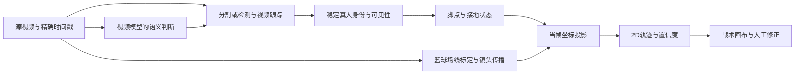

# 模型直接读视频，生成球员轨迹并映射到 2D 篮球场

后续范围更新：用户指定现有 Qwen3.8-Max API，重点是有工具能力的 Agent 反复读图、修正跳跃等造成的地面轨迹错误。请以[当前讨论稿](../qwen-video-trajectory-agent-20261005.md)为主；下文保留前轮模型 / 工具图谱，不作当前实施方向或模型选择共识。

研究日期：2026-10-05，America/New_York。范围来自用户澄清：优先研究模型的视频理解机制及可复用开源项目，不强行抽取 OpenCode / Codex 中不存在的视频模型模块。本轮是源码与官方资料核查，未运行候选模型。

## 1. 已得到的判断

有模型和工具能接受视频文件或视频帧序列，结合文字描述定位对象，输出逐帧框、掩码或点轨迹。最接近“模型读视频并追人”的是 **Sa2VA / UFVideo 的语言条件视频分割**、**SAM3 的概念检测与视频跟踪**；Qwen3-VL 也有视频时空定位示例，值得作为直接生成坐标的对照。

这些输出大多处于图像坐标系。要变成可编辑的篮球 2D 路线，还要解决：同一个真人的身份续接、可信的地面脚点、随镜头变化的标定矩阵、时间戳与缺失状态。现有篮球检测、姿态、球场标定和人工身份工具正好覆盖这几层，下一轮实验可复用它们。

目前核查的 20 个项目中，未找到已用公开篮球基准证明“一个通用视频模型直接输出整段比赛所有球员的准确米制轨迹”的现成实现。**这不是对端到端路线的否定**：应把直接输出轨迹列为实验路线，同时比较语言分割路线与现有检测路线，按身份及地面位置误差决定取舍。

## 2. 模型到底怎样理解视频

### 2.1 视频文件进入模型之前发生了什么

常见调用链是 `MP4 → 解码器 → 采样帧与时间信息 → 缩放 / 分块 → 视觉编码器 → 视觉 token → 语言模型`。用户可直接给文件，服务内部仍需解码视频；模型通常不会直接对压缩后的 MP4 字节做视觉推理。

因此要区分两个实际配置：语言分支看到的采样帧，以及跟踪 / 分割分支处理的帧。视频接口、长上下文、输出很多帧，都不能单独证明语言模型看过每一帧。

以 Qwen3-VL 官方 `qwen-vl-utils` 为例，当前源码默认 `FPS=2.0`，`FRAME_FACTOR=2`，采样帧数还受上下限和传入预算约束；调用者可改变参数。它提供 torchvision / decord / torchcodec 解码路径，返回采样索引、原始帧率等 metadata，再交给 processor 组织视频输入。2 fps 是这份工具的默认配置，**不是模型固定只支持 2 fps**。它也意味着短暂脚部动作可能落在两次采样之间。

源码依据：[采样参数和 smart_nframes](https://github.com/QwenLM/Qwen3-VL/blob/96588727e44c78b25ba03ea03b8e12f7e64fd0da/qwen-vl-utils/src/qwen_vl_utils/vision_process.py#L144)、[fetch_video](https://github.com/QwenLM/Qwen3-VL/blob/96588727e44c78b25ba03ea03b8e12f7e64fd0da/qwen-vl-utils/src/qwen_vl_utils/vision_process.py#L403)。

### 2.2 时序信息怎样保留

视觉编码器把帧中的局部图像转成特征；时序可以在视频编码器内部融合，也可以通过时间位置编码、时间戳文本和语言模型跨帧注意力融合。不同项目不能混为一种架构。

| 机制 / 项目 | 已核实的做法 | 对篮球轨迹的含义 |
|---|---|---|
| Qwen3-VL | 官方描述 Interleaved-MRoPE 对时间 / 高度 / 宽度编码，DeepStack 融合多层视觉特征，Text–Timestamp Alignment 对齐视频与时间；官方 cookbook 有视频时空框定位 | 比独立图片问答更适合时序定位；仍须测球衣、小人物、每个对象的连续 ID 与输出时间对应 |
| VideoLLaMA3 | loader 返回帧和 timestamps；processor 把 `Time …s:` 与帧标记交织；视觉特征经 projector 接入语言模型 | 可明确追溯模型看到的采样帧，输出事件时间仍需和源视频 PTS 对齐 |
| VideoLLaMA3 token 压缩 | `_get_compression_mask` 比较相邻帧对应 patch 的平均绝对像素差，保留变化超过阈值的 token；首帧保留，并有最少 token 兜底 | 减少重复背景；这是视觉冗余压缩，不能把压缩掩码当对象分割或球员轨迹 |
| VideoChat-Flash | 视频编码器配合分层压缩，面向长视频和时间定位 | 适合候选片段 / 动作检索；压缩后的语义 token 不是逐像素位置测量 |
| VideoChat3 | 官方 README 为 I3D-ViT 时空压缩及 Adaptive Frame Resolution；源码有按时序段处理和 temporal pooling | 适合研究运动与流式视频理解；README 的 16× 压缩是作者架构描述，本轮未测篮球定位收益 |

VideoLLaMA3 的真实路径：[infer.py](https://github.com/DAMO-NLP-SG/VideoLLaMA3/blob/05cee23deb854fd6ff82dcff1243a4f682e4d617/videollama3/infer.py#L31)、[时间戳模板](https://github.com/DAMO-NLP-SG/VideoLLaMA3/blob/05cee23deb854fd6ff82dcff1243a4f682e4d617/videollama3/model/processor.py#L59)、[压缩实现](https://github.com/DAMO-NLP-SG/VideoLLaMA3/blob/05cee23deb854fd6ff82dcff1243a4f682e4d617/videollama3/model/videollama3_arch.py#L202)。VideoChat3：[官方概述](https://github.com/MCG-NJU/VideoChat3/blob/015f52eb2ea70b5abda30192aee18034f2c5f13b/README.md)、[时序 pooling](https://github.com/MCG-NJU/VideoChat3/blob/015f52eb2ea70b5abda30192aee18034f2c5f13b/xtuner-videochat3/xtuner/v1/model/compose/videochat3/modeling_vision.py#L562)。

训练也决定能力边界：视频描述、QA、时间定位的监督让模型学习动作和事件；对象区域监督让模型理解指定对象；掩码损失和跨帧记忆才提供密集分割能力。好的视频 QA 成绩不能直接替代球员定位 / ReID / 地面米制轨迹的验收。

### 2.3 从文字推理到逐帧掩码的实际机制

Sa2VA 的机制可以顺着源码追到：视觉与文字输入 → MLLM 生成 `[SEG]` → 取该 token 的隐藏向量 → 投影到分割器提示空间 → SAM2 或对应变体的 SAM3 解码掩码 → 利用视频状态 / 记忆传播。隐藏向量用于驱动掩码解码；输出不仅是“某个人在移动”这句话。

当前仓库的 Qwen3-VL + SAM3 变体已在子项目 README 列出权重地址：[ByteDance/Sa2VA-Qwen3-VL-4B-SAM3](https://huggingface.co/ByteDance/Sa2VA-Qwen3-VL-4B-SAM3)。本轮核实了代码和地址，未下载或验证该权重。

**重要源码限制**：当前 `models_qwen3vl_sam3/modeling_sa2va_qwen.py` 的视频 `predict_forward` 会把传入序列的全部帧送到 grounding 分支，但只把前 5 帧作为 image 内容送到语言分支，并设置 `num_frames=min(5,len(video))`。随后把 `[SEG]` 向量注入这些条件帧，再由 SAM3 对视频状态传播。这不是“Qwen3-VL 对整段完整视频做完语义判断”。同仓库几个 Qwen 变体也有前 5 帧逻辑，具体使用的变体必须单独核对。

源码依据：[语言输入帧](https://github.com/bytedance/Sa2VA/blob/b6fed1a7928ad4adfa124f1fe79031c1f58ec7a1/projects/sa2va/hf/models_qwen3vl_sam3/modeling_sa2va_qwen.py#L120)、[SEG → 掩码](https://github.com/bytedance/Sa2VA/blob/b6fed1a7928ad4adfa124f1fe79031c1f58ec7a1/projects/sa2va/hf/models_qwen3vl_sam3/modeling_sa2va_qwen.py#L230)、[SAM3 语言提示与视频状态](https://github.com/bytedance/Sa2VA/blob/b6fed1a7928ad4adfa124f1fe79031c1f58ec7a1/projects/sa2va/hf/models_qwen3vl_sam3/sam3.py#L99)。训练主体还包括 mask / Dice 损失，见 [sa2va.py](https://github.com/bytedance/Sa2VA/blob/b6fed1a7928ad4adfa124f1fe79031c1f58ec7a1/projects/sa2va/models/sa2va.py#L282)。

这对实验设计很具体：首次识别的球员必须在语言可见帧内，晚入场目标要重新提示；多次短窗口识别还要建立跨窗口身份续接。官方演示 `predict-vid.py` 默认 `frame_interval=6`，掩码对应的是传入的采样帧，不可写成原片每一帧都有模型观测。

UFVideo 同样有真实的 `[SEG]` 隐藏向量投影及 SAM2 掩码传播代码：[生成分支](https://github.com/Heven-Pan/UFVideo/blob/54d1d858489c54ff43adb575c457aeb674bd7a95/ufvideo/model/videorefer_qwen2.py#L427)、[传播分支](https://github.com/Heven-Pan/UFVideo/blob/54d1d858489c54ff43adb575c457aeb674bd7a95/ufvideo/model/sam2.py#L378)。但它不同任务的输入条件有差别：PixRQA 示例读入对象参考 mask 和 region 提示，同时预测后续掩码；不能把这项成绩说成“无提示自动发现所有球员”。PixTRQA 示例另有语言问题驱动的路径，应分开测。训练资料说明明确写着训练 JSON 尚在整理，不能宣称已完整复现全部训练资源。

### 2.4 四种常被混淆的输出

| 输出类型 | 代表项目 | 距离当前目标还缺什么 |
|---|---|---|
| 事件时间区间 / 视频 QA | VideoChat3、VideoLLaMA3、InternVL | 没有逐对象位置和身份保证 |
| 给定区域 / 掩码的对象描述 | PixelRefer / VideoRefer | 参考区域常是输入，需要其他模块提供轨迹；不能当自动分割器 |
| 语言条件对象掩码 / 视频分割 | Sa2VA、UFVideo、VideoLISA；SAM3 可用概念提示 | 掩码不是脚部接地点；track ID 仍需对应稳定真人身份 |
| 查询点轨迹与可见性 | CoTracker3、TAPIR / TAPNext++ | 不负责理解“7 号是谁”；鞋上纹理点也不等于球场接地点 |

## 3. 20 个项目的比较

以下为原作者 / 官方主仓库；每个 README 的固定版本记录在 [sources.json](sources.json)。表中“权重入口”表示官方提供了地址，未表示本轮实际运行。公开代码 / 权重的许可证条件不同，不能统一称为无限制开源。

### 3.1 视频大模型与对象级理解

| 项目 | 实际输入 / 输出及权重入口 | 对本项目的用途 / 边界 |
|---|---|---|
| [Qwen3-VL](https://github.com/QwenLM/Qwen3-VL) | 视频路径或帧列表；文字、时空定位框 / 点；官方模型与 grounding cookbooks | **优先做直接坐标对照**及球衣 / 动作 / 身份证据判断。Qwen3 默认定位坐标为 0–1000 相对坐标，转源图像后才能投影；不能沿用 Qwen2.5 的绝对坐标约定 |
| [VideoLLaMA3](https://github.com/DAMO-NLP-SG/VideoLLaMA3) | 视频采样帧与 timestamps → 文字；2B / 7B 和视觉编码器权重 | 研究采样、时间提示、动态分辨率及 token 压缩；不是现成十人 tracker |
| [InternVL](https://github.com/OpenGVLab/InternVL) | 官方视频推理示例以采样帧 / 多图组织；模型家族和训练工具 | 通用语义对照 / 可作为 Sa2VA 的语言骨干；各代输入和坐标协议须分别核查 |
| [VideoChat-Flash](https://github.com/OpenGVLab/VideoChat-Flash) | 视频编码与分层压缩 → 长视频理解 / 时间定位；多个 2B / 7B 权重 | 长片段检索及运动语义候选；README 已指向 VideoChat3，不能只停在旧版本 |
| [VideoChat3](https://github.com/MCG-NJU/VideoChat3) | 2026-07 发布的 4B，标准 / 在线推理 demo；官方权重与训练资源链接 | 当前视频运动 / 流式理解研究对照；输出文本 / 时间定位不等于密集像素轨迹 |
| [PixelRefer / VideoRefer](https://github.com/alibaba-damo-academy/PixelRefer) | 视频 + 用户指定时刻区域 / mask → 对象描述、关系和 QA；对象 tokenizer，VideoRefer 权重入口 | 可以读“已追踪对象”的动作和关系；**区域常为输入**，不可直接替代身份与跟踪。旧 VideoRefer 地址已迁移到此家族仓库 |

Qwen 坐标与视频框依据：[2D grounding cookbook](https://github.com/QwenLM/Qwen3-VL/blob/96588727e44c78b25ba03ea03b8e12f7e64fd0da/cookbooks/2d_grounding.ipynb)、[video understanding cookbook](https://github.com/QwenLM/Qwen3-VL/blob/96588727e44c78b25ba03ea03b8e12f7e64fd0da/cookbooks/video_understanding.ipynb)。Qwen2.5-VL 旧仓库 URL 本轮返回迁移响应，本轮以 Qwen3-VL 当前主仓库核查，不把旧地址算作另一个已查项目。

### 3.2 能输出像素级结果的语言 / 视频项目

| 项目 | 实际输入 / 输出及权重入口 | 对本项目的用途 / 边界 |
|---|---|---|
| [Sa2VA](https://github.com/bytedance/Sa2VA) | 视频序列 + 表达式 → 文本与掩码；InternVL / Qwen 多骨干，含 Qwen3-VL-SAM3 权重入口 | **优先原型候选**。重点验证实际语义输入帧、拥挤场景、球衣定位和掩码串人；当前 Qwen demo 前 5 帧限制见上文 |
| [UFVideo](https://github.com/Heven-Pan/UFVideo) | 视频 + 文字 / 对象参考 → QA、分割、时间定位；UFVideo-7B | **优先联合理解对照**。各任务是否输入参考 mask 须标明；训练 JSON 未完整公布，时间目标使用 0–99 相对值，须转片段时间 |
| [VideoLISA](https://github.com/showlab/VideoLISA) | 语言指令的视频推理分割；VideoLISA-3.8B 权重 | 更早的 SEG 路线对照；依赖栈较旧，不能照搬成 SAM2 / SAM3 架构 |
| [SAM3 / SAM3.1](https://github.com/facebookresearch/sam3) | 文本概念 / 视觉提示 → 匹配实例、框、掩码和视频跟踪；SAM3.1 有共享记忆多对象跟踪 | **优先像素工具候选**。类别“player”不解决真人号码身份；原厂 SAM3 概念检测接口与 Sa2VA 的语言向量 tracker 接口不同。权重需 HF 授权访问，采用 SAM License |
| [SAM2 / SAM2.1](https://github.com/facebookresearch/sam2) | 视频 + 点 / 框 / mask 提示 → 对象逐帧掩码，视频记忆；官方 checkpoints | 适合用已确认球员起始框驱动传播；原厂 SAM2 本身不理解球衣文字 |
| [Grounded-SAM-2](https://github.com/IDEA-Research/Grounded-SAM-2) | 文本检测 / grounding + SAM2 视频传播；有连续检测 demo | 工具组合路线，适合发现晚入场目标；依赖可选项有本地 GroundingDINO / Florence-2，也有需要云 SDK 的 DINO 1.5 / 1.6 / DINO-X，不能全称本地开源权重 |

### 3.3 点轨迹、体育重建与篮球几何

| 项目 | 实际输入 / 输出及资源 | 对本项目的用途 / 边界 |
|---|---|---|
| [CoTracker3](https://github.com/facebookresearch/co-tracker) | 视频 + 查询点 → 图像点轨迹 / visibility；online / offline 权重 | 局部点续接 / 地板点运动对照；不是身份模型。LICENSE.md 为 **CC BY-NC 4.0**，不能按 Apache / MIT 处理 |
| [TAPNet 家族](https://github.com/google-deepmind/tapnet) | TAPIR、BootsTAP、TAPNext / TAPNext++；视频 + 查询点 → 轨迹 / 遮挡状态；官方 demos / checkpoints | 点轨迹、遮挡再检测、镜头运动研究；跟住鞋面不证明知道地面接触。代码 Apache-2.0，其他资产单独核对 |
| [SoccerNet Game State Reconstruction](https://github.com/SoccerNet/sn-gamestate) | 原视频 → 检测 / ReID / tracker / 球衣号 / 分队 / 标定 → 场地 2D 人员状态；官方数据、配置与 GS-HOTA | **最贴近完整业务结构**。它是足球任务，需篮球场线模板、篮球身份 / 检测模型与数据；GPL-3.0 代码，不能直接宣称篮球效果 |
| [TrackLab](https://github.com/TrackingLaboratory/tracklab) | 可组合 detector、ReID、tracking、评估与可视化；SoccerNet GSR 的基础框架 | 借鉴统一结果契约与对照评估；框架存在不代表任务模型已训练好，MIT 代码 |
| [DeepSportRadar camera calibration](https://github.com/DeepSportRadar/camera-calibration-challenge) | 篮球场地线分割 / 相机标定基线；数据和资源获取说明 | 直接相关的篮球几何候选；本轮未下载数据或测我们素材，代码 / 数据 / 权重许可须分别核对 |
| [DeepSportRadar player ReID](https://github.com/DeepSportRadar/player-reidentification-challenge) | 篮球人物 crops 的重识别任务、基线和数据说明 | 针对相似球衣身份续接的候选；不是从 MP4 直接生成世界轨迹的完整方案 |
| [KaliCalib](https://github.com/CEA-LIST/KaliCalib) | 篮球图像配准与场地坐标；权重 / 训练入口 | 可复用已研究的标定候选，但 FIBA 模板与 NBA 不同；CeCILL-2.1。见已有篮球专项报告 |
| [BasketTracking](https://github.com/Basket-Analytics/BasketTracking) | Detectron2 / OpenCV，人物轨迹重投影到标准篮球场的 demo，含 homography / panorama 代码 | 篮球端到端工程演示参照；作者明确性能不是该项目目标，旧式球模板匹配不作精度证明 |

## 4. 从图像轨迹到篮球 2D 的关键层

若 `H_t` 定义为球场平面到第 t 帧图像的映射，则可信地面点满足：

`[X,Y,1] ∝ inverse(H_t) · [u,v,1]`，再按第三维做齐次归一化。

若接口保存的是图像到球场矩阵，则直接乘它，不能再反一次。每条位置都必须注明对应帧、矩阵方向和球场尺寸 / 坐标约定。球场制式应来自实际比赛及校准模板，不能让通用模型猜一个 NBA 或 FIBA 尺寸。

SoccerNet 已有可检查实现：[bbox2pitch.py](https://github.com/SoccerNet/sn-gamestate/blob/1c958345067218297d221e45e1a6405f975f83e0/sn_gamestate/calibration/bbox2pitch.py)。它支持相机地面反投影和 homography，使用 bbox 下边的左 / 右 / 中点。该实现说明了从检测到小地图的工程办法，**并不证明 bbox 底中点在篮球遮挡、起跳时是真实接地点**。

几个容易直接造成错误轨迹的情况：

- **身份与局部 track ID 不同**：SAM / BoT-SORT 的对象 ID、跨窗口 ID、球衣号码和业务球员 P1–P10 是不同字段。切镜、出画再入画和同队遮挡后需重新关联并记录依据；画面外球员可以有身份，但不应编造观测位置。
- **掩码 / 框不是地面点**：掩码质心通常在躯干，框底可被挡住或含影子。现有 RTMPose 脚部候选能补充，但踝 / 趾位置仍需可见性和接地判断；起跳时需地面足迹推断或留空。
- **镜头变化需要当帧几何**：平移、变焦、切镜会使 `H_t` 改变。用一个首帧矩阵投完整段会把镜头移动写成球员移动；切镜需重新标定并重建 track 关联。
- **时间和坐标必须还原**：resize、crop、0–1000 坐标、采样索引、相对区间均需还原到源图像 / 源时间；变帧率应沿用 PyAV 解码 PTS，不能只以“帧号 / 平均 fps”替代。
- **篮球在空中不服从地面 H**：球的二维地面投影需要额外深度 / 高度假设，不能把空中球像素按球员脚点公式当实际球场位置。

## 5. 与当前工具及 2D-first 计划的关系

目前仓库已经有有效的前置层，不能把本次候选表写成“还需从零搭建”：

| 当前已有部分 | 本轮研究对应的接入点 | 已知边界 |
|---|---|---|
| 篮球 E-BARD 检测、BoT-SORT、人工身份与球衣候选 | 作为现有对照，或给 SAM 提供起始球员框 / 参考对象 | 既有报告存在漏检与身份串号；配置可运行不代表十人身份准确 |
| RTMPose 脚部候选与人工脚点 | 掩码结果可结合姿态估计脚点，再映射 | 双踝不是已确认接地，遮挡 / 起跳须有未知状态 |
| Court48 / KaliCalib 研究、球场标定和镜头传播 | 复用地面几何，不要求语言模型直接猜全场米制坐标 | 当前默认后端与离线全场联合方案分开，不能把候选矩阵覆盖当精度 |
| PyAV 与 TacticalWorkbench 帧 / PTS / 视频指纹核验 | 统一所有模型的采样清单与原帧映射 | 目前战术输入有帧数预算，不是逐帧完整视频推理 |
| Codex 身份与战术 Agent | 改用新模型提供的结构化轨迹证据，或做局部语义复核 | 现有 `multimodal-api` provider 是待实现入口，不是已经接通的视频推理服务 |
| 2D-first 战术工作流计划 | 新结果进入“身份 → 2D 映射 → 派生平滑 → 战术画布 → 回投实拍” | 这份计划是待实施设计，不是本轮新增完成的产品能力 |

已有依据：[全场工具研究](../../vision/fullcourt-tools-and-camera-tracking-20261004.md)、[脚部与场地工具](../../vision/vision-player-refinement/ground-tools-survey.md)、[联合复检](../../../engineering/docs/function-audit-20261004.md)、[2D-first 计划](../../../engineering/docs/plans/2026-10-05-2d-first-tactics-workbench-plan.md)。源码接点为 `engineering/scripts/tactical_workbench.py`、`tactics_agent.py`、`identity_agent.py`、`vision_provider.py`。这些源文件在上一轮 [Agent 研究](../agent-video-understanding-20261005/REPORT.md) 已单独核查。

旧实验中全场联合矩阵候选覆盖 99.17% 并非米制准确率；既有身份 + 标定联合指标“至少一个场内 P”也不是十人完整轨迹。因此下一轮要在同一人工真值上分开测身份、像素位置和球场误差。

## 6. 下一轮建议：三个路线同片比较

以下是建议实验，不是本轮已完成的功能或测量。先选 3–5 秒窗口，按可见球员评估，再逐步扩大时长。

| 路线 | 输入和步骤 | 主要要验证的问题 |
|---|---|---|
| M1：视频模型直接坐标 | Qwen3-VL 输入视频 + 已确认球员参考 / 任务说明 → 带时刻、ID、框 / 脚点的 JSON；第一组用共同 `H_t` 转 2D，另一组可让模型直接给球场坐标 | **直接检验用户的核心想法**。模型输出坐标能否真实对齐每个人、是否编造缺失帧、是否足够稳定；直接米制输出单独评估，不能借共同标定的成绩替它背书 |
| M2：语言理解 + 视频掩码 | Sa2VA / UFVideo 定义目标，或 Qwen3-VL grounding + SAM3 / SAM2 → 对象掩码 → 脚点 / 可见性 → 同一 `H_t` | 语言选人是否正确、分割是否串人、足部是否保留；UFVideo 有 / 无参考 mask 两种条件分开统计；Sa2VA 前 5 帧及抽帧策略单列 |
| M3：现有检测主干 + 视频语义复核 | 当前 E-BARD + BoT-SORT / ReID + RTMPose + 标定，VLM 仅在遮挡 / 号码 / 重入画窗口校验；同时跑不加 VLM 的既有基线 | VLM 是否减少串号及人工修正，还是只增加延迟；用既有工具提供可比较的底线 |

首选 M2 的具体候选为 **Sa2VA-Qwen3-VL-4B-SAM3**，以 SAM2 变体作为对照；UFVideo 作为联合理解的第二候选。Qwen3-VL 的时空 grounding cookbook 对应 M1。SAM3.1 的多对象共享记忆值得测资源收益，但不能先声明适合我们 GPU 或十人同时跟踪。

要使比较可解释，第一轮固定同一视频、球员确认参考、评估时刻和 `H_t`。不同模型自带采样不得偷偷当成全部原帧预测；报告语言分支及分割分支各自处理多少帧。轨迹插值作为派生结果另记，原始模型观测保持独立。

### 最小结果契约

先定义接口草案，而不是立即改现有生产 schema：

| 字段组 | 应记录的内容 |
|---|---|
| 来源 | video SHA、shot / window ID、源帧索引、PTS / timeBase、源时间秒；语言 / 分割输入采样清单与模型版本 |
| 身份 | 局部 track ID、业务 player ID、号码 / 队伍证据、参考帧、identity confidence、确认来源 |
| 图像位置 | mask / bbox、脚点、源图尺寸及坐标类型、可见性 / 接地状态、位置置信度；未知可为 null |
| 球场 | `H_t` 版本及方向、标定来源 / confidence、场地制式 / 尺寸、X / Y 及有效状态 |
| 派生 | 是否模型观测、传播、插值、人工修正；是否跨切镜、是否身份待核对 |

模型的 confidence 只作为原始分数保存，未做校准不能当实际正确概率。输出 schema 保证可解析，不保证几何正确。已有观测层 / 派生平滑层的区分应沿用 2D-first 计划。

### 标注与指标

至少选正常全景、推拉 / 平移、同队交叉遮挡、起跳、出画重入画、切镜六类情况。由人工标注可见目标的身份、框 / mask 或脚点、源时刻；独立核对球场参照，避免以待测标定生成“真值”再测试自己。

- 像素层：可见球员召回、重复 / 漏检、IDF1 / HOTA、ID switch、mask J&F 或框定位误差；同时报告可见人数，不能强制每帧都有 10 人。
- 几何层：人工可确认时刻的球场位置误差中位数 / P95、可用位置覆盖、切镜后漂移、接地点误差；姿态不可确认或地面真值不足时单列。
- 联合层：参考 SoccerNet **GS-HOTA** 的位置与身份联合评估思路；篮球属性和阈值需要明确适配，不能把自定义数值叫官方足球榜单成绩。
- 产品层：完成 3–5 秒战术窗口所需人工修正次数、身份错误导致的轨迹错误数、处理时间、显存及模型看到的帧数；推理和解码 / 后处理耗时分别记录。
- 缺失处理：正确留空与错误填充分开统计；平滑好看但串人的路线不通过身份验收。

官方联合评估依据：[SoccerNet README 中 GS-HOTA](https://github.com/SoccerNet/sn-gamestate/blob/1c958345067218297d221e45e1a6405f975f83e0/README.md#L101)、[实际 pipeline 配置](https://github.com/SoccerNet/sn-gamestate/blob/1c958345067218297d221e45e1a6405f975f83e0/sn_gamestate/configs/soccernet.yaml)。

## 7. 本轮完成状态与复现边界

已完成：20 个主仓库的 README 固定提交核查；7 个项目源码本地克隆；Qwen3 采样与坐标协议、VideoLLaMA3 时间戳 / 压缩、VideoChat3 时序 pooling、Sa2VA 前 5 帧 / SEG / SAM3、UFVideo 参考 mask / SEG / SAM2、SoccerNet pipeline / bbox2pitch 的静态路径核查。来源 URL、提交与 README 哈希保存到 `sources.json`。

7 份第三方源码在共享仓库外的本机研究目录；报告只保存说明与链接，不再复制不存在的 Agent 模块，也不提交模型权重 / 第三方依赖。非克隆项目的深度停留在固定版本 README / 官方入口核查，不能和已经追过代码的项目写成同等验证程度。

未完成：权重下载、GPU 环境适配、真实比赛推理、人工轨迹真值、任何候选模型的精度 / 速度验收，以及工作台功能接入。SAM3 原厂权重需访问授权；UFVideo 训练 JSON 未齐备；其他资产获取和硬件成本仍需具体模型卡核对。这些影响下一轮复现，不影响本轮源码研究结论。

上一轮现有成果已提交并推送 `main@572594030abf23f684c8608b67e5af5f01a0d2f7`，推送后本地 HEAD、origin/main 与远端分支 SHA 一致。**本视频模型报告是随后形成的新研究，本轮留在本地，尚未提交 / 推送。**
