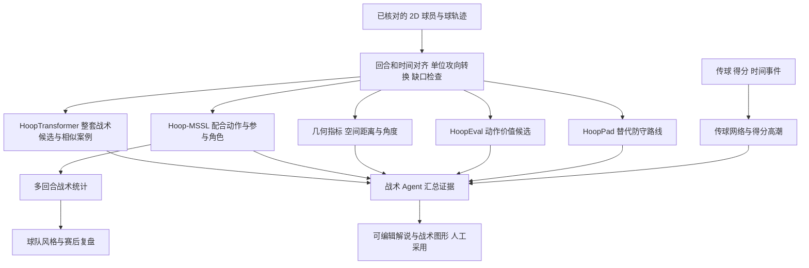

# 逐篇理解篮球论文：输入什么、输出什么、接到哪里

2026-10-05，Asia/Shanghai。根据用户追加问题扩查，研究对象仍为张绍良与 Xing Wang（王星）及其合著成果。本文按论文讲功能；[上一轮报告](README.md)保留源码、权重和本地运行证据；[最新模型发布专项核查](OPEN_SOURCE_AUDIT.md)补充作者 Issue 分享与历史权重发现。下文的产品用途是我们提出的接入建议，不是作者已经替本项目实现的功能。

**如果目标是“把我们的 2D 跑动轨迹送进去，判断这是什么战术”，最直接对应的是 HoopTransformer 和 Hoop-MSSL。** HoopTransformer 偏整套进攻战术分类与相似回合检索；Hoop-MSSL 还研究局部配合动作和挡拆参与者角色。HoopEval 回答动作价值，HoopPad 生成替代防守路线；这两项解决的是后续评价与对照问题。

本文选取 14 篇与项目可用数据或潜在组件相关的论文，另列 HoopPad 应用。不是两位研究者所有论文的完整书目；足球、裁判心理、一般训练干预等未逐篇展开。扩查入口为[张绍良成果列表](https://sportssuper.github.io/ZSL/publications/)、[王星学位论文](https://oa.upm.es/92222/)、出版方与官方论文。对不同年份的同一研究不重复计算独立模型。

## 先区分“输入”和“模型”

我们的 2D 球场图只是显示方式。轨迹模型真正需要的是**带时间戳、单位、稳定球员编号的坐标序列**；一张路线截图、没有时间顺序的折线、只含两个主角的路径，不能直接等同完整回合输入。

| 输入层次 | 具体是什么 | 能支持的研究 |
| --- | --- | --- |
| 连续轨迹 | 每个时刻球 / 球员的球场 x、y，身份持续一致，知道攻守与攻向 | HoopTransformer、Hoop-MSSL、HoopEval、空间指标、HoopPad |
| 事件流水 | 某时刻谁传给谁、何时出手、得分变化、球权转换 | 传球网络、得分高潮；也是轨迹切回合和动作编码的重要辅助 |
| 已统计战术 | 一队整场使用单打、挡拆、手递手等的次数与完成情况 | 球队风格聚类、制胜指标分析 |
| 球员 / 球队统计 | 得分、篮板、助攻、失误、出场时间、赛季、主客场等表格 | 球员画像、位置演化、赛程影响 |
| 负荷与问卷 | 运动传感器测量、主观用力、恢复、酸痛与健康感受 | 运动负荷论文；不能从普通 2D 路线完整推出来 |

“模型”也有不同含义：神经网络通常需要训练权重；聚类 / 回归也属于模型，但论文可能只发表方法和统计结果；几何指标则能按定义直接计算，不一定需要下载 checkpoint。

## 1. HoopTransformer：识别整套进攻战术，寻找相似回合

**论文：** *HoopTransformer: Advancing NBA Offensive Play Recognition with Self-Supervised Learning from Player Trajectories*，Wang、Tang、Shao 等，2024，Sports Medicine。两位均为作者。[出版方](https://doi.org/10.1007/s40279-024-02030-3)、[作者仓库](https://github.com/Mr81wx/HoopTransformer)。

**研究问题。** 不只看某人跑得多快，而是把五名进攻球员与球的连续互动编码，判断整段回合的进攻套路，或找出历史上采用相似套路的回合。

**输入。** 五名进攻球员 + 球的 x、y、速度，按半场阵地进攻切段，统一朝向、5 Hz；短回合填充到 121 步并附有效数据 mask。论文输入形状为 `[6,121,3]`，现有公开实现使用英尺制。防守五人的路线未纳入这个版本；球员的真实姓名、脸部和骨架不是必要视觉输入，但每人的轨迹不能串号。

**它怎样学。** 先遮住未来或中间一段轨迹，让模型预测 / 重建，以此学习协同跑位；再取编码器，接战术分类器或向量检索。预训练不需要战术名称，但**分类器仍需战术标注**。作者学位论文方法章明确：五位有经验球探标了 592 个回合、14 类战术，再做十折交叉验证；81.5% top-1 是微调后的结果，冻结编码器只训练线性分类头为 58.8%。

**输出有三种，不能混用。**

| 使用方式 | 输出数据 | 对我们意味着什么 |
| --- | --- | --- |
| 战术分类 | 已训练类别中的候选标签及类别分数 | 给回合打“可能是哪套战术”的候选标签 |
| 相似检索 | 一个回合向量；历史回合 ID、相似度排序 | 点选一个回合，找到几段类似案例用于解释或复核 |
| 预训练解码 | 被遮住坐标的预测与不确定性参数 | 学习轨迹表示的训练任务，不能直接冒充战术名称或观测真值 |

论文的检索演示包含 Weave、Floppy、Double drag 等套路。已见的十个检索示例名称**不等于完整的十四类分类字典**。它没有证明能识别任何新战术、区分全部防守体系，或仅看到开头两秒就稳定给出答案。

**我们的插槽。** 保存的 2D 准备快照 → 切回合、补齐球并统一单位 → 编码器 → 战术候选 / 相似视频 → 战术 Agent。比如输出“这个回合与某几个 Floppy 参考回合相似”，再由 Agent 结合可见掩护与接球位置解释。这里的解释句是产品设计，不是网络原生输出。

**现有模型状态。** 源码和 90,524 条向量存在，前轮运行了结构和检索。后续补查发现作者在 Issue 分享过 `Checkpoints_C.ckpt` 与 Colab；notebook 已取得，权重匿名访问受限。仍未取得匹配编码器、完整分类头与标签映射。方向直接吻合，但现在还不是可给我们新视频直接打标签的现成服务。

依据：[学位论文 PDF](https://oa.upm.es/92222/1/XING_WANG.pdf)第 85–98、129–132、146 页（PDF 页序）；[本地运行证据](evidence/transformer-cpu.json)。

## 2. Hoop-MSSL：同时理解战术、配合动作和参与者角色

**论文：** *Hoop-MSSL: Multi-Task Self-supervised Representation Learning on Basketball Spatio-Temporal Data*，2024 Workshop；2025 期刊版 Shao、Wang、Pelechrinis、Scanlan、Zhang。两位均参与。[官方条目](https://neurips.cc/virtual/2024/104552)、[期刊版](https://doi.org/10.1016/j.ish.2025.11.001)。

**研究问题。** 用同一个轨迹编码器支持不同尺度的篮球理解。它比只考虑进攻路线的 HoopTransformer 纳入了更多攻防关系。

**输入。** 十名球员 + 球的连续 x、y、速度，统一半场朝向、5 Hz、121 步，输入 `[11,121,3]`。预训练包括轨迹重建、攻守角色识别、同一回合不同遮挡视图的对比学习。这里“角色识别”首先指攻方 / 守方关系，不是识别人脸或球衣姓名。

**论文明确评估的输出。**

| 下游任务 | 输出是什么 | 可接到我们哪一部分 |
| --- | --- | --- |
| 回合级 | 十四类进攻套路的分类，如 Elevator、Floppy、Horns | 回合战术标签 |
| 动作级 | 挡拆、无球掩护、手递手等局部配合类别 | 动作候选标注与解说证据 |
| 球员级 | 挡拆中的持球人、掩护人、持球人的防守者、掩护人的防守者 | 将具体人物连接到动作与战术图形 |

这些输出需要对应的下游分类头与标注训练，不是把编码向量直接读成文字。论文正文列三种主要动作，结果说明又提到动作任务有四个标签；第四类的确切含义、完整字典及事件起止输出契约本轮未确认，不自行补成“背景”。

**我们的插槽。** 在可靠 2D 轨迹之后产出“配合类别 + 参与者”。再由我们的事件切分模块确定时间区间，战术 Agent 生成解释、圈人和路线。相较单一回合标签，这条路线更贴近“告诉我谁给谁掩护、发生了什么”的需求。

**状态与边界。** 本轮取得的是官方 Workshop PDF 的检索索引正文（第 4、6、8 页），直接下载仍受限；期刊摘要可查，不宣称通读了全部期刊正文。前轮找到的第三方复现运行失败，未找到可直接接入的官方权重。重建任务使用前后信息，不证明能恢复我们画外球员的真实路线。MSSL 的线性探测成绩也不能直接与 HoopTransformer 微调后的 81.5% 比较。

依据：[官方 PDF，附录 A.3](https://openreview.net/pdf/9c3236322a7e08fb406c93f1e376c91c437b8bcf.pdf)、[本轮来源边界](evidence/paper-guide-provenance.json)。

## 3. HoopEval：评价“这次传球或无球跑动有多大价值”

**论文：** *HoopEval: Individual Player Action Evaluation via Deep Reinforcement Learning*，Wang、Fu、Xu 等，2026，MIT Sloan；张绍良参与。[官方论文与 PDF](https://www.sloansportsconference.com/research-papers/hoopeval-individual-player-action-evaluation-via-deep-reinforcement-learning)。

**研究问题。** 一次进攻即使最终没有命中，也可能有人通过跑位创造了好机会。它尝试把团队进攻价值拆到有球决策与五名进攻球员的移动决策，评价选项与个人贡献。

**输入。** 十名球员与球的连续位置、稳定 ID / 队伍、球权和传球状态，回合切到出手；再将相邻时刻变化编码为实际动作。原论文使用离散格点与移动方向，训练还需要 qSQ（投篮机会质量）变化形成奖励。球与人的接近只能提供球权启发式，需要检查传球中间态和持球人。

**输出。** 对某时刻“投篮、传给某人、继续运球”和“朝哪些方向移动”分别给出动作价值 Q；还可以形成状态价值、实际动作价值与贡献曲线。Q 是该奖励定义下的预期回报，不能直接称为得分数、胜率或已校准命中率。

**我们的插槽。** 已识别 / 确认的回合与动作 → 价值评价 → Agent 解释。产品例子是：“P3 的无球横移增加了可利用的空间；模型认为这个移动方向优于停留。”这是带模型依据的候选分析，不是客观因果结论。

**状态与边界。** 公开源码与论文输入契约有明显版本差异：当前源码使用连续 `(x,y,vx,vy)`，并有不同动作头维度。后续历史审计发现 2025-11-03 提交中的 checkpoint，已与旧六边形输入版本严格加载，CPU/GPU 前向通过；其 EMA 副本未初始化，且未确认是 2026 论文最终模型。作者可视化消费预计算结果。尚不能给我们的视频正式评分，也不输出整套战术名称或逐个防守人的价值评价。

代码与版本：[训练仓库](https://github.com/Mr81wx/HoopEval)、[前轮契约差异与测试](README.md#42-hoopeval核心可运行离正式评分仍有缺口)。

## 4. 不同回合结果的时空分析：把“出手机会”解释成可测量的量

**论文：** Jiao、Gong、Cao、Zhang 等，*Using massive spatial temporal data to analyse NBA match performance under different possession outcomes*，2025。[原刊](https://www.sciencedirect.com/science/article/pii/S3050544525000040)。张绍良合著。

- **研究内容：** 比较投中 / 投失回合的球、球员与球队空间特征；从 632 场 SportVU 数据中筛出 4,464 个完整、以跳投或上篮结束的阵地回合。
- **输入：** 全员和球的追踪坐标、投篮人、出手时刻、回合边界、投中 / 投失结果。计算单个距离只需相关点，复现论文的结果比较则需完整事件与分组。
- **方法：** 几何特征计算与统计比较；论文摘要没有给出一个“输入轨迹就吐出战术标签”的预训练神经网络。
- **输出：** 投篮距离、最近防守距离、防守角度等数值；以及这些指标在不同结果 / 球队中的差异。指标单位和角度定义需要按原文或我们明确的规范实现，不能同名不同义。
- **接入：** 2D 证据计算器，为 Agent 提供“出手点距篮筐多远、最近防守者有多近”等可检查事实。可以从原理自主实现，不必等作者权重。
- **边界：** 发现相关性不等于给出单次投篮的命中概率。本轮阅读到原刊摘要，未逐项复现完整特征表与统计实验。

## 5. Beyond the box score：识别一支球队整体偏向哪种进攻风格

**论文：** Dong、Chen、Zhang 等，*Beyond the box score: Clustering offensive play types to reveal game styles in professional basketball*，2025 在线发表。[原刊](https://www.tandfonline.com/doi/full/10.1080/02640414.2025.2578585)。张绍良合著。

- **研究内容：** 用已有进攻类型统计聚类，再分析风格、得分表现和比赛背景之间的关系。
- **输入：** 球队的单打、挡拆持球人、手递手、无球掩护等已统计战术数据，配合投篮表现、对手强弱、节奏和旅行等背景。原刊摘要写 982 games；本轮未取得可核对逐行单位的原始表，保留原文口径。
- **方法：** k-means 分出风格；随机森林 + SHAP 检查风格差异；泊松回归分析背景关系。
- **输出：** 三类风格：个人创造型（ICS）、挡拆变化型（PNRS）、掩护与低位协同型（SPSS），以及哪些战术指标推动归类。
- **接入：** 大量回合完成动作标注之后的球队风格面板。例如汇总某队最近几场更依赖个人创造还是掩护配合。
- **边界：** 它的输入已经包含战术统计，因此不能拿它替代从原始轨迹识别战术的步骤。未找到一键可用的作者模型包。

## 6. More than meets the eye：用传球关系识别组织者与协作角色

**论文：** Zhang、Li、Wang 等，*More than meets the eye: effects of passing network metrics on perceptual response and physical demands in professional basketball*，2026。两位均合著。[原刊](https://www.tandfonline.com/doi/full/10.1080/24748668.2026.2617712)。

- **研究内容：** 研究球员在传球网络中的位置，及其与运动负荷的联系；样本为 22 名职业球员、26 场比赛。
- **输入：** 谁向谁传球的事件，构建球员之间的关系；计算接近中心性、中介中心性、特征向量中心性。研究负荷还需 sRPE 与穿戴设备数据，包含 PlayerLoad、加减速、跳跃、变向。
- **方法：** 两步聚类、相关分析和线性混合效应模型。
- **输出：** 每人的网络指标与三类角色：组织者、核心协作者、空间创造者；另输出不同角色与主观 / 身体负荷的统计关系。
- **接入：** 传球网络图、球员角色说明、回合 / 比赛组织枢纽。我们可以先实现网络指标；要沿用论文的三类角色，仍需聚类规则 / 参数及合适的统计窗口。
- **边界：** 两个人跑得近不等于传过球。“空间创造者”是论文聚类的解释性名称，不是证明每次移动制造了空位。负荷部分不能只凭视频计算。原刊称数据受机构限制，可合理申请；本轮未联系作者。

## 7. Momentum：找出比赛中的得分高潮区间

**论文：** Qiu、Zhang 等，*The influence of “momentum” on the game outcome while controlling for game types in basketball*，2024。[原刊全文](https://www.frontiersin.org/journals/psychology/articles/10.3389/fpsyg.2024.1412840/full)。张绍良合著。

- **研究内容：** 将“起势”操作化为时间和净得分条件，再研究其与比赛结果的关系。
- **输入：** 有时间戳的得分事件、双方比分、节次；分析强弱背景另需球队胜率等数据。无需球员 2D 路线。
- **方法：** 规则提取区间，配合统计检验和 CHAID 决策树。该样本采用 96 秒内净胜至少 6 分的触发条件，并处理同队重叠区间；这是该研究的定义，不是篮球统一标准。
- **输出：** 高潮区间的起止、归属球队、净得分、每节次数及与结果的关联；论文在 372 场中识别 2,083 段。
- **接入：** 自动挑选“这一波连续得分”的解说段落和精彩片段，为战术视频提供比赛背景。
- **边界：** 不能据此断言读出了运动员心理，也不能把“起势相关”变成比赛一定获胜的保证。它与战术识别走不同的数据路径。

## 8. 本土与外援表现画像：给球员建立长期功能画像

**论文：** Wang、Han、Zhang 等，*The Differences in the Performance Profiles Between Native and Foreign Players in the Chinese Basketball Association*。期刊卷标 2021，2022-01-31 在线发表。两位均合著。[原刊全文](https://www.frontiersin.org/journals/psychology/articles/10.3389/fpsyg.2021.788498/full)。

- **研究内容：** 不只用传统位置名称描述球员，而是按实际技术统计分组，并考察阵容组成与季后赛资格。
- **输入：** 球员赛季统计，一行对应“球员—赛季”。包括每 40 分钟的两分 / 三分 / 罚球命中与未中、助攻、失误、篮板、抢断、盖帽等，加使用率与出场时间；区分本土与外援。身高、体重、PER 和得分在该研究中用于描述，未直接纳入聚类。
- **方法：** 高斯混合聚类、卡方检验、CART 分类树。
- **输出：** 本土九类、外援六类表现画像；球队拥有各类球员的数量与季后赛资格之间的统计规则。2,197 条样本不是 2,197 名去重球员。
- **接入：** 已知球员身份之后的资料卡、阵容结构与长期角色背景，可与我们的球员资料入口相连。
- **边界：** 不能从一段跑位确定球员赛季角色；也不能把 NBA 2K 属性不经映射直接当作论文统计列。未找到打包好的作者推理模型。

## 9. 位置演化：解释为什么“中锋也组织进攻”

**论文：** Durmuş、Sansone、Zhang，*From fixed positions to role diversity: positional evolution in the National Basketball Association*，2026。[作者所在大学登记与摘要](https://avesis.ankara.edu.tr/publication/details/4c9dab5b-e36f-463f-b45a-7cb41cb779e1/from-fixed-positions-to-role-diversity-positional-evolution-in-the-national-basketball-association)、[DOI](https://doi.org/10.1080/24748668.2026.2703387)。

- **研究内容：** 比较 2005–06 与 2024–25 赛季的球员位置与表现结构变化。
- **输入：** 球员赛季、位置、每百回合标准化的 11 项表现指标，覆盖进攻产量、效率、组织决策和防守贡献。
- **方法：** PCA、PERMANOVA、PERMDISP；主要是多变量统计，不是视频识别网络。
- **输出：** 低维表现坐标、不同位置的分布与离散程度、年代间角色变化；论文发现内线承担了更多组织与持球职责。
- **接入：** 球员角色解释与知识背景，让 Agent 不只按 PG / C 固定印象解释某次跑位。
- **边界：** 不能根据该论文把一个匿名轨迹自动认成人名或位置。只有具备同口径赛季指标时，才能建立我们自己的画像投影。当前核验到摘要，未复现统计结果。

## 10. Winning beyond scoring：解释整场表现中哪些指标更关联胜负

**论文：** Dong、Peng、Liu、Gómez-Ruano、Zhang 等，*Winning beyond scoring: an explainable machine learning framework for identifying key performance indicators in the Chinese Basketball Association*，2026。[原刊全文](https://link.springer.com/article/10.1186/s13102-026-01620-0)。张绍良合著。

- **研究内容：** 在不同终场分差背景下，识别较稳定的制胜指标。
- **输入：** InStat 的整场技术统计和已标注战术指标，初选 34 项比赛统计 + 22 项战术指标；目标为比赛胜负，按终场分差区分情境。
- **方法：** Lasso 与逐步逻辑回归筛特征，比较十类分类器，再用 SHAP 解释贡献。
- **输出：** 胜负分类 / 分数，以及篮板、失误、犯规、投篮效率、战术类型等指标的关联方向与重要性。
- **接入：** 全场或多场的赛后复盘面板，帮助解释一队获胜时表现出什么统计特征。
- **边界：** 论文使用终场结果与整场统计做回顾性分析，不能直接把其分类准确率宣传为赛前或直播胜率预测。SHAP 表示模型关联，不是调整某项指标必然获胜的因果效果。未取得可直接部署的作者权重。

## 11. Rest or rust：用赛程解释主场优势与休息背景

**论文：** Wang、Zhang、Gasperi、Robertson、Gómez Ruano，*Rest or rust? Complex influence of schedule congestion on the home advantage in the National Basketball Association*，2023。两位均合著。[大学登记](https://vuir.vu.edu.au/47862/)、[DOI](https://doi.org/10.1016/j.chaos.2023.113698)。

- **研究内容：** 休息时间过短或过长、旅行和赛季进程如何关联主场优势。
- **输入：** 主客队、历史得分、球队间两场比赛相隔小时数、旅行距离、月份；模型需历史比赛拟合球队攻防强度。
- **方法：** 分层贝叶斯泊松回归，对主客得分建模，并加入休息的一次 / 二次项与背景变量。
- **输出：** 模型条件下的主客得分期望、主场优势参数、休息 / 旅行效应及后验不确定性。
- **接入：** 赛前 / 赛后背景说明，例如说明当前是否背靠背；它不负责命名某次掩护或评价瞬间跑位。
- **边界：** 不能从视频直接量出疲劳，更不能据赛程替某位球员诊断状态。需拟合参数与当前赛程数据才能做新的模型估计。

具体模型依据为[学位论文](https://oa.upm.es/92222/1/XING_WANG.pdf)PDF 第 81–84 页。其个别数值示例存在百分比书写疑点，本文没有照抄该数值示例。

## 12. The Complexity in Basketball Performance：分开解释负荷、组织和背景

**论文：** Zhang、Li、Sansone 等，*The Complexity in Basketball Performance: Quantifying the Independent Effects of Game Load, Technical–Tactical Approaches, and Contextual Factors on Player Performance*，2026。[作者摘要](https://pubmed.ncbi.nlm.nih.gov/41838459/)、[DOI](https://doi.org/10.1123/ijspp.2025-0387)。

- **研究内容：** 研究身体负荷、传球组织关系和比赛背景分别如何关联球员表现；数据来自一支职业男篮球队的 26 场比赛。
- **输入：** RPE、PlayerLoad、加减速、跳跃、变向；传球网络中心性；比分差、对手水平；对应比赛统计。
- **方法：** 分别建立线性混合效应模型。
- **输出：** 对得分、PIR、PTC、PIE、Game Score、效率 EFF 六种表现指标的回归估计、关系方向与不确定性。
- **接入：** 当未来有真实负荷数据时，可做训练 / 表现分析；现在更适合作为传球网络解释的研究依据。
- **边界：** 2D 轨迹的速度和距离不能替代穿戴设备的全部指标，更不能推断 RPE。不是现有视频工作台可完整复现的组件；当前读取摘要，未测试拟合。

## 13. Tracking What Truly Matters：负荷、恢复和健康感受如何关联效率

**论文：** Zhang、Li、Chen、Wang 等，*Tracking What Truly Matters: The Contribution of Game Load, Recovery, and Well-Being to Basketball Performance*，2025。两位均参与。[出版方摘要](https://journals.humankinetics.com/view/journals/ijspp/aop/article-10.1123-ijspp.2024-0488/article-10.1123-ijspp.2024-0488.xml)。

- **研究内容：** 分析不同表现水平下，负荷、恢复和健康感受与效率的关系；样本为 16 名职业男篮球员、18 场比赛。
- **输入：** 穿戴设备负荷与跳跃指标、sRPE、恢复和健康感受问卷、对应表现效率。
- **方法：** PCA 提取综合因素，再用分位数回归分析不同效率水平。
- **输出：** 综合负荷、健康感受等因素得分，以及这些因素在不同效率分位上的回归作用。
- **接入：** 未来训练管理 / 球员状态模块；不能仅凭我们当前短视频得出恢复状况。
- **边界：** 这是统计研究，没有查到可直接从视频输出身体状态的模型包；本轮未获取受限个人数据，也未复现统计实验。

## 14. Monitoring game load across quarters：解释四节比赛中的负荷变化

**论文：** Zhang、Li、Wang 等，*Monitoring game load across quarters in professional basketball: positional differences and contextual effects*，2026。两位均参与。[出版方摘要](https://www.termedia.pl/Monitoring-game-load-across-quarters-in-professional-basketball-r-npositional-differences-and-contextual-effects,78,57301,0,1.html)。

- **研究内容：** 比较前场 / 后场球员四节负荷变化、RPE 与外部负荷关系以及背景影响；16 名职业男篮球员。
- **输入：** Catapult S7 的 PlayerLoad 与惯性运动指标、分节 RPE、球员分组和比赛背景。
- **方法 / 输出：** 分节统计比较与关系分析，输出各节各组负荷、差异和情境效应；不是战术标签。
- **接入：** 未来有真实设备数据的分节体能面板。我们可以从可靠路线计算跑动距离，但应将其命名为视频跑动指标，不能借论文名称包装成完整 PlayerLoad 或疲劳预测。
- **边界：** 当前摘要没有提供可部署模型权重和完整推理字段表，本轮不推定其实现细节。

## 补充应用：HoopPad 是“给定进攻，生成另一条防守路线”

[作者应用](https://github.com/Mr81wx/HoopPad/tree/app)包含真实 checkpoint，前轮已经运行。它与具体论文正式版本的对应仍未明确，所以单列为应用，不能凭同一作者就叫它 HoopEval 的模型。

| 项目 | 内容 |
| --- | --- |
| 输入 | 完整回合五名进攻球员和球的已知轨迹、防守球员开头一小段位置、稳定槽位和有效数据 mask |
| 输出 | 五名防守球员在后续时刻的一组候选坐标；附带的 qSQ 模型还能为不同站位生成机会质量分数 |
| 用途 | 真实路线与替代路线对比，支持防守讨论和教学演示 |
| 与战术识别的关系 | 它产生路线；战术分类器产生类别，两者可在不同步骤组合 |
| 当前状态 | 已严格加载四套防守权重与 qSQ，在作者 11 个样例上运行；不等于在我们实拍视频验收 |

模型使用完整未来进攻轨迹，所以是离线条件生成。它不是看到开头就预测一切，也不能把候选路线填进我们原始数据当作真实观测。详见[前轮测试](README.md#43-hooppad带训练权重的真实样例试跑)。

## 针对我们的 2D 跑位，究竟应如何组合



图是接入设计，不表示模型已上线。当前读取入口是 [court-preparation.mjs](../../../engineering/tools/player-review/court-preparation.mjs) 的准备快照；[tactics_agent.py](../../../engineering/scripts/tactics_agent.py) 已把保存的 `courtTrajectory` 送入 Agent。新的分类 / 指标结果应该作为额外证据传入，保留模型版本、来源区间和拒绝原因。

下面是**拟议的数据契约示例**，不是任一论文原生 API，也不是真实模型预测：

```json
{
  "input": {
    "time_seconds": [0.0, 0.2, 0.4],
    "players": [{"id": "P1", "team": "offense", "xy_metres": [[5.0, 4.0], [5.2, 4.1], [5.4, 4.2]], "valid": [true, true, true]}],
    "ball_xy_metres": [[5.1, 4.0], [5.3, 4.1], [5.5, 4.2]],
    "attack_direction": "left",
    "note": "仅示意一名球员；实际需按具体模型补齐五人或十人及完整区间"
  },
  "output_slots": {
    "play_candidates": [],
    "similar_possessions": [],
    "action_candidates": [],
    "participant_roles": [],
    "spatial_metrics": [],
    "action_values": [],
    "ghost_trajectories": []
  }
}
```

**按功能匹配选型：** 先研究 HoopTransformer / Hoop-MSSL 的识别接口；按当前可落地程度，可以先建设几何证据与人工事件，再离线测试 HoopPad。不要因为 HoopPad 权重最容易取得，就把项目目标改成防守生成。

**我们仍要补的关键数据：** 连续身份、球的球场平面坐标、攻守方向、准确时间和回合边界。只拿几条人工画线，无法满足所有模型；只有五名进攻球员时，HoopTransformer 的输入门槛比十人模型低，但仍需要球和可用时间序列。

**“识别一种战术”还不等于“说明整段发生了什么”。** 用户期望的解说通常同时包含动作、参与者、先后顺序、空间变化和机会好坏。应让各组件返回其有证据支持的数据，由 Agent 组织语言并允许人工修正。

## 来源与验证边界

- 本轮增加 Exa 16 次检索，请求 67 条、实际返回 62 条、URL 去重 53 条，覆盖五个方向；另用网页检索补查官方论文正文、出版方 DOI 与作者身份。[检索元数据](evidence/paper-guide-search-index.json)中保留了不相关命中，未将它们当作成果证据。
- 下载 177 页王星学位论文，定向阅读方法、结果和局限章节，检查 HoopTransformer 架构图；不声称逐页读完全部学位论文。PDF SHA、所读页序和原始网页 SHA 见[来源记录](evidence/paper-guide-provenance.json)。原始 PDF / HTML 留在忽略目录。
- Hoop-MSSL 的直接 PDF 下载仍受限；本轮从官方 PDF 的搜索索引取得输入与附录 A.3 下游任务正文，不把可查片段写成已经完整下载全文。第三方 MSSL 实测结论沿用前轮。
- 已剔除检索误命中的 *Modeling the influence of basketball players’ offense roles on team performance*（2023）：原刊作者为 Ruobing Chen、Mingxin Zhang、Xiao Xu，不能归到这两位名下。
- 上面十四篇均说明了输入、输出和项目位置；未找到公开模型包只表示本轮核查范围内未找到。对摘要可确认的统计研究，没有虚构权重、API 或逐字段推理配置。
- 本轮是论文功能解释与扩查，没有新增模型效果测试、工作台实现、云资源或对外联系；前轮运行证据保留原始结果，不重复计算为新验证。
