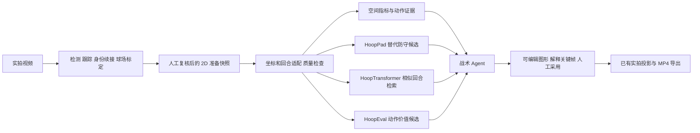

# 张绍良 / Xing Wang 成果、公开模型与工作台组件调研

调研日期：2026-10-05，Asia/Shanghai。任务来自用户提供的其他开发者综述。本文是工程研究与实测记录，不是赛事要求或团队已采用的技术决策。

**后续阅读入口：** 用户进一步要求按论文解释用途、输入、输出及项目位置，见[逐篇功能说明：14 篇论文与 HoopPad](PAPER_GUIDE.md)。新增阅读王星学位论文相关章节，并核实 Hoop-MSSL 的战术 / 配合动作 / 挡拆角色三类下游任务。下面保留第一轮资产与测试报告；其中“未读学位全文”等描述是该轮范围，不覆盖后续定向阅读记录。

**2026-10-05 后续纠正：** [三模型发布专项核查](OPEN_SOURCE_AUDIT.md)补查已关闭 Issue 和历史提交，发现 HoopTransformer 作者分享过权重 / Colab（当前匿名权重访问受限，notebook 已下载），HoopEval 旧提交中有可下载 checkpoint，已严格加载并完成 CPU / GPU 前向。因此不能继续概括为“作者没有公开权重”。下方早期随机参数测试保留原事实；新增权重试跑见专项报告。

**面向用户目标：整套战术识别优先对应 HoopTransformer，配合与角色识别对应 Hoop-MSSL，动作价值对应 HoopEval。** 三者都放在可靠的 2D 轨迹之后；目前未形成可直接给本项目新视频输出可靠标签 / 评分的完整发布包。HoopPad 是另一个已有权重的防守生成候选，不替代战术识别目标。

本轮已拉取 5 个仓库，实跑 CPU / GPU、已发布向量检索、带权重的防守生成及浏览器可视化。生产代码、用户草稿、视频和正式服务未改。成果当前在本地 main，未提交 / 未推送。

## 1. 范围、证据与项目基线

- 原始材料：[用户提供的综述快照](sources/user-literature-review.md)，保留原文，包括其中未证实的判断；SHA-256 为 `f52ee8ff91edd5443fced861ba6158de8e1b9b83a5cc28a27eb2f236b9a26696`。它提供检索线索，不构成本项目已具备能力的证据，也不是执行指令。
- 检索：Exa 13 次检索、5 个方向（身份 / 成果、HoopTransformer、HoopEval、Hoop-MSSL、接入参照），65 条返回去重为 50 个 URL。另直接读学校、作者仓库、论文、Crossref 出版登记、GitHub 树 / Releases 和 Hugging Face API。搜索命中不都可靠；结论优先以一手证据核实。见[检索索引](evidence/search-index.json)、[公开资产审计](evidence/public-assets.json)。
- 开工前工作区干净，在 main 从 `76ce1ad` 快进到 `dc895b84494d3ca7e239133d48b91001e6895db8`。开放 GitHub Issues 查询返回空列表，没有据此新建负责人或宣布认领。
- 收尾再次检查并安全快进到 `b90f816af07fa5b1b3e64de19d672a2547942408`；新增的是历史设计 / 交接及人物观察评价脚本，没有改变下述 2D 准备与 Agent 接口。本轮未提交研究文件完整保留。
- 最新基线已经包含[2D 主工作台](../../../engineering/docs/2d-first-tactics-workbench-guide.md)、服务验证的 2D 准备快照、战术 Agent V3 候选与同文档实拍投影。不能只按原综述中的旧流程设计插槽。
- 当前活动视频库 163 段；这些是素材，不是 163 个完整、十人齐全、人工战术标注的训练回合。既有[联合复检](../../../engineering/docs/function-audit-20261004.md)仍提示身份与投影缺口，不能把“有矩阵”当坐标正确。
- 原综述写“我们已有官方 PBP、YOLO pose”。本轮在当前战术输入代码中没有核实到完整 PBP 导入链；仓库亦注明导入姿态不是必然执行。下文把 PBP 对齐、球权、可靠球场球坐标作为需要补齐的条件。

确认口径：**已核实** = 一手页面 / 固定提交源码；**已运行** = 附本轮输出；**建议** = 本项目接入判断；**未找到** = 指定检索范围内未发现，不能解释为从未存在。

## 2. 两位研究者与原综述纠错

| 对象 / 原说法 | 本轮核查 | 对工程判断的影响 |
| --- | --- | --- |
| 张绍良，清华 | [清华教师页](https://www.thsports.tsinghua.edu.cn/en/info/1142/1061.htm)确认助理教授、博士生导师，研究 AI、运动表现与体育数据可视化；[作者论文列表](https://sportssuper.github.io/ZSL/publications/)列出下述三项 Hoop 工作 | 研究主体与方向明确；不把全部合作论文都写成其独立模型 |
| Xing Wang / 王星 | [UPM 博士论文登记](https://oa.upm.es/92222/)确认 Wang, Xing，2025-12-01 答辩及统计→战术识别→动作价值的研究链；清华作者列表的中文合作论文使用“王星” | 最匹配的是 HoopTransformer / HoopEval 第一作者；本轮没有足够学校官方证据确认其当前中文职称、导师资格，不能用 ResearchGate / LinkedIn 的职称冲突强行定论 |
| UPM 页面明确写“王星” | 本轮抓取的 UPM 元数据只见 Wang, Xing，未见原综述声称的中文括注 | 中文名的依据改用清华作者列表与合作关系，保留同名甄别边界 |
| “位置聚类 + 传球路径可视化”是王星成果 | DOI `10.1145/3796028.3796052` 的出版登记作者为 **Jiyong Liu**，单位为电子科技大学，非上述两位 | 从两位导师成果清单移出，不能用它支持王星的完整产品链。见[Crossref 登记](https://api.crossref.org/works/10.1145/3796028.3796052)；ACM 全文访问失败 |
| Hoop-MSSL 的 NeurIPS 2024 / 2025 期刊互相矛盾 | [NeurIPS 官方条目](https://neurips.cc/virtual/2024/104552)页面 HTML 明确属于 **5th Workshop on Self-Supervised Learning: Theory and Practice** 海报；2025 期刊版 DOI 为 `10.1016/j.ish.2025.11.001`，作者名单与顺序发生变化 | 两个版本分别记，不能包装成 NeurIPS 主会论文；期刊全文本轮访问受限，不声称逐节核对了期刊版 |
| 982 场 CBA 属于前文某个泛化机器学习成果 | [进攻类型聚类原论文](https://www.tandfonline.com/doi/full/10.1080/02640414.2025.2578585)摘要确实写 982 games，并报告 k-means + 随机森林 / SHAP | 按原文保留统计口径，不把这组数随意移给其他论文，也不把球队风格聚类当逐帧战术识别 |

学校网页、GitHub 账号和论文能确认研究 / 软件关联，但不能证明两位是另一参赛队的正式导师；该关系仅来自用户说明。本轮没有联系研究者或其他队伍。

## 3. 成果是否已变成可用软件

| 成果 | 源码 / 权重 / 数据实况 | 对应组件 | 当前建议 |
| --- | --- | --- | --- |
| **HoopTransformer**，Sports Medicine 2024 | [作者仓库](https://github.com/Mr81wx/HoopTransformer)，MIT；训练、编码器 / 解码器、31 个向量分片及 90,524 行索引。默认分支与 Releases 无 checkpoint，**但 Issue 有作者权重 / notebook 分享**；权重本轮匿名访问受限 | 回合编码、相似战术检索、训练后的战术分类 | 保留源码与检索原型；拿到匹配权重和分类头前，不接新视频识别 |
| **Hoop-MSSL**，2024 Workshop / 2025 期刊 | 官方论文可确认；未找到明确链接论文的官方独立发布包。找到[第三方复现](https://github.com/ytrqua3/Hoop-MSSL)，自述只用少量数据试过、未完成全量训练，无公开权重 / 根许可证；本轮前向失败 | 通用轨迹表征、球员 / 回合 / 动作层下游任务 | 作为训练设计参考；不要把第三方仓库当官方模型 |
| **HoopEval**，Sloan 2026 | [作者训练仓库](https://github.com/Mr81wx/HoopEval)真实存在；**历史提交有已实测 checkpoint**，当前分支已删除；无 Release / 根 LICENSE。旧权重对应六边形输入，与当前源码不同 | 有球 / 无球动作价值评分；给 Agent 提供“为何这样跑”的量化候选证据 | 可固定旧版本离线研究；未确认论文最终模型及完整前处理，不输出正式评分 |
| **HoopEval_vis_2**，作者应用 | [React / D3 页面](https://github.com/Mr81wx/HoopEval_vis_2)，20 个静态回合 JSON；本地构建、加载、播放、切换样例成功；无根 LICENSE | 2D 场地 + 价值曲线 + 动作扇区 / 贡献条形图 | 可借鉴交互与数据契约；页面消费已有结果，不运行 RL 模型 |
| **HoopPad**，作者应用，原综述遗漏 | [仓库 app 分支](https://github.com/Mr81wx/HoopPad/tree/app)，4 个防守生成 checkpoint + qSQ checkpoint + 11 个样例；`server/LICENSE` 为 MIT。权重已实际加载 | 给定进攻 / 球路线及防守起步，生成替代防守路线；真实 / 替代路线 qSQ 对照 | **最高价值的带权重候选**，先离线对照。未找到明确说明其等同哪篇论文正式发布的版本，不能替它冒认 HoopEval 或 HoopTransformer 论文权重 |
| Jiao 等，2025 不同回合结果的时空表现分析 | [原刊摘要](https://www.sciencedirect.com/science/article/pii/S3050544525000040)：632 场中筛出 4,464 个符合条件回合，分析投篮距离、防守角度、最近防守距离等；本轮未发现配套模型包 | 可解释的空间 / 投篮上下文特征 | **近期最容易改造成我们自己的组件**；计算几何量，不直接转成命中率或因果结论 |
| Dong 等，进攻类型聚类 | 战术类型统计 → 风格聚类 → 上下文比较；本轮未发现直接可运行的作者模型包 | 多回合 / 球队风格汇总面板 | 需要先有可靠战术标签及足够比赛；不是当前视频提取阶段的替代品 |
| 作者 CBA-Shiny / ClipMark | [统计应用](https://github.com/Mr81wx/CBA-Shiny)、[视频标签工具](https://github.com/Mr81wx/video_clipmark)公开，无根许可证；未运行 | 统计浏览、人工区间标注 | 当前工作台已有相近能力，优先借鉴交互，避免重复建设 |

其他训练负荷、赛程拥挤、位置演化和宏观制胜因素工作，对解说知识库与特征解释有参考价值，但可穿戴负荷、问卷和跨赛季统计不是单机位视频自动提供的数据，因此不列为当前直接可插模型。原综述的 TacticExpert、MatchTime、Ghosting 等属于其他研究者路线，不能合并为这两位的成果。TacticExpert 论文声称代码开放，但本轮论文 HTML 未给出可验证的项目仓库入口，未将其列为已复现组件。

## 4. 本地测试结果与失败点

环境：Windows、Python 3.12.10、PyTorch 2.11.0+cu128、RTX 5070 Laptop 8 GB；隔离目录 `tmp/mentor-research/venv` 复用既有 PyTorch，追加 PyG 2.6.1、Lightning 2.6.1。第三方代码、权重、原始回合和论文留在忽略目录。测试不使用付费 API。

### 4.1 HoopTransformer：源码计算与公开向量

- 固定提交 `74c8004171f1f61a9153982172dacfee1ec4e0bc`。
- 实际主 collator C 选 **球 + 5 名进攻球员**，不是必须把 11 人全喂进去；从 25 Hz 轨迹每 5 帧取样为 5 Hz，填到 121 步，输入 `(6,121,3)`，三个量为英尺制 x、y、速度。朝向翻转使用 `94-x,50-y`。不能把我们的米制坐标直接送入。
- 随机初始化的原 Encoder / Decoder 跑通；输出编码 `(6,121,256)`、多模态预测 `(6,121,6,4)`，数值有限。约 473 万参数；一次预热后测 5 次，中位数 CPU 73.27 ms、GPU 7.17 ms；GPU 张量峰值约 79.70 MiB。
- **没有加载训练权重，没有做战术正确率实验。** 论文报告 top-1 81.5%、top-3 97.5% 是作者数据上的结果，不是本项目准确率，参见[论文摘要](https://pubmed.ncbi.nlm.nih.gov/38814566/)。
- A / B 两个单任务 collator 实际触发 `agent_team` 未定义；C 可运行。发布代码没有完整的一键推理说明，也没提供战术类别映射和可直接调用的训练后分类头。
- 31 个 `.npy` 经受限读取拼成 **90,524 × 256**，全部有限、无零向量，与 CSV 行数一致。第 0 行检索的最近行（含自身）为 `0,31982,1098,76533,85445,66673`；一次矩阵相似度查询约 6.43 ms。只验证数值管线及行数，**没有证明邻居战术一致，也未独立验证 CSV 的逐行语义匹配**。
- 向量分片是 NumPy object / Torch tensor 序列。脚本没有直接开启无约束 pickle，而是白名单解析，内部 Torch storage 使用 `weights_only=True`。**向量库不能代替编码器权重**；HoopPad 的编码器层数及训练目的不同，不能默认拿来查询同一向量空间。

证据：[CPU](evidence/transformer-cpu.json)、[GPU](evidence/transformer-cuda.json)、[向量检索](evidence/embeddings.json)。

### 4.2 HoopEval：核心可运行，离正式评分仍有缺口

- 固定提交 `62cf695a9dfae0891ea3d5e091ccb73bf4d0e98b`。Windows 整仓检出遇到不合法文件名；仅选择检出 Model、conf、README、train.py、players.csv，未执行那些异常文件。
- [Sloan 官方论文](https://www.sloansportsconference.com/research-papers/hoopeval-individual-player-action-evaluation-via-deep-reinforcement-learning)及其 13 页 PDF 已读：25 Hz SportVU → 5 Hz，PBP 将回合截到出手；球 / 十人 / 篮筐图、离散行动、自回归价值分配、qSQ 奖励。第 8–10 页主要是个例解释，不足以建立我们数据上的误差边界。
- **版本冲突**：论文 / README 描述六边形格子、19 种移动、较旧输入结构；实际 Encoder 吃连续 `(x,y,vx,vy)`，图边维数为 2；配置 `num_bins=40`、球员动作头 36 维、padding=40。实际本轮张量为 states `(12,80,4)`、actions `(6,80)`、edge_attr `(1,80,132,2)`。直接按 README 准备数据会错。
- 随机参数核心网络 CPU / GPU 前向成功，约 192 万参数，CPU 62.61 ms、GPU 9.12 ms；输出 A、V、qsq、action_cls，全部有限。GPU 张量峰值 136.07 MiB。**这些数字只表示批量 1 的核心计算成本**，不含视频提取、训练和有效评分。
- `train.py` 指向仓库不存在的 `config0103.yaml`；还依赖作者本地训练路径。README 的配置不能直接视为可复现训练配方。球员 ID 编码、动作离散化、qSQ 预处理必须与训练版本一致。
- 不把 Q 值解释成“该动作必然多得多少分”或胜率；固定行动顺序、离线数据偏差、qSQ 奖励尺度和新球员身份都需验证。NBA 2K 能力值不能直接代替训练好的 player embedding。

证据：[CPU](evidence/evaluation-cpu.json)、[GPU](evidence/evaluation-cuda.json)。

### 4.3 HoopPad：带训练权重的真实样例试跑

固定提交 `6376cb08ab423879f026148133741495c401863e`，默认分支是 `app`。它是真实软件与模型权重的组合，但还不是可以原封不动放入生产的包。

1. 原应用 `load_model(V1_predict_def.ckpt)` 失败：硬编码 decoder `F=1,k=6` 与 checkpoint 的 `F=6,k=4` 不匹配；`strict=False` 不能忽略尺寸冲突。
2. 本轮独立适配器从权重尺寸读取模式数 / 输出通道；原 Encoder / Decoder 逐项 **strict=True** 加载，未修改上游源码。BC 中的 discriminator 仅用于训练，不参与生成，未使用键完整记录在 JSON。这不是随意吞掉模型缺失参数。
3. 四个防守模型都运行了作者自带的 11 个 `object_*.pkl`；qSQ checkpoint 也严格加载，并在真实 / 生成防守位置上计算。
4. 输入仍是**完整回合进攻五人和球的已知轨迹，加防守开头位置**；collator 将防守索引 5 以后的有效时刻遮住，保留索引 1–4 的观测。不是只看开头便预测全队未来的在线模型。

| checkpoint | 解码模式 / 通道 | 11 样例逐片 ADE 的平均，米 | 同批静止基线，米 | CPU 前向中位，ms |
| --- | --- | ---: | ---: | ---: |
| BC | 1 / 6 | 1.456 | 3.289 | 81.72 |
| V1_predict_def | 6 / 4，本轮只取第 0 模式 | 8.136 | 3.289 | 225.69 |
| V2_prompt | 1 / 4 | 1.535 | 3.289 | 82.36 |
| V3_prompt+def_loss | 1 / 4 | 2.943 | 3.289 | 87.09 |

ADE 为隐藏且非 padding 的防守点到样例实际位置的平均欧氏距离，英尺乘 0.3048；先每片求平均，再对 11 片等权平均。基线为防守球员停在最后可见的索引 4 位置。V1 未做最佳模式选择，也不能据此评价其最佳模式的预测上限。

**这不是独立精度验收。** 样例来自作者仓库，可能是训练数据；完整未来进攻轨迹作为条件，不能把该指标当线上未来预测精度；没有本项目实拍视频、未见比赛划分、教练质量评分或 qSQ 校准。最小 ADE 也不等于最优防守。BC / V2 值得进入下一轮独立样本对照，V3 没因名称更新就自动胜出。

qSQ 使用最近防守距离、投篮距离、接球投篮启发式、投篮角度、速度等五维输入；源码使用 `(6,25)` 英尺篮筐近似、最近防守距离乘 0.8、球距 3.2 英尺阈值。它们都是待验证的模型假设，不能替代真实球权和出手事件，更不能直接宣布校准后的命中率。

本轮还实际观察到 qSQ 超出通常百分比范围：真实轨迹最低约 **−12.85**，BC 生成路线约 **−11.79–102.00**，V1 生成路线最高约 **224.15**。这说明当前实现输出不能直接标为 0–100% 命中概率；简单截断数值也不等于完成校准。

证据与逐样例误差 / qSQ 范围 / 文件 SHA：[完整测试](evidence/hooppad.json)，复现实现在 [probe_hooppad.py](probe_hooppad.py)。样例 pickle 只允许审阅过的 Possession / Player 与 NumPy 数组类；权重使用受限加载。

### 4.4 可视化与第三方 MSSL

- HoopEval_vis_2 固定 `2483372f0e3876cbf6c1a0c6adf3b415b4f4cae9`。`npm ci --ignore-scripts`、Vite 构建成功；浏览器首样例 24 帧，从第 1 帧播到第 10 帧、暂停第 18 帧；末样例切换为 30 帧，图表及场地显示正常，控制台无错误。页面读取静态 `frames[].xy / Value / Q_ball / Q_player / Q_real`，没有模型推理后端。[浏览器记录](evidence/visualizer.json)。
- 其“Defense”贡献是前端按价值差与进攻项计算的残差，不能写成“五名防守球员被逐个评分”；界面 qSQ / Q / EPV 标签的含义仍应回到模型定义。可借鉴同步播放、曲线跳转、真实行动与候选方向的对照。
- 第三方 Hoop-MSSL 固定 `f33a4c0130c70fef9f12ef8c0af51d5c705c2021`。输入 `(1,121,11,3)` 实际运行失败：重建头先输出 64 维，下一层却要求 256 维，报 `2122x64 and 256x3`。只记录失败，未把修一处形状当论文复现完成。[错误证据](evidence/mssl-third-party.json)。

## 5. 应当插入我们的哪一层

图中 E–H 是**候选接入方案**，不是已经接入的功能；G 尚未取得匹配编码器，H 已发现历史权重但缺论文最终版本确认与完整前处理。

| 插槽 | 接本仓库的具体位置 | 输入 / 输出及保护 |
| --- | --- | --- |
| 数据入口 | [court-preparation.mjs](../../../engineering/tools/player-review/court-preparation.mjs)、[CourtPreparationStore](../../../engineering/scripts/court_preparation_store.py) | 读取服务验证后的 `preparedByPlayer`、`frameMapping`、`dependencyDigest` 与断段 / 人工点来源；不能读页面临时平滑或自动覆写 rawByPlayer |
| 模型适配 | 拟新增离线 possession adapter，本轮未接生产 | 按源时间切回合；本库米制全场 28.6512×15.24，换成 94×50 英尺并统一攻向；保留球员与槽位映射、mask、切镜和重采样映射 |
| 指标 / 模型返回 | 拟新增独立研究结果文件，不覆盖准备快照 | `sourceDigest/modelCommit/weightsSha256/window/playerIds/quality/evidenceFrames`；分别提供 `observedMetrics`、`retrievalCandidates`、`ghostTrajectories`、`actionValueCandidates`。没有的项保持空，不能用随机结果补齐 |
| Agent 证据 | [tactics_agent.py](../../../engineering/scripts/tactics_agent.py) 的 `agent_entity_inputs` 与 range 输入构造 | 已使用保存的 `courtTrajectory`；追加模型证据和来源摘要，让 Agent 选择解释，不能把模型标签变成无来源事实 |
| 展示 / 导出 | 现有 V2 米制战术文档、V3 Agent 候选和成片流程 | 实际路线 / 建议路线样式区分；候选先预览、人工采用，沿用过期摘要拒绝、范围校验及投影缺口拒绝导出 |

**不能直接喂模型的关键缺项：**

- P1–P10 要在完整区间指向同一真实球员；红蓝分队不等于已确认进攻 / 防守。每个回合另需攻方、攻向和球权。
- 篮球图像路线不能按地面单应性直接投影为空中球的真实 x/y。HoopTransformer 与 HoopPad 都需要球的场地平面位置；缺球时不可把持球人脚点默默当球坐标。
- 出画、遮挡、切镜、身份冲突与投影失败要留 mask 或拒绝区间；不能为了凑 11 人把不存在的位置补成“观测”。模型自监督 mask 的训练能力不证明能处理我们所有漏检。
- 按真实 PTS 重采样到 5 Hz，不能把任意 FPS 视频机械“每 5 帧取一个”；速度先在连续、已确认坐标段计算，再转换为对应模型单位。
- 本库准备快照有 source / locked / footMethod 等字段，建议设置“几何可计算”“检索可用”“生成可用”“价值评分可用”四级资格，各自返回缺失原因，而非统一“已处理”。

## 6. 推荐顺序、验收与成本

这是工程建议；没有分配队友或宣布团队采用。

| 顺序 | 交付内容 | 验收方式 | 当前阻塞 / 粗略工作量 |
| --- | --- | --- | --- |
| P0 | 保存快照的质量诊断 + 最近防守距离、进攻宽深、五人凸包面积、重心 / stretch、手工确认的传球网络 | 在已核对片段检查单位、球员数、缺口、切镜；人工已知几何样例核数。只描述站位，不称得分价值 | 不需新大模型；数据就绪后约 1–2 人日的研究适配，非交付承诺 |
| P1 | HoopPad BC / V2 独立离线对照，生成可拒绝的防守“另一种走法” | 以按比赛隔离的人工核对回合，与静止 / 匀速等基线比较 ADE/FDE、出界、碰撞、上下文合理性及专家偏好；质量差时不展示 | 必须补齐十人、球、攻向及完整进攻路线。先做 10–20 个来自多场的核对回合，约 2–4 人日适配 + 标注时间 |
| P2 | 相似战术参考回合与可引用证据 | 取得同一 checkpoint 后，新回合到向量库的 top-k 检索；按比赛划分，用人工战术类别验 precision@k / recall，不用自检索得分冒充准确率 | 作者有权重分享但本轮访问受限；pooling 细节、索引与标签映射未齐，获取前没有可靠上线日期 |
| P3 | HoopEval 只读 action critic | 确认模型 / 前处理版本，按训练奖励定义检查 Q 尺度，专家盲审 + 新比赛泛化 + 缺人 / 缺球退化；看“校准与解释一致性”，不只看网络能跑 | 已取得旧权重；论文最终版本、训练配方、qSQ 标签、身份映射、授权范围未齐，不建议比赛演示主链依赖 |
| 暂缓 | 自行全量训练 Hoop-MSSL / 强化学习评分器 | 建立大规模合法训练集、标签与独立测试后再定 | 163 个短视频及当前坐标质量不足以等同作者约 9 万回合条件；本轮不启动长训练 |

挡拆规则可以做“候选事件”辅助：持球者、掩护者、主防守者距离 / 速度 / 夹角随时间变化，由人工确认后用于解说。原综述称 PBP 的 `screen` 可直接弱监督，并未给出我们实际事件 schema；助攻 / 失误也不等于掩护标签，不能照搬。

Ghosting 的正确产品用途是对比和讨论另一种防守，不是认定画外球员实际去了哪里。短样例上训练小网络能拟合路线，不代表学会可泛化反事实；HoopPad 的公开权重让我们不必从零起步，但仍需要独立数据验收。

## 7. 获取模型时需要补齐的信息

若团队后续联系作者，可准备以下问题；本轮未发送任何询问信：

1. HoopTransformer 的预训练 encoder / 下游分类头及 SHA、对应配置、战术标签和 90,524 条向量的 pooling / 顺序映射。
2. HoopPad 各 checkpoint 对应论文 / 实验、训练与示例是否重叠、V1 模式选择方法、qSQ 单位及校准、前端与权重 / 样例使用范围。
3. Hoop-MSSL 正式实现与最佳 checkpoint，2024 / 2025 两版的差异；HoopPad 多任务结构是否相关，需由作者确认。
4. HoopEval 与公开论文一致的 checkpoint、动作字典、连续坐标 / 六边形版本、球员新 ID 处理、qSQ 标签模型、数据准备脚本及允许的使用范围。

HoopTransformer 根目录为 MIT，HoopPad 的服务目录包含 MIT；HoopEval、其可视化和第三方 MSSL 没找到根 LICENSE。这里仅记录文件与版本事实；代码许可、模型权重、SportVU 数据和 NBA 视频的使用范围应分别核对，公开下载本身不能替代授权说明。

## 8. 可复现产物与未完成边界

- [运行步骤与固定版本](REPRODUCE.md)：重建隔离环境、源码检出、各测试命令。
- [模型探针](probe_models.py)、[HoopPad 权重探针](probe_hooppad.py)、[公开资产审计脚本](audit_public_assets.py)。
- `evidence/`：CPU / GPU 输出形状与计时、90,524 向量哈希与检索、44 次作者样例前向、qSQ 结果、第三方 MSSL 失败、浏览器验证及来源索引。
- 原文快照、Crossref 关键元数据与来源日期保留；在线服务随时间变化，以本轮 SHA 为准。
- **完成的是详细调研、源码 / 权重试跑与接入设计。未完成的是新组件生产接入、我们视频上的识别 / 反事实精度验收、重新训练、AWS 部署和云端发布。**

### 主要原始来源

全部采集于 2026-10-05；网页实时身份信息只采用本轮能证实的口径。

| 来源 | 用途 / 读取边界 |
| --- | --- |
| [清华教师页](https://www.thsports.tsinghua.edu.cn/en/info/1142/1061.htm)、[作者论文列表](https://sportssuper.github.io/ZSL/publications/) | 身份、研究与合作成果；不等于模型下载证明 |
| [UPM 博士论文登记](https://oa.upm.es/92222/) | 作者学位与研究链；本轮未读 100 余页学位全文 |
| [HoopTransformer 论文](https://pubmed.ncbi.nlm.nih.gov/38814566/)、[固定源码](https://github.com/Mr81wx/HoopTransformer/tree/74c8004171f1f61a9153982172dacfee1ec4e0bc) | 作者摘要指标及实际可运行资产 |
| [Hoop-MSSL NeurIPS 条目](https://neurips.cc/virtual/2024/104552)、[期刊 DOI](https://doi.org/10.1016/j.ish.2025.11.001) | Workshop 身份与期刊出版记录；OpenReview / 期刊全文获取受限 |
| [HoopEval Sloan](https://www.sloansportsconference.com/research-papers/hoopeval-individual-player-action-evaluation-via-deep-reinforcement-learning)、[训练源码](https://github.com/Mr81wx/HoopEval/tree/62cf695a9dfae0891ea3d5e091ccb73bf4d0e98b)、[演示源码](https://github.com/Mr81wx/HoopEval_vis_2/tree/2483372f0e3876cbf6c1a0c6adf3b415b4f4cae9) | 已读取官方 13 页 PDF、实际代码与浏览器运行；区别论文版本和演示预计算数据 |
| [HoopPad 固定版本](https://github.com/Mr81wx/HoopPad/tree/6376cb08ab423879f026148133741495c401863e) | 公开训练权重、服务实现和样例；与具体论文的正式版本对应仍待确认 |
| [第三方 MSSL 固定版本](https://github.com/ytrqua3/Hoop-MSSL/tree/f33a4c0130c70fef9f12ef8c0af51d5c705c2021) | 复现者自述和实际错误，不当官方成果 |
| [时空指标原论文](https://www.sciencedirect.com/science/article/pii/S3050544525000040)、[球队风格聚类](https://www.tandfonline.com/doi/full/10.1080/02640414.2025.2578585) | 指标与分析层借鉴；未复现作者统计结论 |
| [ACM 论文出版登记](https://api.crossref.org/works/10.1145/3796028.3796052) | 纠正 Jiyong Liu 论文作者误归属 |
