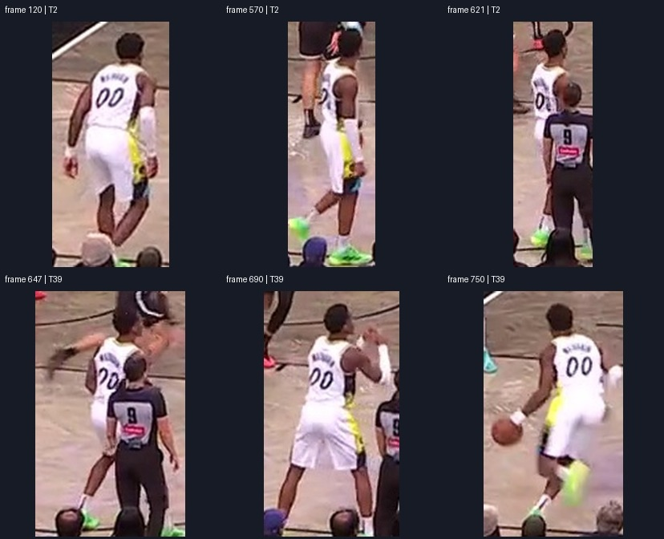
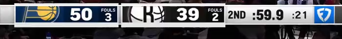

# 单球员遮挡续接与号码 / 队标真实试验

日期：2026-10-06，Asia/Shanghai。状态：本机独立 QA 试验，未写入用户正式草稿，未提交或推送。

## 结论

本次真实模型调用在当前 17.5 秒导入视频中，将白衣 `00` 号球员从遮挡前的 `T2` 接到遮挡后的 `T39`。在所选 9.50–12.50 秒区间，保守保留原始检测位置的覆盖从 52 / 181 帧增至 156 / 181 帧；622–646 共 25 帧仍未知。模型看到的 28 张候选依据帧均另行由 Codex 视觉复核，没有观察到把身份接给另一人的情况。这是单个案例的抽样证据，尚不是全片十人准确率或人类逐帧真值。

同片首帧记分牌的单次队标视觉试验返回左 `IND`、右 `BKN`，理由分别引用蓝色 P / 黄色篮球 / 速度线，以及白色篮球上的黑色 B / 缝线。原图可直接复核这些特征。初次试验只产生候选；本轮随后已接入工作台，生产界面核验见下节。

## 本轮工程接入与实际页面核验

2026-10-06，Asia/Shanghai，本地未提交／未推送。球队／号码识别和固定身份续接已有常显入口，播放栏新增 0.25×／0.5×／1×。本地 OCR 的字符串置信度故障已修；明确主比分卡区域排除了右侧排行榜中的 `KInGS → SAC`，第 0 帧真实 HTTP 文字 OCR 返回 `no_reading`。这张记分牌只有球队 logo，因此没有将文字未读到解释为没有球队。

从实际 QA 页面点击「Agent 识别队标 / 球队」，同一 `8876` 服务通过既有 `/api/identity-ocr` 的 `scoreboard_vision` 模式返回 `IND / BKN`。该生产调用实际使用 `gpt-6-astra / low`，区域 `[0,633,704,720]`，保留 `identityConfirmed=false`、`reviewRequired=true`。轻量完整响应见 [production-team-response.json](production-team-response.json)；它与下文初次直接 provider 的 medium 试验不同。

页面测试中，仅在 `qa=1` 副本手动将蓝组绑定 IND、红组绑定 BKN。现有自动建议将本例白衣 00 号放在 P6；初次空白内存试验使用 P1，两者都是工作台槽位，与背号无关。实际页面选择 P6、定位 2.00 秒的 T2，大模型再次正确读出白衣描述与 `00`，核对后保存 QA 参考，再在 9.50–12.50 秒查找并采用 5 个有限片段。第二次返回的边界与初次试验一致，生产页面的全片 P6 有位置帧从 622 增至 726（增加 104），10.37–10.78 秒仍为缺口；逐帧确认始终只有参考 1 帧，没有自动把其余帧变成已确认。11.50 秒页面显示 P6 对应 T39。

文字 OCR 在第 120 帧的本帧背号读取为 `no_reading`，大模型读取 `00` 成功；两种结果分别保留，未把失败改写成成功。保存视觉参考曾把实际 NBA 球队覆盖为球衣描述，首次选择赛季也曾丢失球队偏好；本轮修复保留同视频的已采用分组球队，并在名单查询中恢复该代码。名单查找仍需选赛季、点击查找及核对姓名，不能由号码自动确认真人。

实际页面截图、DOM 与第二次作业响应保存在忽略目录 `artifacts/player-identity-continuation-20261006/`；具体记录见 [工程核验说明](../../../engineering/docs/identity-ocr-confidence-compatibility.md)与[本轮交接](../../../handoffs/thy-0629/2026-10-06-1203-identity-continuation-and-team-matching.md)。用户正式草稿和原视频未改。测试尚未覆盖十人全片身份或米制球场位置。

## 来源与隔离

- 视频 SHA-256：`17c36f8d3b3e294f13f7119f23b82ec7f3fbe96d5564db9cbe7d61f49ebbbd7d`。
- 源：工作台 `sample=local-17c36f8d3b3e294f13f7119f23b82ec7f3fbe96d5564db9cbe7d61f49ebbbd7d`、`variant=team-stable`，1280 × 720，1050 帧，60 fps，原始容器 PTS。
- 跟踪指纹：`2e873fbb19a0980bc5b9f8ca146102f16e164e42e09719a98a81826f4264f36e`。
- 工作台服务：本机 `8876`；请求使用 `qa=true`，新建空白副本 session，未读取或保存用户浏览器 localStorage 草稿。
- 参考是 Codex 根据真实帧选定的 **QA 视觉参照**。API 的“保存参考”前置契约在副本中模拟，不能表示为用户人工确认。
- 原始作业、源帧、完整响应等大文件留在忽略目录 `artifacts/player-identity-continuation-20261006/`。本目录只保存脚本、结果摘要和轻量证据。

## 参考与续接

参考来自零起点第 120 帧、`T2` 原始检测框。肉眼可读背号 `00`，白衣、黄色与深色侧拼接、右臂白色护袖、绿色鞋均来自实际像素，没有依据文件名或球员名单猜身份。

实际调用已有 `/api/identity-agent/jobs` 两次：

| 作业 | 结果 | 观察到完成的时间上界 |
| --- | --- | --- |
| reference，`41fb628f-23ba-437d-a3c3-70792b75c7fb` | 白色球衣，侧面有黄色和深色拼接；号码 `00`，保留前导零 | 22.32 秒 |
| continuation，`20a58670-80c0-4599-907e-be4751050043` | 5 段候选，T2 → T39，25 帧缺口保留 | 53.63 秒 |

这两次使用实际本机 `codex-cli / gpt-6-astra / low`，没有注入假候选。时间是提交后轮询首次读到 ready 的观察上界，包含轮询间隔，并非纯推理耗时。

| 临时编号 | 零起点且含末帧的范围 | 帧数 | 模型依据帧 |
| --- | --- | --- | --- |
| T2 | 570–600 | 31 | 570、578、585、592、600 |
| T2 | 601–621 | 21 | 601、606、611、615、616、621 |
| 未知 | 622–646 | 25 | 无可采用候选，未补位置 |
| T39 | 647–690 | 44 | 647、658、660、669、679、690 |
| T39 | 691–735 | 45 | 691、702、705、713、724、735 |
| T39 | 736–750 | 15 | 736、740、743、746、750 |

参考、遮挡前与重新出现后的选定证据：



完整 28 帧视觉复核的范围与图像哈希见 [review-metadata.json](review-metadata.json)。后段背部 `00` 清楚，前段有侧身及裁判遮挡，身份判读也使用球衣侧拼接、护袖、发型与鞋。28 帧抽样内未见串人；未宣称其余 153 帧已视觉确认。检测框包含部分前景裁判，框底脚点的几何精度仍需要单独核对。

## 实际数据流重放

[evaluate.mjs](evaluate.mjs) 使用现有生产 `applyIdentityCandidates` 与 `buildTrajectories`，将真实返回候选只在私有内存副本中重放。基线是参考球员原 T2 的模型建议，覆盖所选范围的 52 帧；接入真实 T39 候选后得到 156 帧原始框底位置，增加 104 帧，覆盖 86.19%。

六项断言通过：调用者 session 不变、位置来自有限原始观测、25 帧缺口保留、T2 → T39 接回同一 P1、范围外记录不变、0 帧被自动设置为逐帧已确认。[evaluation.json](evaluation.json) 保存输入指纹、结果与完整候选。

当前该片没有球场标定，因此本试验验证的是 **P 身份续接后读到真实图像位置**；未生成或验收米制 2D 坐标、脚点精度或战术成片。正式页面未采用这些候选。

## 队标、OCR 与名单是三条不同链路

另做一次视觉队标调用：同片第 0 帧全图和左下记分牌裁图 `[0,640,700,720]`，未传入文件名、球队缩写或候选名单。通过现有 `CodexVisionProvider` 受限图片 + JSON schema 调用，禁止额外工具。



模型返回 `IND`、`BKN`，11.16 秒完成。它使用 `gpt-6-astra / medium`，对应直接 provider 调用当时的可信默认设置，和已经启动的身份服务 low 不同。[scoreboard-response.json](scoreboard-response.json) 保存输入边界、依据、设置与时间。置信度 0.98 / 0.97 是模型主观估计，不是正确率。

- 现有文字 OCR 入口负责读文字 / 球衣数字，不能把只显示 logo 的记分牌自动等价成球队文字。本轮初次调用发现其真实 RapidOCR score 返回字符串触发 400；独立工程修复与修后真实测试由主任务另外负责，本试验脚本不修改生产 OCR。
- 队标视觉试验已跑通，但这份研究本身没有新增产品入口、球衣与球队关联或正式采用。
- 主任务只读测试 `/api/player-identity/lookup?season=2024-25&team=IND&jersey=00` 返回 `unique_candidate / Bennedict Mathurin`。这证明给定赛季、球队、号码的名单匹配可用；没有证明当前图像已经识别出该姓名。球队与球衣归属仍需确认。

## 复跑

需要本机 Python 的 PyAV / Pillow、Node，以及正在运行的工作台与可用 Codex provider；不下载模型或创建云资源。脚本只发身份 QA 作业与只读识别请求，没有 `/save` 或正式草稿采用请求。

```powershell
python research/vision/player-identity-continuation-20261006/probe.py inspect
python research/vision/player-identity-continuation-20261006/probe.py reference --frame 120 --track 2
python research/vision/player-identity-continuation-20261006/probe.py poll --purpose reference
python research/vision/player-identity-continuation-20261006/probe.py continuation --frame 120 --track 2 --team '白色球衣，侧面有黄色和深色拼接' --jersey '00' --start 570 --end 750
python research/vision/player-identity-continuation-20261006/probe.py poll --purpose continuation
node research/vision/player-identity-continuation-20261006/evaluate.mjs
python research/vision/player-identity-continuation-20261006/probe.py logo --frame 0
python research/vision/player-identity-continuation-20261006/probe.py package
```

`poll` 需要等模型实际完成；新的模型调用可能输出不同候选，固定 156 帧的断言专门核对本次留存结果，不能用旧缓存冒充新的复测。更大范围及十人全片试验需逐步扩展独立核验样本，不能据本例直接宣布完成。
